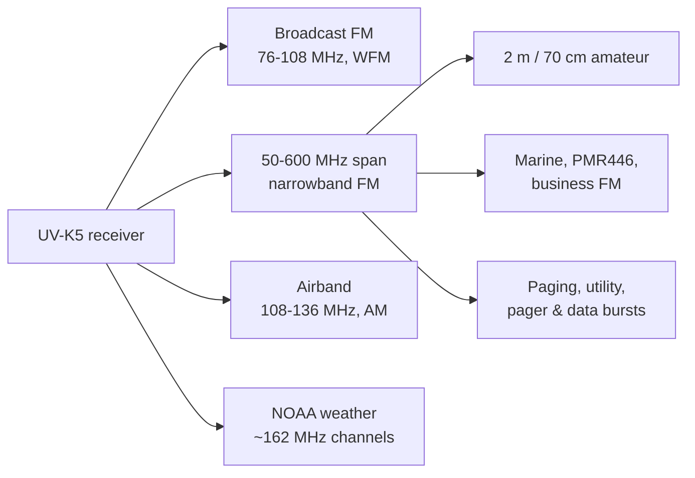
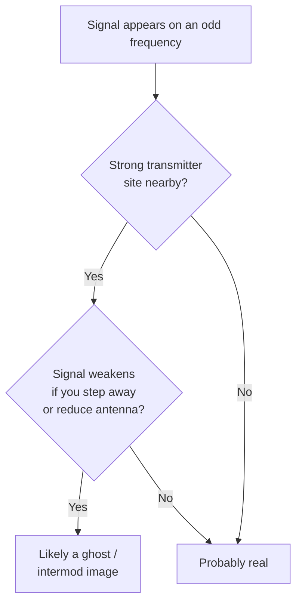
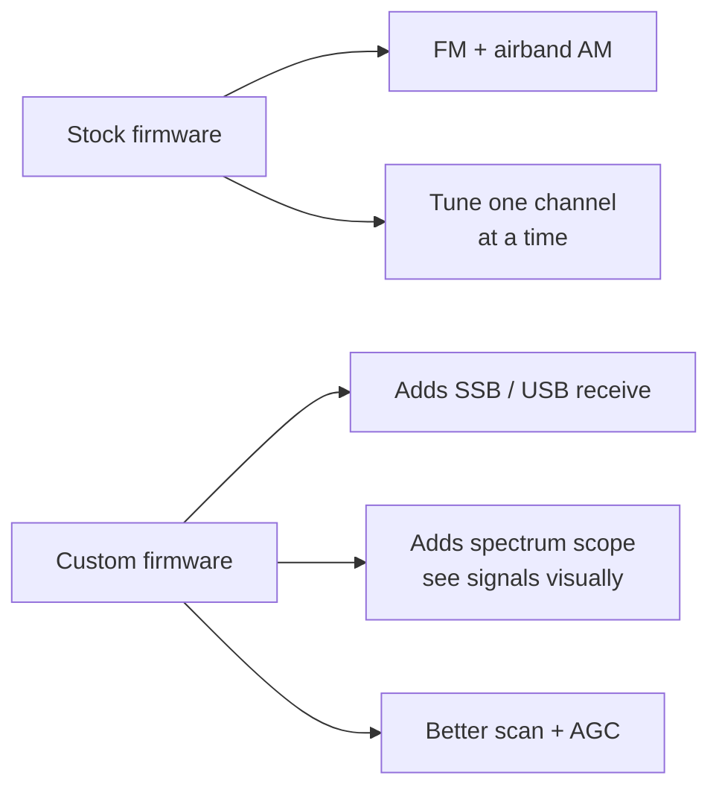

# The wideband receiver: FM, Airband, NOAA and 50–600 MHz

The UV-K5 is not just a ham radio: it is also a scanner, a weather receiver, an airband monitor and a pocket FM broadcast radio, all sharing the same little BK4819 receiver chip. The cover of the manual boasts "50–600 MHz Receiving", and that headline is broadly true — this one radio hears across a huge slice of the very-high and lower-ultra-high frequency spectrum. It is also a budget-class handheld, an honest reminder that a wide receiver and a _good_ receiver are not the same thing. This page is a tour of everything the stock firmware can hear, how to reach each mode, and where the modest front end will lead you astray.

## One radio, most of the spectrum

Before the detail, here is the shape of what a stock UV-K5 receives. Think of it as four overlapping jobs handled by one chip: broadcast FM for music and news, the wide 50–600 MHz span for scanning FM services, an AM mode bolted on for the aviation airband, and a dedicated set of weather channels.

Every one of those is _receive_. Transmitting is a separate, much narrower story that we come back to at the end — the short version is that hearing a frequency never means you are allowed to talk on it. First, the parts you can enjoy with no licence at all.

Two words of vocabulary you will meet throughout. **Modulation** is how information rides on a radio carrier: **FM** (frequency modulation) wobbles the carrier's frequency, **AM** (amplitude modulation) wobbles its strength. The stock radio demodulates both FM and AM, but _only_ FM by default — AM is a mode you switch on for one specific band. It cannot do **SSB** (single-sideband, the efficient AM cousin used on the [HF](outpost:entry/logbook73.handbook/hf) bands) at all in stock form. Hold that thought; it becomes the headline limitation.

## Broadcast FM: the F+0 radio

The friendliest feature first. Press `F` then `0` and the radio leaves the amateur world entirely and becomes an ordinary broadcast **FM radio** covering roughly 76–108 MHz — the band your car stereo uses. In this mode the `Up`/`Down` keys tune, `F+1` swaps between VFO (free tuning) and MR (stored stations), `F+2` runs an auto-store that hunts the band and parks up to 20 strong stations in memory, and `F+3` stores the current station by hand. Press `Exit` (or `F+0` again) to leave.

The clever bit is the interruption behaviour. While you are listening to music, the radio keeps half an ear on your selected amateur channel. Press the **PTT** (the push-to-talk key) and it drops the broadcast, lets you transmit on your ham channel, then returns to the music when you release. So the FM radio is not a dead-end mode — it is a companion that steps aside the moment you need the radio to be a radio.

Why is broadcast FM a separate mode rather than just another frequency in the wide span? Because broadcast stations use **wide FM** (WFM) — a fat, ±75 kHz signal carrying high-fidelity stereo audio — whereas everything else the radio hears is **narrowband FM** squeezed into 12.5 or 25 kHz. The chip has to widen its filters and change its de-emphasis to make WFM sound right, so it gets its own mode. The manual quotes a WFM sensitivity of about −110 dBm across 76–108 MHz: perfectly good for local stations, less so for distant ones, which is exactly what you would expect from a whip antenna on a handheld.

## The 50–600 MHz span — and its sub-band caveats

Now the headline. Tune the radio manually (press `*` for the frequency-entry page, or set a **step** in menu `02 STEP` — `2.5K` through `25K` — and walk the dial with `Up`/`Down`) and you can land almost anywhere from 50 MHz up to 600 MHz. In that window live the [2 m](outpost:entry/logbook73.handbook/vhf) and [70 cm](outpost:entry/logbook73.handbook/uhf) amateur bands, marine VHF, business and utility channels, paging transmitters and a great deal else besides.

The receive sensitivity is genuinely respectable. The manual's reference figure for narrowband FM (measured at 12 dB SINAD, the standard "how quiet does a signal need to be to sound clean" test) is around **−121 to −123 dBm** across the 50–600 MHz sub-bands — that works out to roughly **0.2 microvolts**, competitive with radios costing many times more. Frequency stability is a tidy **±1 ppm**. On paper, this is a keen little receiver.

The honest caveat is the same one that made the [UV-5R](outpost:entry/logbook73.guide.uv-5r/overview) famous: to cover this enormous range cheaply, the front end uses very little input filtering. A receiver that will listen _everywhere_ has, almost by definition, little defence against strong signals _anywhere_. Park near a broadcast tower, a paging site or a cellular mast and the receiver can **overload** — a nearby powerhouse signal swamps the input stage — producing three classic symptoms:

- **Desensitisation**: the receiver goes partially deaf, and weak signals you could otherwise hear vanish.
- **Images and ghosts**: a signal appears at a frequency where nothing is actually transmitting, a mathematical phantom of two strong signals mixing inside the radio. If a "repeater" turns up on an odd frequency near a transmitter site, suspect intermodulation before you believe it — the full explanation is in [Overload and Ghost Signals](outpost:entry/logbook73.handbook/overload-and-ghost-signals).
- **Counter-intuitive antenna behaviour**: fitting a bigger, better outdoor [antenna](outpost:entry/logbook73.handbook/antennas) can make reception _worse_, because it feeds even more out-of-band energy into an already-overwhelmed front end. A band-pass filter cures it, which proves the front end is the limit.

None of this means the radio is broken. In everyday pocket use, away from big transmitter sites, you will rarely notice it. But treat the 50–600 MHz coverage as "broad and useful", not "clean and selective", and you will never be fooled by a ghost.

## Airband: switching to AM with menu 49

Aviation voice communication uses **AM**, not FM, and it lives between 108 and 136 MHz. Because the stock radio is an FM set by default, listening to aircraft needs one deliberate step: menu `49 AM`, set to `ON`. That tells the receiver to demodulate amplitude modulation instead of frequency modulation. The manual is explicit that **menu 49 is only valid across 108–136 MHz** — this is an airband switch, not a general AM mode, so tune inside that window before you enable it. When AM receive is active the screen shows an **AM** indicator.

Airband sensitivity is quoted at about **−113 dBm** (measured at 10 dB signal-to-noise, the usual yardstick for AM) across 108–135.9975 MHz. That is a little less keen than the FM figure, which is normal for AM, but plenty to hear a nearby airfield's tower or approach frequency. Aircraft transmit with real power from altitude, so you will often hear the aeroplane long before the ground station.

A caution worth stating plainly: airband AM is the mode where the cheap front end shows most. AM has no capture effect — the automatic "loudest signal wins" behaviour that keeps FM clean — so overload, birdies and background hash intrude more readily here than on FM. If your airband reception is noisy near a busy transmitter site, the front end, not the aircraft, is usually to blame.

## NOAA weather channels and the auto-alert

Press `F` then `5` and the radio jumps to its **NOAA weather** channels — 10 pre-set channels covering the North American weather-radio service that broadcasts continuous forecasts and hazard alerts near 162 MHz. This is a genuinely useful safety feature _if you are in the coverage area_: in most of the United States and Canada there is a NOAA transmitter within range, broadcasting around the clock.

Be honest with yourself about geography, though. NOAA weather radio is a **North American service**. Outside the US and Canada there is generally nothing transmitting on those channels, so the feature sits idle — the ~162 MHz slot is used for other things in other countries, and your national weather service almost certainly does not broadcast a voice channel your handheld can pick up. It is a headline feature aimed squarely at the North American market.

Related but separate is menu `50 NOAA_S`, the weather **auto-scan/alert**. Turn it on and the radio periodically checks the weather channels in the background, so a hazard broadcast can grab your attention even while you are doing something else. Again, this only earns its keep where NOAA actually transmits.

## The FM services in between

Beyond the amateur bands, the wide span lets you _listen_ to a variety of narrowband FM services. Whether you _may_ listen — and what you may do with what you hear — depends on your country, so the list below is "what the hardware can demodulate", not "what you are entitled to monitor everywhere":

| Service                          | Roughly where       | Mode     | Notes                                          |
| -------------------------------- | ------------------- | -------- | ---------------------------------------------- |
| Marine VHF                       | ~156–162 MHz        | FM       | Ship, harbour and coastguard working channels  |
| [PMR446](outpost:entry/logbook73.handbook/uhf) (Europe) | 446.0–446.2 MHz     | FM       | Licence-free family/leisure radio              |
| FRS (North America)              | ~462–467 MHz        | FM       | The North American licence-free equivalent     |
| Business / utility               | scattered VHF & UHF | FM       | Taxis, site radios, events — often analogue FM |
| Paging & data                    | scattered VHF       | FM burst | You will hear bursts, not decodable voice      |

Two honest limits shape this list. First, **stock firmware only decodes analogue FM** — a great deal of modern professional and public-safety radio is _digital_ (DMR, TETRA, P25 and friends), and to the UV-K5 those sound like harsh buzzing you cannot decode. Second, **the scrambler in menu `11 SCR` is voice inversion, not encryption**: it neither makes your own transmissions private nor lets you unscramble anyone else's, and it is often not permitted on the amateur bands. Do not mistake it for either privacy or a decoder.

To hunt across these services efficiently rather than tuning by hand, the radio's scan engine and its two scan lists do the walking for you — that is the whole subject of the [next page on scanning](outpost:entry/logbook73.guide.uv-k5/scanning).

## What stock can't do — and what custom firmware adds

Draw a clear line here, because it is the single most useful thing to understand about this radio family. **Stock firmware is FM-only, plus AM for the airband, and nothing more.** There is no **SSB** and no **CW** (Morse) demodulation, so the busy [HF](outpost:entry/logbook73.handbook/hf) amateur bands and the SSB corners of VHF are silent to a stock UV-K5. There is no spectrum display either — you tune blind, one frequency at a time.

This is exactly where the radio's remarkable custom-firmware scene comes in. Community firmware for the DP32G030-based radios (the original UV-K5, the UV-K5(8)/UV-K6, and the UV-5R Plus) unlocks capabilities the hardware always had but the stock code never exposed:

A word of caution that we will hammer throughout the firmware pages: **custom firmware is MCU-specific.** The original UV-K5 / K5(8) / K6 / 5R Plus use the **DP32G030** processor; the newer **UV-K5 V3** and **UV-K1** use a different chip, the **PY32F071**. Firmware built for one _cannot_ be flashed to the other, and getting it wrong can brick the radio. So the SSB-and-spectrum upgrade is real and wonderful, but only with a build that matches your exact hardware — start with the [firmware overview](outpost:entry/logbook73.guide.uv-k5/firmware-overview) and the [choosing guide](outpost:entry/logbook73.guide.uv-k5/firmware-choosing) before you flash anything, and read [flashing](outpost:entry/logbook73.guide.uv-k5/firmware-flashing) carefully. For now, know that if you crave SSB receive or a waterfall display, the radio can grow into it — see also the handbook chapter on [software-defined radio](outpost:entry/logbook73.handbook/software-defined-radio) for the concepts.

## The legal line: receiving is not transmitting

The most important sentence on this page: **being able to hear a frequency is a capability, not a permission to transmit on it.** The UV-K5 receives across roughly 50–600 MHz, but it is designed and type-approved to _transmit_ only on the amateur allocations — broadly the 2 m and 70 cm bands (around 136–174 MHz and 400–470 MHz, with the exact edges depending on your market version). Custom firmware or hardware mods can unlock out-of-band transmit, and you must not use that capability.

On **receiving**, the picture is more relaxed but not universal. In many countries you may freely listen across the spectrum for your own use; in others, monitoring certain services — or acting on what you overhear — is restricted or prohibited. Treat wideband RX as broadly permissible but check, because the rules genuinely differ by country.

On **transmitting**, the rule is simple and strict everywhere: you may transmit only on the frequencies your licence and your national band plan permit, at permitted power, for permitted purposes. Talking on the airband, marine, PMR446/FRS, or public-safety channels — anywhere outside your allocation — is illegal and can cause dangerous interference, no matter what the radio is technically able to do. Your national regulator is the authority (Ofcom in the UK, the FCC in the US, and their equivalents elsewhere are the bodies to check). Whenever this guide discusses transmitting, assume the unspoken clause "within your [licence conditions](outpost:entry/logbook73.handbook/getting-licensed)".

## Try it yourself

You need no licence for any of this — it is all receive. With a stock radio and its supplied antenna:

1. **Listen to broadcast FM.** Press `F+0`, then `F+2` to auto-store. In a minute or two the radio fills up to 20 memories with your strongest local stations. Tune them with `Up`/`Down`.
2. **Set an airband channel.** Leave FM (`Exit`), press `*` and key in a local airfield tower or approach frequency inside 108–136 MHz. Then open menu `49 AM` and set it `ON`. Watch for the **AM** indicator and listen — traffic is intermittent, so give it time.
3. **Hunt an FM service.** Set menu `02 STEP` to `12.5K`, tune to a local marine or business band, and step the dial with `Up`/`Down`. Note how the signal-strength bars respond.
4. **Spot a ghost.** Near a strong transmitter site, note any signal that seems oddly placed, then walk a few hundred metres away. If it fades disproportionately, you have met your first intermodulation product — the front-end limit, live.

Log what you hear in LogBook73 as you go; even receive-only listening builds a picture of your local RF landscape.

## Key takeaways

- The stock UV-K5 is a **wideband receiver**: broadcast FM (`F+0`, 76–108 MHz WFM), a 50–600 MHz narrowband-FM span, airband AM via menu `49` (108–136 MHz only), and 10 NOAA weather channels (`F+5`) with a menu `50 NOAA_S` auto-alert.
- Receive sensitivity is genuinely good — around **0.2 µV** (−121 to −123 dBm) on FM — but the **cheap, unfiltered front end overloads** near strong transmitters, producing desense and ghost signals; a bigger antenna can make it worse, not better.
- **Airband is AM**, so it needs menu `49 AM` switched on, and that switch is only valid across 108–136 MHz.
- **NOAA weather is a North American service** near 162 MHz — a headline feature that sits idle outside the US and Canada.
- Stock firmware is **FM-only plus airband AM**: no SSB, no CW, no spectrum display, and its menu-`11` "scrambler" is voice inversion, not encryption or a decoder.
- **Custom firmware adds SSB/USB receive and a spectrum scope** — but it is **MCU-specific** (DP32G030 for UV-K5/K6/5R+, PY32F071 for V3/K1); never flash a mismatched build.
- **Hearing a frequency is not permission to transmit on it.** Receiving is broadly (not universally) permitted; transmitting is strictly limited to your licensed allocations.

Now that you know _what_ the radio can hear, let's make it do the listening for you — [Scanning: Scan Lists, Resume Modes & Finding Signals](outpost:entry/logbook73.guide.uv-k5/scanning).
