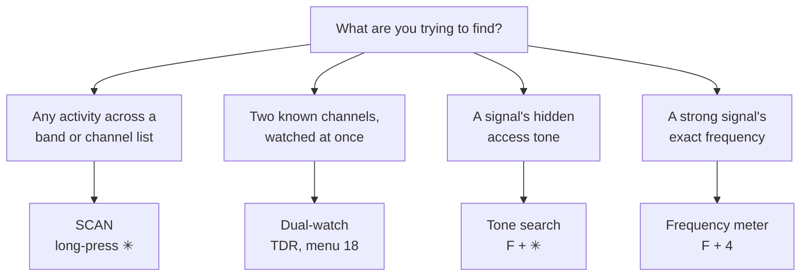
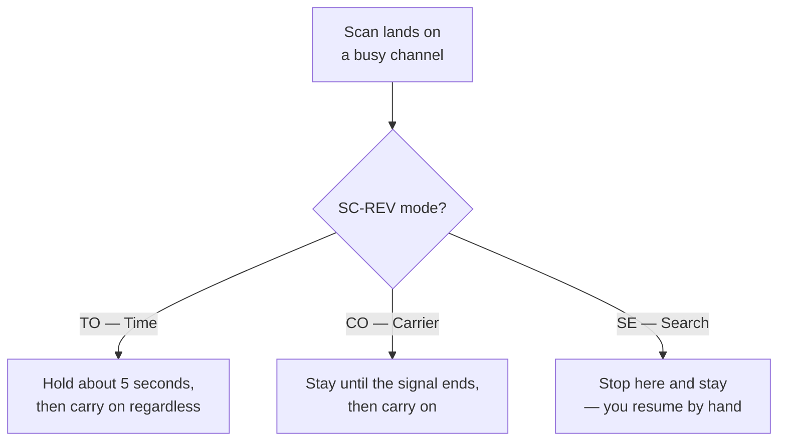
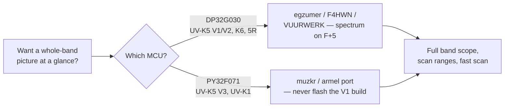

# Finding activity: scan, dual-watch, tone search and frequency meter

A handheld is only as useful as the activity you can find with it, and the UV-K5 gives you four quite different tools for the hunt — each solving a different problem, each with its own keypress, and none of them explained clearly in the box. This page untangles them: the **scan** that sweeps a band or a list of channels, the **dual-watch** that keeps half an ear on two frequencies at once, the **tone search** that reverse-engineers a repeater's hidden access tone, and the **frequency meter** that reads a strong nearby signal straight off the air. Get these straight and the radio stops being a thing you talk into and becomes a thing you listen _with_. At the end we look at what a custom firmware adds — a full band **spectrum analyser** — because it changes the game entirely, and it is the single best reason many owners reflash.

You met the keys and menu mechanics in [Getting Started](outpost:entry/logbook73.guide.uv-k5/getting-started) and the core settings in [Core Menus](outpost:entry/logbook73.guide.uv-k5/menus-core). Nothing on this page can harm the radio; you are only ever listening.

## Which tool for which job

Before the detail, a map. The four features are not alternatives — they answer four separate questions, and picking the wrong one wastes time.



A quick reference, then each in turn:

| Feature          | How you start it                           | What it finds                                    | Needs                            |
| ---------------- | ------------------------------------------ | ------------------------------------------------ | -------------------------------- |
| Scan             | Long-press `✳` (or a side key set to Scan) | The next channel or frequency with activity      | A sensible squelch setting       |
| Dual-watch (TDR) | Menu `18 TDR` → `CHAN_A` / `CHAN_B`        | A call on _either_ of your two lines             | Two frequencies already set      |
| Tone search      | `F` + `✳` while a signal is present        | The CTCSS or DCS tone a station is sending       | A live signal to listen to       |
| Frequency meter  | `F` + `4`                                  | A strong local signal's exact frequency and tone | A _strong_, close-by transmitter |

## Scan: sweeping for activity

Scanning is the workhorse. Hold the `✳` key (or press a side key you have programmed to **Scan**) and the radio starts stepping — checking one frequency or channel after another, pausing whenever it hears something that breaks the squelch. The **▲/▼** keys flip the scan direction while it runs. Press `EXIT` to stop.

_What_ it scans depends on the mode you are in, and this trips up newcomers constantly:

- In **frequency (VFO) mode** — reached with `F` + `3` — the radio sweeps _frequencies_, moving in whatever increment `02 STEP` is set to, across the current band. This is blind band-searching: good for discovering who is active on 2 m simplex, useless for anything you have not already narrowed down, because a `12.5` kHz step across a whole band is a great many hops.
- In **channel (memory) mode** — the other position of `F` + `3` — it sweeps only the channels you have stored, and only those you have added to the active **scan list**. This is far more useful day to day: it walks your local repeaters and simplex channels in seconds.

### Scan lists: telling the radio what to watch

The UV-K5 keeps **two** scan lists, so you can group channels — say, "repeaters" in one and "PMR446 and simplex" in the other — and sweep whichever you want.

- `26 S-ADD1` toggles whether the _current_ channel belongs to scan list 1; `27 S-ADD2` does the same for list 2. A channel can sit in both, one, or neither.
- `32 S-LIST` chooses which list is _active_ — `LIST1` or `LIST2` — i.e. the one a scan actually walks.
- `33 SLIST1` and `34 SLIST2` let you review which channels are in each list.

A channel in _no_ list is simply skipped by the scanner, which is how you keep a rarely-wanted channel stored but out of the sweep. See [Channels & Memories](outpost:entry/logbook73.guide.uv-k5/menus-channels) for storing and naming channels in the first place.

### What happens when it finds something: SC-REV

The most important scan setting is `23 SC-REV` — the **resume method** — which decides what the radio does the instant it lands on a busy channel.



- **`TO` (Time)** pauses roughly five seconds, then resumes whether or not the station is still talking. Good for _sampling_ a busy band without getting stuck.
- **`CO` (Carrier)** holds as long as the carrier is present and resumes only when the channel goes quiet. This is the sensible all-round default: the radio parks on a conversation, lets you hear the whole thing, then moves on. You never lose a chat mid-over.
- **`SE` (Search)** stops dead on the first signal and leaves the rest to you. Handy when you are hunting _one_ specific signal and want the sweep to halt the moment it appears.

Set **`CO`** and most scanning behaves the way your instinct expects.

One honest limitation sits underneath all of this: the squelch. The UV-K5's squelch is coarse and its front end has little filtering (the same trade-off as the whole UV-5R class — see [Overload & Ghost Signals](outpost:entry/logbook73.handbook/overload-and-ghost-signals)). If `01 SQL` is too low the scanner stalls on hiss and drifting noise; too high and it walks straight past weak signals. Set squelch by ear first — usually `2`–`4` — _then_ scan. A scanner that "won't stop" or "won't move" is almost always a squelch problem, not a fault.

`12 BCL` (busy-channel lockout) is a cousin of scanning worth knowing: with it on, the radio refuses to _transmit_ on a channel that is already busy, so you don't talk over someone. It doesn't help you find activity, but it stops you clobbering it.

## Dual-watch (TDR): two channels at once

Scanning walks a whole list; dual-watch does the opposite — it keeps a close eye on exactly **two** frequencies, your A line and your B line. The radio has a single receiver, so it cannot truly listen to both at the same instant; instead it time-shares, hopping between the two many times a second, and parks on whichever one comes alive. The screen shows **`DW`** while it runs.

You turn it on in `18 TDR`, and the choice you make there matters more than it looks:

- **`OFF`** — normal single-line operation.
- **`CHAN_A`** — watch both lines, but transmit on **A** by default.
- **`CHAN_B`** — watch both lines, but transmit on **B** by default.

That "default TX" part is the classic dual-watch trap. You are watching your local repeater on A and the 2 m calling channel on B; a call arrives on B, you go to answer it — but if the radio is set to transmit on A, your reply goes out on the wrong frequency entirely. Two habits keep you safe: pick the TX line that matches how you actually operate, and glance at the solid channel-arrow on the display before you key up. Which line is "main" also governs which one the PTT uses; `F` + `2` swaps the active line by hand.

Dual-watch is genuinely useful — monitoring a repeater and a calling channel while you make coffee is exactly what it's for — but it is not magic. Two stations transmitting at once still collide, the extra hopping costs a little battery, and it makes the squelch feel slightly twitchier. Turn it on when you truly want two channels; leave it off for simplicity.

## Tone search: cracking the access tone

Most [repeaters](outpost:entry/logbook73.handbook/repeaters) demand a quiet sub-audible **CTCSS** tone or **DCS** code riding under your voice before they will open — a kind of password (the full story is in [Tones & Squelch](outpost:entry/logbook73.guide.uv-k5/menus-tones)). Usually you look the tone up in your national repeater directory and set it by hand. But when you can _hear_ a signal and don't know what tone it carries, the radio can work it out for you.

Tune to the live signal, press **`F` + `✳`**, and the radio scans through the standard tones and codes until it finds the one the incoming transmission is actually sending. When it locks on, press `M` to save it into the current channel's receive-tone setting. It searches both CTCSS and DCS — `04 R_DCS` and `05 R_CTCS` each note that `F` + `✳` triggers the matching search.

Two cautions. First, it only reads the tone on **incoming** audio, so you need a station transmitting _now_ — you cannot search a silent channel. Second, this recovers the tone a repeater or station _sends back_; the tone you need to _open_ a repeater (its access tone) may differ, and is properly found in the directory. Tone search is brilliant for figuring out why your speaker keeps opening on a shared channel, or matching a group's tone on the spot, but treat the directory as the authority for transmit access.

## Frequency meter and Fast Copy: reading a signal off the air

The cleverest and least-understood tool is the **frequency meter**, reached with **`F` + `4`**. Point the radio near a _strong, close_ transmitter — a friend's handie a few metres away, a rig on the bench — and the UV-K5 measures the carrier's actual frequency and its sub-tone straight from the airwaves. This is the "**Fast Copy One Channel**" feature on the marketing bullets: it lets you effectively _clone_ a channel just by receiving it. You point, it reads the frequency and tone, and you can store that as a channel without anyone reading numbers aloud.

The single hard requirement is signal strength. The measurement only works on a **strong local** signal — the transmitter needs to be close and loud. Aim it at a distant repeater and you will get nonsense or nothing; this is a near-field party trick, not a way to survey the band. Press `EXIT` or the `PTT` to leave the meter.

It is worth being clear about what this is _not_. It is not a spectrum display and it does not show you the whole band — it reads exactly one dominant signal at a time. If you want to see everything around you at a glance, that is a different tool entirely, and stock firmware simply does not have it.

```viz
{
  "type": "spectrum",
  "title": "What blind scan can't show you",
  "caption": "Stock scan hops frequency by frequency and only reveals a signal once it breaks squelch. A spectrum scope shows the whole band at once — every carrier, plus the birdies you'd otherwise chase.",
  "xLabel": "Frequency across the band",
  "components": [
    { "f": 18, "amp": 0.7, "width": 3, "label": "repeater", "tone": "primary" },
    { "f": 40, "amp": 0.9, "width": 3, "label": "strong local", "tone": "primary" },
    { "f": 58, "amp": 0.35, "width": 2, "label": "weak simplex", "tone": "success" },
    { "f": 78, "amp": 0.5, "label": "birdie", "tone": "danger" }
  ],
  "noiseFloor": 0.06
}
```

## Beyond blind scanning: the spectrum analyser

Everything above is _blind_ searching. Stock scan tells you a channel is busy only _after_ it lands there; the frequency meter reads one signal at a time; nothing paints a picture of the band. This is the biggest single limitation of the stock firmware, and it is exactly what the popular custom firmwares fix.

Flash **egzumer** (or one of its relatives, F4HWN and VUURWERK) and you gain the **fagci spectrum analyser** — a full-screen band _scope_. Launched with **`F` + `5`**, it sweeps a frequency range and draws a live graph of what's out there: every carrier as a peak, the noise floor as a baseline, all updating in real time. Instead of hopping blindly you _see_ the activity and tune straight to it. Its own keypad controls let you set the scan step, the vertical dB scale, and — crucially — an RSSI trigger so the scope only stops on real signals and not birdies; you can even blacklist a stubborn carrier. egzumer also adds a **scan-ranges** mode (set a start and stop frequency and sweep only that slice) and much faster channel scanning. It is a genuine step-change, and for many owners the whole reason to reflash. The full walkthrough is in [Egzumer Firmware](outpost:entry/logbook73.guide.uv-k5/firmware-egzumer); if it sounds like an [SDR](outpost:entry/logbook73.handbook/software-defined-radio) panadapter in your pocket, that is more or less the idea.

One warning you must not skip, and it is the golden rule of this whole radio family. **Custom firmware is MCU-specific.** egzumer, F4HWN and VUURWERK are built for the **DP32G030** chip inside the original UV-K5, UV-K5(8), UV-K6 and UV-5R (the V1/V2 generation). The newer **UV-K5 V3** and the **UV-K1** use a completely different **PY32F071** chip, and need a separate port (the muzkr/armel firmware). Flash the wrong image onto the wrong chip and you can **brick the radio**. Before you reflash for the spectrum analyser, confirm which generation you own — the details, and how to check, are in [Choosing Firmware](outpost:entry/logbook73.guide.uv-k5/firmware-choosing).



## Try it yourself

Spend ten minutes making the four tools yours, using only the stock radio and a quiet corner of the [2 m band](outpost:entry/logbook73.handbook/vhf):

1. **Set squelch first.** Open `01 SQL` and nudge it up from `1` until the background hiss just stops — usually `2`–`4`. Every good scan starts here.
2. **Blind-scan a band.** Press `F` + `3` to reach frequency mode, set a `12.5` kHz step in `02 STEP`, then hold `✳`. Watch it sweep; press `▲`/`▼` to reverse direction, `EXIT` to stop.
3. **Set the resume method.** In `23 SC-REV` choose `CO`, then scan again — notice it now _holds_ on a conversation instead of jumping away mid-over.
4. **Build a scan list.** Store two or three local channels, add each to list 1 with `26 S-ADD1`, set `32 S-LIST` to `LIST1`, switch to channel mode (`F` + `3`) and scan — it now walks just those channels.
5. **Try tone search.** With a friend transmitting nearby, press `F` + `✳` and watch the radio hunt out their CTCSS tone; press `M` to save it.
6. **Read a frequency off the air.** With the same friend keying up a few metres away, press `F` + `4` and watch the frequency meter report their exact frequency. Move them across the room and see the reading hold — then point it at a distant signal and see it fail. That gap is precisely what the spectrum analyser closes.

## Key takeaways

- The UV-K5 has **four** finding tools, not one: **scan** (long-press `✳`) for activity across a band or list, **dual-watch** (`18 TDR`) for two known channels, **tone search** (`F` + `✳`) for a hidden access tone, and the **frequency meter** (`F` + `4`) for a strong local signal's exact frequency.
- Scan behaves as you expect only when squelch is set sensibly first, and when `23 SC-REV` is on **`CO`** so it holds a conversation to the end. Two scan lists (`S-ADD1`/`S-ADD2`, `S-LIST`) let you group channels.
- Dual-watch's trap is the **default TX line** — a call on the _other_ line can leave you transmitting on the wrong frequency, so check the channel-arrow before you key.
- **Tone search reads incoming audio only** and recovers the tone a station _sends_; the tone to _open_ a repeater still comes from your national directory.
- The **frequency meter needs a strong, close signal** — it is a near-field clone tool, not a band survey, and it reads one signal at a time.
- Stock searching is **blind**: nothing shows the whole band. The custom-firmware **spectrum analyser** (`F` + `5` on egzumer) is the fix and the main reason many owners reflash.
- **Match firmware to MCU** — DP32G030 builds for V1/V2, the PY32F071 port for V3/UV-K1 — or you risk bricking the radio.

With the finding tools in hand, the next step is the full settings list behind them: see the complete [Menu Reference](outpost:entry/logbook73.guide.uv-k5/menu-reference).
