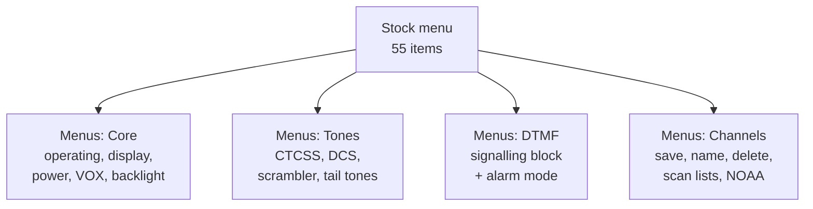

# Menu reference — stock options at a glance

The stock UV-K5 hides all its settings behind one numbered list — fifty-five items, each named in cramped four- or five-letter code (`SFT-D`, `RP-STE`, `S-ADD1`) that the radio never explains. This page is the map. It lists every stock menu item in order, tells you in one line what it does, gives its range of values, and points you to the fuller write-up on one of three companion pages. Skim it to find what you need, then follow the link for the "why", the sensible value, and the mistakes to avoid.

You met the mechanics in [Getting Started](outpost:entry/logbook73.guide.uv-k5/getting-started): press **M** (the Menu/Confirm key), scroll with **▲/▼** or type the item number, **M** again to open it, arrows to change the value, **M** to save, **EXIT** to back out. A handy shortcut: **long-press M** jumps straight to the last menu item you touched. Nothing on this list can damage the radio, so explore freely.

## One important caveat: this is the _stock_ menu only

Everything below describes the firmware your UV-K5 shipped with. The popular custom firmwares — **egzumer**, **mainline-F4HWN** and **VUURWERK** on the older DP32G030-based sets (UV-K5, K5(8), K6, 5R V1/V2), and the **muzkr+armel** port on the newer PY32F071 sets (UV-K5 V3, UV-K1) — **replace this menu entirely**. They rename items, reorder them, and add whole new blocks (a live spectrum analyser, SSB receive, more scan lists). So if your radio's menu does not match the table here, it is almost certainly running custom firmware, and this reference no longer applies. See [Firmware Overview](outpost:entry/logbook73.guide.uv-k5/firmware-overview) for what changes, and never flash firmware without matching your radio's MCU — the two families are not interchangeable.

## How the fifty-five items split across three pages

The stock list is long but it clusters into a few clear families. Rather than one enormous chapter, the deep explanations live on the page that fits their family:

- **[Menus: Core](outpost:entry/logbook73.guide.uv-k5/menus-core)** — the everyday operating, display, power and housekeeping items: squelch, step, power, offset, bandwidth, VOX, backlight, dual-watch, beep, time-out and so on.
- **[Menus: Tones](outpost:entry/logbook73.guide.uv-k5/menus-tones)** — the sub-audible tone squelch family (CTCSS and DCS, receive and transmit), the scrambler, and the two tail-tone tidiers.
- **[Menus: DTMF](outpost:entry/logbook73.guide.uv-k5/menus-dtmf)** — the touch-tone signalling block inherited from the radio's commercial-fleet roots, plus the emergency alarm mode.
- **[Menus: Channels](outpost:entry/logbook73.guide.uv-k5/menus-channels)** — everything to do with memory channels: saving, naming, deleting, scan-list membership, the one-key call channel, and NOAA weather scan.

## The full stock menu (all 55 items)

Every item, in the order the radio lists it. The **Guide** column tells you which companion page carries the full explanation.

| No. | Name     | What it does (one line)                                                       | Range / values                                  | Guide                                    |
| --- | -------- | ----------------------------------------------------------------------------- | ----------------------------------------------- | ---------------------------------------- |
| 01  | `SQL`    | Squelch — how strong a signal must be before the speaker opens                | `0`–`9`                                         | [Core](outpost:entry/logbook73.guide.uv-k5/menus-core)         |
| 02  | `STEP`   | Frequency step — how far the dial moves per arrow press                       | `2.5` / `5` / `6.25` / `10` / `12.5` / `25` kHz | [Core](outpost:entry/logbook73.guide.uv-k5/menus-core)         |
| 03  | `TXP`    | Transmit power level                                                          | `LOW` / `MID` / `HIGH`                          | [Core](outpost:entry/logbook73.guide.uv-k5/menus-core)         |
| 04  | `R_DCS`  | Receive DCS — digital code an incoming signal must carry to open your squelch | `OFF` / `D...N` / `D...I`                       | [Tones](outpost:entry/logbook73.guide.uv-k5/menus-tones)       |
| 05  | `R_CTCS` | Receive CTCSS — analogue sub-tone an incoming signal must carry               | `OFF` / 50 tones `67.0`–`254.1` Hz              | [Tones](outpost:entry/logbook73.guide.uv-k5/menus-tones)       |
| 06  | `T_DCS`  | Transmit DCS — digital code sent with everything you transmit                 | `OFF` / `D...N` / `D...I`                       | [Tones](outpost:entry/logbook73.guide.uv-k5/menus-tones)       |
| 07  | `T_CTCS` | Transmit CTCSS — access tone sent under your audio (opens most repeaters)     | `OFF` / 50 tones `67.0`–`254.1` Hz              | [Tones](outpost:entry/logbook73.guide.uv-k5/menus-tones)       |
| 08  | `SFT-D`  | Repeater shift direction — whether TX is above, below or same as RX           | `OFF` / `+` / `−`                               | [Core](outpost:entry/logbook73.guide.uv-k5/menus-core)         |
| 09  | `OFFSET` | Repeater offset — how far TX shifts from RX                                   | `0.0000`–`99.9990` MHz                          | [Core](outpost:entry/logbook73.guide.uv-k5/menus-core)         |
| 10  | `W/N`    | Bandwidth — wide (25 kHz) or narrow (12.5 kHz) for TX and RX                  | `WIDE` / `NARROW`                               | [Core](outpost:entry/logbook73.guide.uv-k5/menus-core)         |
| 11  | `SCR`    | Scrambler (analogue voice inversion) — **not** encryption, not private        | `OFF` / `1`–`10`                                | [Tones](outpost:entry/logbook73.guide.uv-k5/menus-tones)       |
| 12  | `BCL`    | Busy-channel lockout — blocks TX while the channel is occupied                | `OFF` / `ON`                                    | [Core](outpost:entry/logbook73.guide.uv-k5/menus-core)         |
| 13  | `CHNAME` | Edit a memory channel's name (in channel mode)                                | text entry                                      | [Channels](outpost:entry/logbook73.guide.uv-k5/menus-channels) |
| 14  | `MEM-CH` | Save the current VFO settings into a numbered memory channel                  | channel `1`–`200`                               | [Channels](outpost:entry/logbook73.guide.uv-k5/menus-channels) |
| 15  | `SAVE`   | Battery saver — receiver micro-sleeps between checks                          | `OFF` / `1:1` / `1:2` / `1:3` / `1:4`           | [Core](outpost:entry/logbook73.guide.uv-k5/menus-core)         |
| 16  | `VOX`    | Voice-operated transmit — keys up on your voice, no PTT                       | `OFF` / `1`–`10`                                | [Core](outpost:entry/logbook73.guide.uv-k5/menus-core)         |
| 17  | `ABR`    | Auto-backlight timer — how long the screen stays lit                          | `OFF` / `1`–`5` s / `ON`                        | [Core](outpost:entry/logbook73.guide.uv-k5/menus-core)         |
| 18  | `TDR`    | Dual-watch — listen on both channels; sets which is default TX                | `OFF` / `CHAN_A` / `CHAN_B`                     | [Core](outpost:entry/logbook73.guide.uv-k5/menus-core)         |
| 19  | `WX`     | Cross-band receive/transmit routing                                           | `OFF` / `CHAN_A` / `CHAN_B`                     | [Core](outpost:entry/logbook73.guide.uv-k5/menus-core)         |
| 20  | `BEEP`   | Keypad confirmation beep                                                      | `OFF` / `ON`                                    | [Core](outpost:entry/logbook73.guide.uv-k5/menus-core)         |
| 21  | `TOT`    | Transmit time-out timer — stuck-mic safety cut-off                            | `1`–`10` min                                    | [Core](outpost:entry/logbook73.guide.uv-k5/menus-core)         |
| 22  | `VOICE`  | Spoken voice prompts for menu actions                                         | `OFF` / `ENG` / `CHI`                           | [Core](outpost:entry/logbook73.guide.uv-k5/menus-core)         |
| 23  | `SC-REV` | Scan resume method — what a scan does on a busy channel                       | `TO` / `CO` / `SE`                              | [Channels](outpost:entry/logbook73.guide.uv-k5/menus-channels) |
| 24  | `MDF`    | Channel display mode — show frequency, channel number or name                 | `FREQ` / `CH` / `NAME`                          | [Core](outpost:entry/logbook73.guide.uv-k5/menus-core)         |
| 25  | `AUTOLK` | Auto keypad lock after idle                                                   | `OFF` / `ON`                                    | [Core](outpost:entry/logbook73.guide.uv-k5/menus-core)         |
| 26  | `S-ADD1` | Add the current channel to scan list 1                                        | `OFF` / `ON`                                    | [Channels](outpost:entry/logbook73.guide.uv-k5/menus-channels) |
| 27  | `S-ADD2` | Add the current channel to scan list 2                                        | `OFF` / `ON`                                    | [Channels](outpost:entry/logbook73.guide.uv-k5/menus-channels) |
| 28  | `STE`    | Tail-tone elimination — mutes the squelch-tail burst you send                 | `OFF` / `ON`                                    | [Tones](outpost:entry/logbook73.guide.uv-k5/menus-tones)       |
| 29  | `RP-STE` | Repeater tail-tone elimination — suppresses the repeater's tail burst         | `OFF` / `ON`                                    | [Tones](outpost:entry/logbook73.guide.uv-k5/menus-tones)       |
| 30  | `MIC`    | Microphone gain                                                               | `0`–`4`                                         | [Core](outpost:entry/logbook73.guide.uv-k5/menus-core)         |
| 31  | `1-CALL` | Choose the channel recalled by the one-key call (`F+9`)                       | channel select                                  | [Channels](outpost:entry/logbook73.guide.uv-k5/menus-channels) |
| 32  | `S-LIST` | Which scan list is active                                                     | `LIST1` / `LIST2`                               | [Channels](outpost:entry/logbook73.guide.uv-k5/menus-channels) |
| 33  | `SLIST1` | View / configure the channels in scan list 1                                  | list view                                       | [Channels](outpost:entry/logbook73.guide.uv-k5/menus-channels) |
| 34  | `SLIST2` | View / configure the channels in scan list 2                                  | list view                                       | [Channels](outpost:entry/logbook73.guide.uv-k5/menus-channels) |
| 35  | `AL-MOD` | Emergency alarm mode — local sound only, or sound plus transmitted signal     | `SITE` / `TONE`                                 | [DTMF](outpost:entry/logbook73.guide.uv-k5/menus-dtmf)         |
| 36  | `ANI-ID` | Your DTMF caller ID (identifies the radio, **not** your callsign)             | code entry                                      | [DTMF](outpost:entry/logbook73.guide.uv-k5/menus-dtmf)         |
| 37  | `UPCODE` | DTMF up-code sent on key-down (with PTT-ID)                                   | code entry                                      | [DTMF](outpost:entry/logbook73.guide.uv-k5/menus-dtmf)         |
| 38  | `DWCODE` | DTMF down-code sent on key-up (with PTT-ID)                                   | code entry                                      | [DTMF](outpost:entry/logbook73.guide.uv-k5/menus-dtmf)         |
| 39  | `D-ST`   | DTMF side tone — whether you hear the tones you key                           | `OFF` / `ON`                                    | [DTMF](outpost:entry/logbook73.guide.uv-k5/menus-dtmf)         |
| 40  | `D-RSP`  | DTMF decode response — how the radio reacts to a received code                | `NULL` / `RING` / `REPLY` / `BOTH`              | [DTMF](outpost:entry/logbook73.guide.uv-k5/menus-dtmf)         |
| 41  | `D-HOLD` | DTMF auto-reset time                                                          | `5`–`60` s                                      | [DTMF](outpost:entry/logbook73.guide.uv-k5/menus-dtmf)         |
| 42  | `D-PRE`  | DTMF pre-load (pre-send) delay before the code starts                         | `30`–`990` ms                                   | [DTMF](outpost:entry/logbook73.guide.uv-k5/menus-dtmf)         |
| 43  | `PTT-ID` | When to send the PTT-ID codes                                                 | `OFF` / `BOT` / `EOT` / `BOTH`                  | [DTMF](outpost:entry/logbook73.guide.uv-k5/menus-dtmf)         |
| 44  | `D-DCD`  | DTMF decoding on/off                                                          | `OFF` / `ON`                                    | [DTMF](outpost:entry/logbook73.guide.uv-k5/menus-dtmf)         |
| 45  | `D-LIST` | DTMF contact list for direct calls                                            | contacts `1`–`16`                               | [DTMF](outpost:entry/logbook73.guide.uv-k5/menus-dtmf)         |
| 46  | `PONMSG` | Power-on message style                                                        | `FULL` / `MSG` / `VOL` / `PIC`                  | [Core](outpost:entry/logbook73.guide.uv-k5/menus-core)         |
| 47  | `ROGER`  | End-of-transmission "roger" beep                                              | `OFF` / `ROGER` / `MDC`                         | [Core](outpost:entry/logbook73.guide.uv-k5/menus-core)         |
| 48  | `VOL`    | Show battery voltage on screen                                                | `OFF` / `ON`                                    | [Core](outpost:entry/logbook73.guide.uv-k5/menus-core)         |
| 49  | `AM`     | AM receive (for the 108–136 MHz airband only)                                 | `OFF` / `ON`                                    | [Core](outpost:entry/logbook73.guide.uv-k5/menus-core)         |
| 50  | `NOAA_S` | NOAA weather-channel auto-scan / alert                                        | `OFF` / `ON`                                    | [Channels](outpost:entry/logbook73.guide.uv-k5/menus-channels) |
| 51  | `LOGO1`  | Power-on welcome text, line 1                                                 | text entry                                      | [Core](outpost:entry/logbook73.guide.uv-k5/menus-core)         |
| 52  | `LOGO2`  | Power-on welcome text, line 2                                                 | text entry                                      | [Core](outpost:entry/logbook73.guide.uv-k5/menus-core)         |
| 53  | `Ver`    | Display the firmware version                                                  | read-only                                       | [Core](outpost:entry/logbook73.guide.uv-k5/menus-core)         |
| 54  | `DEL_CH` | Delete a stored memory channel                                                | channel select                                  | [Channels](outpost:entry/logbook73.guide.uv-k5/menus-channels) |
| 55  | `RESET`  | Reset — `VFO` keeps channels, `ALL` is a full factory wipe                    | `VFO` / `ALL`                                   | [Channels](outpost:entry/logbook73.guide.uv-k5/menus-channels) |

## A few honest notes before you dive in

Three things worth flagging while the whole list is in front of you.

**The scrambler (`11 SCR`) is not encryption.** It is analogue voice inversion — it flips the audio spectrum so speech sounds garbled to a plain receiver, but anyone with the same cheap radio (or a simple de-inverter) can undo it in seconds. It gives no real privacy, and on the amateur bands sending deliberately obscured speech is generally **against your licence conditions** — check yours (Ofcom in the UK, the FCC in the US, your national regulator elsewhere) before you ever switch it on. See [Menus: Tones](outpost:entry/logbook73.guide.uv-k5/menus-tones) for the full picture.

**The DTMF block (`35`–`45`) is fleet-radio legacy.** For ordinary amateur voice you can leave almost all of it at default. Crucially, the `ANI-ID` and `PTT-ID` codes identify the _radio_, not you — they do **not** satisfy your legal duty to give your callsign by voice. [Menus: DTMF](outpost:entry/logbook73.guide.uv-k5/menus-dtmf) explains what each does and why you rarely need it.

**Some values change by market version.** The stock transmit bands depend on which regional variant you bought (FCC, CE/UKCA, IC, or the wide "NORMAL" version). The receive span of roughly 50–600 MHz is genuine, but with the same cheap-front-end caveats as any budget handheld — expect [overload and ghost signals](outpost:entry/logbook73.handbook/overload-and-ghost-signals) near strong transmitters. Only ever transmit within your licence conditions and your radio's type-approved bands.

## Key takeaways

- The stock UV-K5 menu is **55 items** in one numbered list; press **M** to enter, and **long-press M** to jump back to the last item you edited.
- The fifty-five split into four families: everyday operating and display (**Core**), sub-tone squelch and tail tones (**Tones**), the touch-tone signalling block (**DTMF**), and memory-channel management (**Channels**).
- The four you touch most — `01 SQL`, `02 STEP`, `03 TXP`, `10 W/N` — all live on the [Core](outpost:entry/logbook73.guide.uv-k5/menus-core) page; the CTCSS/DCS access tones (`04`–`07`) that open repeaters live on [Tones](outpost:entry/logbook73.guide.uv-k5/menus-tones).
- `11 SCR` is voice inversion, not encryption — no privacy, and usually not permitted on the amateur bands.
- The DTMF codes (`ANI-ID`, `PTT-ID`) are **not** your callsign; you must still identify by voice.
- **Custom firmware replaces this entire menu** — different names, different order, extra features — and is MCU-specific: match egzumer/F4HWN/VUURWERK to DP32G030 sets and the muzkr+armel port to PY32F071 sets, or you risk bricking the radio. See [Firmware Overview](outpost:entry/logbook73.guide.uv-k5/firmware-overview).

With the whole list mapped, start where it matters most: the everyday operating settings in [Menus: Core](outpost:entry/logbook73.guide.uv-k5/menus-core).
