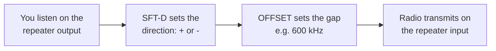
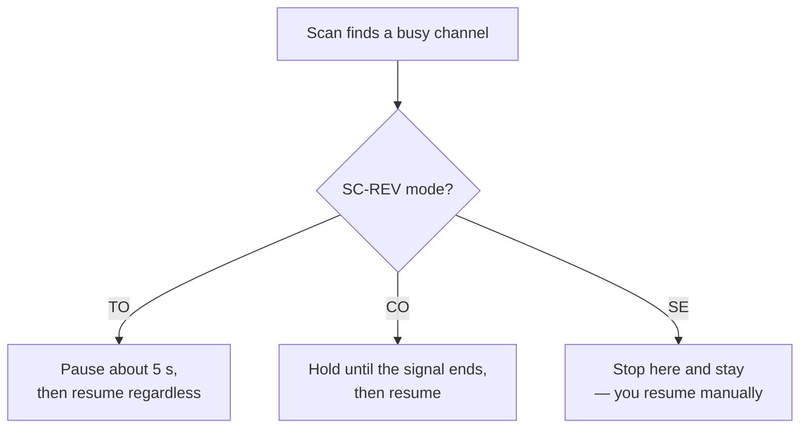

# Core menus: squelch, step, power, offset, display and battery

The UV-K5's stock firmware packs fifty-five settings behind one numbered list, and the little screen barely names them — you scroll to `10 W/N` or `08 SFT-D` and the radio assumes you already know what that means. This page decodes the settings you actually reach for day to day: how loud a signal must be before you hear it, where the dial stops, how much power you push, how wide your signal sits, how you open a repeater, and the handful of display and housekeeping switches that make the radio pleasant to live with. For each substantial item we answer what the manual never does — what it does, what is happening inside, why it exists, sensible values, a Foundation-friendly recommendation, and whether you should ever touch it.

You met the mechanics in [Getting Started](outpost:entry/logbook73.guide.uv-k5/getting-started): press **M** (the Menu/Confirm key), type the two-digit item number or scroll with **▲/▼**, press **M** to open the value, **▲/▼** to change it, **M** again to save, **EXIT** to back out. A long-press of **M** jumps you straight back to the last item you edited — handy when you are tweaking one setting repeatedly. Nothing on this page can harm the radio. The tone-squelch and DTMF items get their own treatment in [Tones & squelch](outpost:entry/logbook73.guide.uv-k5/menus-tones); the channel and scan-list machinery lives in [Channels](outpost:entry/logbook73.guide.uv-k5/menus-channels); the full numbered list is the [Menu reference](outpost:entry/logbook73.guide.uv-k5/menu-reference).

## How to read these pages

Each substantial item carries a one-glance verdict, the same scheme used across this handbook's radio guides:

| Symbol | Meaning                                                    |
| ------ | ---------------------------------------------------------- |
| ✅     | Set it like this and forget it — right for almost everyone |
| ⭐     | Genuinely useful, depending on how you operate             |
| ⚠️     | Advanced — understand it before you enable it              |
| ❌     | Leave it off unless you have a specific reason             |

One honesty note before we start. The UV-K5 is a remarkably capable budget set, but it is a wideband receiver with a modest front end — it hears almost everything from `50` to `600` MHz, which also means it can be fooled by strong nearby signals. A couple of settings below are really about managing that. See [Overload & ghost signals](outpost:entry/logbook73.handbook/overload-and-ghost-signals) if the radio ever seems to hear things that are not there.

## Getting on the air: SQL, STEP, TXP, W/N

These four decide the basics — silence between overs, where the dial lands, how hard you transmit, and how wide your signal sits.

### 01 · SQL — squelch level — ✅ 2–4

The control that silences the background hiss when no one is talking.

- **Does:** sets how strong a signal must be before the speaker opens. `0` leaves it wide open (constant hiss); `9` clamps so tightly only a strong local signal gets through.
- **Inside:** an FM receiver with no signal produces a loud rushing hiss. Squelch is a gate that measures the channel noise and mutes the audio below your threshold, opening it above. It is receive-only — it changes nothing you transmit.
- **Values:** `0`–`9`.
- **Recommendation:** ✅ **Start at `3`.** Drop to `1`–`2` on a hilltop when chasing weak signals; nudge up if a busy urban spot keeps breaking squelch on noise. Set it once by ear — up until the hiss just stops, no further.
- **Common mistakes:** cranking it to `8`–`9` "to stop the hiss", then missing the weak repeater you could otherwise hear. Hold the **Monitor** side key (Side Key 1, short press by default) to force the squelch fully open when you want to listen underneath your setting.
- **Should you change it?** Yes — find your number once, then leave it.

### 02 · STEP — frequency step — ✅ match the service

How far the frequency moves for each press of the arrows in Frequency (VFO) mode.

- **Does:** sets the tuning increment — `2.5`, `5`, `6.25`, `10`, `12.5` or `25` kHz per step.
- **Inside:** the synthesiser lands on a grid of frequencies; the step is that grid's spacing. It does **not** change your transmit bandwidth (that is `10 W/N`) — only where the dial stops as you tune.
- **Why it exists:** different services lay their channels on different grids; match the grid and every channel lands exactly on frequency.
- **Values:** `2.5` / `5` / `6.25` / `10` / `12.5` / `25` kHz.
- **Recommendation:** ✅ **`12.5` kHz** suits most modern 2 m (VHF) and 70 cm (UHF) amateur work; a few legacy channels sit on the `25` kHz grid. Check your national band plan for the spacing in your country. One honest limit: the stock menu offers no `8.33` kHz step, so the European VHF airband's `8.33` kHz channels cannot be tuned dead on — fine for casual listening, not precise.
- **Common mistakes:** blaming a "deaf" radio for missing a repeater when the real fault is a step that never quite lands on frequency.
- **Should you change it?** Yes, to suit whatever you tune. `12.5` kHz is the sensible home setting for amateur voice.

### 03 · TXP — transmit power — ⭐ the lowest that works

Chooses the output power level. Note this radio has **three**, shown as **H / M / L** on the screen.

- **Does:** switches between **HIGH**, **MID** and **LOW**. The stock specification caps transmit at `≤5` W, so HIGH is roughly that; LOW is around a watt; MID sits between. The manual does not state each level's exact wattage, so treat those as ballpark.
- **Inside:** it changes how hard the final amplifier is driven. More power means a stronger signal at the far end — but a flatter battery, a warmer radio, and more of your signal spilling where you would rather it did not.
- **Why it exists:** you rarely need full power. Through a nearby repeater a watt is plenty; reaching a distant hilltop, you want everything the radio has.
- **Values:** LOW / MID / HIGH. Ignore any "8 W" claims on the box — the spec is `≤5` W and bench tests bear that out. See [RF power](outpost:entry/logbook73.handbook/rf-power).
- **Recommendation:** ⭐ **Run LOW or MID wherever it works, HIGH only when you must** — the most important habit of a considerate operator, and always within your licence conditions. It saves battery, keeps the set cooler, and spreads less spurious energy from a budget transmitter. The **F+6** shortcut cycles H/M/L without diving into the menu, and a side key can do the same.
- **Should you change it?** Constantly. Treat LOW as your default and HIGH as a deliberate choice.

### 10 · W/N — wide / narrow bandwidth — ✅ match the channel

Sets how much room your FM signal takes up — and how wide a slice the radio listens to.

- **Does:** switches between **WIDE** (a `25` kHz channel, `16KΦF3E`) and **NARROW** (a `12.5` kHz channel, `11KΦF3E`), for both transmit and receive. An **N** appears on the screen when narrow.
- **Inside:** FM carries your voice as swings in the carrier's frequency — the _deviation_. Wide swings roughly twice as far as narrow: louder, fuller audio, but twice the spectrum. On receive, the setting sets how wide a slice the radio's filter passes. See [Modulation](outpost:entry/logbook73.handbook/modulation).
- **Why it exists:** as bands filled, many services halved their spacing from `25` to `12.5` kHz to fit twice the channels, so the radio must do both — and match whatever the other station is using.
- **Values:** WIDE (`0`) / NARROW (`1`).
- **Recommendation:** ✅ **Match the channel.** Modern amateur repeaters and simplex on the `12.5` kHz grid want **NARROW**; older `25` kHz allocations want **WIDE**. Licence-free channels are set by regulation — [PMR446](outpost:entry/logbook73.handbook/uhf) in Europe is **NARROW**, and FRS in North America is likewise narrow-band. When in doubt on the amateur bands today, NARROW is the safer default.
- **Common mistakes:** running WIDE on a narrow channel makes your voice over-deviate — loud, distorted, and splattering the channel above; running NARROW on a wide station comes out quiet and muffled. Transmitting WIDE on a licence-free channel that mandates narrow is both illegal and rude.
- **Should you change it?** Yes — and once you store channels (see [Channels](outpost:entry/logbook73.guide.uv-k5/menus-channels)), set it correctly per memory so you never think about it again.

## Working a repeater: SFT-D, OFFSET, TDR, WX

A [repeater](outpost:entry/logbook73.handbook/repeaters) listens on one frequency and re-transmits on another at the same instant, which is how it covers a wide area. To use one your radio must **transmit** on the repeater's input while you **listen** on its output — a trick called _duplex_. Two settings arrange that: `08 SFT-D` picks the direction of the gap, and `09 OFFSET` sets its size.

### 08 · SFT-D — shift direction — ⭐ set per repeater

Tells the radio which way to move its transmit frequency away from where you are listening.

- **Does:** sets the transmit shift to **OFF** (simplex — transmit where you listen), **+** (transmit above your receive frequency) or **−** (below it). A small **+** or **−** shows on the screen.
- **Inside:** in Frequency mode the display shows your receive frequency; SFT-D and OFFSET together compute where the transmitter goes when you key up. For simplex — direct radio-to-radio, no repeater — you want **OFF**.
- **Values:** OFF / + / −.
- **Recommendation:** ⭐ **OFF for simplex; + or − to match the repeater** from its listing. Which way a band shifts genuinely varies by country, so read the directory rather than guess.
- **Common mistakes:** leaving a shift set on a simplex calling channel, so you transmit `600` kHz away from where everyone is listening and nobody answers.
- **Should you change it?** Yes, per repeater — and store it in the memory so it travels with the frequency.

### 09 · OFFSET — repeater offset — ⭐ set per repeater

The size of the gap between listen and transmit that SFT-D applies.

- **Does:** sets the offset amount, `0.0000` to `99.9990` MHz, typed on the keypad. When you key up, the radio adds (or subtracts) this figure from your displayed receive frequency to find where to transmit.
- **Why it exists:** every band has a standard repeater spacing; you dial it in so the input lands exactly right.
- **Recommendation:** ⭐ Use your band plan's standard. The internationally common figures are **`600` kHz (`0.6000` MHz) on 2 m** and a larger shift on 70 cm — often **`1.6` MHz in Region 1** or **`5` MHz in Region 2** — but this differs by country, so confirm it against your national society's repeater directory.
- **Common mistakes:** entering the offset but leaving SFT-D on OFF, so nothing shifts; typing `6.0000` instead of `0.6000` and transmitting six megahertz away.
- **Should you change it?** Set it per repeater and store it in the channel. In Channel (memory) mode the shift and offset are baked into the stored channel, so you never enter them by hand on the air.

### 18 · TDR — dual watch — ⭐ useful, with one trap

Lets the radio keep half an ear on both frequency lines at once.

- **Does:** set to **CHAN_A** or **CHAN_B**, the receiver watches both on-screen lines and catches a call on either; the **DW** icon shows it running. The choice of A or B decides which line the PTT transmits on by default.
- **Inside:** the set has one receiver, so it time-shares — hopping between the two lines many times a second, then parking on whichever goes active for the conversation.
- **Values:** OFF / CHAN_A / CHAN_B.
- **Recommendation:** ⭐ **On when you genuinely want two channels; OFF for simplicity**, slightly better battery and a snappier squelch. **The trap:** the PTT keys the _default_ line, so an incoming call on the other line can leave you replying in the wrong place — glance at the solid channel arrow before you transmit, and switch the active main channel with **F+2**. Do not expect true simultaneous reception: two signals arriving at once still collide.
- **Should you change it?** On when you need it, off when you do not.

### 19 · WX — cross-band receive/transmit — ⚠️ advanced, leave OFF

Routes audio between the two bands so the radio can act as a simple cross-band relay.

Set to **CHAN_A** or **CHAN_B**, it makes one line receive and the other re-transmit, roughly like a personal cross-band repeater; **OFF** is the normal state. ⚠️ **Leave OFF** unless you understand cross-band operation and your licence conditions permit an unattended or automatic transmitter — many do not without special arrangements. It is easy to mis-configure into a station that transmits without you noticing. Not for ordinary use: note it exists and move on.

## Display, battery and startup: MDF, SAVE, ABR, VOL, PONMSG, LOGO1/2, VOICE, BEEP, ROGER

None of these affect what leaves the antenna — they are about how the radio looks, sounds and lasts.

### 24 · MDF — channel display mode — ✅ NAME or FREQ

What the screen shows for a stored channel in memory mode.

- **Does:** displays each channel as its **FREQ**uency, its **CH** (channel number), or its **NAME** (the text label you gave it).
- **Recommendation:** ✅ **NAME** is the friendliest once you have labelled your channels ("GB3XX", "PMR-1") in [Channels](outpost:entry/logbook73.guide.uv-k5/menus-channels); **FREQ** if you prefer to see the actual frequency; **CH** if you memorise numbers. Pure preference — pick what you read fastest.

### 15 · SAVE — battery saver — ✅ 1:2 or 1:3

Lets the receiver doze between checks to stretch the battery.

- **Does:** micro-sleeps the receiver while idle, waking briefly to sample the channel. The ratio sets sleep versus listen — higher saves more.
- **Inside:** idle listening dominates a handheld's drain. Rather than listen continuously, the radio powers the receiver down for a fraction of a second, wakes, checks, and sleeps again. The catch: a call arriving _during_ a sleep window is not heard until the next wake, so the very start of a transmission can be clipped.
- **Values:** OFF / `1` / `1:2` / `1:3` / `1:4`.
- **Recommendation:** ✅ **`1:2` or `1:3`** for everyday monitoring — real extra standby time you never notice. Set it **OFF** only when catching the first syllable matters, such as net control or listening for brief calls.
- **Common mistakes:** chasing a phantom "the radio keeps missing the start of calls" fault when the cure is simply turning SAVE off.
- **Should you change it?** Set `1:2` and leave it; OFF only for critical listening.

### 17 · ABR — auto-backlight timer — ✅ a few seconds

How long the screen stays lit after a keypress. **OFF** keeps it dark (best standby), `1`–`5` lights it for that many seconds on activity, and **ON** keeps it lit constantly. ✅ A few seconds is a comfortable read without much drain; choose **OFF** for maximum battery, **ON** only when mains-powered. A taste setting — pick once.

### 48 · VOL — battery voltage display — ⭐ ON is handy

Shows the battery voltage on screen. **ON** is a genuinely useful gauge — a healthy pack reads high and sags as it empties, giving you far more warning than the crude battery icon. ⭐ Turn it **ON** and glance at it; when the number drops near the pack's minimum, it is time to charge.

### 46 · PONMSG — power-on message — leave to taste

What the screen shows the instant you switch on: **FULL** (a full-screen splash), **MSG** (your custom welcome text from LOGO1/LOGO2), **VOL** (the battery voltage) or **PIC** (a stored picture). **VOL** is arguably the most useful — an at-a-glance battery check every time you power up. Otherwise pure preference.

### 51/52 · LOGO1 / LOGO2 — welcome text — cosmetic

Two lines of text shown at power-on when PONMSG is set to **MSG**. Most owners put their callsign here — a small, sensible touch, since a lost radio then shows who it belongs to. Cosmetic only; it changes nothing you transmit.

### 22 · VOICE — voice prompt — leave to taste

A robotic voice that announces menu items and actions aloud, in **ENG**lish or **CHI**nese, or **OFF**. **ENG** can help while you learn which numbered item is which; most operators settle on **OFF** once the menu is familiar. It affects nothing you transmit — pure preference.

### 20 · BEEP — key beep — ✅ ON while learning

The confirmation tone on each keypress. **ON** tells you a press registered (handy with gloves or in the dark); **OFF** for silent operation on a quiet net. Leave it **ON** while you are learning the radio, then choose to taste.

### 47 · ROGER — roger beep — ❌ usually OFF

A tone sent at the _end_ of each transmission: **OFF**, **ROGER** (the little "frog" chirp) or **MDC** (a data burst). ❌ Most amateur operators leave this **OFF** — a roger beep on every over is unnecessary on a ham channel and mildly grating to others. It is your choice, but silence is the polite default.

## Convenience and safety: TOT, VOX, MIC, AUTOLK, SC-REV, BCL

The last cluster covers a safety net, a hands-free option, and a few quality-of-life switches.

### 21 · TOT — transmit time-out timer — ⭐ 2–3 minutes

Cuts off an over-long transmission automatically.

- **Does:** limits continuous transmit time; reach the set value and the radio stops transmitting and beeps, even with the PTT still held.
- **Inside:** a countdown starts when you key up and resets when you release. Hit zero and the firmware un-keys the transmitter regardless.
- **Why it exists:** a stuck or accidentally pressed PTT — the radio sat on in a bag — would otherwise hold a channel or repeater open indefinitely. This is your defence against the classic "stuck mic".
- **Values:** `1`–`10` minutes.
- **Recommendation:** ⭐ **2–3 minutes.** Long enough for any single over, short enough to catch a jammed PTT quickly. Many repeaters run their own timer too; treat this as your personal back-stop.
- **Common mistakes:** setting it so short it cuts you off mid-sentence.
- **Should you change it?** Set `3` minutes and forget it — a safety net you hope never to hear.

### 16 · VOX — voice-operated transmit — ❌ normally off

Makes the radio transmit when it hears your voice, so you can talk hands-free.

- **Does:** above `0`, the radio keys up when your voice crosses a loudness threshold and drops when you go quiet — no PTT. The number `1`–`10` sets sensitivity (higher = more sensitive). A **VOX** icon warns you it is armed.
- **Inside:** an audio-level detector watches the microphone; cross the threshold and the firmware keys the transmitter, un-keying after a short built-in hang.
- **Why it exists:** genuine hands-free use — driving, climbing, both hands busy — usually with a headset.
- **Values:** OFF / `1`–`10`.
- **Recommendation:** ❌ **Leave OFF for general use.** VOX transmits without you deciding to: it sends background noise, wind or half a conversation in the room, and does **not** listen first, so it can double straight over a station already talking. Use it only with a specific hands-free need and a decent headset. **F+7** toggles it quickly, and a side key can be assigned to it.
- **Common mistakes:** setting sensitivity high "so it always catches me" and then transmitting every cough and door-slam.
- **Should you change it?** Only with a real hands-free need.

### 30 · MIC — microphone gain — ⭐ 2–3

How loud your voice is fed into the transmitter.

- **Does:** sets microphone gain from `0` (quietest) to `4` (loudest).
- **Inside:** higher gain drives the modulator harder — louder audio at the far end, but past a point it over-drives, adding distortion and, on a budget set, some splatter onto neighbouring channels.
- **Recommendation:** ⭐ **`2`–`3` is a sensible middle.** If reports say you are quiet, nudge up; if you sound distorted or "hot", nudge down. Ask a friend for an honest audio check — you cannot judge your own transmit audio from the radio.
- **Should you change it?** Once, to get your audio right, then leave it.

### 25 · AUTOLK — automatic keypad lock — ⭐ ON to taste

Locks the keypad by itself after a short idle, so pocket presses do not change your settings.

- **Does:** **ON** locks the keypad automatically after a period of inactivity; **OFF** never does. A padlock icon shows when locked. You can always lock or unlock by hand with a long-press of **F**, and the side keys keep working while locked.
- **Recommendation:** ⭐ **ON** if you carry the radio in a pocket or bag — it stops accidental changes. **OFF** if the auto-lock catches you out mid-operation. Taste, leaning towards ON for a set that lives on your belt.

### 23 · SC-REV — scan resume method — ⭐ CO for monitoring

Decides what the radio does when a scan lands on a busy channel.

- **Does:** **TO** (Time) pauses about five seconds then resumes regardless; **CO** (Carrier) holds while the signal is present and resumes only when it drops; **SE** (Search) stops dead on the first signal and leaves scanning to you.

- **Why it exists:** skimming a band, you want it to sample and move on; following a conversation, you want it to sit put until the talkers finish.
- **Values:** TO / CO / SE.
- **Recommendation:** ⭐ **CO (Carrier)** is the best all-round choice — the radio parks on an active conversation and resumes only once the channel goes quiet, so you never lose a chat mid-flow. Use **TO** to keep sampling a busy band, **SE** when hunting a single signal.
- **Common mistakes:** using **SE** for general monitoring and having it stop forever on the first stray carrier or birdie; forgetting that scanning needs the squelch (`01 SQL`) set properly first, or it stalls on noise.
- **Related:** scanning itself and the scan lists are covered in [Scanning](outpost:entry/logbook73.guide.uv-k5/scanning).
- **Should you change it?** Yes — set **CO** and most scanning behaves as you expect.

### 12 · BCL — busy channel lockout — ⭐ ON for shared channels

Stops you transmitting on top of someone already using the channel.

- **Does:** **ON** prevents the PTT from keying up if the radio currently hears a signal on the channel; **OFF** lets you transmit regardless.
- **Inside:** when you press PTT, the firmware first checks whether the squelch is open; if it is, it refuses to transmit and warns you, so you do not stamp on an ongoing conversation you might not have been listening to.
- **Why it exists:** politeness and interference avoidance on shared and busy channels — it enforces "listen before you talk".
- **Values:** OFF / ON.
- **Recommendation:** ⭐ **ON** on shared or licence-free channels where colliding with others is likely; **OFF** if you find it blocking you on a channel where you genuinely need to transmit through activity (some repeater work). A sensible courtesy default for casual use.
- **Common mistakes:** panicking that "the radio won't transmit" when BCL is simply doing its job on a busy channel — check whether something is coming in first.
- **Should you change it?** ON for shared-channel monitoring; OFF when it gets in your way.

## Try it yourself

Set up one real repeater by hand, so the shift menus stop being abstract. Pick a repeater from your national society's directory and note its **output** frequency, its **shift direction**, its **offset** and its **access tone** (you will do the tone in [Tones & squelch](outpost:entry/logbook73.guide.uv-k5/menus-tones)).

1. In Frequency mode (**F+3** toggles Frequency/Channel), tune to the repeater's **output** frequency using a matching **`02 STEP`**.
2. Open **`08 SFT-D`** and set **+** or **−** to match the directory.
3. Open **`09 OFFSET`** and key in the gap (for example `0.6000` for `600` kHz), then **M** to save.
4. Set **`10 W/N`** to NARROW for a modern repeater, and **`03 TXP`** to LOW to start.
5. Watch the **+/−** icon appear. Press PTT briefly and confirm the radio _shows_ it is transmitting on the shifted frequency (use **F+8** Reverse to swap TX/RX and read the input frequency back).

You have now built duplex operation from the parts, and you will understand exactly what a stored repeater channel is doing for you later.

## Key takeaways

- The four you touch daily: **`01 SQL`** (set by ear around `2`–`4`), **`02 STEP`** (`12.5` kHz for most amateur work; no `8.33` kHz airband step), **`03 TXP`** (LOW/MID/HIGH — run low, HIGH only when needed), **`10 W/N`** (NARROW for modern channels, WIDE for legacy `25` kHz — mismatch it and your audio comes out distorted or muffled).
- A repeater needs two settings working together: **`08 SFT-D`** for the direction of the gap and **`09 OFFSET`** for its size; leave both OFF for simplex, and confirm the numbers against your national band plan — they differ by country.
- **`18 TDR`** dual-watch is handy but keys the _default_ line — glance at the active-channel arrow before you transmit. **`19 WX`** cross-band is advanced; leave it OFF.
- **`21 TOT`** at `2`–`3` minutes is your stuck-mic safety net; **`12 BCL` ON** keeps you off busy channels; **`23 SC-REV` CO** makes scanning behave.
- Display and startup items (`24 MDF`, `46 PONMSG`, `48 VOL`, `51/52 LOGO`) are taste and convenience — a callsign in LOGO and voltage on screen are the two worth setting; **`47 ROGER` OFF** is the polite default.
- **`16 VOX`** transmits without you deciding to — leave it off unless you have a headset and a reason; **`30 MIC`** around `2`–`3` gets your audio right after one honest report.

With the everyday switches decoded, the next job is the sub-tones that actually open a repeater — the CTCSS and DCS menus — in [Tones & squelch](outpost:entry/logbook73.guide.uv-k5/menus-tones).
