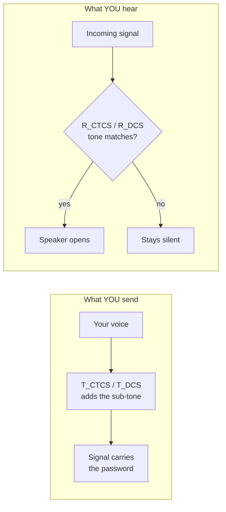
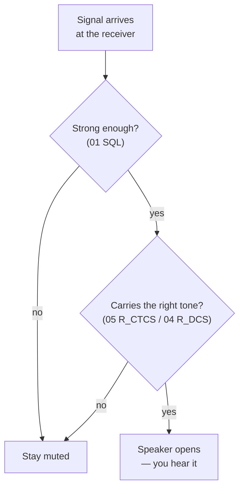
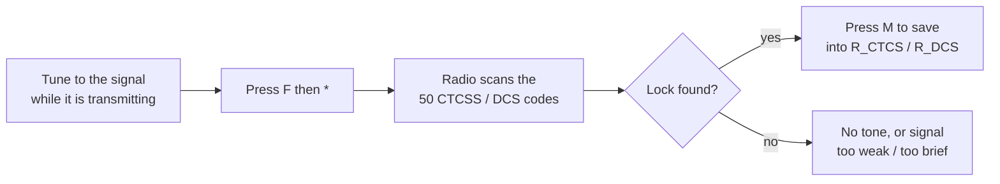

# CTCSS, DCS, tail tones and the scrambler

Most repeaters will not answer a perfect signal unless it carries a quiet little password you never hear — a tone humming below your voice. Get it right and the machine relays you across the county; get it wrong and it ignores you completely, which is the single most common reason a new UV-K5 owner decides their radio is "broken". This chapter takes the six tone-related items in the stock menu — `04 R_DCS`, `05 R_CTCS`, `06 T_DCS`, `07 T_CTCS`, plus the tail-tone pair `28 STE` and `29 RP-STE` — and the misleadingly named `11 SCR`, and explains what each one actually does before you ever touch it.

Everything here belongs to the **stock (factory) firmware**. If you have reflashed to egzumer, F4HWN or VUURWERK the menu is laid out differently, though the underlying ideas are identical — see [Custom Firmware Overview](outpost:entry/logbook73.guide.uv-k5/firmware-overview). To open the menu on the stock radio: press **M**, scroll with **▲/▼** to the item, **M** to edit, arrows to change the value, **M** to save, **EXIT** to leave. Nothing in this chapter can harm the radio.

## What a sub-audible tone actually is

When you key up in plain FM, your voice and nothing else goes out. **CTCSS** — Continuous Tone-Coded Squelch System, sometimes called a "sub-audible tone" or by the Motorola trade name PL — adds one steady, very low pitch underneath your speech and keeps it there the whole time you transmit. The pitch sits between `67.0` and `254.1` Hz, right at the bottom of the hearing range, and the receiving radio filters it out before it reaches the speaker, so nobody actually hears it. There are 50 standard tones, and the UV-K5 numbers them `1`–`50` in the menu rather than showing the Hz value directly — worth remembering when you are matching a listing.

**DCS** — Digital-Coded Squelch — does the same job a different way. Instead of one analogue pitch it sends a slow, continuous digital word, written as a `D` followed by three digits and a suffix: `D023N`, `D754I`. The suffix marks **N**ormal or **I**nverted (the manual also calls inverted "reverse"). A radio set for CTCSS will not answer DCS and vice versa, so any given channel is one system or the other, never both, and a Normal code will not answer its Inverted twin. The screen shows `CT` when a CTCSS tone is active and `DCS` when a digital code is.

```viz
{
  "type": "spectrum",
  "title": "The sub-tone hides below your voice",
  "caption": "A steady ~100 Hz CTCSS tone sits beneath the 300-3000 Hz speech band; the far radio checks for it and filters it out of what you hear.",
  "xLabel": "Audio frequency (0-3.4 kHz)",
  "components": [
    { "f": 3, "amp": 0.55, "width": 2, "label": "CTCSS tone (67-254 Hz)", "tone": "success" },
    { "f": 50, "amp": 0.85, "width": 44, "label": "Your voice (300-3000 Hz)", "tone": "primary" }
  ],
  "noiseFloor": 0.04
}
```

Why does anyone bother? Two reasons, and they map onto the two directions the tone can travel. A [repeater](outpost:entry/logbook73.handbook/repeaters) uses a required tone so that it wakes only for real users and ignores noise, distant co-channel signals and interference — it will not key up for anything that lacks the correct tone. And on a busy shared channel, a tone lets your own radio stay silent through everyone else's traffic and alert you only when your group calls. Same tone, opposite ends of the link — which is exactly why the menu splits into transmit and receive halves.

## RX versus TX: which way the tone travels

This is where people tie themselves in knots, so slow down. The four tone menus are two systems (CTCSS and DCS) times two directions (receive and transmit):

| Menu        | Meaning             | Affects           |
| ----------- | ------------------- | ----------------- |
| `04 R_DCS`  | Receive DCS code    | What you **hear** |
| `05 R_CTCS` | Receive CTCSS tone  | What you **hear** |
| `06 T_DCS`  | Transmit DCS code   | What you **send** |
| `07 T_CTCS` | Transmit CTCSS tone | What you **send** |

The **T_** (transmit) items add a tone or code to everything you send. This is how you open a repeater that demands an access tone: set `07 T_CTCS` to the required tone and your radio quietly sends it under your voice every time you key up. The **R_** (receive) items do the opposite — they keep your speaker silent unless an incoming signal carries the tone you have set. This is "tone squelch": the radio can hear the signal perfectly well, but stays muted until the password matches.



The everyday repeater case needs only the transmit half. You set `07 T_CTCS` to the machine's access tone and leave the receive tone (`05 R_CTCS`) **off**, so you still hear everything the repeater sends back to you, whoever it is talking to. Turning on a receive tone as well is a step you take deliberately, for a specific reason — usually a shared or noisy channel — not a default.

One firmware detail worth knowing: the tone squelch sits **on top of** the ordinary squelch level you set in `01 SQL`. Both gates must open — enough signal strength _and_ the right tone — before you hear anything. So if you set a receive tone and then think the radio has gone dead, it is almost certainly doing exactly what you asked: no matching tone is arriving, so it stays quiet.



A blunt warning that saves grief: a receive tone gives you **no privacy whatsoever**. It changes only what _your_ speaker bothers you with. Anyone listening on plain FM, or with the tone squelch off, hears every word you say. Tone squelch is a convenience filter, not a lock.

## Setting DCS, and never mixing the two

`04 R_DCS` and `06 T_DCS` behave exactly like their CTCSS cousins — receive-side and transmit-side — but you choose a digital code (`D023N` … `D754I`) instead of an analogue pitch. Use them only when a channel or repeater specifically lists a DCS code. In amateur practice CTCSS dominates on repeaters; you meet DCS more often on commercial and some [PMR446/FRS](outpost:entry/logbook73.handbook/uhf) setups.

Two rules that prevent almost every DCS mishap:

- **Never set both a CTCSS and a DCS tone on the same side of the same channel.** Pick one system. If you set `07 T_CTCS` _and_ `06 T_DCS`, you are asking the radio to do two contradictory things.
- **Never swap a code's `N` and `I` variants.** `D023N` and `D023I` are different passwords; a receiver expecting one will ignore the other.

## Finding a tone you cannot hear: the F+\* search

Because the tone is filtered out before it reaches the speaker, you cannot tell by ear what tone a signal is using — which is a problem when you want to answer a repeater but do not know its access tone. The stock radio has a built-in search for exactly this. It lives on the **F+\*** shortcut (the manual labels it `SER`).



To use it: while a station or repeater is actually transmitting, tune to it, then press **F** followed by **\***. The radio steps through the standard tones and codes looking for the one riding under the signal, and when it locks on you press **M** to store it. From the same menu family, `04 R_DCS` and `05 R_CTCS` each note that a short **F+\*** launches the matching search directly.

Two honest limits. The search needs a **strong, steady signal** long enough to test every tone, so a fleeting over may not give it time. And it tells you the tone the _incoming_ signal carries — which for a repeater is the tone the repeater sends back, and is usually (but not always) the same tone the repeater wants _from_ you. When in doubt, treat the search as a strong hint and confirm against your national society's repeater listing (the RSGB directory in the UK; ARRL, DARC and the like elsewhere).

## Worked example: opening a tone-access repeater

Suppose you want to work `GB3xx`, a 2 m repeater that its listing says needs a `71.9` Hz CTCSS access tone and uses a negative offset. The tone part is the piece this chapter owns:

1. Tune the radio to the repeater's **output** frequency (the frequency you _listen_ on).
2. Set the shift and offset so you transmit on the input — that is `08 SFT-D` and `09 OFFSET`, covered in [Core Menus](outpost:entry/logbook73.guide.uv-k5/menus-core).
3. Open `07 T_CTCS` and set it to `71.9` Hz. The `CT` icon appears on screen.
4. Leave `05 R_CTCS` **off**, so you still hear the whole repeater.
5. Store the lot into a memory channel with `14 MEM-CH`, so the tone, shift and offset travel together and you never rebuild them by hand.

Now, whenever you key up on that channel, your radio sends `71.9` Hz under your voice, the repeater recognises its password and relays you. Get the tone wrong — or leave it off — and the machine simply will not respond, no matter how strong and clean your signal is. That is the whole mystery behind "the repeater can't hear me".

If a repeater instead uses the older **1750 Hz tone-burst** access — a single audible beep at the start of your call rather than a continuous sub-tone — the UV-K5 sends it from **Side Key 1** (long-press, the default `1750 Hz` function). That is a momentary tone to trip the repeater open, not the continuous CTCSS these menus produce, so the two are not interchangeable; use whichever your repeater's listing specifies.

## STE and RP-STE: tidying the tail

When an FM transmitter stops, the receiving radio hears a brief burst of noise before its squelch closes — the "squelch tail" or _kerchunk_ at the end of every over. On a tone-squelched link there is a neat trick to kill it: just before you unkey, your radio briefly reverses the phase of the CTCSS tone, which tells the far radio's tone decoder to drop out _immediately_ and mute before the noise arrives. That is what `28 STE` (Squelch Tail Elimination) does — a clean, quiet end to your transmission instead of a splat.

`29 RP-STE` (Repeater tail-tone elimination) handles the same problem from the other side: it manages the tail that the **repeater** sends back when _it_ drops, so the courtesy tone and hang-time close cleanly for you. The two settings cover the two ends of a repeater contact.

Both are simple OFF/ON switches, and the sensible answer for a UV-K5 used on tone-access repeaters is to leave **both ON**. They cost nothing, they make your signal tidier for everyone, and modern repeaters expect them. The only reason to turn `28 STE` off is if you find a particular link or radio that mishandles the phase reversal and clips the last syllable — rare, but if you hear it, that is the switch to try. If the fine timing behaviour matters to you, check your firmware's release notes, as different builds implement the reversal slightly differently.

## SCR — the "scrambler" that scrambles nothing worth having

`11 SCR` is the item most likely to be misunderstood, and misusing it is the one thing in this chapter that can get you into real trouble. The menu offers OFF and levels `1`–`10`, and the `SCR` icon lights when it is on. It is tempting to read "scrambler" as "makes my calls private". **It does not.**

What `SCR` actually performs is **analogue voice inversion**. It takes your audio and flips its frequency spectrum around a pivot point — high tones become low, low become high — so a normal FM receiver hears your speech as unintelligible warble. The ten "levels" are simply ten different pivot frequencies.

The problem is that inversion is not encryption. There is no key, no secret in any meaningful sense. Anyone with another voice-inverter — a second UV-K5, a cheap scrambler chip, or free software fed from an [SDR](outpost:entry/logbook73.handbook/software-defined-radio) — set to the same pivot point recovers your speech in seconds, and there are only a handful of pivots to try. So it offers essentially **no privacy** against anyone who cares to listen, while it noticeably **degrades your audio quality** for the people you actually want to talk to.

And there is the licence question, which settles the matter. Amateur licences almost universally require that your transmissions be **in plain language** and **not encoded to obscure their meaning** — obscuring content is precisely what a scrambler is for, so voice inversion is generally **not permitted on the amateur bands**. Check your own licence conditions, but for the overwhelming majority of readers the correct setting is unambiguous:

- **Leave `11 SCR` OFF.** It buys you no real privacy, it makes you sound worse, and it is very likely outside your licence conditions on the amateur bands.

The feature exists because these radios descend from commercial-fleet hardware where a business might run inversion on a private licensed channel — not because it has any place in normal amateur voice.

## Try it yourself

Find a repeater near you in your national society's directory and note its access tone. On the UV-K5, tune to the repeater's output, then set `07 T_CTCS` to that tone and watch the `CT` icon appear — you have just built a repeater's password by hand.

Now do it the detective's way. Next time you hear a repeater or a tone-squelched net actually transmitting, tune to it and press **F+\***. Let the search run while the signal is present, and when it locks, note the tone it found. Compare that against the published listing. Doing both — reading the tone off a listing _and_ recovering it off the air — turns CTCSS from a mysterious number into something you genuinely understand, and you will never again be stumped by a repeater that "won't hear you".

## Key takeaways

- **CTCSS is one steady sub-audible tone (`67.0`–`254.1` Hz); DCS is a slow digital code (`D023N` … `D754I`).** A channel uses one system, never both, and Normal never answers Inverted.
- **Direction is everything.** `T_CTCS` / `T_DCS` add the password to what you **send** (how you open a repeater); `R_CTCS` / `R_DCS` keep your speaker silent until an incoming signal carries the matching tone. Tone squelch sits on top of `01 SQL` — both gates must open.
- For a normal tone-access repeater, set only the **transmit** tone (`07 T_CTCS`) and leave the receive tone off, then store it in a memory with `14 MEM-CH` so it travels with the frequency.
- **F+\*** searches for the tone hiding under a live signal — a strong, steady signal — and **M** saves it. Confirm against a repeater listing where you can.
- Leave `28 STE` and `29 RP-STE` **ON** for tidy, tail-free transmissions on tone-squelched repeaters.
- **`11 SCR` is voice inversion, not encryption.** It gives no real privacy, degrades your audio, and is generally outside amateur licence conditions — leave it **OFF**.

With the tones sorted, the next family of menus is the one these radios inherited straight from commercial fleet use: DTMF touch-tones, caller IDs and PTT signalling. Continue to [DTMF & Signalling Menus](outpost:entry/logbook73.guide.uv-k5/menus-dtmf).
