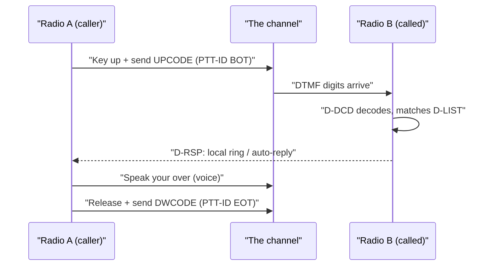

# DTMF, PTT-ID, selective calling and the alarm

Eleven of the stock menu's fifty-five items — numbers `36` to `45`, plus the alarm at `35` — are given over to a single subject the manual never really explains: DTMF signalling. These are the touch-tones your phone made when you dialled, pressed into service as a private paging and remote-control system inherited from the UV-K5's commercial-fleet ancestry. It sounds exotic, and the cover even advertises a "Remote Kill / Revive" trick, but the honest truth is that on the amateur bands you will almost certainly leave every one of these switched off. This chapter tells you what each does, why it exists, and — the part that matters most — why a beginner can happily ignore nearly all of it.

You met the menu mechanics in [Getting Started](outpost:entry/logbook73.guide.uv-k5/getting-started): press **M**, scroll with **▲/▼** or type the item number, **M** to open it, arrows to change the value, **M** to save, **EXIT** to leave. Nothing in this chapter can harm the radio, and — one honesty note up front — none of it replaces your callsign. A DTMF burst is not identification in any legal sense; you must still say who you are by voice, within your licence conditions. This is a companion to [Core Menus](outpost:entry/logbook73.guide.uv-k5/menus-core) and [Tones & Squelch](outpost:entry/logbook73.guide.uv-k5/menus-tones); if the tone-squelch quartet (CTCSS/DCS) is what you actually came for, that lives on the tones page — DTMF is a different animal entirely.

## What DTMF actually is

**DTMF** stands for **Dual-Tone Multi-Frequency**, and you have heard it thousands of times: the musical _boop-beep_ a telephone keypad makes. Each key sends two audio tones at once — one from a "row" group, one from a "column" group — and a decoder at the far end works out which digit you pressed from the pair. The UV-K5 can send the sixteen DTMF characters (`0`–`9`, plus `A`, `B`, `C`, `D`, `*`, `#`) straight over the air on top of your FM audio, and it can listen for them coming back.

Why would a radio want to dial numbers? Because before every handset had a screen and a data mode, fleets used DTMF as a cheap signalling layer. A dispatcher could send a short tone sequence that only unit 12's radio would react to — making it beep, or open its squelch, or announce itself. That is the whole idea behind the block of menus below: **selective calling** (ring one radio, not the whole channel), **caller ID** (the calling radio announces its own code), and a couple of remote-control party tricks.

Three kinds of call fall out of this:

- **Single call** — you send the code that belongs to _one_ specific radio, and only that radio reacts (its speaker opens or it rings). Everyone else on the channel stays quiet.
- **Group call** — a code shared by several radios rings a whole team at once.
- **All call** — a wildcard code that alerts _every_ suitably configured radio listening.

On a commercial site that is genuinely useful: a supervisor pages one worker without deafening thirty others. On a shared amateur simplex channel it is a solution to a problem amateurs mostly do not have, because we identify by voice and generally _want_ to hear each other. That is the recurring theme of this page — keep it in mind as we go.

## How to read these pages

Each item carries a one-glance verdict, the same scale used across this guide:

| Symbol | Meaning                                                |
| ------ | ------------------------------------------------------ |
| ✅     | Fine as it is — the default suits almost everyone      |
| ⭐     | Genuinely useful, depending on how you operate         |
| ⚠️     | Advanced — understand it before you enable it          |
| ❌     | Leave it off unless you have a specific, agreed reason |

## The identity codes: ANI-ID, UPCODE, DWCODE

These three set _who your radio says it is_ and _what it sends automatically_. On their own they do nothing audible — they only come alive once `43 PTT-ID` is switched on.

### 36 · ANI-ID — your caller-ID code — ⚠️ leave default

**ANI** is **Automatic Number Identification** — a short DTMF string that identifies _this handset_, the radio's own "phone number" on the channel.

- **Does:** stores the code that represents your radio to any DTMF decoder listening. In a fleet, when your radio transmits its ID, the controller logs "unit ANI-ID just keyed up".
- **Why it exists:** so a dispatcher sees who called without anyone speaking — pure commercial-radio housekeeping.
- **UK recommendation:** ⚠️ **Leave it at the default.** ANI has essentially no role in amateur voice, and — this bears repeating — it is **not** your callsign and does **not** meet your legal duty to identify. Say your callsign by voice regardless of what any code does.
- **Common mistakes:** believing the ANI code "identifies you" so you need not announce yourself. It does not, and skipping your callsign is a licence breach in most jurisdictions.
- **Related:** `37 UPCODE`, `43 PTT-ID`.

### 37 · UPCODE — the key-down code — ⚠️ off unless a system expects it

The DTMF string the radio can send the instant you _press_ PTT (the "up" code, sometimes called the online/BOT code).

- **Does:** holds the sequence transmitted at the **B**eginning **O**f **T**ransmission when `43 PTT-ID` is set to `BOT` or `BOTH`. This is typically your ANI, used as a "here I am, keying up now" marker, or the address of the radio you are trying to call.
- **Why it exists:** it lets a controller or a selective-call system register your transmission the moment it starts, before you speak.
- **UK recommendation:** ⚠️ **Leave the default and keep `PTT-ID` off** for ordinary chat. A chirp of tones before every over is pointless on a ham channel and mildly antisocial — it clutters the audio and can trip other people's decoders.
- **Related:** `38 DWCODE`, `43 PTT-ID`, `42 D-PRE`.

### 38 · DWCODE — the key-up code — ⚠️ off unless a system expects it

The mirror of UPCODE: the DTMF string sent when you _release_ PTT (the "down" code, offline/EOT code).

- **Does:** holds the sequence transmitted at the **E**nd **O**f **T**ransmission when `43 PTT-ID` is `EOT` or `BOTH`. Fleets use it to log "unit finished" or to hand the channel back cleanly.
- **UK recommendation:** ⚠️ **Off for amateur voice.** Like UPCODE, it exists for systems that expect it; sending a burst of tones after every release just annoys the channel.
- **Related:** `37 UPCODE`, `43 PTT-ID`.

## The behaviour switches: D-ST, D-RSP, D-HOLD, D-PRE

This cluster shapes _how_ DTMF sounds and behaves — feedback tone, how the radio answers a call aimed at it, and the fine timing that stops the first digits being clipped.

### 39 · D-ST — DTMF side tone — ✅ ON to taste

Whether _you_ hear the DTMF tones in your own speaker as they are sent.

- **Does:** `ON` plays the touch-tones back to you as the radio transmits them; `OFF` sends them silently. It changes only your own feedback — the tones still go out over the air either way.
- **UK recommendation:** ✅ **ON while learning** so you can tell when a code has actually been sent; a matter of taste once you are used to it. Harmless whichever way you set it.
- **Values:** OFF / ON.

### 40 · D-RSP — decode response — ⚠️ leave NULL

What your radio _does_ when it decodes a DTMF call addressed to it.

- **Does:** chooses the reaction — `NULL` (do nothing beyond opening as normal), `RING` (sound a local alert so you know you were called), `REPLY` (automatically transmit an acknowledgement back), or `BOTH` (ring _and_ auto-reply).
- **Why it exists:** in a selective-calling system you want to know when _your_ radio was paged, and a controller often wants an automatic "message received" without the operator lifting a finger.
- **UK recommendation:** ⚠️ **Leave `NULL`** for general amateur use. `RING` is harmless and occasionally handy if a small group has agreed to page each other; **avoid `REPLY`/`BOTH`**, because an automatic transmitted acknowledgement keys your radio _without you deciding to_ — the radio talks on its own, which is exactly what you do not want on a shared channel.
- **Values:** NULL / RING / REPLY / BOTH.
- **Related:** `44 D-DCD` (this only matters when decoding is on), `45 D-LIST`.

### 41 · D-HOLD — DTMF auto-reset time — ✅ leave default

How long the radio holds a decoded DTMF state before it resets itself.

- **Does:** sets the timeout, in seconds, after which the radio clears a received-call condition and returns to normal. The manual's range is `5`–`60` s.
- **Why it exists:** after a selective call opens your radio, it needs to know when to go quiet again if nothing follows — this is that "give up and reset" timer.
- **UK recommendation:** ✅ **Leave the default.** It only bites when you are actively using DTMF decode; the middle of the range is fine for the rare occasion you need it.
- **Values:** `5`–`60` seconds.

### 42 · D-PRE — DTMF pre-load time — ⚠️ only if codes get clipped

A short delay between keying the transmitter and the first DTMF digit going out.

- **Does:** inserts a pre-send gap (the manual gives roughly `30`–`990` ms) so the transmitter — and any repeater in the path — is fully up and stable before the tones begin.
- **Why it exists:** a transmitter and a repeater both take a moment to key up; if the code starts instantly, its first digit can be swallowed before the path is established, and the far decoder misses it.
- **UK recommendation:** ⚠️ **Irrelevant unless you actually send PTT-ID or manual DTMF into a decoder.** If the far end reports missing the start of your code — especially through a repeater — nudge this longer until it copies cleanly; otherwise leave it.
- **Values:** ~`30`–`990` ms (check the exact steps on your unit's firmware).
- **Related:** `43 PTT-ID`, `37 UPCODE`.

## The gatekeepers: PTT-ID, D-DCD, D-LIST

These decide whether the radio _sends_ codes automatically, whether it _listens_ for them, and which contacts it recognises.

### 43 · PTT-ID — send code on transmit — ❌ off for ham chat

The master switch that makes UPCODE/DWCODE actually go out around your audio.

- **Does:** sets _when_ the identity codes are sent — `OFF` (never), `BOT` (send `37 UPCODE` on key-down), `EOT` (send `38 DWCODE` on key-up), or `BOTH`. When on, the radio prepends or appends the DTMF around every over.
- **Why it exists:** fleet and controller systems log or gate transmissions by unit, and PTT-ID makes that automatic so the operator never thinks about it.
- **UK recommendation:** ❌ **OFF for ordinary amateur voice.** Firing a burst of tones before or after every transmission is pointless on a ham channel, clutters the audio, and can trip other people's decoders — and, once more, it does **not** satisfy your callsign requirement. Enable it only for a specific system that expects it.
- **Values:** OFF / BOT / EOT / BOTH.
- **Related:** `37 UPCODE`, `38 DWCODE`, `42 D-PRE`.

### 44 · D-DCD — DTMF decoding — ❌ off unless selective-calling

Whether the radio _listens_ for and acts on incoming DTMF.

- **Does:** `ON` turns on the decoder, so incoming DTMF strings are read and matched against your contact list (`45 D-LIST`), triggering whatever `40 D-RSP` specifies; `OFF` ignores DTMF entirely.
- **Why it exists:** without decoding, selective calling, remote commands and auto-reply cannot work — this is the on-switch for the "listening" half of DTMF.
- **UK recommendation:** ❌ **OFF for general use.** Turn it on only inside an agreed group that is genuinely using selective calling, and remember it is what makes the remote-control commands (below) possible — a good reason to leave it off unless you and your group have chosen otherwise.
- **Values:** OFF / ON.
- **Related:** `40 D-RSP`, `45 D-LIST`.

### 45 · D-LIST — DTMF contact list — ⭐ only if you selective-call

A small phonebook of DTMF codes for the radios you might call.

- **Does:** stores up to sixteen named DTMF contacts (`1`–`16`); you pick one with **▲/▼** and press **M** to select it for a direct call. When decoding is on, incoming codes are matched against this list to decide whether a call was meant for you.
- **Why it exists:** so you can single-call a specific radio without keying the code by hand each time, and so your radio recognises calls from known contacts.
- **UK recommendation:** ⭐ **Useful only if a group has agreed to selective-call each other** — a niche but legitimate case, say a small work party who want to page one member quietly on a busy PMR446 channel. For everyone else it sits unused. Set the codes with your group so everyone's lists agree.
- **Values:** entries `1`–`16`.
- **Related:** `44 D-DCD`, `40 D-RSP`.

## The emergency alarm: AL-MOD

### 35 · AL-MOD — alarm mode — ⚠️ know what it does before you use it

The setting behind the **long-press of Side Key 2** (its default action): an emergency alarm.

- **Does:** chooses what the alarm does when triggered — `SITE` sounds a loud alarm tone from _your own_ radio only (a local attention-getter), while `TONE` sounds it locally **and** transmits an alarm signal over the air so other radios hear it too.
- **Why it exists:** a panic/attention function borrowed from safety and security radios — press one key and make a noise, optionally alerting others on the channel.
- **UK recommendation:** ⚠️ **Understand it before relying on it, and default to `SITE`.** The `TONE` mode transmits, which means it keys up on whatever channel you are on — potentially over a repeater or another conversation — with a raw alarm tone and _no callsign_, which is disruptive and does not identify you. It is not a substitute for a real emergency plan or a phone. If you keep it on `TONE`, be sure you know which channel you are transmitting on and that alarming it is appropriate.
- **Values:** SITE (local only) / TONE (local + transmitted).
- **Common mistakes:** triggering it accidentally with a long side-key press and broadcasting an alarm you did not mean to send; treating it as a genuine emergency service — it is a noise-maker, not a lifeline.

## "Remote Kill / Revive" — the honest version

The box and the marketing bullet promise **Remote Kill** and **Remote Revive**, which sound dramatic. Here is what they really are: a DTMF-command feature. A radio configured for it can be sent a specific DTMF sequence over the air that **disables** it (Kill — it stops responding, as if switched off) or **re-enables** it (Revive). It rides entirely on the DTMF decoding machinery above — `44 D-DCD` must be on, and the radio must be set up to accept the commands.

Treat it as a novelty. For a fleet manager it has a real use — remotely disabling a lost or stolen handset. For an amateur it is a curiosity with three catches worth stating plainly:

- **It only works on a radio you have deliberately configured to obey it**, listening on the right channel with decoding enabled. It is not a magic wand you wave at any radio nearby.
- **Transmitting a control command to disable another station is a regulatory minefield.** Sending unidentified control tones, or interfering with another operator's radio, sits well outside normal amateur practice — keep it within your licence conditions and to radios you own and control.
- **It is easy to lock yourself out.** Kill the wrong radio, or forget the Revive sequence, and you have a handset that appears dead until you recover it — often by re-flashing or resetting. There is little upside for the hobbyist.

In short: a genuine feature, honestly niche, and safe to ignore. If you never turn on DTMF decoding, none of it can happen to you.

## Try it yourself

You do not need a second radio to _see_ DTMF working — you need a way to _hear_ the tones. Set `39 D-ST` to **ON**, then from the main screen tap **`*`** for the manual-dial/call page and press a few number keys: you will hear the classic telephone _boops_ in your own speaker as the radio generates them. Now imagine those going out over the air. Next, with a friend a few streets away, agree a short code, add it to each other's `45 D-LIST`, turn `44 D-DCD` **ON** and `40 D-RSP` to **RING**, and try a single call — you should hear the other radio ring only when its own code is sent. When you are done, set `D-DCD` back **OFF** and `PTT-ID` **OFF**: that is where they belong for everyday amateur life. Log the experiment in LogBook73 if you like — a note that you tested selective calling with a club member is exactly the kind of thing your log is for.

## Key takeaways

- **DTMF is telephone touch-tones over the air** — a commercial signalling layer (single/group/all call, caller ID, remote control) that amateurs rarely need, because we identify by voice and want to hear each other.
- **The identity codes** (`36 ANI-ID`, `37 UPCODE`, `38 DWCODE`) do nothing until `43 PTT-ID` is on — and a code is **never** your callsign. Always identify by voice, within your licence conditions.
- **Leave the senders off:** `43 PTT-ID` **OFF** and `44 D-DCD` **OFF** is the right resting state; sending tone bursts around every over just clutters the channel and can trip other decoders.
- **`40 D-RSP` — avoid `REPLY`/`BOTH`:** an automatic transmitted acknowledgement keys your radio without you deciding to. `RING` is harmless; `NULL` is the safe default.
- **`45 D-LIST` selective calling** is the one genuinely useful trick here — but only if a group has agreed codes and switched decoding on together.
- **`35 AL-MOD` — default to `SITE`;** `TONE` transmits an unidentified alarm on whatever channel you are on. Know before you press.
- **"Remote Kill / Revive"** is a real but novelty DTMF-command feature — niche, licence-bound, and easy to leave switched off for good.

With the signalling odds and ends decoded, the last of the practical stock menus is the part you _will_ use every day: storing, naming and organising your channels — covered in [Channels & Memory](outpost:entry/logbook73.guide.uv-k5/menus-channels).
