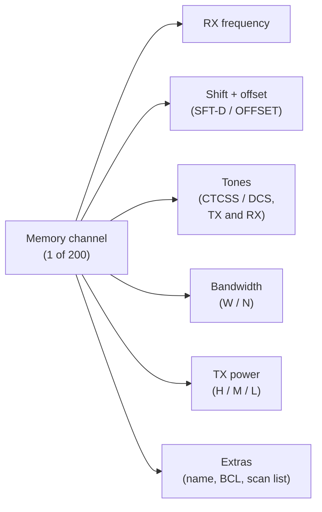
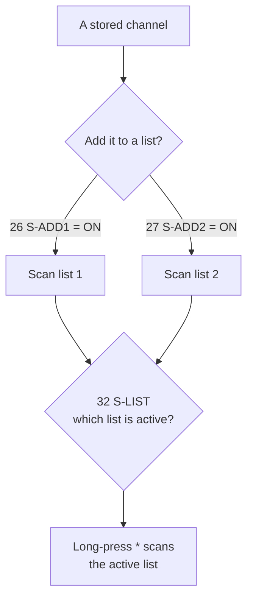
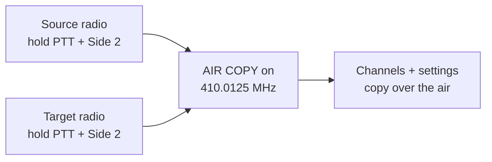

# Channels, scan lists, NOAA, AM and reset

Everything so far has been about tuning a frequency by hand. That is fine for a rummage across the band, but the moment you have a repeater you use every day, a calling channel, and a weather frequency you want at a thumb's reach, you want them **stored** — named, tuned, tones set, ready to recall in one press. The UV-K5 holds 200 such memory channels, and each one freezes far more than a frequency. This chapter covers the stock menu items that build and manage that memory: how to save a channel, name it, delete it, organise channels into two scan lists, keep a one-key call channel, pull in weather and airband, clone one radio to another over the air, and — carefully — reset the radio without losing everything.

You met the menu mechanics in [Getting Started](outpost:entry/logbook73.guide.uv-k5/getting-started): press **M**, scroll with **▲/▼** or type the item number, **M** to open, arrows to change, **M** to save, **EXIT** to leave. Nothing here can harm the radio except one item — `55 RESET` — which we treat with the respect it deserves. This page assumes you are running the **stock firmware**; the custom firmwares in the [Firmware Overview](outpost:entry/logbook73.guide.uv-k5/firmware-overview) reorganise all of this.

## VFO versus memory — the two modes

The radio lives in one of two modes, and the **`F`+`3`** shortcut swaps between them:

- **Frequency mode (VFO)** — you tune freely, step by step, anywhere the radio can go. This is where you _find_ and set up a frequency. You cannot recall a stored channel here, and you cannot key in a repeater shift by hand in the same way.
- **Channel mode (MR, "memory recall")** — the arrows step through your stored channels by number, each one recalling its whole saved setup at once. This is where you _operate_ day to day.

The workflow is always the same: set everything up in VFO mode, save it to a channel, then live in channel mode. Think of VFO as the workbench and memory as the tidy drawer of finished tools.

## What a memory channel actually stores

Here is the point most newcomers miss. A memory channel is **not** just a frequency. When you save one, the radio bottles up almost every transmit-and-receive setting that was live at that moment, so recalling the channel restores the lot in a single press. That is why a stored repeater "just works" — the offset, the access tone and the bandwidth travel with it.

Concretely, one channel carries:

| Stored with the channel | Set by menu                  | Why it matters                                                 |
| ----------------------- | ---------------------------- | -------------------------------------------------------------- |
| Receive frequency       | tuned in VFO                 | Where you listen                                               |
| Shift direction         | `08 SFT-D` (`+` / `−` / off) | Which way transmit jumps for a [repeater](outpost:entry/logbook73.handbook/repeaters) |
| Offset amount           | `09 OFFSET`                  | How far it jumps (e.g. 600 kHz on 2 m)                         |
| Transmit tone           | `06 T_DCS` / `07 T_CTCS`     | The sub-tone that opens the repeater                           |
| Receive tone            | `04 R_DCS` / `05 R_CTCS`     | Tone squelch, if you want it                                   |
| Bandwidth               | `10 W/N`                     | Wide or narrow — match the channel                             |
| Transmit power          | `03 TXP`                     | High / Mid / Low                                               |
| Busy-channel lockout    | `12 BCL`                     | Refuses to transmit over an active channel                     |
| Name                    | `13 CHNAME`                  | A readable label instead of a number                           |
| Scan-list membership    | `26 S-ADD1` / `27 S-ADD2`    | Which scans include it                                         |

So the recipe for a good channel is: in VFO mode, tune the receive frequency, set the shift and offset, set the transmit tone the repeater needs, choose narrow or wide, choose your power, _then_ save. Set it up once, correctly, and you never fiddle with tones on the air again.

## Saving a channel — MEM-CH (14)

`14 MEM-CH` writes whatever is set up on the current VFO into a channel number of your choosing.

- **Do it:** get the VFO exactly right first — frequency, shift, offset, tones, bandwidth, power. Then **M** → scroll to `14 MEM-CH` → **M**. The radio offers a channel number; use **▲/▼** to pick an empty one (or an existing one to overwrite), press **M**, and answer the **`SURE?`** prompt to confirm.
- **Inside:** the radio copies the live settings into that slot in its memory. There are 200 slots, plus separate storage for 20 broadcast-FM presets and 10 fixed NOAA weather channels — those do not eat into your 200.
- **A habit worth forming:** decide your numbering _before_ you fill it. Empty slots scattered at random become a maze. A little planning (below) turns 200 channels from a junk drawer into a filing cabinet.
- **Common mistake:** saving before setting the tone, then wondering on the air why the repeater ignores a perfect signal. The tone must be live on the VFO _at save time_ to be stored.

## Naming a channel — CHNAME (13)

A bare channel number tells you nothing. `13 CHNAME` gives each one a short text label, so the screen can read `GB3xx` instead of `CH-007`.

- **Do it:** you must be in **channel (MR) mode**. **M** → `13 CHNAME` → **M**, pick the channel with **▲/▼**, press **M** to start editing, then type. The name is a handful of characters.
- **Input methods:** the stock firmware offers two — a **Pinyin** method (for entering Chinese characters phonetically) and plain **English**. The **`#`** key **toggles between them**; for a callsign or a place name you want the English method. **EXIT** deletes the character you just entered, which is how you back out a typo.
- **Seeing the name:** whether the display shows the frequency, the channel number or the name is set by `24 MDF` (channel display mode: `FREQ` / `CH` / `NAME`). Set `MDF` to `NAME` and your labelling pays off — the screen finally tells you where you are at a glance.
- **Note:** naming from the tiny keypad is fiddly. If you have many channels to label, most people do it far faster from a computer (covered under the firmware and software pages); the on-radio method is there for a quick edit in the field.

## Deleting a channel — DEL_CH (54)

`54 DEL_CH` empties a slot completely. **M** → `54 DEL_CH` → **M**, pick the channel with **▲/▼**, press **M**, confirm. The slot returns to empty and is skipped when you step through channels or scan. Use it to clear out a channel you saved by mistake or no longer want — it removes only that one channel, and leaves every other setting on the radio untouched.

## Building a sensible channel plan

The radio does not care how you organise 200 slots, but future-you will. A little grouping means you can find things by thumbing to a range, and it makes the two scan lists (next) actually useful. A plan many operators are happy with:

| Channel block | Contents                                                       | Scan list |
| ------------- | -------------------------------------------------------------- | --------- |
| 1–10          | Local repeaters you use most                                   | List 1    |
| 11–20         | Simplex calling and working channels                           | List 1    |
| 21–40         | Further repeaters, occasional use                              | List 2    |
| 41–60         | [PMR446](outpost:entry/logbook73.handbook/uhf) / licence-free channels                | List 2    |
| 61+           | Listening only — airband, marine, whatever your region permits | —         |

The exact numbers matter less than the _principle_: keep the channels you scan every day in one contiguous block, put the "nice to have" ones in another, and only add a channel to a scan list if you genuinely want the scanner to stop on it. Remember that on any channel you can only _transmit_ within your licence conditions and the radio's authorised bands — a great deal of the 50–600 MHz receive span is listen-only for an amateur, and some of it (like [airband](outpost:entry/logbook73.handbook/vhf)) is receive-only for everyone.

## Two scan lists — S-ADD1, S-ADD2, S-LIST, SLIST1, SLIST2

The UV-K5 keeps **two independent scan lists**, so you can flip between, say, "my daily repeaters" and "everything else" without re-adding channels each time. Five menu items work together.

- **`26 S-ADD1` / `27 S-ADD2`** — membership switches. With a channel recalled (in MR mode), open `S-ADD1` and set it `ON` to put _that_ channel into scan list 1; `S-ADD2` does the same for list 2. A channel can be in one list, both, or neither. Turn a switch `OFF` to drop the channel from that list.
- **`32 S-LIST`** — the master switch that chooses **which list the radio actually scans**: `LIST1` or `LIST2`. This is what you change when you want to hunt through your daily repeaters versus your wider net.
- **`33 SLIST1` / `34 SLIST2`** — the review screens. They let you _see and manage_ the channels currently in each list, so you can audit what a scan will actually cover without stepping through all 200 slots.

To scan, **long-press `*`**. The radio sweeps the active list and follows the resume rule you set in `23 SC-REV` (`CO` — carrier — is the sensible default; the full logic lives in [Scanning](outpost:entry/logbook73.guide.uv-k5/scanning)). The **▲/▼** keys reverse the scan direction while it runs.

The payoff of two lists is context. Put your five local repeaters and the calling channel in list 1 for everyday driving-around; put the marine, PMR446 and distant repeaters in list 2 for when you are somewhere new and just want to hear what is about. One flick of `S-LIST` swaps your whole listening posture.

## The one-key call channel — 1-CALL (31)

`31 1-CALL` nominates a single channel as your **call channel** — the one recalled instantly by the **`F`+`9`** (CALL) shortcut, from anywhere, without scrolling. **M** → `31 1-CALL` → **M**, pick the channel you want as your priority, confirm.

Point it at whatever you would reach for in a hurry: your main local repeater, or the 2 m calling frequency, or (where you operate in a group) an agreed rendezvous channel. The value is muscle memory — one combination, always the same place, even if you are lost several channels away in the memory.

## Weather and airband — NOAA_S (50) and AM (49)

Two receive-only extras round out the stock system menu.

**`50 NOAA_S`** governs the **NOAA weather channels** — 10 fixed frequencies (a North American service; not broadcast in most other regions, though the radio will still let you listen if a signal is present). The **`F`+`5`** shortcut jumps you into weather receive; `50 NOAA_S` set to `ON` enables automatic weather-alert scanning, where the radio watches the weather channels for an alert signal in the background. Leave it `OFF` if you are nowhere near a NOAA transmitter — there is nothing to hear and it only adds background work.

**`49 AM`** switches the demodulator to **AM (amplitude modulation)** so you can listen to the **airband** — civil aviation voice, which lives at 108–136 MHz and is transmitted in AM, not the FM the radio uses everywhere else. Set `49 AM` to `ON` while tuned into that range and aircraft and control-tower audio becomes intelligible; leave it `OFF` and the same signal sounds like a garbled buzz. The menu **only applies within 108–136 MHz** — it does nothing on the amateur bands, which are FM. Airband is **receive-only** for everyone, amateur licence or not, so treat it purely as a listening feature. The UV-K5's simple front end means strong nearby transmitters can still overload it; if a busy channel produces phantom signals, see [Overload & Ghost Signals](outpost:entry/logbook73.handbook/overload-and-ghost-signals).

## Cloning without a cable — Wireless Radio Replication

Here is a genuinely clever stock feature: you can copy one radio's settings and channels into another **over the air**, no cable, no computer. Quansheng calls it Wireless Radio Replication; on screen it reads **`AIR COPY`**.

- **Do it:** on **both** radios, hold **PTT together with Side Key 2**. The screen shows **`AIR COPY (RDY)`**. The two radios talk on a **fixed frequency of `410.0125` MHz**. Start the transfer on the source; the sender counts through its data (the display shows something like **`SND:120`**), and the receiver shows the copy progressing.
- **Use it for:** setting up a second, identical radio in minutes — a spare, a family member's handset, or a fresh unit for an event — without re-typing 200 channels. It is also a rough-and-ready backup: clone your configured radio onto a blank one and you have a copy of your work.
- **Watch out:** because the transfer happens on a real frequency (`410.0125` MHz sits in the UHF range), keep the two radios close together and be aware you are briefly transmitting — only do it where transmitting on that frequency is within your licence conditions. And a clone **overwrites** the target's channels with the source's, so do not copy _onto_ a radio whose contents you want to keep.

There is a related receive-only trick, **Fast Copy One Channel** (**`F`+`4`**, the frequency meter): point the radio at a strong nearby signal and it measures that signal's carrier frequency and tone, letting you effectively "clone" a single channel by listening to it. It needs a strong local signal to work.

## Version and reset — Ver (53) and RESET (55)

**`53 Ver`** simply displays the **firmware version** the radio is running. It sounds trivial, but it is the first thing to check before you do anything firmware-related, and the first thing anyone helping you will ask. Knowing whether you are on stock and which build matters — and it becomes critical when you approach custom firmware, because the UV-K5 family splits by processor and the wrong flash can brick a radio. The [Firmware Overview](outpost:entry/logbook73.guide.uv-k5/firmware-overview) explains that split in full; for now, just know where `Ver` lives.

**`55 RESET`** is the one item on this page that can undo hours of work, so read this before you touch it. It offers two levels:

| Choice | What it does                                     | What it keeps                 |
| ------ | ------------------------------------------------ | ----------------------------- |
| `VFO`  | Resets the **settings** (menu items) to defaults | **Keeps** your saved channels |
| `ALL`  | Full factory reset — settings **and** channels   | Keeps **nothing** you added   |

- **`VFO`** is the safe one. Use it when you have tangled the menu into a confusing state — tones set oddly, a scan misbehaving, VOX armed by accident — and want a clean settings baseline **without losing your carefully built channel memory**. Your 200 channels survive.
- **`ALL`** wipes the radio back to the factory — every channel gone, every setting default. Use it only when you truly want a blank slate: before selling the radio on, or before flashing, or when something is so muddled that starting over is quicker than untangling it.

**Before an `ALL` reset, back up.** The easiest backup is exactly the clone above — `AIR COPY` your configured radio onto a spare — or a software copy from a computer if you have the cable. Once you confirm `ALL`, the channels are gone; there is no undo.

## Try it yourself

Build and store one proper channel, then prove memory works:

1. In VFO mode (**`F`+`3`** toggles), tune a local repeater's **output** frequency (the one you _hear_).
2. Set the shift direction `08 SFT-D` (`+` or `−`) and the amount `09 OFFSET` so transmit lands on the repeater's input.
3. Set the required access tone in `07 T_CTCS` (or `06 T_DCS`), choose `10 W/N` to match, and pick a modest power in `03 TXP`.
4. Save it: `14 MEM-CH` → pick an empty slot → **`SURE?`** → confirm.
5. Name it: switch to channel mode, `13 CHNAME`, use **`#`** to reach the English input, type `GB3xx` (or your repeater), **EXIT** to fix any slip.
6. Set `24 MDF` to `NAME`, then step to your new channel — the screen should show its name, and one key recalls the whole setup.
7. Add it to a scan list with `26 S-ADD1 = ON`, and log the channel in your LogBook73 station notes so you remember why slot 7 is what it is.

Do that three or four times and you have the beginnings of a real channel plan — and the confidence to fill the drawer.

## Key takeaways

- A memory channel stores far more than a frequency: **shift, offset, tones, bandwidth, power, name and scan-list membership** all travel with it. Set everything on the VFO first, _then_ `14 MEM-CH` to save — with the **`SURE?`** confirm.
- Name channels with `13 CHNAME` (the **`#`** key toggles Pinyin/English input, **EXIT** deletes a character) and set `24 MDF` to `NAME` so the screen actually tells you where you are. `54 DEL_CH` clears one slot cleanly.
- Two scan lists give you two listening contexts: `26 S-ADD1` / `27 S-ADD2` add a channel to a list, `32 S-LIST` chooses which list is live, and `33 SLIST1` / `34 SLIST2` let you review them. Plan your channel numbering so the lists mean something.
- `31 1-CALL` sets the channel that **`F`+`9`** recalls instantly — point it at your go-to frequency. `50 NOAA_S` (weather, mostly North America) and `49 AM` (airband, 108–136 MHz, receive-only) are listen-only extras.
- **Wireless Radio Replication** (hold **PTT + Side 2**, `AIR COPY`, fixed **`410.0125` MHz**) clones one radio to another over the air — perfect for a second handset or a backup, but it overwrites the target.
- `55 RESET` has two levels: **`VFO` keeps your channels** and only resets settings; **`ALL` wipes everything**. Always back up (clone or software) before an `ALL` reset, and check `53 Ver` before anything firmware-related.

With the stock menu fully mapped, the natural next question is whether to leave it stock at all — and that means understanding the custom-firmware world and the processor split that makes it risky. Start with the [Firmware Overview](outpost:entry/logbook73.guide.uv-k5/firmware-overview).
