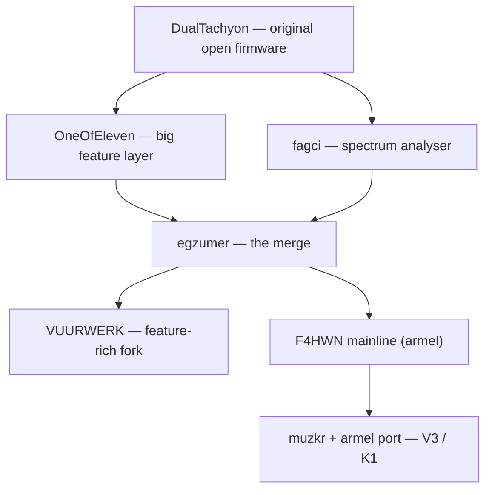
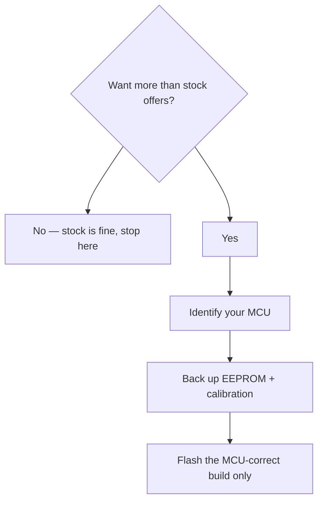
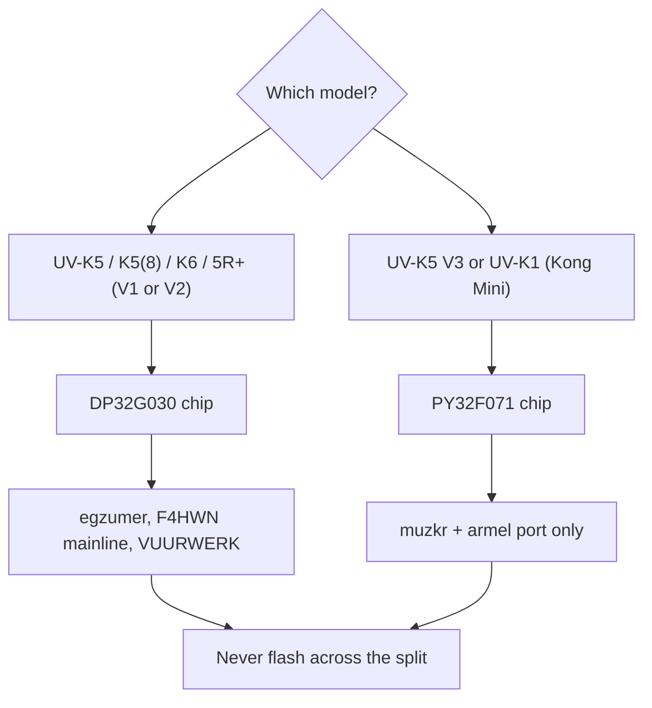

# Custom firmware: the ecosystem and which radio you have

The Quansheng UV-K5 is an ordinary budget handheld with an extraordinary second life. Because a small band of developers reverse-engineered its software and published the result, you can replace the firmware that runs the radio — the program burned into its chip at the factory — with community-written code that turns the same hardware into a pocket spectrum analyser, a single-sideband receiver and a far cleverer scanner. This page is the gateway to that world. It explains why the custom firmware exists, draws the family tree so the names stop being a blur, weighs honestly what you gain against what you risk, and — most importantly of all — teaches you to identify exactly which radio you are holding **before** you touch a flasher. Get that last part wrong and you can turn a working radio into a paperweight, so we will spend real time on it.

## Why custom firmware exists at all

Most radios are sealed boxes: the manufacturer writes the software, locks it away, and that is what you live with for the life of the set. The UV-K5 is different for two reasons, and both are worth understanding.

The first is the hardware. Inside the radio sits a cheap, capable pairing: a small ARM microcontroller (the "MCU" — the little computer that runs the radio's menus and logic) driving a **BK4819** radio-on-a-chip that does the actual receiving and transmitting. The BK4819 is a remarkably flexible part. It can be told to demodulate FM, AM and — with the right code — single sideband (SSB); it can report signal strength, noise and other measurements back to the MCU many times a second. The factory firmware uses only a slice of what the chip can do. All that unused capability is what the community learned to unlock.

The second reason is openness. In 2023 a developer known as **DualTachyon** published a clean, open-source reimplementation of the UV-K5's firmware — a from-scratch program that behaves like the original but whose source code anyone can read, change and rebuild. That single act is the seed of everything that follows. Because the code is open (under permissive licences), dozens of people could pile improvements on top of it, share them freely, and fork one another's work. A budget radio with an open software platform and a huge, curious owner base is a rare thing, and the result is one of the liveliest firmware ecosystems in amateur radio.

None of this changes the radio's physics. The front-end filtering is still cheap and broad, so the set still [overloads in strong RF](outpost:entry/logbook73.handbook/overload-and-ghost-signals) and the transmitter is still a modest budget transmitter. Firmware is software, not a new radio — it can make the hardware _cleverer_, never _better built_. Keep that line clear in your head and the rest of this section makes sense.

## The family tree

Newcomers meet a wall of names — egzumer, F4HWN, VUURWERK, fagci, OneOfEleven — with no sense of how they relate. They are not rivals shouting past each other; they are a single lineage, each fork building on the one before. Here is the shape of it.

Reading it top to bottom:

- **DualTachyon** wrote the open foundation everything else stands on.
- **OneOfEleven** layered on a huge set of practical improvements — the "AM fix" that stops strong AM signals swamping the receiver, an S-meter, faster scanning, on-radio channel-name editing, configurable keys.
- **fagci** contributed the full-screen **spectrum analyser** (a band scope that sweeps a range of frequencies and draws the activity) and the groundwork for SSB receive.
- **egzumer** merged OneOfEleven's feature layer with fagci's spectrum analyser, added SSB/USB receive into the normal interface, tidied the menus, and became the **de-facto community standard**. Most people who "put custom firmware on a UV-K5" are running egzumer or one of its children.
- **F4HWN** (by the operator armel) forks egzumer and adds a polished suite of its own settings — a refined power ladder, an IARU-standard S-meter, up to 24 named scan lists, extra screen layouts. The **mainline** F4HWN is still the original-generation radio.
- The **muzkr + armel port** takes F4HWN and re-targets it at the _newer_ hardware (the UV-K5 V3 and UV-K1). This matters enormously and we return to it below.
- **VUURWERK** is a separate feature-rich fork of egzumer, focused on real-time "closed-loop" reception smarts — a voice-seeking spectrum, adaptive squelch and gain, and a polished transmit chain.

Each of these has its own page in this guide ([egzumer](outpost:entry/logbook73.guide.uv-k5/firmware-egzumer), [F4HWN](outpost:entry/logbook73.guide.uv-k5/firmware-f4hwn), [VUURWERK](outpost:entry/logbook73.guide.uv-k5/firmware-vuurwerk)); the [choosing](outpost:entry/logbook73.guide.uv-k5/firmware-choosing) page helps you pick. Here we stay at the level of the map.

## What you actually gain

Why bother at all? Because custom firmware turns a two-band FM handheld into something markedly more capable as a _receiver_ and a much nicer radio to operate. The common wins, all inherited or extended across the family:

- **A spectrum analyser / band scope.** A full-screen sweep of a frequency range, drawing bars where there is activity — you _see_ the band instead of tuning blind. It is the single most-loved feature and a genuine taste of [software-defined radio](outpost:entry/logbook73.handbook/software-defined-radio) on a pocket set. Launched with `F` + `5` on every firmware here.
- **SSB / USB receive.** Stock firmware does FM and AM only. egzumer and its children add upper-sideband demodulation, so you can _listen_ to the SSB voice that fills the [HF](outpost:entry/logbook73.handbook/hf) and VHF weak-signal segments. (Receive only — the radio still cannot _transmit_ SSB.)
- **Better AM.** The "AM fix" dynamically manages the receiver's front-end gain so a strong AM signal — an airband transmission, say — no longer saturates and distorts. It is on by default in the F4HWN builds and a menu toggle in egzumer.
- **Smarter, faster [scanning](outpost:entry/logbook73.guide.uv-k5/scanning).** More scan lists (two in egzumer, up to twenty-four named lists in F4HWN), quicker sweeps, and the ability to jump straight to a list.
- **A proper S-meter.** A real signal-strength bar graph in place of the stock radio's crude indication — F4HWN's is calibrated to the IARU standard.
- **Configurable keys.** The two side buttons (and the long-press of the MENU key) become assignable to whatever you use most — monitor, scan, flashlight, spectrum, VFO switch.
- **Quality-of-life polish.** Battery percentage and voltage on the status bar, backlight dimming, on-radio channel-name editing, and much more.

The [receive-everything](outpost:entry/logbook73.guide.uv-k5/receive-everything) page shows these features earning their keep. In short: you keep the radio's cheap ubiquity and gain a receiver and a user interface that punch far above the price.

## What you risk

This is not free. Flashing rewrites the program that makes the radio boot, and four honest risks come with it.

**Bricking — the big one.** "Bricking" means leaving the radio unable to start, as useful as a brick. The overwhelming cause is flashing firmware built for the _wrong chip_ — the subject of the whole next section. A wrong-MCU flash, or an interrupted write (cable pulled, battery removed, PC asleep mid-flash), can corrupt the radio. Most bad flashes are recoverable by re-entering flash mode and rewriting a correct image, because the bootloader usually survives — but "usually" is not "always," and the firmware authors themselves warn, in plain words, that in the worst case "you'd need to buy another radio."

**Losing calibration.** Every UV-K5 is individually calibrated at the factory — its per-band transmit power, frequency trimming and metering — and those numbers live in a small memory chip (the EEPROM) unique to _your_ radio. Quansheng does not publish them, and there is no clean factory restore. A botched flash or a careless memory write can wipe them, after which transmit power and metering read wrong. The fix is prevention: **back up the EEPROM and calibration before you flash anything.** The [flashing page](outpost:entry/logbook73.guide.uv-k5/firmware-flashing) walks through exactly how.

**Warranty.** Flashing unofficial firmware may affect or void the seller's or manufacturer's warranty; check the terms that apply to your purchase before proceeding.

**Legal responsibility stays with you.** Custom firmware can _unlock transmit outside_ the amateur bands — wide receive from tens of MHz upward, plus hidden menus that enable transmit on ranges the radio was never type-approved for. That is a _capability_, not a _permission_. You may only transmit where your licence and national allocation permit, at permitted power; transmitting on airband, marine, public-safety or PMR channels is illegal and can cause dangerous interference, whatever the radio can technically do. Your national regulator (Ofcom in the UK, the FCC in the US, and their equivalents elsewhere) sets those limits — see [Getting Licensed](outpost:entry/logbook73.handbook/getting-licensed). Keep transmit inside your [licence conditions](outpost:entry/logbook73.handbook/getting-licensed), always.

So the sane decision flow before you go further looks like this:

## Which radio do you actually have? The MCU split

This is the most important section on the page, so read it slowly. **The UV-K5 family is split across two different microcontrollers, and firmware built for one will not run on the other — flashing the wrong one can brick the radio.** Get this right and everything else is straightforward.

The two families are:

- **DP32G030** — the _original_ generation. This ARM Cortex-M0+ chip powers the classic **UV-K5**, the **UV-K5(8)** / **UV-K6**, and the **UV-5R Plus** (hardware V1 and V2). These share one architecture and run the entire classic firmware library: egzumer, mainline F4HWN, VUURWERK, fagci, IJV and the rest.
- **PY32F071** — the _newer_ generation. This different chip (from Puya) powers the **UV-K5 V3** and the compact **UV-K1** ("Kong Mini"). Moving to it forced the developers to rewrite the low-level drivers, so these radios need their _own_ firmware line — the **muzkr + armel PY32F071 port** of F4HWN — and their own flashing tool.

**How do you tell which you have?** In order of reliability:

1. **The model name is your first clue.** A radio sold and marketed as **"V3"** or as a **UV-K1 / Kong Mini** is the PY32F071 generation. Anything sold plainly as UV-K5, UV-K5(8), UV-K6 or UV-5R Plus (without a "V3" flag) is almost certainly the DP32G030 generation.
2. **Read the board label.** Remove the battery and look at the printed circuit board: later revisions are marked with their version. In VUURWERK's own words, an _unmarked_ board is the original V1; a board printed "V2" or "V3" is the newer revision. This is a solid check, but exact markings vary — do not treat a single visual cue as gospel.
3. **Let a modern tool identify it.** Some flashing tools read the board revision for you and refuse mismatched combinations — knoinok's `quansheng_toolkit`, for instance, has an "anti-brick allowlist" that blocks incompatible firmware/MCU pairs. Using a tool that checks is the safest path of all.

Two honest cautions, because the community's own reports are not perfectly tidy:

- **Late UV-K5(8) units.** Some later-production UV-K5(8) sets are reported to have shipped with _different_ silicon (a PY32-family part was discussed in the community), which broke firmware compatibility for those specific radios. If you have a late UV-K5(8), verify the exact chip before flashing rather than assuming it is DP32G030. Check the current release notes and community wiki.
- **Version terminology differs between projects.** VUURWERK's documentation, for example, labels the boards V1 / V2 / V3 and supports **only V1 (DP32G030)** — it treats V2 and V3 as unsupported. egzumer and mainline F4HWN target the DP32G030 boards (their V1/V2), and the separate port covers the PY32F071 V3/K1. When a firmware's own page names the versions it supports, trust _that_ page over any general rule, and match it to the chip, not just the label.

The rule to carry away, in one sentence: **confirm your MCU first, download only firmware built for that MCU, and if you are ever unsure, do not flash.** When in doubt, back up and stop.

## The three firmwares at a glance

Detail lives on each firmware's own page; this table is the orientation. All three descend from egzumer, so they share the spectrum analyser, AM fix, SSB/USB receive and configurable keys — the differences are in emphasis, polish and, crucially, which radios they run on.

|                      | **egzumer**                                                                                         | **F4HWN** (Fusion)                                                                                                                 | **VUURWERK**                                                                               |
| -------------------- | --------------------------------------------------------------------------------------------------- | ---------------------------------------------------------------------------------------------------------------------------------- | ------------------------------------------------------------------------------------------ |
| **Based on**         | Merge of OneOfEleven + fagci                                                                        | Fork of egzumer                                                                                                                    | Fork of egzumer                                                                            |
| **Runs on**          | DP32G030 (UV-K5/K5(8)/K6/5R+ V1/V2)                                                                 | Mainline: DP32G030 V1/V2. **Port** (muzkr+armel): PY32F071 V3/K1                                                                   | DP32G030 **UV-K5 V1 only** (per its README)                                                |
| **Best known for**   | The community-standard base; spectrum analyser, SSB/USB, AM fix, dual scan lists, configurable keys | Polished `Set*` menu suite, refined power ladder, IARU S-meter, up to 24 named scan lists, screen modes; the _only_ route to V3/K1 | Closed-loop RX smarts: voice-seeking spectrum, adaptive squelch and gain, refined TX chain |
| **Good if you want** | A sensible, well-documented default that most guides assume                                         | Feature depth and per-model polish — or you own a V3/K1                                                                            | The cleverest receiver behaviour on an original UV-K5 V1                                   |
| **Note**             | Where most people start                                                                             | Version numbers differ between mainline and the port — don't cross-reference them                                                  | Tight flash budget; V1-only, newest of the three                                           |

If you are not sure which to pick, start with egzumer on a DP32G030 radio; it is the base the others assume, and the [choosing](outpost:entry/logbook73.guide.uv-k5/firmware-choosing) page walks through the trade-offs.

## Try it yourself

You do not need to flash anything to start learning — in fact, the smartest first step is entirely non-destructive:

1. **Identify your radio without opening it.** Look at how it was sold and what the case says: is it a plain UV-K5 / K6 / 5R Plus, or is it flagged "V3" or a UV-K1 "Kong Mini"? Write down your answer: **DP32G030** or **PY32F071**.
2. **Confirm by the board label.** Power off, remove the battery, and read the printed board. Note whether it is unmarked or stamped V2 / V3. Does it agree with step 1? If the two clues disagree, treat that as a signal to slow down and verify with a tool before flashing.
3. **Match a firmware to your finding.** From the table above, list which firmwares your radio _could_ run — and cross off, out loud, the ones it must never receive. A DP32G030 owner should be able to say "egzumer, mainline F4HWN and VUURWERK are candidates; the PY32F071 port is not."

Doing this once, calmly, with a working radio in your hand, builds exactly the habit that keeps radios un-bricked: **identify, then match, then flash — never the other way round.**

## Key takeaways

- Custom firmware exists because DualTachyon open-sourced the UV-K5's software and the flexible **BK4819** chip had unused capability to unlock — it makes the radio _cleverer_, never better built; the cheap front end and modest transmitter are unchanged.
- The names are one family tree, not rivals: **DualTachyon → OneOfEleven + fagci → egzumer**, then **F4HWN** and **VUURWERK** as forks, and a **muzkr + armel port** re-targeting F4HWN at newer hardware.
- You gain a spectrum analyser, SSB/USB receive, better AM, smarter scanning, a real S-meter and configurable keys — a genuinely more capable receiver and a nicer radio to operate.
- The real risks are bricking (mostly wrong-MCU flashes), losing your unique factory calibration, voided warranty, and the legal duty — always yours — to transmit only within your [licence conditions](outpost:entry/logbook73.handbook/getting-licensed).
- **The single most important fact:** the family splits by chip. **DP32G030** = UV-K5/K5(8)/K6/5R+ (V1/V2); **PY32F071** = UV-K5 V3 / UV-K1. Firmware is _not_ interchangeable across that line, and flashing the wrong side can brick the radio.
- Identify your MCU by model name, board label and — best of all — a tool that checks; watch for late UV-K5(8) units with different silicon, trust each firmware's own version notes, and **if in doubt, do not flash**.

With your radio identified and a firmware in mind, the next step is doing it safely — back up first, enter flash mode, and write the correct image: [Flashing: Backups, Bootloader Mode & Doing It Safely](outpost:entry/logbook73.guide.uv-k5/firmware-flashing).
