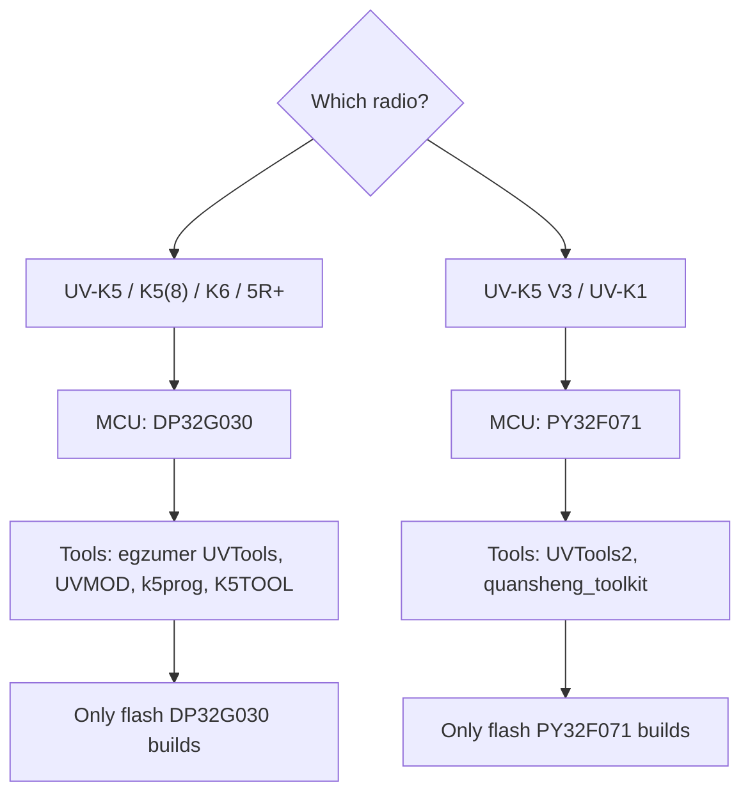
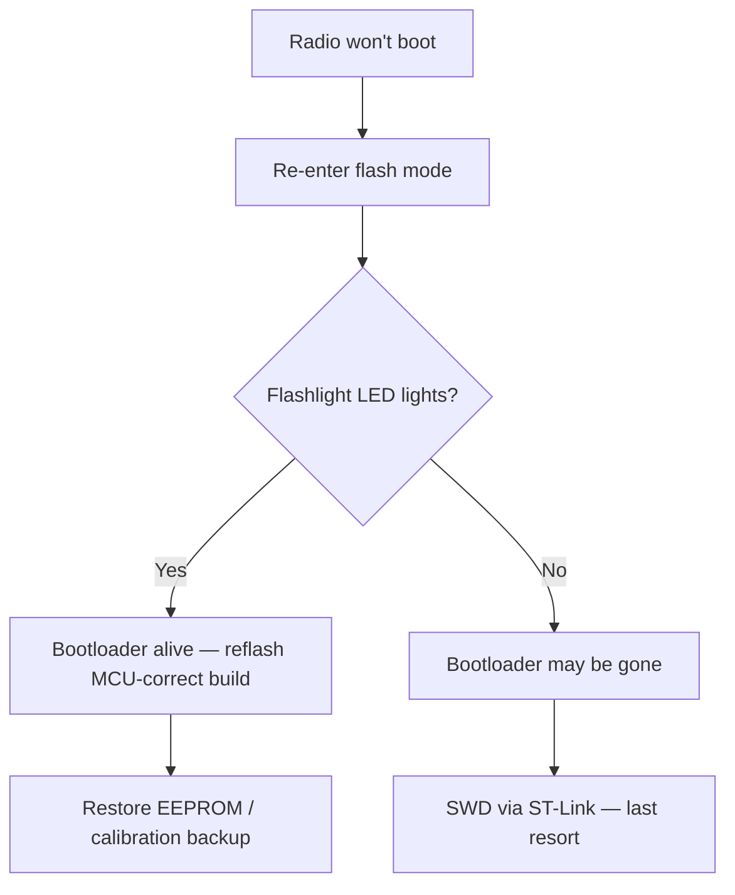

# Flashing safely: tools, backups and unbricking

Flashing custom firmware onto a UV-K5 is one of the most rewarding afternoons in cheap-radio ownership — and one of the few where a wrong click can leave you holding a paperweight. The good news is that every serious mistake is avoidable with two habits: match the firmware to your radio's processor, and take a backup before you write a single byte. This page walks you through the tools, the safe order of operations, and how to talk a "dead" radio back to life if things go sideways.

None of this is difficult. It is just unforgiving of guesswork, so we will go slowly and explain each step rather than hand you a recipe to follow blind.

## First, the one rule that prevents bricks

Before you touch a flasher, you must know which chip is inside your radio, because the UV-K5 family is split across two entirely different microcontrollers — the small "brain" that runs the firmware — and **firmware built for one cannot run on the other**. Flash the wrong one and, at best, nothing happens; at worst you corrupt the part of the radio that lets you flash at all.

The split is clean and easy to remember:

| Radio                     | MCU (the processor) | Firmware & tool family                          |
| ------------------------- | ------------------- | ----------------------------------------------- |
| UV-K5 (original / V1, V2) | `DP32G030`          | DP32G030 builds — egzumer, F4HWN, VUURWERK, IJV |
| UV-K5(8) / UV-K6          | `DP32G030`          | Same DP32G030 builds                            |
| UV-5R Plus                | `DP32G030`          | Same DP32G030 builds                            |
| UV-K5 V3                  | `PY32F071`          | PY32F071 builds only (armel / F4HWN fork)       |
| UV-K1 (Kong Mini)         | `PY32F071`          | PY32F071 builds only                            |

The original trio — `UV-K5`, `UV-K5(8)`/`UV-K6` and `UV-5R Plus` — all use the Puya-style `DP32G030` (an ARM Cortex-M0+ with roughly 64 KB of program flash and 8 KB of EEPROM) paired with the BK4819 radio chip. They share one hardware architecture and run the same enormous library of custom firmware. The newer `UV-K5 V3` and the compact `UV-K1` moved to a different processor, the `PY32F071`. That change forced the firmware authors to rewrite the low-level drivers, so those two need their own firmware line and their own tools.

One caution to flag before you commit: some **late-production `UV-K5(8)` v2.0 units** reportedly shipped with different silicon (a `PY32F030` was discussed in the community), which broke firmware compatibility for those specific radios. This is community-sourced rather than confirmed by Quansheng, so if you have a recent K5(8), verify the exact chip against a current community thread before flashing — don't assume it is a DP32G030 just because the box says K5(8).

## The toolbox

You do not need all of these. You need the cable, the driver, one flasher for your MCU, and one EEPROM tool for the backup. Here is the whole ecosystem so you can see where each piece fits.

| Tool                        | Platform                                  | What it's for                                                                                                                           | Where                                  |
| --------------------------- | ----------------------------------------- | --------------------------------------------------------------------------------------------------------------------------------------- | -------------------------------------- |
| Quansheng OEM flasher       | Windows                                   | Writes **official** stock firmware; the safe baseline path. V3/K1 use Quansheng's newer Radio-Manager-style updater with auto-detection | `en.qsfj.com/support/downloads`        |
| egzumer UVTools             | Web (Chromium: Chrome/Edge/Opera)         | The mainstream **DP32G030** browser flasher — pick a build, click "FLASH WITH A BROWSER", choose the COM port                           | `egzumer.github.io/uvtools/`           |
| UVTools2 (armel / F4HWN)    | Web (Chrome/Edge/Opera, or Firefox 151+)  | The **PY32F071** equivalent: firmware flasher _and_ calibration manager for V3/K1 — extracts and restores calibration                   | `armel.github.io/uvtools2/`            |
| UVMOD (whosmatt)            | Web (Chromium)                            | Client-side **patcher + flasher** — applies selectable mods to _stock_ firmware for K5/K6/K5(8)/5R+                                     | `whosmatt.github.io/uvmod/`            |
| k5prog (sq5bpf)             | Linux (tested), macOS, Windows via Cygwin | Command-line **EEPROM + flash** programmer; the classic tool for reading and backing up EEPROM (`-r`)                                   | `github.com/sq5bpf/k5prog`             |
| k5prog-win (OneOfEleven)    | Windows (GUI)                             | A point-and-click port of k5prog for EEPROM read/write/backup without the command line                                                  | `github.com/OneOfEleven/k5prog-win`    |
| K5TOOL (qrp73)              | Cross-platform (Python)                   | EEPROM read/write and flashing; can dump _just_ the calibration block to a small file                                                   | `github.com/qrp73/K5TOOL`              |
| quansheng_toolkit (knoinok) | Windows / macOS / Linux                   | Modern **PY32F071** toolkit — calibration dump/verify/restore (byte-for-byte) and DFU flashing with an "anti-brick allowlist"           | `github.com/knoinok/quansheng_toolkit` |
| CHIRP                       | Windows / macOS / Linux                   | **Not a firmware flasher** — this programmes your channels _after_ flashing                                                             | `chirpmyradio.com`                     |

A word on the stripped clone: a fork of UVMOD called RE3CON removed the safety warnings from the tool. The original authors advise against it, and so do we — those warnings exist precisely because this is the one step where a mistake costs a radio.

### The cable and driver

Every serial path — OEM, browser or command line — talks to the radio through a **Baofeng/Kenwood-style USB programming cable** plugged into the radio's speaker/mic jack. Those cables almost always use a `CH340` USB-to-serial chip, so your computer needs the CH340 driver installed before the radio will appear as a COM port. If the flasher can't find a port, the driver is the first thing to check, followed by the cable itself: seat it _firmly_ — a loose plug in that jack is a leading cause of failed, half-finished writes.

One more gotcha for the web flashers: they use the **Web Serial API**, which only exists in Chromium browsers (Chrome, Edge, Opera) — with the one exception that UVTools2 also works in Firefox 151 and later. Safari and older Firefox simply will not connect, and the tool won't always tell you why.

## Entering flash mode

On a `DP32G030` radio (the original K5/K6/K5(8)/5R+), you put the radio into its **bootloader**, or flash mode, by hand:

1. Turn the radio **off**.
2. Press and **hold the PTT** (the press-to-talk key on the side).
3. While still holding PTT, turn the radio **on**.
4. The **flashlight LED lights up**. That glow is your confirmation you are in flash mode.

Do this before or as you connect the cable, then open the flasher and select the port. During the write itself the **top LED flashes** — that is the radio taking data, and it is the moment you must not interrupt.

The newer `PY32F071` radios (V3 and K1) don't use the PTT trick. They rely on their tool's **auto-detection** instead, so follow the on-screen prompts in UVTools2, quansheng_toolkit, or Quansheng's Radio-Manager updater rather than trying to force a bootloader by hand.

## Back up your calibration — this is the step people skip and regret

Here is the single most important habit on this page, and the one that separates a confident modder from a nervous one.

> **Every UV-K5 is individually factory-calibrated, and that calibration lives in the EEPROM.** It holds your radio's own transmit-power settings per band, plus frequency, signal-strength (RSSI), battery and crystal trimming — the small per-unit corrections that make _your_ set read and transmit accurately. Quansheng does **not** publish it, and there is **no clean factory restore**. Overwrite or erase it and your TX power and metering can be wrong with no easy way back. So dump it to a file **before you flash anything**, and keep that file somewhere safe off the radio.

The calibration sits in the region of EEPROM above roughly address `0x1d00`, with the main calibration block near `0x1e00` (about `0x200` bytes). You don't need to memorise those numbers — the tools know where it is — but they explain _why_ a careful EEPROM tool treats that area differently.

**On DP32G030 radios**, dump the whole EEPROM with k5prog's read flag:

- `k5prog -r` reads the entire EEPROM out to a `.raw` file. This is your full backup.
- k5prog-win does the same with a GUI if you prefer buttons to a terminal.
- K5TOOL can dump _just_ the calibration block — read `0x200` bytes at `0x1e00` into `eeprom-calib.raw` — for a targeted safety copy alongside the full dump.

**On PY32F071 radios (V3 / K1)**, use UVTools2 or knoinok's quansheng_toolkit — both have explicit calibration dump, verify and restore. quansheng_toolkit even does a byte-for-byte verification, so you _know_ the backup matches the radio.

### Writing EEPROM safely: -W vs -w vs -B

If you later write EEPROM back (not the same as flashing firmware — more on that below), k5prog gives you three modes with very different blast radii. Learn the difference before you type one:

| Flag | What it writes                                                                 | Use it?                                                       |
| ---- | ------------------------------------------------------------------------------ | ------------------------------------------------------------- |
| `-W` | Most of the EEPROM but **deliberately skips** the suspected calibration region | The safe default — protects your calibration                  |
| `-w` | Writes like the OEM software                                                   | Fine for normal channel/config data                           |
| `-B` | Writes **all** of it, calibration included                                     | Avoid — the author literally calls this "brick my radio" mode |

The takeaway: prefer `-W`, which leaves your calibration untouched. Reserve `-w` for when you specifically mean to mimic the stock tool, and treat `-B` as a loaded gun — only for someone who knows exactly which bytes they are replacing and why.

One reassurance so you don't over-worry: **flashing the firmware** (the program code) is generally a _separate_ operation from the calibration EEPROM, and a normal, correct flash usually leaves calibration intact. The danger cases are a **wrong-MCU flash**, an **interrupted write**, or an explicit **EEPROM erase** — any of which can still wipe it. That is exactly why the rule is "back up first, always," not "back up if you feel like it."

## The flash, start to finish

With the concepts in hand, here is the whole procedure in order. Read it once through before you begin.

1. **Identify the MCU.** DP32G030 (K5/K6/K5(8)/5R+) or PY32F071 (V3/K1). Everything else depends on this. Check late-production K5(8) units individually.
2. **Install the CH340 driver** and connect a Baofeng/Kenwood USB programming cable, seated firmly in the speaker/mic jack.
3. **Back up EEPROM** — full dump _and_, ideally, the calibration block — to a file kept off the radio. `k5prog -r` (DP32G030) or UVTools2 / quansheng_toolkit (PY32F071).
4. **Enter flash mode.** DP32G030: hold PTT while powering on, look for the flashlight LED. V3/K1: let the tool auto-detect.
5. **Open the correct flasher** and select the COM/serial port. Chromium browser for the web tools (Firefox 151+ also works for UVTools2).
6. **Choose a firmware build that matches your MCU**, then start the write. The top LED flashes while it works.
7. **Do not interrupt.** No unplugging the cable, no pulling the battery, no letting the PC sleep, no powering anything off mid-write.
8. **Let the radio reboot.** Restore calibration if the process touched it.
9. **Programme channels with CHIRP**, then verify TX and RX behave correctly against a dummy load or a known reference before you use it for real.

### Choosing the right .bin

"Matches your MCU" is the headline, but two smaller mismatches trip people up too. A **patcher** like UVMOD targets a _specific stock firmware version_ — feed it the wrong stock base and the patch may not apply cleanly. And some firmwares come in variants for different hardware states; IJV, for instance, ships `firmware_IJV_V3.bin` for a standard 200-channel radio and `firmware_IJV_VX3.bin` for radios with an EEPROM-expansion hardware mod that unlocks 999 channels. Read the release notes for the exact build you are about to write, and when a project offers both a browser-flash button and a downloadable `.bin`, either is fine — just make sure it is the one for _your_ MCU and _your_ hardware.

## Unbricking: talking a dead radio back

Take a breath — a UV-K5 that "won't boot" is very often not dead at all. The **bootloader** lives independently of the main app, so a botched _app_ flash usually leaves the flashing mechanism itself intact. That means your first move is almost always to just try again.

**The normal recovery** (DP32G030): put the radio back into flash mode — hold PTT, power on, watch for the flashlight LED. If that LED lights, the bootloader is alive and you can simply reconnect and **re-flash a known-good, MCU-correct build**. Afterwards, restore your EEPROM/calibration backup if it was affected. If your own EEPROM is trashed and you have no backup, k5prog ships a reference `uvk5_original_eeprom.raw` that can _resurrect_ a radio to a working state — but understand it is a generic image, **not your unit's own calibration**, so metering and TX power may be off until you re-calibrate.

**Prevention beats recovery**, and the newer tools help: knoinok's quansheng_toolkit uses an **anti-brick allowlist** that refuses to write incompatible firmware/MCU combinations in the first place — a genuine safety net for the V3/K1 world.

**The last resort** is SWD. If the _bootloader itself_ is gone — say, an interrupted bootloader write or a wrong-MCU write that reached that area — the serial cable can no longer recover the radio, because there is nothing left to talk to. The community's hardware fallback is to open the radio, attach a generic ST-Link programmer to the MCU's SWD pads, and reflash the bootloader directly. This works, but it needs basic soldering/SWD knowledge, and the specifics — pinout and the exact recovery images — **differ between the DP32G030 and the PY32F071**. Treat this as expert territory and verify every detail against a current community guide for _your_ MCU before you pick up an iron.

## A note on staying legal

Flashing doesn't just add features — some custom builds and patches can **unlock transmit outside** the radio's designed 2 m/70 cm ranges. That is a _capability_, not a _permission_. You may only transmit on frequencies your licence and national allocation permit, at permitted power; keying up on air-band, marine, public-safety or PMR channels is illegal and can cause dangerous interference, whatever the radio is technically able to do. Receiving is more permissive in many countries but not universally — some restrict listening to certain services. When in doubt, your national regulator (Ofcom in the UK, the FCC in the US, and their equivalents elsewhere) is the authority, not the firmware. Operate within your own [licence conditions](outpost:entry/logbook73.handbook/getting-licensed) and local law.

## Try it yourself

You can do the most valuable step **without flashing anything** — take the backup, today, while your radio is still happily stock:

1. Install the CH340 driver and connect your programming cable.
2. On a DP32G030 radio, run `k5prog -r` (or open k5prog-win) and dump the full EEPROM to a file named with your radio and the date, e.g. `uvk5_mine_2026-07-12.raw`. On a V3/K1, use UVTools2 or quansheng_toolkit's calibration export.
3. Copy that file somewhere off the radio — a cloud folder, a second drive — and confirm it opened without error (quansheng_toolkit's byte-for-byte verify is ideal here).

That single file is your insurance policy. Every future flash becomes low-stakes once you know your calibration is safely in your pocket.

## Key takeaways

- **Match firmware to the MCU, always.** DP32G030 (K5/K6/K5(8)/5R+) and PY32F071 (V3/K1) are different processors with incompatible firmware; crossing them is the number-one brick risk. Verify late-production K5(8) silicon individually.
- **Back up your EEPROM before you flash** — the per-unit factory calibration lives there, Quansheng won't give it back, and there's no clean factory restore. `k5prog -r` on DP32G030; UVTools2 or quansheng_toolkit on V3/K1.
- **Pick the right tool for the chip**: egzumer UVTools / UVMOD / k5prog for DP32G030; UVTools2 / quansheng_toolkit for PY32F071. Web flashers need a Chromium browser (or Firefox 151+ for UVTools2), a CH340 driver, and a firmly-seated cable.
- **Enter flash mode** on DP32G030 by holding PTT while powering on until the flashlight lights; never interrupt the top-LED flashing during a write.
- **When writing EEPROM, prefer `k5prog -W`** (skips calibration); avoid `-B`, the author's own "brick my radio" mode.
- **Most "bricks" recover**: re-enter flash mode and reflash a known-good, MCU-correct build; SWD via an ST-Link is a genuine but expert-only last resort — verify the pinout for your MCU first.
- **Unlocked out-of-band TX is a capability, not a permission** — transmit only within your licence and national allocation.

With your backup safe and the rules straight, you're ready to pick a build and do it for real. We'll start with the most popular one — [Firmware Focus: egzumer](outpost:entry/logbook73.guide.uv-k5/firmware-egzumer).
