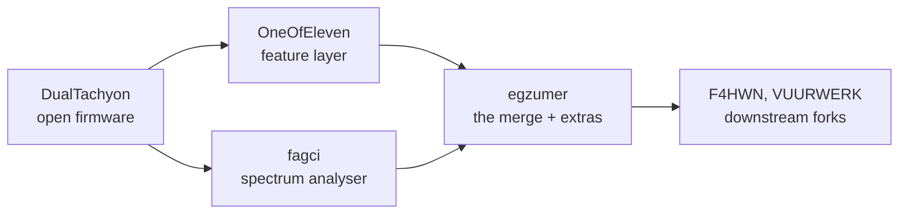
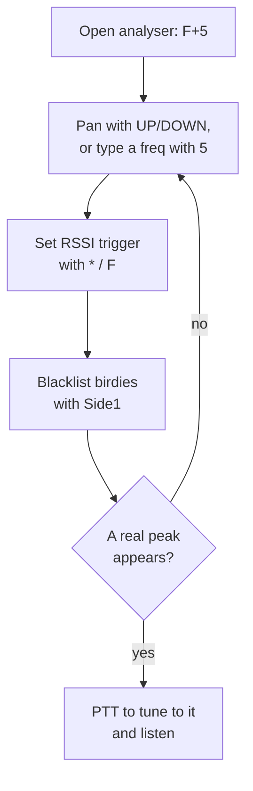
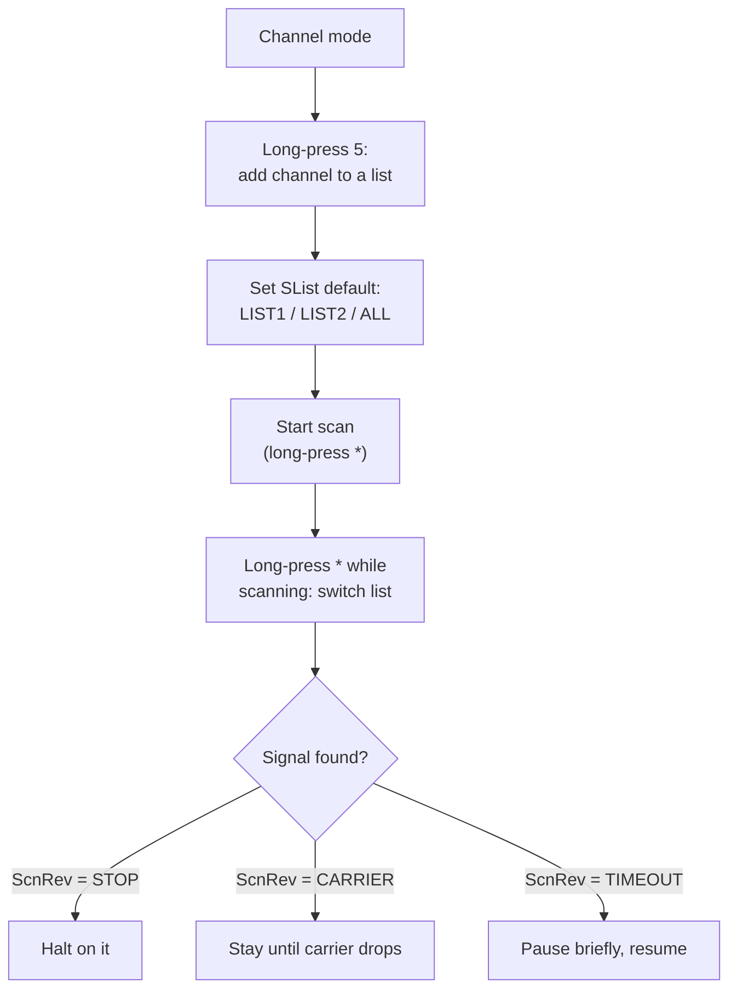
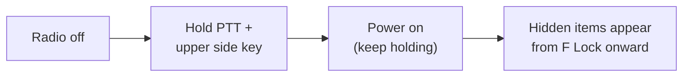

# Egzumer: the spectrum-analyser firmware

The stock UV-K5 is a competent little FM handheld, but the reason people talk about this budget radio — the reason it became a hobby in its own right — is the custom firmware. Egzumer is the one most people mean when they say "put the good firmware on it": it turns the radio into a pocket spectrum analyser, teaches it to hear single sideband, rescues the airband audio, and lets you remap the buttons to your own taste. This chapter is the narrative tour — what egzumer adds, why each piece matters, and how to actually drive it — so you know what you are getting into before you flash. For the exhaustive item-by-item menu table, we hand you off at the end to a dedicated reference page.

Before anything else, one hard rule that will save your radio. Egzumer is built **only** for the original UV-K5 generation — the UV-K5, UV-K5(8), UV-K6 and UV-5R class of set, the ones whose brain is a chip called the **DP32G030** (an ARM Cortex-M0). It is **not** for the newer **UV-K5 V3** or the **UV-K1** ("Kong Mini"), which use a completely different chip, the **PY32F071**. The two chips need different low-level drivers, so flashing an egzumer image onto a V3 or a K1 can brick the radio — leave it a dead brick that will not power on. If your box or listing says "V3" or "K1", stop here and read [Choosing your firmware](outpost:entry/logbook73.guide.uv-k5/firmware-choosing), which points you at the right PY32F071 port. Everything below assumes a V1/V2-generation DP32G030 set.

## Where egzumer came from

Egzumer is not one person's invention out of thin air — it is the top of a three-generation family tree, and knowing the shape of it helps you understand why the firmware is so complete.

It started when **DualTachyon** wrote a clean, open re-implementation of the radio's firmware from scratch — a legal, from-nothing rewrite that anyone could read and build on. **OneOfEleven** then piled a huge layer of features on top: the AM audio fix, a proper S-meter, faster scanning, on-radio channel naming, remappable keys. Separately, **fagci** wrote the spectrum-analyser modification and the beginnings of single-sideband receive. **Egzumer** merged those two branches — OneOfEleven's feature layer and fagci's spectrum scope — added his own polish (single sideband in the everyday interface, backlight dimming, battery calibration by pack type, more configurable buttons, better tone scanning, a display-interference crash fix), and shipped the result. That merge became the de-facto community standard, and most of the _other_ firmwares you will hear about — including [F4HWN](outpost:entry/logbook73.guide.uv-k5/firmware-f4hwn) and [VUURWERK](outpost:entry/logbook73.guide.uv-k5/firmware-vuurwerk) — are themselves forks of egzumer. If you learn egzumer, you have most of the map for the whole family.

Because flash memory on this chip is tight, egzumer's features are chosen _at build time_: whoever compiles the image switches each one on or off with an `ENABLE_*` flag, trading flash space for capability. So two egzumer builds can differ — one might have single sideband but drop the American weather channels, another the reverse — and because the on-screen menu numbering shifts with whatever is compiled in, the item number for a given setting is not fixed. The [Flashing](outpost:entry/logbook73.guide.uv-k5/firmware-flashing) chapter covers building your own; here we describe the full feature set as if everything is switched on.

## The headline features

### The fagci spectrum analyser

This is the marquee feature — the thing that makes the UV-K5 special. The spectrum analyser turns the whole screen into a **band scope**: instead of listening to one frequency at a time, the radio sweeps rapidly across a range of frequencies and draws a live graph of _how busy_ each one is. Peaks are signals; the flat baseline is quiet air. It is the single cheapest way to _see_ radio activity around you rather than hunting for it blind — a genuine teaching tool for anyone learning what a band actually looks like. If you have read [FFTs and waterfalls](outpost:entry/logbook73.handbook/ffts-and-waterfalls), this is the same idea in your pocket, drawn one sweep at a time.

You open it with `F` + `5` (the same `5` key that reaches the weather channels on stock), or — better — assign it to one of the side keys so it is one press away. Inside the analyser almost every number key does something, and the controls repay a few minutes of practice:

| Key           | What it does in the analyser                                                 |
| ------------- | ---------------------------------------------------------------------------- |
| `UP` / `DOWN` | Move the centre frequency — pan the view left or right                       |
| `5`           | Type a frequency directly to jump the view there                             |
| `1` / `7`     | Increase / decrease the **scan step** (how finely it samples)                |
| `2` / `8`     | Increase / decrease the **cursor step** (how far the marker jumps)           |
| `4`           | Change the number of steps / the width of the swept range                    |
| `3` / `9`     | Raise / lower the **dB scale** — the graph's vertical zoom                   |
| `*` / `F`     | Raise / lower the **RSSI trigger** — the level a peak must reach to count    |
| `0`           | Toggle the demodulation mode (FM / AM / USB)                                 |
| `6`           | Toggle listening bandwidth (wide / narrow)                                   |
| `Side1`       | **Blacklist** the current peak — mute a birdie so it stops halting the sweep |
| `Side2`       | Toggle the backlight                                                         |
| `PTT`         | Switch to "still" mode and tune to the current peak so you can listen        |
| `EXIT`        | Close the analyser                                                           |

The two controls to learn first are the **RSSI trigger** (`*`/`F`) and **blacklist** (`Side1`). RSSI is "received signal strength indication" — the level of what the antenna is hearing at each point on the sweep. The trigger is effectively a squelch for the scope: set it just above the noise floor and the sweep only halts on real signals rather than pausing on every wisp of noise. Blacklist is for the _birdies_ — spurious internal signals the radio generates itself, which show up as persistent peaks that never carry audio. Blacklist the stubborn ones and the sweep stops fighting you. When you spot something interesting, `PTT` drops you onto it in "still" mode so you can listen.

Two honest limits. First, the scope is a _swept_ analyser, not a real-time one: it visits each slice of the range in turn, so a very short-lived transmission between sweeps can be missed. Narrow the range (fewer steps, key `4`) and it revisits each point sooner, at the cost of seeing less band at once — that is the trade you are always making. Second, the UV-K5's front end has no _tuned filtering_ — it is wide open — so on a scope you will see internal birdies and, near strong transmitters, ghost peaks that are not really out there on the air. That is the hardware, not the firmware; the [Overload and ghost signals](outpost:entry/logbook73.handbook/overload-and-ghost-signals) chapter explains why. The blacklist manages the worst offenders, but no firmware can conjure a bandpass filter the radio does not have.

### AM fix — the airband audio rescue

On stock firmware, tuning an [airband](outpost:entry/logbook73.handbook/modulation) AM transmission that is even moderately strong makes the audio distort and break up. AM (amplitude modulation) carries the voice as changes in signal _strength_, so anything that clips the strength mangles the voice. The cause here is that the receiver's front-end amplifier saturates — it is turned up too high for a strong AM signal and clips the peaks. **AM fix** is a piece of code (inherited from OneOfEleven) that continuously and automatically adjusts those front-end gains to keep the AM demodulator out of saturation. It is the single biggest _reception-quality_ improvement in the firmware, and it makes casual airband and shortwave-AM listening genuinely pleasant rather than a chore. It is controlled by the `AM Fix` menu item; leave it on for airband.

There is one caveat worth flagging so it does not confuse you later: **while AM fix is actively working, the on-screen signal-strength reading is not trustworthy**. AM fix is quietly turning the gain up and down, and the RSSI/S-meter reflects that gain juggling rather than the true signal off the air. So do not use the S-meter to compare AM signals — treat it as a rough presence indicator only. And note the honest ceiling: once AM fix has turned the gain all the way down and the signal is _still_ too strong, the audio distorts again, just like stock. It buys you a much wider comfortable range, not an infinite one.

### SSB (single sideband) receive

Egzumer's own signature addition — adapted from fagci's work — is **USB single-sideband receive**. Single sideband is the voice mode of the HF long-distance bands and of weak-signal VHF work; it is a stripped-down cousin of AM that throws away the carrier and one sideband to save power and space, which is why it sounds like nothing on an FM-only radio (a "Donald Duck" garble at best). Egzumer adds a third demodulation mode alongside FM and AM, cycled with the `Demodu` menu item — its choices are `FM` / `AM` / `USB` — or with the assignable **switch demodulation** button.

Set the mode to `USB` and, within the radio's wide receive range and the limits of its modest front end, you can resolve SSB voice — a remarkable trick for a handheld never designed for it. Three honesty notes. It is **receive only** — the UV-K5 cannot _transmit_ SSB, and its transmitter is FM. The audio is passable, not a proper HF rig's: there is no fine "clarifier" tuning, so you nudge the frequency in whole steps to clarify a voice rather than turning a smooth dial — set a small step (say 1 kHz) before you go hunting. And it is USB only; the lower amateur HF bands conventionally use LSB (lower sideband), which the firmware does not offer, so those will sound off-pitch. As a way to _hear_ the SSB portions of the higher bands on modest hardware, though, it is extraordinary.

### Dual scan-lists, fast scan, scan ranges and wide RX

Egzumer keeps the stock idea of **two scan lists** but makes them far easier to live with, and adds a combined view. A **long-press of `5`** assigns the current channel into a scan list on the spot; while a scan is running, a **long-press of `*`** cycles between the lists. Optional **faster channel scanning** speeds the whole thing up (at the cost of a slightly twitchier squelch — a fair trade for most).

Three settings shape scanning, and they are worth knowing by name. `SList` chooses which list scans by default — `LIST1`, `LIST2` or `ALL`. `ScAdd1` / `ScAdd2` are the per-channel toggles that put the current channel into list 1 or list 2 (the long-press `5` shortcut flips these for you). And `ScnRev` — scan resume mode — decides what happens when the scanner finds something: `TIMEOUT` pauses then carries on, `CARRIER` waits for the signal to actually drop before moving, and `STOP` halts dead on the first hit. Pick `CARRIER` for monitoring a conversation, `TIMEOUT` for sweeping a busy list.

Two range features widen the net further. **Scan ranges** lets you sweep a start-to-stop _frequency range_ rather than a list of stored channels — handy for combing an unfamiliar slice of band. **Wide RX** opens the receiver from roughly **18 MHz right up to 1300 MHz**. Bear in mind the radio's front end and antenna are not designed for that whole span, so sensitivity varies wildly and much of it is more curiosity than performance — but it means the spectrum analyser and the receiver can roam far beyond the amateur bands. Full detail on driving all of this is in [Scanning](outpost:entry/logbook73.guide.uv-k5/scanning).

### Configurable side keys and long-press MENU

Stock lets you reprogram the two side keys, but only from a short fixed list and only via software. Egzumer gives you **four independent slots on the radio itself** — a short-press _and_ a long-press action for each of the two side keys — plus a third: an action bound to a **long-press of the MENU key**. Five assignable buttons, in effect, all set from these menu items:

| Menu item | What it sets               |
| --------- | -------------------------- |
| `F1Shrt`  | Side key 1, short press    |
| `F1Long`  | Side key 1, long press     |
| `F2Shrt`  | Side key 2, short press    |
| `F2Long`  | Side key 2, long press     |
| `M Long`  | Long-press of the MENU key |

Each can be set to any action from the same list: `NONE`, `FLASHLIGHT`, `POWER` (cycle TX power), `MONITOR` (hold squelch open), `SCAN`, `VOX`, `ALARM`, `FM RADIO`, `1750HZ` (a repeater tone burst), `LOCK KEYPAD`, `SWITCH VFO` (swap A/B), `VFO/MR` (frequency vs memory mode), `SWITCH DEMODUL` (cycle FM/AM/USB), `BLMIN TMP OFF` (momentarily kill the backlight, e.g. for night observing) and `SPECTRUM`. A sensible starting layout is below in the walkthroughs.

### The finishing touches

The rest of egzumer's headline list is a collection of quality-of-life wins:

- **A real S-meter and bar graphs.** A proper dBm/S-unit RSSI bar, the well-regarded "Piotr022" S-meter styling, plus a **mic-level bar** (`MicBar`) and a TX audio bar so you can see your own modulation while you speak.
- **Battery UX.** Show battery **percentage or voltage** in the status bar (`BatTxt`); **calibrate** the displayed voltage against a meter (`BatCal`); and tell the radio which pack you have — **1600 mAh or 2200 mAh** — with `BatTyp`, so the percentage curve is actually accurate rather than guessing.
- **Backlight control.** Longer timeouts (`BackLt`), dimming with a configurable minimum (`BLMin`) and maximum (`BLMax`) brightness, and control over whether the light comes up on transmit and receive (`BltTRX`).
- **On-radio channel names.** Edit ten-character channel names (`ChName`) directly on the set — no PC needed — and a name-plus-frequency display mode via `ChDisp`.
- **A live DTMF decoder.** `D Live` shows DTMF tones on screen as they arrive — handy for figuring out repeater and system codes.

## How to actually use it

Reading the feature list is one thing; here are four short walkthroughs that turn the highlights into muscle memory.

### Configure the side keys

Do this first — it is what makes the rest one-touch. Open the menu, find `F1Shrt`, and set it. A layout that suits most people:

| Slot     | Action           | Why                                            |
| -------- | ---------------- | ---------------------------------------------- |
| `F1Shrt` | `MONITOR`        | Peek under the squelch for a weak signal       |
| `F1Long` | `FLASHLIGHT`     | The torch, out of the way of an accidental tap |
| `F2Shrt` | `SCAN`           | Start/stop a scan without the menu             |
| `F2Long` | `SPECTRUM`       | The band scope, one long-press away            |
| `M Long` | `SWITCH DEMODUL` | Flip FM/AM/USB without hunting for `Demodu`    |

Now the scope, the scan and the mode switch all live under your thumb, and `MONITOR` on a short press is the single most useful thing a side key can do — hold it to hear what the squelch is hiding.

### Set up the transmit-power ladder

The UV-K5 has three power levels — `LOW`, `MID`, `HIGH` — set per channel (or per VFO) with `TxPwr`. Power is stored _with the channel_, so the habit worth building is: set the right level as you save each channel, not globally. A sensible ladder:

- **`LOW`** for a repeater whose antenna you can nearly see, or any close simplex contact. It sips battery and keeps you off distant users' frequencies.
- **`MID`** as the everyday default for a repeater a town away.
- **`HIGH`** only when you genuinely need to reach — a distant repeater, or a marginal simplex path.

Two practical notes. `HIGH` is roughly 5 W and runs the battery down fastest and the radio warmest, so do not leave it there out of habit. And you can map `POWER` to a side key so you can drop to `LOW` mid-conversation when someone tells you you are full-scale into their receiver. More power is not more range once you are already opening the other end cleanly — see [RF power](outpost:entry/logbook73.handbook/rf-power) for why.

### Use the scan lists

Build two lists that mean something to you — say list 1 for local repeaters, list 2 for simplex and PMR/FRS calling channels. To fill a list: tune or select a channel, then **long-press `5`**; the channel joins the current default list. Set `SList` to `LIST1`, `LIST2` or `ALL` depending on what you want to sweep, set `ScnRev` to `CARRIER` so the radio stays on a live conversation, and start the scan (your `SCAN` side key, or a long-press of `*`). While it runs, **long-press `*`** to jump between lists without stopping. `EXIT` ends the scan and returns you to where you started.

### Drive the spectrum analyser end to end

Open it with `F` + `5` (or your `SPECTRUM` side key). Type a start frequency with `5` — pick a slice you know carries traffic, like your local 2 m repeater outputs. Use `1`/`7` to set the scan step fine enough to separate channels (5 or 6.25 kHz for VHF FM), and `4` to set how wide a range you sweep. Now nudge the RSSI trigger up with `F` until the baseline noise stops halting the sweep, `Side1` any always-there birdie into the blacklist, and watch. When a peak holds, `PTT` drops you onto it to listen; `0` cycles the demod mode if it is an AM or SSB signal; `EXIT` leaves. Five minutes of this teaches you more about your local RF environment than an hour of reading.

## The renamed menu

Egzumer rewrote the menu — reordered it and, to fit long names on a tiny screen (six characters is all the menu column shows), renamed most items to compact mixed-case labels. If you already know the [stock menu](outpost:entry/logbook73.guide.uv-k5/menu-reference), this table maps the highest-value ones so you can find the setting you want under its new name:

| Stock name | Egzumer name | Setting                          |
| ---------- | ------------ | -------------------------------- |
| `TXP`      | `TxPwr`      | TX power Low/Mid/High            |
| `R_DCS`    | `RxDCS`      | Receive DCS code                 |
| `R_CTCS`   | `RxCTCS`     | Receive CTCSS tone               |
| `SFT-D`    | `TxODir`     | Repeater shift direction         |
| `OFFSET`   | `TxOffs`     | Repeater offset frequency        |
| `SCR`      | `Scramb`     | Scrambler (voice inversion)      |
| `BCL`      | `BusyCL`     | Busy-channel lockout             |
| `AM`       | `Demodu`     | Demodulation — now FM/AM/**USB** |
| `MEM-CH`   | `ChSave`     | Save VFO to a channel            |
| `DEL-CH`   | `ChDele`     | Delete a channel                 |
| `MDF`      | `ChDisp`     | Channel display: freq / name     |
| `ABR`      | `BackLt`     | Backlight timeout                |
| `VOL`      | `BatVol`     | Battery voltage display          |
| `AUTOLK`   | `KeyLck`     | Auto keypad lock                 |
| `TOT`      | `TxTOut`     | Transmit time-out timer          |
| `SAVE`     | `BatSav`     | Battery-save ratio               |
| `TDR`      | `RxMode`     | Dual-watch behaviour             |

Two of those are more than a rename. `Demodu` (old `AM`) is now the three-way FM/AM/USB switch that unlocks single sideband. And `RxMode` (old `TDR`) is a proper rethink of dual-watch: its options — `MAIN ONLY`, `DUAL RX RESPOND`, `CROSS BAND`, `MAIN TX DUAL RX` — replace the old A/B toggle, giving cleaner control over which VFO the radio watches and which one it answers on. The genuinely _new_ items with no stock equivalent — `ChName`, the four side-key slots plus `M Long`, `MicBar`, `BatTxt`, `BLMin`/`BLMax`/`BltTRX`, `BatCal`, `BatTyp`, `D Live` and `AM Fix` — are the ones that give the firmware its character. This page is the tour; the full list of all ~60 items, with every value and its exact behaviour, lives on the reference page linked below.

## The hidden menu — handle with care

Egzumer keeps a block of settings **hidden** behind a deliberate unlock, because getting them wrong can put you on the air illegally or, in one case, wipe your radio. To reveal them you power the radio on while holding a key combination.

Hold **PTT and the upper side key together**, then switch the radio on. The extra items appear in the menu, starting with `F Lock`. What is in there:

- **`F Lock`** — the transmit-band lock, chosen from **region profiles** that constrain where the radio will transmit to a legal band plan: `DEFAULT+` (137–174 / 400–470), `FCC HAM` (144–148 / 420–450), `CE HAM` (144–146 / 430–440), `GB HAM` (144–148 / 430–440), two `137-174 / 400-4xx` commercial variants, `DISABLE ALL`, and `UNLOCK ALL`. **Pick the profile that matches your licence and region** — for example `GB HAM` or `CE HAM` in much of ITU Region 1, `FCC HAM` in Region 2. `UNLOCK ALL` (shown as `READ MANUAL`) removes every transmit restriction and, as a safety catch, must be selected and confirmed ten times before it takes effect; only choose it if you genuinely understand the legal implications.
- **`Tx 200` / `Tx 350` / `Tx 500` and `350 En`** — enables for extra transmit and receive bands. Again a licensing hazard: they let the radio key up outside the amateur bands, where you almost certainly have no authority to transmit, and where the transmitter is not designed to work well anyway.
- **`FrCali`** — reference-crystal (frequency) calibration. `BatCal` and `BatTyp` — the battery calibration and pack-type settings — also live in the everyday area but are exposed here too.
- **`ScraEn`** — the global scrambler enable, without which the per-channel `Scramb` does nothing.
- **`Reset`** — a factory reset. `VFO` resets only the VFO settings; `ALL` erases _everything_, including your stored channels.

Two cautions, stated plainly. First, the transmit-band unlocks are a **legal** matter: transmitting outside your [licence conditions](outpost:entry/logbook73.handbook/getting-licensed) is an offence in most countries, and the fact that the firmware _lets_ you does not make it lawful. Keep `F Lock` on a proper region profile. Second, `FrCali` can mistune the radio's reference oscillator if you fiddle with it blindly, throwing every frequency off — leave it at the factory value unless you have a known reference and know exactly what you are doing.

## Honest caveats and limits

Egzumer is superb value, but it is software on cheap hardware, and a few limits are worth carrying with you:

- **The front end is wide open.** No track-tuned bandpass filtering means birdies on the scope, ghost signals near strong transmitters, and AM audio that eventually distorts once AM fix runs out of headroom. This is the radio, not the firmware — see [Overload and ghost signals](outpost:entry/logbook73.handbook/overload-and-ghost-signals).
- **SSB is receive-only, USB-only and coarse.** Great for _hearing_ the higher HF/VHF SSB segments; not a substitute for an HF rig, and off-pitch on the LSB-convention bands.
- **The S-meter lies in AM.** With AM fix active, treat signal strength as presence-only.
- **Flash space is finite.** Not every feature fits at once; your particular build may be missing something this page describes, and the menu numbering will differ. Check what is actually on your radio.
- **It is community firmware, at your own risk.** The project's own README opens with a blanket disclaimer — it may not work, and in the worst case a bad flash can brick the radio. Back up your original firmware and EEPROM before you start.

## Try it yourself: hear an SSB signal on the scope

Here is a five-minute exercise that uses three of egzumer's headline features at once — the spectrum analyser, the RSSI trigger and USB demodulation. You need an egzumer-flashed V1/V2 radio and, ideally, the rubber antenna outdoors or near a window.

1. **Open the analyser.** Press `F` + `5`. The screen becomes a live band scope.
2. **Point it at a busy range.** Use `5` to type a frequency in a slice of band you know carries voice traffic — a local repeater output, or the top of a VHF amateur band — then pan with `UP`/`DOWN`.
3. **Tidy the noise.** Nudge the RSSI trigger up with `F` (down with `*`) until the sweep stops halting on empty noise and only pauses on genuine peaks. Blacklist any stubborn always-there peak with `Side1` — those are the radio's own birdies, not real signals.
4. **Land on a signal.** When a peak appears and holds, press `PTT` to tune to it in "still" mode and listen.
5. **Try single sideband.** Press `0` to cycle the demodulation to `USB`. On an FM signal it will sound wrong — that is expected. Now aim the scope at an SSB portion of a band and use `USB`; a garbled voice on FM should resolve into intelligible speech. Nudge the frequency a step at a time to clear it up.

You have just used your budget handheld as a band scope _and_ an SSB receiver — two things it was never sold to do.

## Where to go deeper

This page is the narrative — what each feature is for and how to drive it. For the exhaustive, item-by-item menu — all ~60 everyday items plus the hidden block, with every value, range and quirk laid out in one table — see the companion **[egzumer complete menu reference](outpost:entry/logbook73.guide.uv-k5/firmware-egzumer-menu)**. Keep that one open on a second screen while you set the radio up; keep this one in mind for the _why_. For getting the image onto the radio in the first place, the [Flashing](outpost:entry/logbook73.guide.uv-k5/firmware-flashing) chapter walks through the web flasher and building your own feature set.

## Key takeaways

- **Egzumer is DP32G030 only** — for the original UV-K5 / UV-K5(8) / UV-K6 / UV-5R generation. Never flash it on a **UV-K5 V3 or UV-K1** (PY32F071 chip); a wrong-MCU flash can brick the radio.
- It is a **merge of OneOfEleven's feature layer and fagci's spectrum analyser**, on DualTachyon's open base — and the parent that most other UV-K5 firmwares (F4HWN, VUURWERK) fork from.
- The **spectrum analyser** (`F`+`5`, or a side key) is the headline act: a live band scope. Learn the RSSI trigger (`*`/`F`) and blacklist (`Side1`) first, and `PTT` to tune to a peak.
- **AM fix** rescues airband audio by juggling front-end gain — but it makes the on-screen S-meter untrustworthy. **USB demod** (`Demodu`) adds single-sideband _receive_, a first for this radio; it cannot transmit SSB.
- You get **five assignable buttons** (both side keys, short and long, plus long-press MENU), two scan lists with a resume-mode setting, on-radio channel names, a real S-meter and bars, and battery calibration by pack type.
- The **menu is renamed and reordered** — `AM`→`Demodu`, `TXP`→`TxPwr`, `TDR`→`RxMode` and so on; the table above maps the common ones, and the reference page lists them all.
- The **hidden menu** (hold PTT + upper side key at power-on) holds `F Lock`, the TX-band unlocks, calibration and reset. Keep `F Lock` on a **region profile that matches your licence**, and never touch `FrCali` or `UNLOCK ALL` casually.

Egzumer is the sensible default, but it is not the only game in town — its best-known fork rethinks the whole interface for clarity. Next up: [F4HWN — the polished interface fork](outpost:entry/logbook73.guide.uv-k5/firmware-f4hwn).
