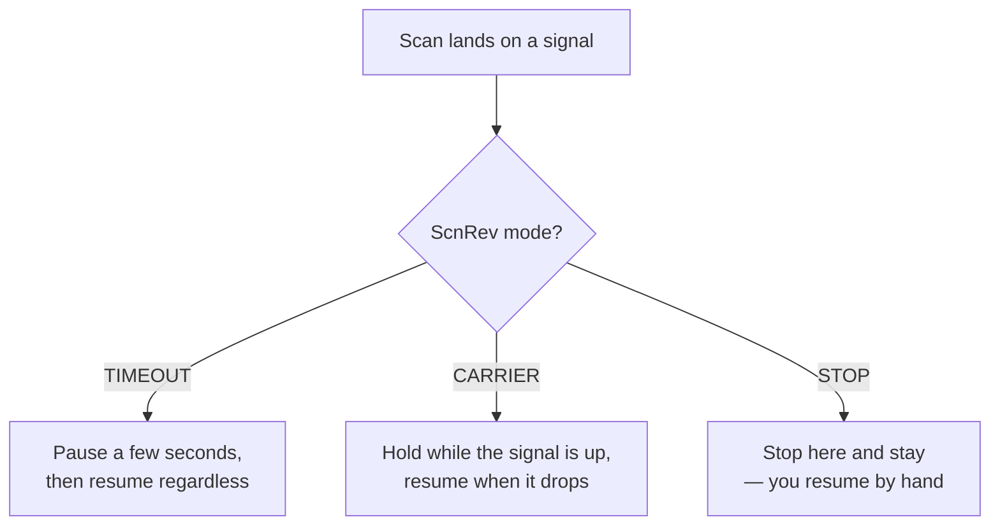
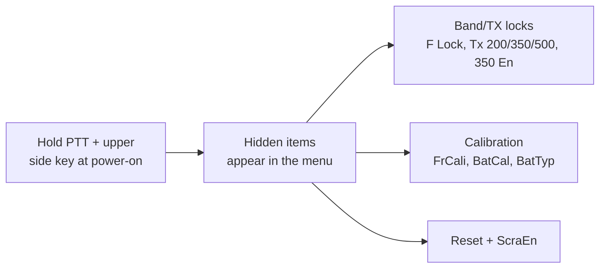

# Egzumer menu reference

If you have flashed egzumer onto your UV-K5 and opened the menu expecting the familiar `SQL`, `STEP`, `TXP` list, the first surprise is that almost nothing is where it was. Egzumer keeps the same little six-character screen, but it renames most items, reorders the whole list, and adds a good dozen new ones — companding, a live DTMF decoder, separate minimum and maximum backlight brightness, a proper repeater-tail delay, an AM front-end fix, three assignable buttons. This page is the complete map: every normal menu item in the order the radio lists them, then the notable ones explained in the depth the on-screen label never gives you. It is the reference companion to the [egzumer deep-dive](outpost:entry/logbook73.guide.uv-k5/firmware-egzumer); read that for the feature tour, read this to find and understand a specific setting.

Egzumer is an open-source firmware for the **DP32G030-based** sets — the original UV-K5, the K5(8), K6, and 5R+ in their V1/V2 hardware — built on a Nuvoton ARM Cortex-M0 main chip driving a Beken BK4819 radio. It does **not** run on the newer PY32F071 sets (UV-K5 V3, UV-K1); those need a different port entirely. If you are unsure which you have, stop and read [Firmware Flashing](outpost:entry/logbook73.guide.uv-k5/firmware-flashing) before you do anything — flashing the wrong family is how radios get bricked.

## Getting around the menu

The mechanics are the same as stock, with a couple of egzumer touches worth knowing:

- **MENU** opens the list, enters the highlighted item, and confirms a value. On the "are you sure" items (Reset, ChSave, ChDele, ChName) each press advances the confirmation — `SURE?` then `WAIT!` then done.
- **▲ / ▼** move the cursor (the list wraps top-to-bottom) or, inside an item, change the value.
- **Number keys 0–9** jump straight to a menu item by its position number — the fastest way to reach a setting once you know its index. Inside an item they type a numeric value, a three-digit channel number, or (for `TxOffs`) a frequency.
- **EXIT** backs out without saving; it also stops a tone scan, or deletes the last digit while you are typing an offset.
- **F + 5** opens the fagci spectrum analyser (the bandscope) — one of egzumer's headline additions.

One caution about the numbering. Egzumer is a "compile what you want" firmware: features such as voice prompts, VOX, NOAA, the audio bar, and the DTMF calling block are switched on or off when the firmware is built. Turn one off and every item below it shifts up a number. The list below assumes a **full-feature build** with everything enabled — the common case for pre-built downloads — so your radio's item numbers should match unless you compiled your own trimmed image.

## Reading the six-character labels

The BK4819's LCD menu column is only wide enough for a name of six characters, so egzumer's names are heavily abbreviated and, unlike stock, sometimes mix upper and lower case to squeeze meaning in. `TxCTCS` is the transmit CTCSS tone; `BltTRX` is "backlight on TX/RX"; `D Live` is the live DTMF decoder. Where the meaning is genuinely opaque the grouped sections below spell it out. Read the six characters as a mnemonic, not a word, and lean on this page for the first while — the names become second nature faster than you would expect.

## The full egzumer menu — every item in order

Every normal (non-hidden) menu item, in the on-screen order egzumer uses. The final column gives the stock UV-K5 name where there is a direct equivalent, so you can carry over what you already know.

| No. | Name     | What it does                                                                | Values                                                                         | Stock    |
| --- | -------- | --------------------------------------------------------------------------- | ------------------------------------------------------------------------------ | -------- |
| 1   | `Step`   | Frequency tuning step (how far the dial moves per arrow press)              | Sorted step table, `0.01` kHz up to `500` kHz (includes `8.33`, `12.5`, `25`…) | `STEP`   |
| 2   | `TxPwr`  | Transmit output power for this VFO/channel                                  | `LOW` / `MID` / `HIGH`                                                         | `TXP`    |
| 3   | `RxDCS`  | Receive DCS code the squelch must hear to open; press `*` to scan for it    | `OFF`; `D…N` (normal, 1–104); `D…I` (inverted, 105–208)                        | `R_DCS`  |
| 4   | `RxCTCS` | Receive CTCSS sub-tone the squelch must hear; press `*` to scan for it      | `OFF`; 50 tones `67.0`–`254.1` Hz                                              | `R_CTCS` |
| 5   | `TxDCS`  | DCS code sent while you transmit                                            | `OFF`; `D…N`; `D…I`                                                            | `T_DCS`  |
| 6   | `TxCTCS` | CTCSS tone sent while you transmit (opens most repeaters)                   | `OFF`; 50 tones `67.0`–`254.1` Hz                                              | `T_CTCS` |
| 7   | `TxODir` | Repeater shift direction for the TX offset                                  | `OFF` / `+` / `−`                                                              | `SFT-D`  |
| 8   | `TxOffs` | Repeater offset magnitude                                                   | `0` to `99.99999` MHz                                                          | `OFFSET` |
| 9   | `W/N`    | Channel bandwidth for TX and RX                                             | `WIDE` / `NARROW`                                                              | `W/N`    |
| 10  | `Scramb` | Per-channel voice-inversion scrambler frequency (only works if `ScraEn` on) | `OFF`, `2600` … `3500` Hz                                                      | `SCR`    |
| 11  | `BusyCL` | Busy-channel lockout — block TX when the channel is occupied                | `OFF` / `ON`                                                                   | `BCL`    |
| 12  | `Compnd` | Compander — noise-reducing companding on TX and/or RX                       | `OFF` / `TX` / `RX` / `TX/RX`                                                  | —        |
| 13  | `Demodu` | Demodulation (modulation) mode for this VFO/channel                         | `FM` / `AM` / `USB` (plus `BYP` / `RAW` on some builds)                        | `AM`     |
| 14  | `ScAdd1` | Add this channel to scan list 1                                             | `OFF` / `ON`                                                                   | `S-ADD1` |
| 15  | `ScAdd2` | Add this channel to scan list 2                                             | `OFF` / `ON`                                                                   | `S-ADD2` |
| 16  | `ChSave` | Save the current VFO into a memory channel (asks `SURE?`)                   | Channel `1`–`200`                                                              | `MEM-CH` |
| 17  | `ChDele` | Delete a stored memory channel (asks `SURE?`)                               | Channel select                                                                 | `DEL-CH` |
| 18  | `ChName` | Edit a memory channel's 10-character name                                   | 10 printable characters                                                        | `CHNAME` |
| 19  | `SList`  | Which scan list is used by default when scanning                            | `LIST1` / `LIST2` / `ALL`                                                      | `S-LIST` |
| 20  | `SList1` | Browse/assign channels in scan list 1; shows `PRI1`/`PRI2`                  | `NULL` or a channel                                                            | `SLIST1` |
| 21  | `SList2` | Browse/assign channels in scan list 2; shows `PRI1`/`PRI2`                  | `NULL` or a channel                                                            | `SLIST2` |
| 22  | `ScnRev` | Scan resume mode — what a scan does on a busy channel                       | `TIMEOUT` / `CARRIER` / `STOP`                                                 | `SC-REV` |
| 23  | `NOAA-S` | NOAA weather-channel auto-scan                                              | `OFF` / `ON`                                                                   | `NOAA_S` |
| 24  | `F1Shrt` | Action for a **short** press of side key 1                                  | Side-function list (see below)                                                 | —        |
| 25  | `F1Long` | Action for a **long** press of side key 1                                   | Side-function list                                                             | —        |
| 26  | `F2Shrt` | Action for a **short** press of side key 2                                  | Side-function list                                                             | —        |
| 27  | `F2Long` | Action for a **long** press of side key 2                                   | Side-function list                                                             | —        |
| 28  | `M Long` | Action for a **long** press of the MENU key (a third assignable button)     | Side-function list                                                             | —        |
| 29  | `KeyLck` | Automatic keypad lock after inactivity                                      | `OFF` / `AUTO`                                                                 | `AUTOLK` |
| 30  | `TxTOut` | Transmit time-out timer (stuck-mic cut-off)                                 | `30 sec`, `1`–`9 min`, `15 min`                                                | `TOT`    |
| 31  | `BatSav` | Battery-save receive duty cycle                                             | `OFF` / `1:1` / `1:2` / `1:3` / `1:4`                                          | `SAVE`   |
| 32  | `Mic`    | Microphone gain (shown as actual dB)                                        | Index 0–4, displayed `+x.x dB`                                                 | `MIC`    |
| 33  | `MicBar` | Show a mic/audio level bar while transmitting                               | `OFF` / `ON`                                                                   | —        |
| 34  | `ChDisp` | What a memory channel shows on screen                                       | `FREQ` / `CHANNEL NUMBER` / `NAME` / `NAME+FREQ`                               | `MDF`    |
| 35  | `POnMsg` | What is displayed at power-on                                               | `FULL` / `MESSAGE` / `VOLTAGE` / `NONE`                                        | `PONMSG` |
| 36  | `BatTxt` | Battery readout style on the status bar                                     | `NONE` / `VOLTAGE` / `PERCENT`                                                 | —        |
| 37  | `BackLt` | How long the backlight stays on after a keypress                            | `OFF`, `5 sec`, `10 sec`, `20 sec`, `1 min`, `2 min`, `4 min`, `ON`            | `ABR`    |
| 38  | `BLMin`  | Minimum (dimmed) backlight brightness                                       | `0`–`9`                                                                        | —        |
| 39  | `BLMax`  | Maximum (full) backlight brightness                                         | `1`–`10`                                                                       | —        |
| 40  | `BltTRX` | Turn the backlight on during transmit and/or receive                        | `OFF` / `TX` / `RX` / `TX/RX`                                                  | —        |
| 41  | `Beep`   | Keypress confirmation beep                                                  | `OFF` / `ON`                                                                   | `BEEP`   |
| 42  | `Voice`  | Spoken voice prompts                                                        | `OFF` / `CHI` / `ENG`                                                          | `VOICE`  |
| 43  | `Roger`  | Tone sent at the end of a transmission                                      | `OFF` / `ROGER` / `MDC`                                                        | `ROGER`  |
| 44  | `STE`    | Squelch-tail elimination — mute the tail burst you send                     | `OFF` / `ON`                                                                   | `STE`    |
| 45  | `RP STE` | Repeater squelch-tail elimination delay                                     | `OFF`, `1`–`10` (`n×100 ms`)                                                   | `RP-STE` |
| 46  | `1 Call` | Channel recalled by the one-touch call feature                              | Channel select                                                                 | `1-CALL` |
| 47  | `AlarmT` | TX alarm behaviour                                                          | `SITE` / `TONE`                                                                | `AL-MOD` |
| 48  | `ANI ID` | The radio's own DTMF caller (ANI) ID                                        | DTMF string                                                                    | `ANI-ID` |
| 49  | `UPCode` | DTMF code sent at the start of transmission (BOT)                           | Up to 16 DTMF characters                                                       | `UPCODE` |
| 50  | `DWCode` | DTMF code sent at the end of transmission (EOT)                             | Up to 16 DTMF characters                                                       | `DWCODE` |
| 51  | `PTT ID` | When the up/down codes are sent relative to PTT                             | `OFF` / `UP CODE` / `DOWN CODE` / `UP+DOWN CODE` / `APOLLO QUINDAR`            | `PTT-ID` |
| 52  | `D ST`   | DTMF side tone — hear the tones you key                                     | `OFF` / `ON`                                                                   | `D-ST`   |
| 53  | `D Resp` | How the radio responds to a received DTMF call                              | `DO NOTHING` / `RING` / `REPLY` / `BOTH`                                       | `D-RSP`  |
| 54  | `D Hold` | How long a DTMF call state is held before auto-reset                        | `5`–`60 s`                                                                     | `D-HOLD` |
| 55  | `D Prel` | Delay before DTMF is sent after PTT (preload)                               | `30`–`990 ms` (shown `n×10 ms`)                                                | `D-PRE`  |
| 56  | `D Decd` | Enable DTMF decoding on this channel                                        | `OFF` / `ON`                                                                   | `D-DCD`  |
| 57  | `D List` | Select/enter a DTMF phonebook contact                                       | Contact `1`–`16`                                                               | `D-LIST` |
| 58  | `D Live` | On-screen live DTMF decoder                                                 | `OFF` / `ON`                                                                   | —        |
| 59  | `AM Fix` | Dynamic front-end gain in AM to reduce distortion                           | `OFF` / `ON`                                                                   | —        |
| 60  | `VOX`    | Voice-operated transmit and its sensitivity                                 | `OFF`, `1`–`10`                                                                | `VOX`    |
| 61  | `BatVol` | Read-only battery voltage and percentage                                    | Display only (`u.uuV`, `u%`)                                                   | `VOL`    |
| 62  | `RxMode` | Dual-watch / cross-band receive behaviour                                   | `MAIN ONLY` / `DUAL RX RESPOND` / `CROSS BAND` / `MAIN TX DUAL RX`             | `TDR`    |
| 63  | `Sql`    | Global squelch threshold                                                    | `0`–`9` (`0` = open)                                                           | `SQL`    |

That is the whole normal list. The rest of this page explains the items that reward a closer look — the firmware-specific ones especially — grouped by what they do.

## Tones & squelch

The tone-squelch family (`RxDCS`, `RxCTCS`, `TxDCS`, `TxCTCS`) works exactly as on stock: a **CTCSS** tone is a continuous sub-audible pitch (67–254 Hz) sent under your voice, and a **DCS** code is a low-speed digital word doing the same job. Set the transmit tone (`TxCTCS`) to whatever your repeater's directory lists and it will open; set a receive tone only if you want the radio to stay silent unless that exact tone arrives.

Egzumer keeps the handy **tone scanner**: with the cursor in `RxCTCS` or `RxDCS` on an FM channel, press `*` to start a background scan that listens for the incoming tone or code and, when it finds one, jumps the cursor to the matching item and loads the value. Press `*` again or `EXIT` to stop. It is the quickest way to discover an unknown repeater's access tone.

`Sql` (item 63, egzumer's `SQL`) is the global squelch, `0`–`9`; set it by ear until the hiss just stops, usually around `2`–`4`. `STE` and `RP STE` tidy up the little noise burst at the end of a transmission — `STE` mutes yours, `RP STE` sets a delay (in hundreds of milliseconds) to swallow a repeater's tail. Leave both on for polite, quiet operation.

### The scrambler needs two switches

`Scramb` (item 10) sets a per-channel voice-inversion frequency, but egzumer will not actually scramble anything unless the **global** `ScraEn` switch — which lives in the hidden menu — is `ON`. This two-part design is deliberate: it keeps the scrambler dormant by default. A reminder that applies to every firmware: voice inversion is **not encryption** and gives no real privacy, and transmitting deliberately obscured speech is generally against your [licence conditions](outpost:entry/logbook73.handbook/getting-licensed) on the amateur bands. See the stock [Tones](outpost:entry/logbook73.guide.uv-k5/menus-tones) page for the full picture; the mechanics are identical.

## Scan & scan lists

Egzumer's scanning is richer than stock. There are still two scan lists — add a channel with `ScAdd1` / `ScAdd2`, review or assign members with `SList1` / `SList2` — but `SList` (the default scan list) gains an **`ALL`** option, so a scan can sweep every list at once rather than one or the other. The `SList1` / `SList2` browsers also show the priority channels `PRI1` and `PRI2`, which the scanner checks more often so a call there is not missed.

`ScnRev` (egzumer's rename of `SC-REV`) sets how a scan resumes after it lands on a signal:

`CARRIER` is the best all-round choice: it parks on an active conversation and moves on only once the channel goes quiet. `TIMEOUT` keeps sampling a busy band; `STOP` is for hunting a single signal. A couple of handy shortcuts: **long-press `5` (NOAA)** adds the current channel to a scan list without diving into the menu, and **long-press `*` while scanning** toggles which scan list is active.

## Side keys & buttons

This is one of egzumer's biggest departures from stock. Instead of one or two fixed side-key roles, egzumer gives you **five** fully assignable actions: short and long press of each side key, plus a long press of the MENU key promoted into a third button. They are set through items 24–28 (`F1Shrt`, `F1Long`, `F2Shrt`, `F2Long`, `M Long`), and all five draw from the same list:

> `NONE`, `FLASH LIGHT`, `POWER` (cycle TX power), `MONITOR` (open squelch), `SCAN`, `VOX`, `ALARM`, `FM RADIO`, `1750HZ` (the tone-burst some repeaters need), `LOCK KEYPAD`, `SWITCH VFO`, `VFO/MR` (frequency vs memory mode), `SWITCH DEMODUL` (cycle FM/AM/USB), `BLMIN TMP OFF` (temporarily kill the dim backlight — useful in daylight), and `SPECTRUM` (jump to the bandscope).

Some entries only appear if the matching feature was compiled in. A sensible starting layout: `MONITOR` on a short side-key press, `POWER` on the other short press, `SPECTRUM` on a long press, and `SWITCH DEMODUL` on `M Long` so USB is a button away. The point is that you rarely need to open the menu once your four or five most-used actions live on keys.

## Display & backlight

Egzumer splits the single stock backlight setting into a small system. `BackLt` (was `ABR`) still sets how long the light stays on after a keypress, but now `BLMin` and `BLMax` set the **dimmed** and **full** brightness levels independently (0–9 and 1–10), and the two mutually clamp so the maximum always stays above the minimum. Set `BLMin` to a low but readable level and the screen idles softly lit rather than fully dark or blazing. `BltTRX` (new) lights the screen during transmit and/or receive — handy for confirming at a glance that the radio is doing something.

One quirk to expect: entering `BackLt`, `BLMin` or `BLMax` forces the brightness up so you can preview it, and adjusting `BLMin`/`BLMax` changes the brightness live as you scroll. That is intentional, not a fault.

`ChDisp` (was `MDF`) gains a fourth mode, `NAME+FREQ`, showing both the channel label and its frequency at once — the friendliest choice once you have named your channels. `POnMsg` and `BatTxt` control the power-on splash and the status-bar battery readout; `BatTxt` lets you show voltage, a percentage, or nothing, which stock could not do.

## Power & battery

`TxPwr` (was `TXP`) is the usual `LOW` / `MID` / `HIGH` — run the lowest that reliably reaches, both to save battery and to spill less spurious energy from a budget transmitter (see [RF power](outpost:entry/logbook73.handbook/rf-power)). `TxTOut` (was `TOT`) is your stuck-mic safety net; two or three minutes is sensible. `BatSav` (was `SAVE`) micro-sleeps the receiver between checks — `1:2` or `1:3` for everyday use, `OFF` only when catching the first syllable of a call matters.

`BatVol` (item 61, was `VOL`) is a read-only live readout of battery voltage and percentage; egzumer gives it a longer menu time-out so you can sit and watch it settle. The related **battery type and calibration** settings live in the hidden menu, covered below — you rarely need them, but they exist if a replacement pack reads oddly.

## Audio

Three audio items are worth knowing. `Mic` (microphone gain) is shown as an actual figure in decibels (`+x.x dB`) rather than a bare 0–4 index — friendlier when you are chasing a good audio report; `2`–`3` on the index is a sensible middle. `MicBar` (new) draws a live level bar while you transmit, so you can see whether you are driving the mic too hard. `Compnd` (the compander, new) applies noise-reducing companding — it compresses your audio on transmit and expands it on receive, which can lift a weak, noisy signal, but **only** helps when the station at the other end is companding too; otherwise it makes your audio sound pumped. Leave it `OFF` unless you and a regular contact both enable it.

## DTMF

Egzumer carries the full DTMF signalling block inherited from the radio's commercial-fleet roots, largely unchanged from stock but with everything renamed to the `D …` scheme: `ANI ID` (your caller ID), `UPCode`/`DWCode` (the codes sent at the start and end of a transmission), `PTT ID` (when they are sent), `D ST` (side tone), `D Resp` (how the radio answers a received call), `D Hold`, `D Prel`, `D Decd`, and `D List` (a 16-entry phonebook). One new item stands out: `D Live` (item 58), a **live on-screen DTMF decoder** that shows tones as they arrive — genuinely useful for reading off another station's codes, and something stock never offered. `PTT ID` also gains an `APOLLO QUINDAR` option, the twin tone-bursts used either side of transmissions on some networks.

For ordinary amateur voice you can leave this whole block at its defaults. As on stock, the ANI and PTT-ID codes identify the **radio**, not you — they do not satisfy your duty to give your callsign by voice. The stock [DTMF](outpost:entry/logbook73.guide.uv-k5/menus-dtmf) page explains each item in full.

## The firmware's signature items

A handful of items are the reason people flash egzumer in the first place, and they have no stock equivalent:

- **`Demodu`** — the modulation mode, `FM` / `AM` / `USB` (and `BYP` / `RAW` on some builds). The `USB` option is the headline: single-sideband receive that the stock radio simply cannot do, opening up SSB voice on the amateur HF/VHF weak-signal segments and much clearer air-band and utility listening. See [Modulation](outpost:entry/logbook73.handbook/modulation) for what SSB actually is.
- **`AM Fix`** — a dynamic front-end AGC for AM. The BK4819's AM demodulator overloads and distorts on strong signals; `AM Fix` continuously nudges the receiver gain to keep it in its comfort zone. Leave it `ON` if you listen to the airband — it noticeably cleans up strong AM.
- **`Compnd`** and **`D Live`** — described above; both are pure additions.
- **The spectrum analyser** — not a menu item at all, but reached with **F + 5** or a side key mapped to `SPECTRUM`. It draws a live bandscope so you can _see_ activity across a slice of spectrum rather than scanning blind. Inside it: `EXIT` leaves, `▲/▼` move across the band, and `MENU` locks onto the current peak to listen. It is covered properly in the [egzumer deep-dive](outpost:entry/logbook73.guide.uv-k5/firmware-egzumer).

`RxMode` (item 62, egzumer's replacement for `TDR`) is also worth a note: it folds dual-watch and cross-band into one four-way choice — `MAIN ONLY`, `DUAL RX RESPOND` (watch both lines), `CROSS BAND`, and `MAIN TX DUAL RX`. As with stock dual-watch, the radio has only one receiver and time-shares, so two signals arriving at once still collide; and cross-band relaying can leave you transmitting unattended, so understand your [licence conditions](outpost:entry/logbook73.handbook/getting-licensed) before using it.

## The hidden / calibration menu

Egzumer keeps a second block of items hidden from the normal list. They are not secret for the sake of it — several of them change **which bands the radio will transmit on**, and two adjust factory **calibration**. They are reached only by holding **both the PTT and the upper side button while you switch the radio on**; do that, then open the menu, and the extra items appear at the end.

> **Back up your EEPROM before you touch these.** The calibration items write directly to the radio's settings memory, and a wrong crystal or battery figure will leave the set mis-tuned or mis-reading its battery. Making a backup takes a minute and means any mistake is a two-minute restore rather than a repair job. The how-to is on the [Firmware Flashing](outpost:entry/logbook73.guide.uv-k5/firmware-flashing) page. This is not a reason to be frightened of the menu — just a reason to have a safety net first.

| Name     | What it does                                                                                              | Values                                                                                                       | Stock    |
| -------- | --------------------------------------------------------------------------------------------------------- | ------------------------------------------------------------------------------------------------------------ | -------- |
| `F Lock` | Master band/TX-lock preset — which bands the radio may operate and transmit on                            | `DEFAULT+`, `FCC HAM`, `CE HAM`, `GB HAM`, `137-174/400-430`, `137-174/400-438`, `DISABLE ALL`, `UNLOCK ALL` | `F-LOCK` |
| `Tx 200` | Allow transmit on the 200 MHz region (174–350)                                                            | `OFF` / `ON`                                                                                                 | `200TX`  |
| `Tx 350` | Allow transmit on 350–400 MHz                                                                             | `OFF` / `ON`                                                                                                 | `350TX`  |
| `Tx 500` | Allow transmit on the 500 MHz band                                                                        | `OFF` / `ON`                                                                                                 | `500TX`  |
| `350 En` | Enable **reception** of 350–400 MHz                                                                       | `OFF` / `ON`                                                                                                 | `350EN`  |
| `ScraEn` | Global master switch for the scrambler (the per-channel `Scramb` does nothing unless this is on)          | `OFF` / `ON`                                                                                                 | `SCREN`  |
| `FrCali` | Reference crystal frequency calibration — fine-tunes the radio's master oscillator                        | `−50` to `+50`, with the resulting crystal frequency shown live                                              | —        |
| `BatCal` | Battery-voltage calibration — corrects the on-screen voltage reading                                      | `1600`–`2200` (raw), with the resulting voltage shown live                                                   | —        |
| `BatTyp` | Which battery capacity the percentage curve assumes                                                       | `1600mAh` / `2200mAh`                                                                                        | —        |
| `Reset`  | Factory reset — `VFO` clears VFO settings, `ALL` wipes everything to defaults (asks `SURE?` then `WAIT!`) | `VFO` / `ALL`                                                                                                | `RESET`  |

A few of these need explaining:

**`F Lock`** is the master transmit-band gate, and it has a deliberate speed bump. The `UNLOCK ALL` option — which removes all transmit-band restrictions — will not take effect until you select and confirm it **ten times in a row**; until then the radio shows `READ MANUAL` instead of applying it. That is by design, to stop anyone unlocking out-of-band transmit by accident. Only ever transmit within your own licence conditions and your radio's type approval; the presets (`FCC HAM`, `CE HAM`, `GB HAM`, and so on) exist so you can pick a sensible regional band set and leave it. The individual `Tx 200` / `Tx 350` / `Tx 500` switches and `350 En` fine-tune specific out-of-plan segments and are best left off unless you have a specific, lawful reason.

**`FrCali`** (reference crystal calibration) and **`BatCal`** (battery calibration) are the two genuine calibration controls. `FrCali` shifts the master oscillator so the radio lands exactly on frequency — a factory-set value you should not move unless you have measured a real error against a known reference and understand what you are doing. `BatCal` corrects the voltage reading if a new pack reads high or low; both preview their result live, and both use a longer menu time-out so you can watch the number settle. Get either wrong and the fix is restoring your EEPROM backup — which is exactly why you made one.

**`Reset`** sits at the end of the hidden block. `VFO` is a mild tidy-up; `ALL` is a full factory wipe that clears your channels and settings, so treat it as a last resort and export your channels first.

## Key takeaways

- Egzumer keeps the six-character screen but **renames and reorders almost every item** and adds a dozen new ones; jump straight to any item with the **number keys**, and reach the spectrum analyser with **F + 5**.
- The normal menu is **63 items** on a full-feature build; turning a compile-time feature off shifts every number below it, so your indices match this page only if nothing was trimmed.
- Egzumer's signature additions are **`Demodu` (adds USB/SSB receive)**, **`AM Fix`** for clean airband, the **compander**, the **live DTMF decoder**, split **`BLMin`/`BLMax`** backlight brightness, and **five assignable buttons** (`F1Shrt`/`F1Long`/`F2Shrt`/`F2Long`/`M Long`).
- The **scrambler needs two switches** — the per-channel `Scramb` and the hidden global `ScraEn` — and remains voice inversion, not encryption, and usually not permitted on the amateur bands.
- The **hidden menu** (hold PTT + upper side key at power-on) holds the transmit-band locks and the crystal/battery calibration; `F Lock`'s `UNLOCK ALL` deliberately needs confirming **ten times**.
- **Back up your EEPROM before touching `FrCali`, `BatCal` or `F Lock`** — a wrong value mis-tunes the radio, and a backup turns a mistake into a two-minute restore. See [Firmware Flashing](outpost:entry/logbook73.guide.uv-k5/firmware-flashing).

For the full feature tour — SSB in practice, the bandscope, and how egzumer compares with the alternatives — read the [egzumer deep-dive](outpost:entry/logbook73.guide.uv-k5/firmware-egzumer). Next, the other big DP32G030 firmware and its own take on the menu: [F4HWN](outpost:entry/logbook73.guide.uv-k5/firmware-f4hwn).
