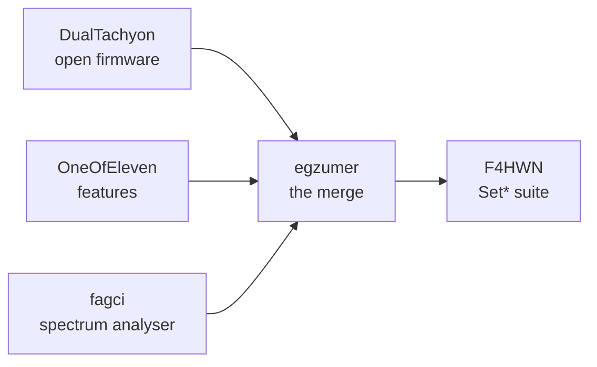
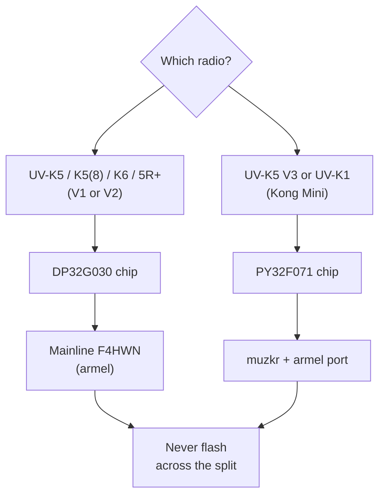
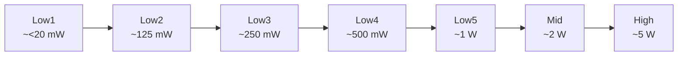
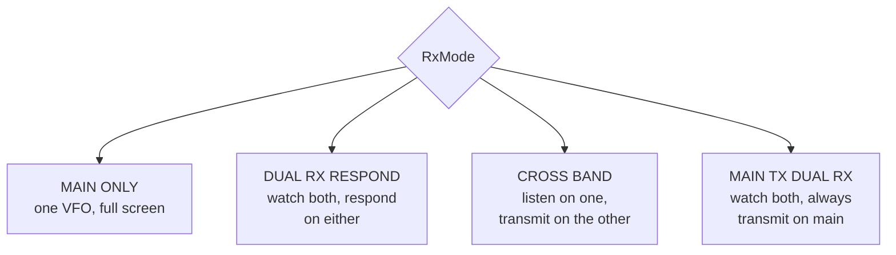

# F4HWN: refined power, cleaner GUI and the V3/UV-K1 port

If [egzumer](outpost:entry/logbook73.guide.uv-k5/firmware-egzumer) is the community's workhorse, F4HWN is the coachbuilt version — the same engine, but with the dashboard rebuilt for someone who cares how the controls feel. Written by the French operator **F4HWN** (his callsign, used as a name in the amateur tradition), it forks egzumer and pours its energy into a suite of tidy, deterministic settings: a proper transmit-power ladder, an S-meter calibrated to an international standard, cleaner screen layouts, honest labels. Crucially for many readers, F4HWN — through a sister project — is also the _only_ firmware family that reaches the newer **UV-K5 V3** and **UV-K1** radios. This page explains what F4HWN adds, why it feels different from its parent, how to actually drive its signature features, and — the part you must not skim — how its two versions map onto two incompatible chips.

You met the family tree in [Firmware Overview](outpost:entry/logbook73.guide.uv-k5/firmware-overview); here we zoom in on one branch. If you have not yet identified which radio you are holding, go back and do that first, because half of this page hinges on it. This is the narrative tour; the exhaustive, item-by-item menu list lives on its own page, and we point you there at the end.

## A fork of a fork — what F4HWN inherits

F4HWN did not start from a blank page. It sits at the end of a chain, and each link handed down its work:

Because F4HWN is a fork of egzumer, it _inherits everything egzumer already had_ and then adds its own layer on top. That inheritance is worth spelling out, because none of it is re-explained in F4HWN's own documentation — it is simply assumed:

- **The full-screen spectrum analyser** (the band scope that sweeps a range of frequencies and draws activity as bars), contributed originally by **fagci** and opened with `F` + `5`. F4HWN improves it — it can show channel names, remember your scan parameters, and sweep at roughly 150 frequencies per second — but the core is fagci's.
- **The OneOfEleven feature layer**: the "AM fix" (an automatic-gain workaround that stops a strong AM signal swamping the receiver), faster scanning, on-radio channel-name editing, configurable side keys, and single-sideband (SSB) receive. In F4HWN the AM fix is turned _on permanently_ — its menu entry is removed because the developer decided it should always be running.
- **egzumer's tidied menu structure and naming**, which F4HWN keeps and then extends with its own renames.

So when you flash F4HWN you are not trading egzumer's features away — you are keeping them and gaining a polished settings suite. Everything the [Overview](outpost:entry/logbook73.guide.uv-k5/firmware-overview) page listed as a "common win" is present. What follows is what F4HWN adds beyond that base.

The flagship build is called **Fusion** — F4HWN's own documentation calls it "the reference edition," a single package that bundles the spectrum analyser, FM broadcast receive, VOX, screenshots to a PC, advanced receive-audio profiles and more. When someone says "install F4HWN," Fusion is almost always what they mean, and it is the build this page assumes.

## Two versions, two chips — the split you cannot get wrong

Here is the section to read slowly. **F4HWN exists as two separate firmwares, built for two different microcontrollers, and they are not interchangeable.** A "microcontroller" (MCU) is the small computer inside the radio that runs its menus and logic; the UV-K5 family ships with two different ones, and firmware compiled for one will not run on the other. Flashing the wrong build can _brick_ the radio — leave it unable to start — and the developers warn, in plain words, that in the worst case "you'd need to buy another radio."

The two versions are:

- **Mainline F4HWN** (published by _armel_) runs on the **DP32G030** — the _original_ chip inside the classic **UV-K5**, the **UV-K5(8)** / **UV-K6**, and the **UV-5R Plus**, hardware revisions V1 and V2. This is the version most F4HWN users run, and it lives in the same repository as its many editions.
- **The muzkr + armel port** is a _further_ fork, adapting F4HWN to the **PY32F071** — the _newer_ chip (from the maker Puya) inside the **UV-K5 V3** and the compact **UV-K1** ("Kong Mini"). Moving to a different chip forced the developers to rewrite the low-level drivers, so the V3/K1 radios need this port and nothing else. **If you own a V3 or a K1, this is your firmware — and mainline F4HWN is not.** The reverse holds equally: never put the port onto an original DP32G030 radio.

A practical trap to name out loud: the two projects use **different version numbers**. The mainline is around v4.x; the port is on its own v5.x line. They are not the same release, one is not "newer" than the other in any meaningful sense, and you should never compare their numbers or download by version alone. Match the _chip_, not the number.

If you are unsure which chip you have, do not guess. Go back to the [Overview](outpost:entry/logbook73.guide.uv-k5/firmware-overview)'s identification steps — model name, board label, and best of all a flashing tool that reads the board revision and refuses mismatched pairs. The repositories themselves do not publish a foolproof visual test for a V3 board versus a V2 (a USB-C socket, for instance, is a hint but not proof), so when the clues disagree, stop and verify before you flash anything.

## Why F4HWN feels different from egzumer

egzumer's design instinct is to _expose_ — to hand you every capability the chip has and let you wire it up. F4HWN's instinct is to _refine_: to take the same capabilities and make each one behave predictably, name it clearly, and remove the ones the author judged distracting or risky. Three threads run through the whole firmware.

**Determinism.** F4HWN prefers settings that do exactly one thing, every time. The power ladder is fixed rungs rather than a vague "high/low"; the screen modes are named states you choose between, not emergent behaviour. You always know what the radio will do next.

**Correctness.** The headline example is the S-meter. egzumer lets you calibrate the meter's endpoints yourself, stored in the radio's memory. F4HWN throws that away and _hardcodes_ the S-meter to the **IARU Region 1 Technical Recommendation R.1** — the international amateur standard for what "S9" actually means on VHF and UHF. (The IARU — International Amateur Radio Union — is the global federation of national societies; its recommendations are the closest thing amateur radio has to a shared rulebook. R.1 pins S9 to a defined signal strength at the antenna, so an "S7" report means the same thing on your radio as on the next operator's.) The trade is honesty for flexibility: your meter now agrees with everyone else's rather than with your own guesswork.

**Subtraction.** F4HWN _removes_ several stock and egzumer features on purpose — the audio scrambler, the DTMF-calling system, the flashing-alarm and SOS modes, and the hidden 200/350/500 MHz transmit menus. The author's view is that these clutter the interface or invite illegal transmit, so a cleaner radio is the better default. If you migrate from another build and miss one of these, that is why: it is gone by design, not by accident.

The result is a firmware that feels _engineered_ rather than _piled up_ — fewer surprises, clearer labels, opinionated defaults. Whether you prefer that to egzumer's everything-on-the-table approach is a matter of taste, and the [choosing](outpost:entry/logbook73.guide.uv-k5/firmware-choosing) page weighs it up.

## The Set* menu suite

F4HWN's signature is a family of settings whose on-screen names all begin `Set`. The little LCD only has room for six-character labels, so they read as truncated words — `SetPwr`, `SetMet`, `SetGUI` — and once you learn the pattern the menu becomes easy to skim. Here are the highest-value ones, with their exact on-screen names and choices. This is a _summary_ of the flagship items; the complete list of every menu (some 60–90 entries depending on your build) is on the [menu reference](outpost:entry/logbook73.guide.uv-k5/firmware-f4hwn-menu) page.

| Menu     | What it sets                                         | Choices                                                            |
| -------- | ---------------------------------------------------- | ------------------------------------------------------------------ |
| `SetPwr` | Your custom **User** transmit-power rung             | `<20mW` / `125mW` / `250mW` / `500mW` / `1W` / `2W` / `5W`         |
| `SetPTT` | How the push-to-talk button behaves                  | `Classic` (hold to talk) / `OnePush` (tap to start, tap to stop)   |
| `SetTOT` | Time-out-timer alert as you approach the limit       | `Off` / `Sound` / `Visual` / `All`                                 |
| `SetEOT` | End-of-transmission ("roger") alert when you release | `Off` / `Sound` / `Visual` / `All`                                 |
| `SetLck` | What the keypad lock actually locks                  | `Keys` / `Keys + PTT`                                              |
| `SetMet` | S-meter visual style                                 | `Classic` / `Tiny`                                                 |
| `SetGUI` | Baseline font size for the frequency display         | `Classic` / `Tiny`                                                 |
| `SetCtr` | LCD contrast                                         | `0`–`15`                                                           |
| `SetInv` | Invert the screen (dark-on-light ↔ light-on-dark)    | `Off` / `On`                                                       |
| `SetRxA` | Receive-audio profile (mode-dependent)               | FM: `Flat`/`Clean`/`Mid`/`Boost`/`Max`; AM: `Sharp`/`Stock`/`Open` |
| `SetVol` | Software receive-volume trim                         | `Off` / `1`–`63`                                                   |
| `SetTmr` | Show live receive/transmit timers on the status bar  | `Off` / `On`                                                       |
| `SetOff` | Deep-sleep delay to save battery when idle           | `Off` / `1 min` … `2 h`                                            |
| `SetNFM` | Narrow-FM channel width                              | `Narrow` (12.5 kHz) / `Narrower` (6.25 kHz)                        |
| `SetScn` | Scan speed                                           | `Normal` / `Fast`                                                  |

Two honest caveats. First, several of these — `SetRxA`, `SetVol`, `SetScn`, `SetOff`, `SetNFM` and others — are **compile-time options**. F4HWN ships in several editions (Fusion, Bandscope, Broadcast, Basic, RescueOps and more), and a given release only includes the features it was built with. If a menu on this page is missing from your radio, your edition simply left it out — check the release notes for that build, and prefer Fusion if you want the fullest set. Second, F4HWN also renames a few inherited menus (covered in the map below): the backlight timer that was `BackLt` becomes `BLTime`, and the old battery-voltage screen becomes `SysInf`, a paged information screen that now shows the firmware version and build date alongside the battery state — a handy way to confirm exactly what you flashed.

### SetPwr — a real power ladder

The stock radio gives you a blunt choice: high or low. egzumer widens it a little. F4HWN replaces it with a proper _ladder_ — a set of named rungs from a whisper to full output — so you can pick the least power that does the job. That habit matters: lower power means a cooler radio, a longer battery, and less of your signal spilling where you would rather it did not (the reasoning is in [RF Power](outpost:entry/logbook73.handbook/rf-power)).

The rungs run **Low1 through Low5**, then **Mid** (roughly 2 W) and **High** (roughly 5 W — the most this hardware makes). The wattages are approximate; treat the labels as a relative ladder rather than a calibrated bench reading, and remember the [Overview](outpost:entry/logbook73.guide.uv-k5/firmware-overview)'s warning that firmware cannot make a budget transmitter cleaner than it is. On top of the fixed rungs sits a **User** rung, whose wattage you set yourself.

Here is how to set up the ladder in practice:

1. Open the menu (short-press `MENU`) and go to `Power`. This is the item that was called `TXP` on the stock radio.
2. Scroll it to `USER` (the first choice) — or to any of the fixed rungs if you would rather just pick one.
3. Back out, then open `SetPwr`. This is where you _define_ what "User" means. Choose a wattage — say `250mW` for a repeater across town.
4. Now your `USER` power level is that wattage, a couple of keypresses away, and you can leave `Power` sitting on `USER` for daily use.

The everyday discipline is unchanged from any radio: run the lowest rung that gets you in cleanly, and step up only when a station reports you weak. On a ladder this fine you will often find `Low3` or `Low4` is plenty for local work, leaving `High` for the genuinely distant contact. If you assign the `POWER HIGH` action to a side key (see below), you can also punch through to full power for one difficult over without disturbing your default rung.

### Screen modes — MAIN ONLY, DUAL and CROSS

F4HWN reworks how the radio watches one or two frequencies into clear _screen modes_, chosen through a menu called `RxMode` (it replaces the stock radio's `TDR` dual-watch setting). Instead of a vague on/off, you pick a named layout:

- **MAIN ONLY** shows a single frequency line filling the screen — the simplest, least cluttered view, and easiest to read at a glance.
- **DUAL RX RESPOND** keeps half an ear on _both_ on-screen lines and lets you answer a call on whichever one goes active — the classic dual-watch, but stated as a deliberate mode.
- **CROSS BAND** listens on one line and transmits on the other — the arrangement a cross-band setup needs, where you receive on one band and reply on another.
- **MAIN TX DUAL RX** is the safety-conscious middle ground: it watches both lines but always transmits on the main one, so you can never accidentally reply on the wrong frequency.

Because these are named states rather than emergent behaviour, the "which line will I actually transmit on?" confusion that trips people up on the stock radio (and which we flagged on the [UV-5R](outpost:entry/logbook73.guide.uv-5r/menus-1)) largely evaporates — the mode tells you. F4HWN adds a small but genuinely useful touch here too: an **RX blink**, where the screen and the receive LED flash to show which line is currently hearing a signal, so a glance tells you where the activity is. You can also bind `RX MODE` or `MAIN ONLY` to a side key to flip between these layouts without opening the menu at all.

### The display trims — SetMet, SetGUI, SetCtr, SetInv

Four settings shape how the radio _looks_, and together they let you tune the little LCD to your eyes:

- **`SetMet`** switches the S-meter between `Classic` (the traditional bar) and `Tiny` (a compact version that frees screen space). Either way the calibration underneath is the IARU-standard one described above — only the drawing changes.
- **`SetGUI`** sets the baseline font for the frequency display: `Classic` for the familiar large digits, `Tiny` for a denser layout that fits more on screen. Pair `SetMet Tiny` with `SetGUI Tiny` for a compact, information-rich display; leave both `Classic` for the traditional big-digit look.
- **`SetCtr`** (contrast, `0`–`15`) and **`SetInv`** (invert the whole screen) rescue a display that is hard to read — a washed-out or too-dark LCD often comes right with a contrast nudge, and inverting to dark-on-light can help in bright sun.

### SetPTT and SetLck — how the controls behave

Two settings change the feel of the physical buttons, and both are worth knowing before they surprise you.

**`SetPTT`** offers `Classic` or `OnePush`. Classic is the normal hold-to-talk you expect: press and hold the PTT to transmit, release to listen. **OnePush turns it into a toggle** — a single tap starts your transmission, and a second tap ends it, with nothing held in between. That is a boon if holding a button is awkward, but it is also exactly how a radio ends up transmitting unattended, so treat OnePush with the same care as [VOX](outpost:entry/logbook73.guide.uv-5r/menus-1) and make sure you always tap it off. The current PTT mode is shown in the status bar, so a glance confirms which behaviour is live.

**`SetLck`** decides what the keypad lock covers: `Keys` locks only the buttons, while **`Keys + PTT`** locks the transmit button too. If your radio rides in a bag or pocket, `Keys + PTT` is the safer choice — it stops a squashed PTT from holding a channel open (the "stuck mic" problem). The separate `KeyLck` menu sets _how long_ of no activity triggers the auto-lock, from 15 seconds up to 10 minutes.

### The receive-audio settings — SetRxA and SetVol

Two comfort settings shape what you _hear_. **`SetRxA`** picks a receive-audio profile, and cleverly it is mode-aware: on FM you choose between `Flat`, `Clean`, `Mid`, `Boost` and `Max` (progressively more treble and presence, so a weak or muffled signal becomes easier to copy); on AM you choose `Sharp`, `Stock` or `Open`. There is no profile to pick on SSB — it simply shows `USB`. **`SetVol`** is a software volume trim (`Off`, then `1`–`63`) layered on top of the physical volume knob, letting you fine-tune loudness beyond the knob's coarse steps. Both are edition-dependent, so they appear on Fusion but may be absent from a slimmer build.

## Driving the spectrum analyser

The band scope is inherited from fagci, but F4HWN makes it more usable, and it is the fastest way to answer "is anything happening around here?" without spinning the tuning knob through empty air. To use it:

1. Tune your radio somewhere near the range you want to survey — the scope centres its sweep on where you are.
2. Press `F` then `5`. The screen switches to the full-width band scope: a horizontal frequency axis with vertical bars showing how strong the received energy is at each point.
3. Watch for a bar that jumps up out of the noise floor — that is activity. Because F4HWN can show **channel names** on the scope, a spike sitting on one of your saved repeaters is labelled, not just a bare frequency.
4. The firmware **remembers your scan parameters**, so the next time you open the scope it returns to the same span rather than making you set it up again.
5. Press `EXIT` to leave the scope and return to normal operation.

Honest limit: the band scope is a receiver survey tool, not a lab-grade spectrum analyser. It shows you where energy is, quickly and cheaply, but the UV-K5 hardware has no track-tuned front-end filtering, so a very strong nearby transmitter can paint bars across the display that are artefacts of overload rather than real signals (the mechanism is in [Overload and Ghost Signals](outpost:entry/logbook73.handbook/overload-and-ghost-signals)). Treat the scope as a pointer — "look over there" — and confirm anything interesting by actually listening.

## Setting up scan lists

F4HWN extends egzumer's scanning to **up to 24 named scan lists**, which turns the scanner from a blunt "listen to everything" into an organised tool: a "local repeaters" list, a "PMR/simplex" list, a "monitoring" list, each scanned on its own.

Each memory channel carries a list assignment, set in the `ChList` menu:

1. Recall or tune to the channel you want to organise, then open `ChList`.
2. Choose `OFF` (never include this channel in a scan), a list number `01`–`24`, or `ALL`. A channel set to `ALL` is scanned by the everything sweep but is not tied to a single named list.
3. Repeat for the channels you care about. You only need to assign the ones you want to scan; the rest can stay `OFF`.

The `ScList` menu then selects which list is _active by default_. Once you are scanning, F4HWN gives you two live shortcuts:

- **Type two digits** to jump straight to a list — `00` scans everything, `01`–`24` selects that named list. No menu diving.
- **Long-press `MENU`** while a scan is running to exclude the channel it just stopped on, so a persistently busy but uninteresting frequency stops interrupting you.

The `ScnRev` menu decides what the scanner does when it finds a signal: `STOP` (halt on it), `CARRIER` (resume once the carrier drops, after a delay you set), or `TIMEOUT` (resume after a fixed time regardless). The full workflow, with worked examples, lives on the [Scanning](outpost:entry/logbook73.guide.uv-k5/scanning) page; the point here is that F4HWN's tidy, deterministic streak reaches the scanner too.

## Configuring the side keys

The two buttons on the left edge of the radio (and a long-press of `MENU`) are yours to program, which is where a lot of F4HWN's speed comes from — the features you use most become a single press. There are five slots:

| Menu     | Trigger                    |
| -------- | -------------------------- |
| `F1Shrt` | Short press of side key 1  |
| `F1Long` | Long press of side key 1   |
| `F2Shrt` | Short press of side key 2  |
| `F2Long` | Long press of side key 2   |
| `M Long` | Long press of the MENU key |

Open any of them and pick an action from the list. Alongside the familiar ones (`MONITOR`, `SCAN`, `FLASH LIGHT`, `FM RADIO`, `1750Hz`), F4HWN adds several of its own: `RX MODE` and `MAIN ONLY` (flip the screen modes above), `POWER HIGH` (jump to full power for one over), `WIDE/NARROW` (toggle bandwidth), `MUTE`, `REMOVE OFFSET`, `PTT` and — on builds that include it — `RxA` (cycle the receive-audio profile) and `BEAM`. A practical starter set: put `MONITOR` on a short press so you can open the squelch to hear a weak station, and `POWER HIGH` on a long press so you always have full power a hold away. Because the choices are the same across all five slots, you can arrange the radio exactly to your habits.

## How the menu differs from stock — the renames

Part of what makes F4HWN feel coherent is a deliberate renaming of the terse stock labels into clearer ones. You do not need to memorise these, but if you have used a stock radio or CHIRP, the map saves confusion. Here are the highest-value renames:

| Stock label | F4HWN label | What it is                      |
| ----------- | ----------- | ------------------------------- |
| `TXP`       | `Power`     | Transmit power (now the ladder) |
| `TDR`       | `RxMode`    | Dual-watch / screen mode        |
| `TOT`       | `TxTOut`    | Transmit time-out timer         |
| `SAVE`      | `BatSav`    | Battery-save duty cycle         |
| `BackLt`    | `BLTime`    | Backlight on-time               |
| `MDF`       | `ChDisp`    | How channels are displayed      |
| `AUTOLk`    | `KeyLck`    | Auto keypad-lock delay          |
| `AM`        | `Mode`      | Modulation (FM / AM / USB)      |
| `MEM-CH`    | `ChSave`    | Save VFO to a memory channel    |
| `BatVol`    | `SysInf`    | System info + battery (paged)   |

Beyond renames, F4HWN adds a genuinely new per-channel item worth knowing: **`TXLock`**, which unlocks transmit on the current channel. If the channel's frequency sits inside your active band-plan lock it shows `Inside F Lock Plan` and refuses to budge; otherwise you can toggle it. This is the fine-grained companion to the hidden `F Lock` band-plan menu, and both touch the same regulatory nerve — see the caveats below.

## Honest caveats and limits

No firmware is only upside. Keep these in mind:

- **Features vary by edition.** As stressed above, many `Set*` menus and side-key actions are compile-time options. The Fusion build is the fullest; slimmer editions (Basic, Bandscope, Broadcast) drop features to save space. A menu missing from your radio is almost always an edition difference, not a fault.
- **The hardware ceiling is real.** F4HWN's IARU meter, audio profiles and band scope are polish on a budget receiver. There is no track-tuned front-end, so dynamic range is limited and AM reception is the first thing to suffer near strong transmitters. Firmware cannot fix a hardware limit.
- **Transmit unlocking is a legal matter, not a feature.** The hidden `F Lock` menu (revealed by holding `PTT` + the upper side key at power-on) can open transmit across all bands — F4HWN reduces the "unlock all" confirmation from ten repeats to three, and adds PMR 446, GMRS/FRS/MURS and various national band plans. Transmitting outside your licence privileges is illegal in most of the world. Enable only the plan that matches your licence and region, and treat `UNLOCK ALL` as something you will almost never want.
- **Removed features may surprise migrants.** If you arrive from another build expecting the scrambler, DTMF calling, or the SOS/blink alarm, they are gone by design. That is a philosophy choice, not a bug report.
- **Back up your calibration before you flash.** The factory calibration is unique to your radio and unpublished — the [Flashing](outpost:entry/logbook73.guide.uv-k5/firmware-flashing) page walks through dumping it first. This matters doubly on the V3/K1 port.

## The recommended path for a V3 or K1 owner

If you own a **UV-K5 V3** or a **UV-K1**, this page is not just informative — it is your route. The PY32F071 radios have far fewer firmware options than the original generation, and the **muzkr + armel port of F4HWN is the mature, actively developed choice** for them. egzumer and VUURWERK, for all their merits, target the older DP32G030 chip and will not run on your radio. So for a V3/K1 the decision is largely made: flash the port, and enjoy the same Set* suite this page describes (indeed, the exhaustive [menu reference](outpost:entry/logbook73.guide.uv-k5/firmware-f4hwn-menu) is drawn directly from the port's Fusion build).

Two reminders before you do. First, **flash only the port build**, never mainline F4HWN — same firmware family, wrong chip. Second, the V3/K1 use a browser-based flasher (**UVTools2**, which runs in Chrome, Chromium or Edge over WebSerial with no driver install) and their own cable — usually USB-C on these newer radios. The full, careful procedure — back up your calibration _first_, enter flash mode, write the correct image — is on the [Flashing](outpost:entry/logbook73.guide.uv-k5/firmware-flashing) page, and you should read it before you connect anything. Backing up the calibration matters especially here: it is unique to your radio, unpublished by the factory, and the only way back if a flash goes wrong is a copy you made yourself.

A DP32G030 owner (classic UV-K5, K6, 5R+) has a real choice between egzumer, mainline F4HWN and VUURWERK — F4HWN is the pick when you want the polished Set* menus, the power ladder and the IARU meter. A V3/K1 owner does not have that choice, and that is fine, because the port gives them the best of F4HWN anyway.

## Try it yourself

You can rehearse the whole decision without touching a flasher — and you should, because the muscle memory it builds is exactly what keeps radios un-bricked:

1. **State your chip out loud.** Look at how your radio was sold and what the case says. Is it a plain UV-K5 / K6 / 5R+, or is it flagged **V3** or a **UV-K1**? Say the answer: "DP32G030" or "PY32F071."
2. **Name your F4HWN build.** From that chip, name the _only_ correct F4HWN version: DP32G030 → **mainline F4HWN**; PY32F071 → **the muzkr + armel port**. Then say the one you must never flash. If you cannot do this confidently, you are not ready to flash — go re-read the [Overview](outpost:entry/logbook73.guide.uv-k5/firmware-overview).
3. **Plan your power ladder.** Decide, before you ever open the menu, what wattage you would put on `SetPwr` User for your most common contact, whether you want `SetLck` on `Keys` or `Keys + PTT`, and which two actions you would bind to the side keys. Deciding the _policy_ away from the radio makes the actual setup calm and quick.

Do this once, deliberately, and the real thing becomes a formality.

## Where to go deeper

This page is the narrative — what F4HWN is for and how to drive its signature features. When you need the _exhaustive_ detail — every one of the 60-plus menu items, its exact six-character label, its full value range, and which build flag gates it — turn to the companion:

**[F4HWN complete menu reference](outpost:entry/logbook73.guide.uv-k5/firmware-f4hwn-menu)** — the item-by-item table, including the hidden band-plan and calibration menus, the full side-key action list, and the renames map in full.

## Key takeaways

- F4HWN is a **fork of egzumer**, so it _inherits_ the fagci spectrum analyser, the OneOfEleven feature layer (AM fix, SSB receive, configurable keys, fast scan) and egzumer's tidied menus — then adds its own polished **Set*** suite on top. Its flagship build is called **Fusion**.
- It comes in **two incompatible versions by chip**: **mainline F4HWN** for the **DP32G030** (UV-K5 / K5(8) / K6 / 5R+ V1/V2), and the **muzkr + armel port** for the **PY32F071** (UV-K5 **V3** and **UV-K1**). Firmware is not interchangeable across the split, and a wrong-chip flash can brick the radio — match the chip, never the version number.
- The design philosophy is **refine, not expose**: a deterministic power ladder (`Low1`–`Low5` / `Mid` / `High` / `User`), an **IARU-standard hardcoded S-meter** that ignores per-radio calibration, and deliberately _removed_ features (scrambler, DTMF calling, SOS, out-of-band TX menus).
- The **Set*** menus are the signature — power, PTT behaviour, alerts, lock scope, display trims, receive audio, timers, sleep — but many are **edition-dependent**, so a given build may not show them all; Fusion is the fullest.
- Learn the **four practical workflows**: build the power ladder via `Power` + `SetPwr`, choose a screen mode in `RxMode`, drive the band scope with `F` + `5`, and organise scanning with `ChList` and the two-digit list jump.
- For a **V3 or K1 owner**, the port is the recommended firmware — flash only the port build, use the UVTools2 browser flasher, and back up your unique calibration first, as the [Flashing](outpost:entry/logbook73.guide.uv-k5/firmware-flashing) page details.

egzumer and F4HWN share a lineage; the next firmware takes egzumer in a different direction entirely, chasing the cleverest possible receiver behaviour on the original hardware: [VUURWERK: Closed-Loop Reception & the Refined Receiver](outpost:entry/logbook73.guide.uv-k5/firmware-vuurwerk).
