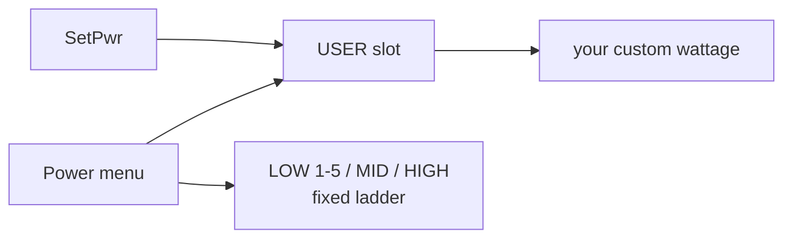
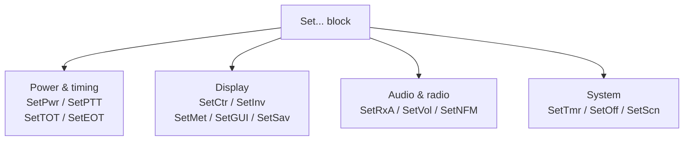

# F4HWN menu reference

F4HWN turns the stock UV-K5 menu inside out. Where the factory firmware gives you fifty-five cramped items, this port gives you ninety-three, renamed into clearer six-letter labels, reordered so the things you touch daily sit near the front, and topped off with a whole block of settings the original never had — a signature run of items all named `Set…` that control power, timers, contrast, audio, volume and more. This page is the complete map: one scannable table of every item in the order the radio lists it, then grouped explanations of what the notable and F4HWN-only settings actually do. It is the reference companion to the [F4HWN deep-dive](outpost:entry/logbook73.guide.uv-k5/firmware-f4hwn); read that first for the "why flash it", and come here when you are standing in the menu wondering what `SetGUI` or `RxMode` means.

One thing to fix in your head before we start: F4HWN is a **PY32F071** firmware — it targets the newer UV-K5 V3 and the UV-K1. It is _not_ for the older DP32G030 sets (UV-K5 V1/V2, K5(8), K6). The two microcontrollers are different silicon and their firmwares are not interchangeable. If you are on a V1/V2 radio you want the [egzumer menu](outpost:entry/logbook73.guide.uv-k5/firmware-egzumer-menu) instead. Never flash without matching the MCU — see [Flashing](outpost:entry/logbook73.guide.uv-k5/firmware-flashing).

## Reading the radio's six-character labels

The UV-K5's screen is tiny — roughly two lines of large text — so every menu name is squeezed into at most six characters. F4HWN uses that budget well, but you still have to learn to read the shorthand. A few reliable patterns unlock most of them:

- **`Tx` / `Rx` prefix** = transmit or receive side. `TxDCS` is the DCS code you _send_; `RxDCS` is the one you must _hear_. `TxOffs` is the transmit offset.
- **`Ch` prefix** = something about a memory channel. `ChSave`, `ChDele`, `ChName`, `ChList`, `ChDisp`.
- **`Sc` / `Scn` / `Sc…`** = scanning. `ScList`, `ScPri`, `ScnRev`.
- **`BL` prefix** = backlight. `BLTime`, `BLMin`, `BLMax`, `BLTxRx`.
- **`Bat` prefix** = battery. `BatSav`, `BatTxt`, `BatCal`, `BatTyp`.
- **`D ` prefix** (with a space) = DTMF. `D ST`, `D List`, `D Live`.
- **`Set…` prefix** = the F4HWN signature block — a run of net-new settings that did not exist in stock firmware at all. If a name starts with `Set`, it is almost certainly unique to this port.

Two navigation habits make the long list bearable. The **menu number is always visible top-left**, even while you are inside a submenu changing a value — a deliberate F4HWN touch, so you never lose your place. And you can **type the item number** on the keypad at the top level to jump straight to it, exactly as on stock. Because the list is long, learning a handful of numbers for the settings you revisit (squelch, step, power) pays off quickly.

CTCSS ("continuous tone-coded squelch system") is a quiet sub-audible tone your radio adds under your voice so a repeater — or another set — only opens up for you. DCS ("digital-coded squelch") does the same job with a low-speed digital code instead of a tone. VFO ("variable frequency oscillator") is the mode where you dial a raw frequency rather than recalling a stored channel. We explain the rest as they come.

## Every F4HWN menu item, in order

All ninety-three items exactly as the firmware lists them. The **Stock equivalent** column shows what the same setting was called (or "new" if F4HWN invented it). A handful of rows are marked **not in F4HWN** — the port compiles them out (scrambler, the extra per-band TX unlocks, the AM-fix toggle, and most of the DTMF-calling block), so you will not normally see them on the radio, but they are listed for completeness and because a differently-built copy could re-enable them.

| Name     | What it does                                                     | Values                                                                         | Stock equivalent |
| -------- | ---------------------------------------------------------------- | ------------------------------------------------------------------------------ | ---------------- |
| `Step`   | VFO tuning step; re-saves the channel if you are on a VFO memory | sorted step table, shown as `X.XXk`                                            | `STEP`           |
| `Power`  | Transmit power level                                             | `USER`, `LOW 1`–`LOW 5`, `MID`, `HIGH` (1–7 also show watts)                   | `TXP`            |
| `RxDCS`  | Receive DCS code (squelch opens only on this code)               | `OFF`; `D###N` (normal); `D###I` (inverted)                                    | `R_DCS`          |
| `RxCTCS` | Receive CTCSS sub-tone                                           | `OFF`; 50 tones `67.0`–`254.1` Hz                                              | `R_CTCS`         |
| `TxDCS`  | Transmit DCS code                                                | `OFF`; `D###N`; `D###I`                                                        | `T_DCS`          |
| `TxCTCS` | Transmit CTCSS sub-tone (opens most repeaters)                   | `OFF`; 50 tones `67.0`–`254.1` Hz                                              | `T_CTCS`         |
| `TxODir` | Repeater shift direction                                         | `OFF`, `+`, `-`                                                                | `SFT_D`          |
| `TxOffs` | Repeater transmit offset frequency                               | `0`–`99.99999` MHz                                                             | `OFFSET`         |
| `W/N`    | Channel bandwidth                                                | `WIDE`, `NARROW`                                                               | `W_N`            |
| `Scramb` | Scrambler (voice inversion) — **not in F4HWN**                   | `OFF`, `2600`–`3500` Hz                                                        | `SCR`            |
| `BusyCL` | Busy-channel lockout (blocks TX on a busy channel)               | `OFF`, `ON`                                                                    | `BCL`            |
| `Compnd` | Compander (audio compress/expand)                                | `OFF`, `TX`, `RX`, `TX/RX`                                                     | `COMPAND`        |
| `Mode`   | Modulation/demodulation mode                                     | `FM`, `AM`, `USB`                                                              | `AM`             |
| `TXLock` | Per-channel TX unlock (new)                                      | `OFF`, `ON`, or `Inside F Lock Plan`                                           | new              |
| `ChList` | Which scan list(s) this channel belongs to                       | `OFF`; `01`–`24`; `ALL`                                                        | `S-ADD` / list   |
| `ChSave` | Save current VFO into a memory channel                           | channel `0`–last, or `None`                                                    | `MEM-CH`         |
| `ChDele` | Delete a memory channel                                          | channel `0`–last                                                               | `DEL-CH`         |
| `ChName` | In-menu 10-character channel-name editor                         | 10 printable characters                                                        | `MEM-NAME`       |
| `ScList` | The default (active) scan list                                   | `1`–`24`; last value `ALL`                                                     | `S-LIST`         |
| `ScPri`  | Enable priority-channel scanning in the list                     | `OFF`, `ON`                                                                    | priority         |
| `PriCh1` | Priority channel 1                                               | channel or `None`                                                              | `S-PRI-CH1`      |
| `PriCh2` | Priority channel 2                                               | channel or `None`                                                              | `S-PRI-CH2`      |
| `ScnRev` | Scan resume behaviour on a busy channel                          | `STOP`; `CARRIER 250ms`–`20s`; `TIMEOUT 5s`–`2m`                               | `SC-REV`         |
| `NOAA-S` | NOAA weather auto-scan (relocated + renamed to `SetNWR`)         | `OFF`, `ON`                                                                    | `NOAA-S`         |
| `F1Shrt` | Side key 1, short press action                                   | side-function list (see below)                                                 | `F1Shrt`         |
| `F1Long` | Side key 1, long press action                                    | side-function list                                                             | `F1Long`         |
| `F2Shrt` | Side key 2, short press action                                   | side-function list                                                             | `F2Shrt`         |
| `F2Long` | Side key 2, long press action                                    | side-function list                                                             | `F2Long`         |
| `M Long` | MENU key, long press action                                      | side-function list                                                             | `M_LONG`         |
| `KeyLck` | Auto keypad lock after idle                                      | `OFF`; `15s`–`10m`                                                             | `AUTOLk`         |
| `TxTOut` | Transmit time-out timer (stuck-mic cut-off)                      | `30s`–`15m`                                                                    | `TOT`            |
| `BatSav` | Battery-save duty cycle                                          | `OFF`; `1:1`–`1:5`                                                             | `SAVE`           |
| `BatTxt` | Battery status text on the top bar                               | `NONE`, `VOLTAGE`, `PERCENT`                                                   | `BatTxt`         |
| `Mic`    | Microphone gain                                                  | `+0.0dB`–`+…dB` (steps 0–8)                                                    | `MIC`            |
| `MicBar` | Show a live mic-level bar while transmitting                     | `OFF`, `ON`                                                                    | `MIC_BAR`        |
| `ChDisp` | How memory channels are shown on screen                          | `FREQ`, `CHANNEL NUMBER`, `NAME`, `NAME+FREQ`                                  | `MDF`            |
| `POnMsg` | Power-on display style                                           | `ALL`, `SOUND`, `MESSAGE`, `VOLTAGE`, `LOGO`, `NONE`                           | `PONMSG`         |
| `BLTime` | Backlight on-time after a keypress                               | `OFF`; 5s steps; `ON` (always on)                                              | `ABR`            |
| `BLMin`  | Backlight minimum (dimmed) brightness                            | `0`–`9`                                                                        | `ABR_MIN`        |
| `BLMax`  | Backlight maximum (full) brightness                              | `1`–`10`                                                                       | `ABR_MAX`        |
| `BLTxRx` | Turn backlight on during TX and/or RX                            | `OFF`, `TX`, `RX`, `TX/RX`                                                     | `BltTRX`         |
| `Beep`   | Keypad confirmation beep                                         | `OFF`, `ON`                                                                    | `BEEP`           |
| `Voice`  | Spoken voice prompts                                             | `OFF`, `CHI`, `ENG`                                                            | `VOICE`          |
| `Roger`  | End-of-transmission roger tone                                   | `OFF`, `ROGER`, `MDC`                                                          | `ROGER`          |
| `STE`    | Squelch-tail elimination on your own TX                          | `OFF`, `ON`                                                                    | `STE`            |
| `RP STE` | Repeater squelch-tail elimination delay                          | `OFF`; `100ms`–`1000ms`                                                        | `RP_STE`         |
| `1 Call` | The one-key call channel                                         | channel `0`–last                                                               | `1_CALL`         |
| `AlarmT` | Alarm mode/type                                                  | `SITE`, `TONE`                                                                 | `AL_MOD`         |
| `ANI ID` | Your DTMF ANI identifier — **off in F4HWN**                      | ID string                                                                      | `ANI_ID`         |
| `UPCode` | DTMF code sent at start of TX                                    | up to 16 characters                                                            | `UPCODE`         |
| `DWCode` | DTMF code sent at end of TX                                      | up to 16 characters                                                            | `DWCODE`         |
| `PTT ID` | When to send the up/down DTMF codes                              | `OFF`, `UP CODE`, `DOWN CODE`, `UP+DOWN CODE`, `APOLLO QUINDAR`                | `PTT_ID`         |
| `D ST`   | DTMF side tone (hear the tones as you key them)                  | `OFF`, `ON`                                                                    | `D_ST`           |
| `D Resp` | DTMF decode response — **off in F4HWN**                          | `DO NOTHING`, `RING`, `REPLY`, `BOTH`                                          | `D_RSP`          |
| `D Hold` | DTMF display hold time — **off in F4HWN**                        | `5`–`60` s                                                                     | `D_HOLD`         |
| `D Prel` | DTMF preload delay before codes are sent                         | `n×10ms` (3–99)                                                                | `D_PRE`          |
| `D Decd` | Per-channel DTMF decode enable — **off in F4HWN**                | `OFF`, `ON`                                                                    | `D_DCD`          |
| `D List` | DTMF contact list — **off in F4HWN**                             | contacts `1`–`16`                                                              | `D_LIST`         |
| `D Live` | Live on-screen DTMF decoder                                      | `OFF`, `ON`                                                                    | `D_LIVE_DEC`     |
| `AM Fix` | AM AGC fix — **not in F4HWN** (always on)                        | `OFF`, `ON`                                                                    | `AM_FIX`         |
| `VOX`    | Voice-operated transmit sensitivity                              | `OFF`; `1`–`10`                                                                | `VOX`            |
| `SysInf` | Paginated system-information screen                              | pages: identity / build / battery / memory / QR                                | `VOL` / `BatVol` |
| `RxMode` | Dual-watch / cross-band screen mode                              | `MAIN ONLY`, `DUAL RX RESPOND`, `CROSS BAND`, `MAIN TX DUAL RX`                | `TDR`            |
| `Sql`    | Squelch level                                                    | `0`–`9`                                                                        | `SQL`            |
| `SetPwr` | Wattage used when `Power` = `USER` (new)                         | `<20mW`, `125mW`, `250mW`, `500mW`, `1W`, `2W`, `5W`                           | new              |
| `SetPTT` | PTT operating style (new)                                        | `CLASSIC`, `ONEPUSH`                                                           | new              |
| `SetTOT` | TX time-out alert type (new)                                     | `OFF`, `SOUND`, `VISUAL`, `ALL`                                                | new              |
| `SetEOT` | End-of-transmission alert type (new)                             | `OFF`, `SOUND`, `VISUAL`, `ALL`                                                | new              |
| `SetCtr` | LCD contrast, applied live (new)                                 | `1`–`15`                                                                       | new              |
| `SetInv` | Invert the LCD (black/white), applied live (new)                 | `OFF`, `ON`                                                                    | new              |
| `SetLck` | What the keypad lock actually locks (new)                        | `KEYS`, `KEYS+PTT`                                                             | new              |
| `SetMet` | S-meter drawing style (new)                                      | `TINY`, `CLASSIC`                                                              | new              |
| `SetGUI` | VFO baseline font size / GUI density (new)                       | `TINY`, `CLASSIC`                                                              | new              |
| `SetRxA` | RX audio profile, mode-aware (new)                               | FM: `FLAT`/`CLEAN`/`MID`/`BOOST`/`MAX`; AM: `SHARP`/`STOCK`/`OPEN`; USB: `USB` | new              |
| `SetTmr` | Show RX and TX elapsed timers (new)                              | `OFF`, `ON`                                                                    | new              |
| `SetOff` | Idle delay before deep sleep (new)                               | `OFF`; `1m`–`2h`                                                               | new              |
| `SetNFM` | The actual `NARROW` bandwidth (new)                              | `NARROW` (12.5 kHz), `NARROWER` (6.25 kHz)                                     | new              |
| `SetVol` | RX audio volume gain, applied live (new)                         | `OFF`; `1`–`63`                                                                | new              |
| `SetKey` | Rescue / emergency key (new)                                     | `KEY_MENU`, `KEY_UP`, `KEY_DOWN`, `KEY_EXIT`, `KEY_STAR`                       | new              |
| `SetNWR` | NOAA weather auto-scan (relocated)                               | `OFF`, `ON`                                                                    | `NOAA-S`         |
| `SetScn` | Scan speed mode (new)                                            | `NORMAL`, `FAST`                                                               | new              |
| `SetSav` | Idle screensaver style (new)                                     | `OFF`, `LOGO`, `LOGO+`, `MATRIX`                                               | new              |
| `F Lock` | **Hidden** — TX/RX band-plan lock                                | band plans + `DISABLE ALL`, `UNLOCK ALL`                                       | `F_LOCK`         |
| `Tx 200` | **Hidden** — 200 MHz TX enable — **not in F4HWN**                | `OFF`, `ON`                                                                    | `200TX`          |
| `Tx 350` | **Hidden** — 350 MHz TX enable — **not in F4HWN**                | `OFF`, `ON`                                                                    | `350TX`          |
| `Tx 500` | **Hidden** — 500 MHz TX enable — **not in F4HWN**                | `OFF`, `ON`                                                                    | `500TX`          |
| `350 En` | **Hidden** — enable the 350 MHz band for RX                      | `OFF`, `ON`                                                                    | `350EN`          |
| `ScraEn` | **Hidden** — scrambler master enable — **not in F4HWN**          | `OFF`, `ON`                                                                    | `SCREN`          |
| `FrCali` | **Hidden** — reference-crystal frequency calibration             | `-50`–`+50`                                                                    | `F_CALI`         |
| `BatCal` | **Hidden** — battery-voltage calibration                         | `1500`–`3500`                                                                  | `BATCAL`         |
| `BatTyp` | **Hidden** — battery chemistry/capacity                          | `1600mAh K5`, `2200mAh K5`, `3500mAh K5`, `1400mAh K1`, `2500mAh K1`           | `BATTYP`         |
| `SetNav` | **Hidden** — navigation layout (new)                             | `LEFT RIGHT UV-K1`, `UP DOWN UV-K5(8)`                                         | new              |
| `Reset`  | **Hidden** — factory reset                                       | `VFO`, `ALL`                                                                   | `RESET`          |

## Tones & squelch

The tone-squelch block sits right up front (`RxDCS` through `TxCTCS`), because on VHF/UHF these are what you set to work a repeater. The two you almost always want are `TxCTCS` (the sub-tone the repeater expects to hear before it opens) and `TxODir`/`TxOffs` (which way and how far your transmit frequency shifts from the frequency you listen on). Set the receive side (`RxCTCS`/`RxDCS`) only if you want your own squelch to stay shut until a matching tone arrives — useful on a busy shared frequency, unnecessary on a quiet one.

A small F4HWN nicety: in `RxCTCS` or `RxDCS`, while you are receiving FM, pressing the **`*` (STAR)** key starts a background scan that listens to the incoming signal and tries to identify which tone or code it is carrying. That saves you guessing a repeater's access tone. Press `*` again, or `EXIT`, to stop the scan. A small badge in the corner shows the tone index, mapped to the CHIRP-approved numbering so you can cross-reference programming software.

`Sql` — the global squelch level, `0`–`9` — lives much further down the list at item 64, but you rarely need to open the menu for it: **`F` + `▲` / `F` + `▼`** changes squelch live from the main screen, and F4HWN saves the new value so it survives a power cycle. Start around `2`–`4`; lower on a hilltop chasing weak signals, higher in a noisy urban spot.

`STE` and `RP STE` are the two tail-tone tidiers. STE ("squelch-tail elimination") kills the brief burst of noise the _other_ radio hears when you unkey; `RP STE` does the same for a _repeater's_ tail. Leave `STE` on. Set `RP STE` to match your local repeater if you hear an annoying "kerchunk" at the end of each over — a value of `1`–`5` (100–500 ms) suits most.

## Scan & scan lists

F4HWN expands scanning well beyond stock's two fixed lists. `ChList` (item 15) assigns the current memory channel to a scan list — and you now have **up to 24 lists** to choose from, plus `ALL` (scan every channel that is not switched `OFF`) and `OFF` (exclude this channel entirely). `ScList` (item 19) picks which list is active by default.

`ScnRev` (item 23) is the resume behaviour, and it is noticeably richer than stock's three cryptic codes:

- `STOP` — stop dead on the first busy channel and stay there.
- `CARRIER 250ms`–`20s` — resume once the carrier drops, after your chosen linger time.
- `TIMEOUT 5s`–`2m` — pause for a fixed dwell, then move on whether or not the channel is still busy.

`CARRIER` with a short linger (say `1`–`2 s`) is the friendly default for casual monitoring: you hear the whole over, and the scanner moves on shortly after the person stops talking.

Two scan shortcuts worth knowing: while a scan is running, **long-press `MENU`** to exclude the channel you are currently sitting on, and **type two digits** to jump straight to a scan list (`00` = `ALL`, `01`–`24` = that list). `SetScn` (in the `Set…` block, item 81) toggles the scan engine between `NORMAL` and `FAST` — `FAST` sweeps roughly 150 frequencies a second, at the cost of a slightly higher chance of skimming past a weak signal. `ScPri`, `PriCh1` and `PriCh2` add priority-channel scanning: the radio periodically checks your two priority channels even mid-sweep, so it never misses activity there.

## Side keys & buttons

Five items — `F1Shrt`, `F1Long`, `F2Shrt`, `F2Long` and `M Long` — assign actions to the two side keys (short and long press each) and to a long press of the `MENU` key. They all draw from the same list of side-functions:

`NONE`, `FLASH LIGHT`, `POWER`, `MONITOR`, `SCAN`, `VOX`, `ALARM`, `FM RADIO`, `1750Hz`, `REGA ALARM`, `REGA TEST`, `LOCK KEYPAD`, `VFO A/VFO B`, `VFO/MEM`, `MODE`, `BLMIN TMP OFF`, `RX MODE`, `MAIN ONLY`, `PTT`, `WIDE/NARROW`, `MUTE`, `RxA`, `POWER HIGH`, `REMOVE OFFSET`, `BEAM`.

The last nine (`RX MODE` onward) are F4HWN additions. A few are genuinely useful to bind: `MONITOR` (hold to force squelch open), `RX MODE` and `MAIN ONLY` (quick dual-watch toggles that mirror the `RxMode` menu), `RxA` (cycle the RX audio profile you set in `SetRxA`), `POWER HIGH` (temporary full power for a hard-to-reach contact), and `WIDE/NARROW` (flip bandwidth on the fly). Note that the radio stores the _action_, not its position in the list, so if a feature is not compiled into your build its action simply will not appear as a choice.

`SetLck` (item 71) decides what the keypad lock covers — `KEYS` alone, or `KEYS+PTT` (which also blocks accidental transmits in your pocket). `SetKey` (item 79, hidden) chooses the rescue key used by F4HWN's first-responder features.

## Display & backlight

The backlight is split across four items so you can tune it precisely. `BLTime` sets how long the light stays on after a keypress (`OFF`, timed in 5-second steps, or `ON` for always-on). `BLMin` and `BLMax` set the _dimmed_ and _full_ brightness levels — F4HWN previews the change live as you scroll, and keeps `BLMax` at least one step above `BLMin`. `BLTxRx` lights the screen during transmit and/or receive so you can see status while working. A neat live shortcut: **`F` + `8`** toggles the backlight between your `BLMin` and `BLMax` on demand, and **`F` + `9`** hands control back to the `BLTime` timer.

`ChDisp` (item 36) chooses how memory channels appear: raw `FREQ`, `CHANNEL NUMBER`, `NAME`, or `NAME+FREQ` (the most informative). `POnMsg` (item 37) is broader than stock's version — alongside `MESSAGE`, `VOLTAGE` and `NONE` it adds `ALL`, `SOUND` and (on builds with the logo feature) `LOGO`.

Then there is a cluster of F4HWN display-only settings in the `Set…` block that the stock firmware simply never offered:

- `SetCtr` — LCD **contrast**, `1`–`15`, applied instantly so you can dial in readability in bright sun.
- `SetInv` — **invert** the display to white-on-black.
- `SetMet` — S-meter style, `TINY` or `CLASSIC`.
- `SetGUI` — the font size on the VFO baseline; `TINY` packs more on screen, `CLASSIC` is bigger and clearer.
- `SetSav` — the idle **screensaver**: `OFF`, `LOGO`, `LOGO+`, or a playful `MATRIX` rain effect.

`SysInf` (item 62, formerly the plain battery-voltage readout) is now a paginated information screen — press `▲`/`▼` to page through firmware identity and version, the build date and commit, battery voltage/percentage/type, a flash-and-RAM memory gauge, and (on QR-enabled builds) scannable code and wiki links.

## Power & battery

`Power` (item 2) selects your transmit level from an eight-step ladder: `USER`, then `LOW 1` through `LOW 5`, `MID` and `HIGH`. The fixed steps also display their approximate wattage — `LOW 1` under 20 mW, rising through `125m`, `250m`, `500m`, `1 W`, `2 W`, to `HIGH` at about `5 W`. What makes F4HWN's ladder special is the `USER` slot: its wattage is whatever you define in `SetPwr` (item 65), so you can set a custom "everyday" power that is not one of the presets. Choose modest power for local repeaters — it is easier on the battery and kinder to the band; you rarely need `5 W` to hit a repeater a few miles away.

On the battery side: `BatSav` (item 32) sets the receive battery-saver duty cycle (`OFF`, or `1:1` through `1:5` — higher ratios sleep longer between checks and stretch runtime, at a tiny cost in how fast the radio wakes to a signal). `BatTxt` (item 33) picks what the top-bar battery indicator shows: `NONE`, `VOLTAGE`, or `PERCENT`. `SetOff` (item 76) is a genuinely handy F4HWN addition — an idle timer, `1 minute` to `2 hours`, after which the radio drops into deep sleep to save power if you have forgotten to switch it off. The battery-_calibration_ items (`BatCal`, `BatTyp`) are hidden; see the calibration section below.

## Audio

F4HWN takes RX and TX audio far more seriously than stock. The headline is `SetRxA` (item 74), a mode-aware **receive audio profile**. On FM you pick from `FLAT`, `CLEAN`, `MID`, `BOOST` or `MAX` — a gentle tone-shaping EQ, from neutral to bass-and-treble boosted for tired ears or noisy environments. On AM the choices are `SHARP`, `STOCK` or `OPEN`. On USB it simply shows `USB`. A `RxA` side-key action lets you cycle profiles without opening the menu.

`SetVol` (item 78) is a fine **RX volume gain**, `OFF` or `1`–`63`, applied live — much finer control than the physical volume knob's steps, so you can set a comfortable ceiling. `Mic` (item 34) sets microphone gain with an on-screen gauge, and `MicBar` (item 35) shows a live level bar while you transmit so you can see whether you are over- or under-driving. `Compnd` (item 12), the compander, evens out loud and quiet speech on `TX`, `RX`, or both. `Roger` (item 44) adds a `ROGER` or `MDC` tone at the end of each over.

## DTMF

DTMF ("dual-tone multi-frequency" — the touch-tones a landline phone makes) is fleet-radio legacy, and F4HWN deliberately **disables the DTMF-calling half** of it. So in a standard build the decode-side items — `ANI ID`, `D Resp`, `D Hold`, `D Decd`, `D List` — do not appear at all, even though they are listed above for completeness. What remains is the send side: `UPCode` and `DWCode` (codes sent at the start and end of a transmission), `PTT ID` (when to send them), `D ST` (whether you hear them as you key), `D Prel` (a small delay before the code starts so the repeater is fully open), and `D Live` (an on-screen decoder that shows tones it hears). For ordinary amateur voice you can leave the whole block alone. And remember: a DTMF ANI code identifies the _radio_, never you — it does not satisfy your duty to give your callsign by voice.

## The firmware's signature `Set…` items

This is the block that most sets F4HWN apart. Everything with a `Set…` name (except `SetNWR`, which is just the relocated NOAA scan) is net-new. Beyond the display, power, audio and scan items already covered, three more deserve a word:

- `SetPTT` (item 66) — `CLASSIC` PTT (hold to talk) or `ONEPUSH` (tap once to start transmitting, tap again to stop), handy for long overs where holding the button is tiresome. The active mode shows in the status bar.
- `SetTOT` and `SetEOT` (items 67–68) — how the radio warns you as the transmit time-out approaches (`SetTOT`) and signals the end of a transmission (`SetEOT`). Both offer `OFF`, `SOUND`, `VISUAL`, or `ALL`.
- `SetTmr` (item 75) — show live RX and TX elapsed timers in the status bar, so you can see how long you have been transmitting.
- `SetNFM` (item 77) — defines what `NARROW` actually means: `NARROW` (12.5 kHz) or `NARROWER` (6.25 kHz) for very tight channel spacing.

`TXLock` (item 14) is another F4HWN original: a _per-channel_ transmit unlock. If a channel's frequency falls inside your active band-plan lock (see below) it shows `Inside F Lock Plan` and cannot be toggled; otherwise you can flip TX on or off for that one channel. It is the fine-grained companion to the coarse `F Lock` plan — and it is cleared automatically if you ever set `F Lock` to `UNLOCK ALL`.

## The hidden / calibration menu

Eleven items at the very end of the list (`F Lock` through `Reset`) are **hidden** — you cannot reach them by scrolling. To reveal them, **hold the PTT and the upper side key while switching the radio on**. They stay visible for that session. This is not a trap to be frightened of, but two of these items touch **transmit band limits and factory calibration**, so treat them with respect: an ill-judged calibration change can leave your radio transmitting where it should not, or reading its battery wrongly. **Before you touch `FrCali` or `BatCal`, back up your EEPROM** so you can restore the factory numbers — the [Flashing](outpost:entry/logbook73.guide.uv-k5/firmware-flashing) page shows how. Note them down before you change them, too.

- `F Lock` — the **band-plan lock**, and the most important item here. It restricts where the radio will transmit, to keep you inside your licence. F4HWN ships a rich set of plans: `DEFAULT+` (137–174 / 400–470 MHz), `FCC HAM` (144–148 / 420–450), `CE HAM` (144–146 / 430–440), `GB HAM` (144–148 / 430–440), a couple of wide `137-174 / 400-430` and `400-438` options, and — depending on how your copy was built — `CA HAM`, `PMR 446`, and `GMRS/FRS/MURS` plans, plus `DISABLE ALL` and `UNLOCK ALL`. Pick the plan that matches your licence and region. `UNLOCK ALL` opens transmit everywhere the hardware can reach and must be confirmed **three times** (F4HWN reduced this from stock's ten), showing `READ MANUAL` during the count — a deliberate speed bump, because transmitting out of band can be illegal and can interfere with services you must not touch.
- `350 En` — enable the 350 MHz band for _receive_ (it reloads the VFO configuration). Harmless; purely an RX convenience.
- `FrCali` — **reference-crystal frequency calibration**, `-50` to `+50`, nudging the master oscillator so the radio lands exactly on frequency. Only change it if you have a known-accurate reference to calibrate against, and only after a backup.
- `BatCal` — **battery-voltage calibration**, `1500`–`3500`. Adjust only if the voltage readout is provably wrong against a meter.
- `BatTyp` — battery chemistry/capacity, which shapes the percentage curve. F4HWN adds `3500mAh K5` and the two UV-K1 types (`1400mAh K1`, `2500mAh K1`) alongside the stock `1600mAh K5` and `2200mAh K5`. Set it to match the pack you actually have so the percentage reads true.
- `SetNav` — an F4HWN hidden original: choose the navigation semantics for your model, `LEFT RIGHT UV-K1` or `UP DOWN UV-K5(8)`. It flips the up/down direction inside submenus, so the arrows feel natural for your radio's key layout.
- `Reset` — **factory reset**, `VFO` (keeps your channels) or `ALL` (a full wipe). It double-confirms with `SURE?` then `WAIT!`, then reboots. Do a full backup before `ALL`.

A few stock hidden items — `Tx 200`, `Tx 350`, `Tx 500` (the extra per-band TX unlocks) and `ScraEn` (the scrambler enable) — are **compiled out of F4HWN entirely**, along with the visible `Scramb` and `AM Fix` items. You will not see them, and that is by design.

## Key takeaways

- F4HWN is a **PY32F071** firmware for the **UV-K5 V3 and UV-K1** — never flash it to an older DP32G030 (V1/V2) set. Match the MCU or use [egzumer](outpost:entry/logbook73.guide.uv-k5/firmware-egzumer-menu) instead.
- The menu is **93 items**, renamed into readable six-character labels and reordered so daily settings sit near the front; the item number stays on screen even inside a submenu.
- Learn the prefixes — `Tx`/`Rx`, `Ch`, `Sc`, `BL`, `Bat`, `D `, and especially **`Set…`**, which marks the block of net-new F4HWN-only settings.
- Live shortcuts save menu trips: `F`+`▲`/`▼` for squelch, `F`+`8`/`9` for backlight, and side-key actions for RX mode, audio profile and power.
- The signature `Set…` block gives you custom `USER` power (`SetPwr`), one-push PTT (`SetPTT`), live contrast/invert (`SetCtr`/`SetInv`), mode-aware RX audio (`SetRxA`), fine volume (`SetVol`), timers, deep-sleep and a faster scanner — none of which exist on stock.
- The **hidden block** (PTT + upper side key at power-on) holds the band-plan `F Lock`, calibration (`FrCali`, `BatCal`), battery type and factory `Reset` — back up your EEPROM before touching calibration, and keep `F Lock` set to your licence's band plan.
- The scrambler, AM-fix toggle, extra TX-band unlocks and most of the DTMF-calling block are deliberately removed from F4HWN.

Next, see how a different community takes the platform in another direction with the [VUURWERK menu reference](outpost:entry/logbook73.guide.uv-k5/firmware-vuurwerk).
