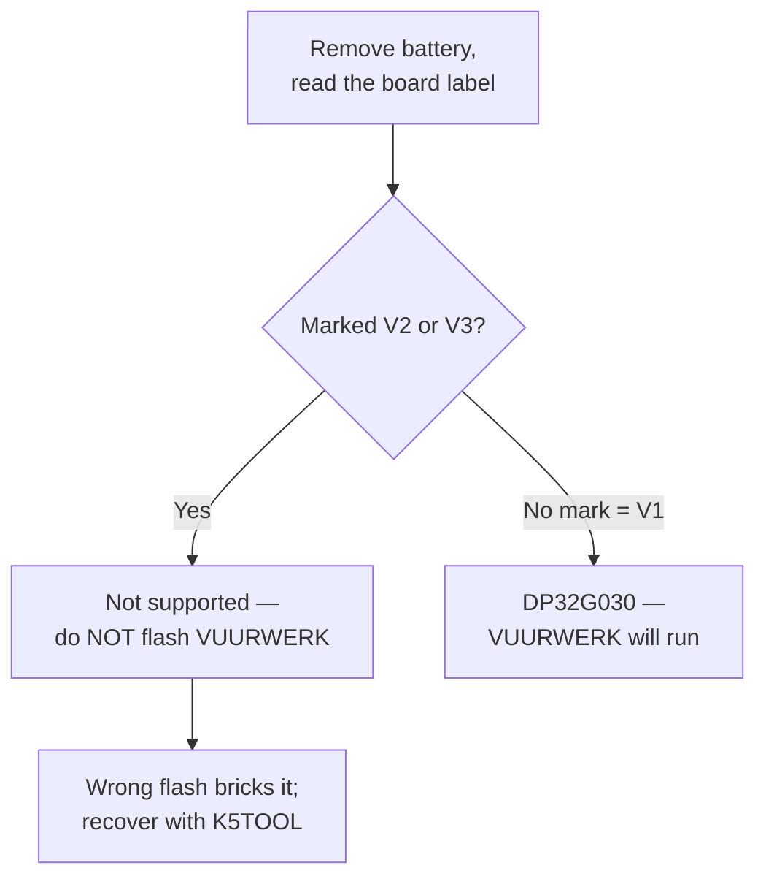
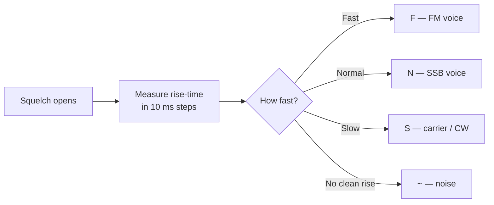
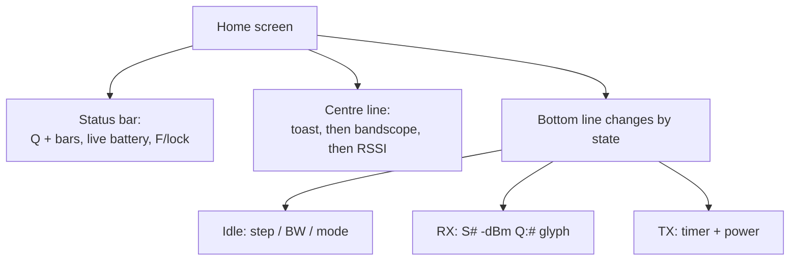
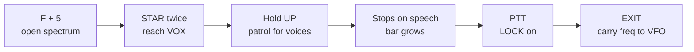

# VUURWERK: bandscope, signal classifier and adaptive audio

Most custom firmware for the UV-K5 hands you more _settings_ — more menus, more numbers to tune, more knobs the stock radio never gave you. VUURWERK ("fireworks", in Afrikaans, by James Honiball KC3TFZ) takes a different bet. It leaves the radio to tune _itself_. Where stock firmware is open-loop — you set a fixed squelch, a fixed gain, and hope the band cooperates — VUURWERK is closed-loop: it measures the noise floor, the signal strength, the audio level and even the _type_ of signal many times a second, and adjusts in real time. The result, when it works, genuinely feels like operating a receiver several price classes up. This page is the narrative tour — how it does that, what each instrument on the screen means, how to actually drive the headline features, and (because it matters more here than on any other firmware in this guide) exactly which radio it will and will not run on. When you want the exhaustive, item-by-item menu table, that lives on its own [complete menu reference](outpost:entry/logbook73.guide.uv-k5/firmware-vuurwerk-menu) page; this one is the story.

## Lineage, and the one hardware fact you cannot skip

VUURWERK is a fork of **egzumer**, the community-standard firmware you met in the [firmware overview](outpost:entry/logbook73.guide.uv-k5/firmware-overview). Its family tree runs `DualTachyon` (the original open reimplementation) → `OneOfEleven` (the big feature layer, including the AM fix) and `fagci` (the spectrum analyser) → `egzumer` (the merge everyone builds on) → **VUURWERK**. The spectrum work you will use most descends directly from fagci's analyser; the CHIRP programming driver (CHIRP is the free, cross-platform tool for editing a radio's memory channels on a computer) descends from Jacek Lipkowski `SQ5BPF`'s Quansheng driver, adapted for VUURWERK by a contributor going by `mjwgeek`. The current release is **v1.5.0** (July 2026), which the author bills as "the stabilization release" — and, as we will see, that word is load-bearing.

Now the fact that matters more than any feature on this page.

**VUURWERK supports the original UV-K5 V1 only — the board built around the DP32G030 microcontroller — and nothing else.** Its own README states this without hedging: newer boards are not supported and will not boot. In VUURWERK's terminology those are the **V2** (which its documentation labels a PY32F030 part) and the **V3** (PY32F071). Flashing VUURWERK onto a V2 or V3 gives you a radio that does not start.

That is narrower than the general rule you learned earlier. The broad MCU split says the whole DP32G030 line — UV-K5, K5(8), K6, 5R Plus, hardware V1 _and_ V2 — runs the classic firmware library. VUURWERK's README frames its own hardware map differently and more conservatively: it claims **V1 only**, and treats even V2 as out of scope. This is exactly the situation the overview warned you about — _when a firmware's own page names the versions it supports, trust that page over any general rule._ So here we go by the repository: V1 / DP32G030 supported; V2 and V3 not. Do not read multi-MCU support into VUURWERK, and never flash it to the newer PY32 boards — that is the `muzkr + armel` port's job, and a different firmware line entirely.

**How to check before you flash:** power off, remove the battery, and read the printed board. In VUURWERK's own words, an _unmarked_ board is the V1 it wants; a board stamped "V2" or "V3" is a newer revision it does not support. A wrong-hardware flash is recoverable — you can rewrite correct stock firmware with **K5TOOL**, which understands every UV-K5 version — but "recoverable" is a rescue, not a plan. Confirm the board first.



## The philosophy: closed-loop reception

Every headline feature on this page is one idea wearing different clothes. A stock radio, and most custom firmware, works _open-loop_: you pick a squelch level, a gain, a bandwidth, and those numbers stay put whether the band is dead quiet or roaring with interference. VUURWERK runs _closed-loop_. It continuously asks the **BK4819** — the radio-on-a-chip that does the actual receiving, which reports noise, glitch and signal-strength figures back to the processor many times a second — _what is happening right now?_, and it moves its own settings to suit. Squelch loosens for a voice and clamps on a pager. Front-end gain rides up and down to keep a signal in the receiver's sweet spot. The screen even tells you what _kind_ of thing it is hearing.

None of this changes the radio's physics — the front end is still cheap and broad, and it still [overloads in strong RF](outpost:entry/logbook73.handbook/overload-and-ghost-signals) — but it wrings a great deal more out of the hardware that is there. Keep the closed-loop idea in mind and the instruments below stop being a jumble of glyphs and become a coherent dashboard.

## The main-screen instruments

VUURWERK turns the ordinary home screen into a live dashboard. Three separate instruments share it, and once you can read them the radio narrates the band to you.

### The live bandscope (F + 7)

Press `F` then `7` and a **bandscope** appears on the screen's centre line: a 128-pixel-wide, 8-pixel-high scrolling strip of RF activity, sampled from the receiver's signal-strength reading roughly every 100 ms. It draws bars for the current signal, leaves **peak-hold dots** that decay about every half-second so you can see a burst that has already passed, and lays down a dotted **noise-floor line** learned per-VFO from the recent signal history. (A VFO — variable frequency oscillator — is one of the radio's two independent tuners, A or B.) It runs without interrupting your audio, and it is suppressed while you transmit. Toggle it back off with `F` + `7` again, and you will see a `SCOPE ON` or `SCOPE OFF` toast confirm the change.

This is not the full-screen spectrum analyser (that is `F` + `5`, below) — it is a permanent, unobtrusive activity strip _on top of_ normal operation, so you are always watching the channel while you listen to it. Think of it as a rear-view mirror: it costs you nothing to leave on, and it quietly shows you a burst of activity you would otherwise only have heard once it opened the squelch.

### The signal classifier (F / N / S / ~)

This is the instrument nothing else on the UV-K5 has. When a signal opens the squelch, VUURWERK measures how _fast_ it rises — in 10 ms steps — and classifies it, printing a single glyph at the end of the receive status line:

| Glyph | Means         | Typical source         |
| ----- | ------------- | ---------------------- |
| `F`   | Fast rise     | FM voice               |
| `N`   | Normal rise   | SSB voice              |
| `S`   | Slow rise     | A steady carrier or CW |
| `~`   | No clean rise | Noise                  |

The classifier resets whenever you change frequency, so the glyph always reflects the signal in front of you, not the last one. It is not only a readout — it also _feeds_ the adaptive gain system, which uses the signal type to choose how long to hold its gain setting (an FM burst wants a short hold, a steady carrier a long one). In practice, that little glyph answers the question every new operator asks: "am I hearing a person, or a machine?" An `F` or `N` is worth listening to; an `S` on a channel that never turns into speech is usually a data link or a stuck carrier you can move past.



### The signal-quality meter (Q + bars)

Alongside the classifier sits a **quality meter**: a `Q` followed by 0–3 bars. VUURWERK computes the _variance_ of the signal strength over an eight-sample window — how much the level jitters — and rates the link accordingly: steady and strong reads EXCELLENT (3 bars), noisy and unstable reads POOR (0 bars), with thresholds around 3, 6 and 10 dB of spread. Like the classifier it throws away its history on a frequency change, so the reading is always about _this_ channel's noise, not the last one's. In plain terms: `Q` with three bars means "solid copy"; `Q` with none means "you are hearing them through the mud." It is the difference between a strong local repeater and a distant mobile fluttering in and out of the noise — and it updates fast enough to _watch_ a station drive under a bridge and back.

### The context-aware bottom line

Tying the instruments together, the screen's bottom line **changes with what the radio is doing**, so it always shows the numbers that matter in that state rather than a fixed layout:

- **Idle:** step / bandwidth / mode.
- **Receiving:** `RX S# -dBm Q:# F/N/S/~` — signal report, absolute level in dBm, the quality meter, and the classifier glyph, all at once.
- **Transmitting:** `TX M:SS PWR:L/M/H` — a running timer and your power level.
- **Scanning:** `SCANNING`.



The centre line has a strict priority order, so instruments never fight: a one-second **toast** overlay (a bordered pop-up like `PWR: HIGH` or `SQL: 5`) sits on top, the bandscope shows beneath it when enabled, and an optional plain signal-strength bar sits under that. This is why nearly every VUURWERK shortcut flashes a toast — the firmware is telling you, in one glance, exactly what you just changed, then getting out of your way.

## The voice-seeking spectrum (F + 5, then STAR to VOX)

Press `F` + `5` and the whole screen becomes a full-screen spectrum analyser — the inherited fagci band scope. Pressing `STAR` (`*`) cycles it through three modes, each announced with a `MODE <name>` overlay: **NORM** (plain bars), **PEAK** (bars plus peak-hold dots), and the signature one, **VOX**.

VOX mode is what VUURWERK's README claims no other UV-K5 firmware does. Instead of drawing bars for raw signal strength — which lights up every carrier, birdie (a spurious internal tone the receiver generates itself) and pager equally — it scores each frequency slice for the _probability that it contains a human voice_, using the BK4819's noise/voice predictor. Carriers, data bursts and pagers stay flat; actual conversations grow bars (half-height for a middling score of 50–74, full-height for a strong 75-plus, a floor dot for anything below the threshold, and a tick marking every slice you can hop to). You then hunt _voices_, not signals.

### How to actually drive the voice-seeker

Once you are in the full-screen spectrum with `VOX` in the corner, the keys change meaning:

- **`UP` / `DOWN`** hop straight to the next voice-scoring slice, skipping the dead carriers between; with no voice that way they fall through to ordinary band stepping. Hold a key to patrol the band, auto-stopping on speech.
- **`SIDE1` / `SIDE2`** (the two buttons on the left edge of the radio) nudge the frequency up / down one step, auto-repeating while held — useful for fine-tuning onto a signal the hop landed near but not on.
- **`MENU`** blacklists the current peak so a persistent birdie stops grabbing you. Blacklist the two or three worst offenders on your band and the hop suddenly behaves.
- **`PTT` while listening** _locks on_: a flashing `LOCKED` banner parks you on that conversation with the squelch held open through its pauses, so a gap between overs does not throw you back into the sweep.
- **`EXIT` while locked**, in frequency mode, **carries the locked frequency into your VFO** — so you leave the spectrum already tuned to the QSO you found, ready to listen or answer.

A typical hunt, start to finish, looks like this: `F` + `5` to open the analyser, tap `STAR` twice to reach `VOX`, hold `UP` to patrol upward, wait for it to stop and grow a bar, tap `PTT` to lock, listen to confirm it is what you wanted, then `EXIT` to drop that frequency into your working VFO.



An honest caveat, because it is the whole reason to insist on the current release. The v1.4.x and v1.5.0 changelog is _dominated_ by fixing spectrum-exit bugs — radios coming back "deaf" after leaving the analyser, or silently flipping to the other VFO on the way out. v1.5.0 is billed as the stabilization release precisely because it drains the keyboard until you release and returns cleanly after tearing the spectrum down. The voice-seeking spectrum is powerful, but it has been historically fragile — **run v1.5.0 or later**, not an older build.

```viz
{
  "type": "waterfall",
  "title": "What the voice-seeking spectrum ignores, and what it chases",
  "caption": "A normal scope lights up every signal equally; VOX mode scores for speech, so the steady carrier and CW pips stay dark and only the SSB and FM voices draw bars.",
  "xLabel": "Frequency across the sweep",
  "yLabel": "Time (newest at top)",
  "signals": [
    { "f": 18, "kind": "carrier" },
    { "f": 38, "kind": "cw" },
    { "f": 58, "width": 8, "kind": "ssb" },
    { "f": 82, "width": 6, "kind": "fm" }
  ]
}
```

## The receive smarts working underneath

Three subsystems run below the instruments, quietly bending the radio's behaviour toward voices.

**Smart squelch** is the crown jewel of the "intelligence" story. Instead of the stock radio's single noise gate, it reads _three_ hardware measurements at once — the noise indicator, the glitch indicator, and the signal-strength-versus-adaptive-noise-floor ratio (a genuine signal-to-noise estimate) — and blends them into a 0–100 voice-probability score. Crucially, during reception it only ever **loosens** the hardware squelch, never tightens it: it opens for things that score like voices and stays shut for pagers, glitches and noise. From v1.3.1 it can even apply a "parked pre-bias", easing the threshold by roughly 1 dB for a strong-scoring weak voice _before_ the hardware squelch opens — and that trick is hard-gated off during any scan, VFO split, or transmit, so it never misbehaves where it might. In plain terms, this is why a weak voice that a stock radio chops into fragments can stay open and readable here: the squelch is being judged by "does this sound like speech?" and not merely "is it loud enough?".

The base `Sql` menu setting (0–9, also on `F` + `4`) still sets the floor the smart layer works from. Leave it around 3–4 for general listening; drop it lower only in a genuinely quiet location, because a too-open squelch gives the smart layer more noise to sift and burns battery keeping the audio stage awake.

**Adaptive front-end gain** (FM only) rides the receiver's front-end gain up and down in real time, aiming for a target signal level, with a fast grab on strong signals and a gentle one-step-per-tick release. The signal classifier decides how long to hold each setting. In AM and SSB the inherited "AM fix" owns that gain instead, so the two never collide; and during a scan the whole thing yields to the chip's own automatic gain control (an earlier version's over-eagerness here caused a "deaf scanner" report that was later fixed).

**Squelch-tail elimination (STE)** mutes the "KSSHHH" burst at the end of the other station's over by watching for the loss of their sub-audible tone — and it does so for both CTCSS (an analogue sub-audible tone) and DCS (a digital squelch code). It lives in the TONE menu as `STE` and `RP STE` (the repeater variant, which adds a short delay to suit tone-access repeaters). Turn both on and the end of every over goes cleanly silent instead of spitting noise at you.

## The transmit chain

VUURWERK does not transmit anything the stock radio cannot — it is still a modest budget FM transmitter — but it _polishes_ the moment you key up. Four things fire on every press of the PTT:

| Stage                  | What it does                                                                                              | Why it matters                                                                 |
| ---------------------- | --------------------------------------------------------------------------------------------------------- | ------------------------------------------------------------------------------ |
| **TX soft start**      | Ramps the power amplifier up on a 6-step cosine curve over 60 ms                                          | Kills the audible "click" other radios hear at your key-up                     |
| **CTCSS lead-in**      | Mutes the mic for the first 150 ms _only when a tone is set_, so the repeater decodes your sub-tone first | No clipped first syllable through tone-access [repeaters](outpost:entry/logbook73.handbook/repeaters) |
| **TX compressor**      | Real-time level control on the mic — a ~3:1 ratio above a threshold, gentle 5 ms attack / 300 ms release  | Transparent at normal level, smoothly catches shouts and close-talking         |
| **Live battery + sag** | Keeps the battery icon updating during transmit, and tracks voltage droop                                 | Stock firmware freezes the icon while keyed; this does not                     |

Two honest caveats. The **TX compressor is not fully settled** — the firmware's own in-source diagnostic comments (from v1.3.1) flag its default threshold as probably _too aggressive_, warning it may peg at maximum reduction on ordinary speech. Treat compressor tuning as a work in progress; there is a diagnostic build to recalibrate it if you want to dig in. And the **live battery-during-transmit** feature pairs with a _sag tracker_ that latches the voltage droop each time you key: from v1.3.1 it pops a `SAG x.xxV` toast when the droop crosses about 0.20 V. As a rough guide the firmware's own notes call 50–100 mV healthy, 200–300 mV a "tired" pack, and 400 mV or more an ageing one. It is an early-warning light for a battery on its way out — genuinely useful, and the sort of instrumentation you do not get on a stock handheld. (For what the droop is telling you, see [RF Power](outpost:entry/logbook73.handbook/rf-power).)

### Setting up the power ladder

Transmit power lives in one place with a live shortcut. In the TX category, `TxPwr` sets **LOW / MID / HIGH** _per channel_ and saves it to that channel's memory; on the fly, `F` + `6` cycles the same three levels with a `PWR: LOW/MID/HIGH` toast and no menu diving. The workflow that keeps a budget handheld honest is to think of it as a ladder, not a switch:

- **LOW** for anything you can hit easily — a repeater across town, a mate on the next street, simplex around the house. Least battery drain, least heat, least interference to others.
- **MID** as your default reach-out level for repeaters you use daily.
- **HIGH** reserved for the marginal contact — the distant repeater, the mobile fading under a hill. Save it for when LOW and MID genuinely will not close the path, because HIGH sags the battery hardest (watch for that `SAG` toast) and warms the radio.

Because power is stored per channel, you can program a busy local repeater at LOW and a fringe one at HIGH, and the radio remembers which is which as you spin the dial. Set it in `TxPwr` when you build the channel; nudge it live with `F` + `6` when conditions change.

## The scan lists, in practice

VUURWERK groups all the scanning controls in the SCAN category, and the pieces fit together like this. Each memory channel can belong to **scan list 1**, **scan list 2**, both, or neither — you set that with `ScAdd1` and `ScAdd2` (OFF/ON) while sitting on the channel. `SList` then chooses which list the scanner actually sweeps: `LIST1`, `LIST2`, or `ALL`. `SList1` and `SList2` let you browse and edit the membership of each list, and they show any priority channels (`PRI1`/`PRI2`) the list is watching more often.

`ScnRev` (scan resume mode) decides what happens when the scanner stops on a busy channel:

| Mode      | Behaviour                                                       | Good for                              |
| --------- | --------------------------------------------------------------- | ------------------------------------- |
| `TIMEOUT` | Pause on the signal, then resume after a few seconds regardless | Casual band-watching                  |
| `CARRIER` | Hold as long as the signal is present, resume when it drops     | Following a conversation to its end   |
| `STOP`    | Stop and stay put                                               | Grabbing a channel you want to answer |

A practical setup: put your everyday repeaters and simplex calling channels in list 1, put the "occasionally interesting" channels (a distant repeater, an event frequency) in list 2, set `SList` to `LIST1` for daily use, and switch it to `ALL` when you want the wider sweep. Use `CARRIER` resume so the scanner rides a conversation rather than jumping off mid-sentence.

Sitting one level up is **`ScnWch`** — a VUURWERK-original control that does double duty. It combines "scan-and-watch" with VFO split in one menu item:

- `OFF` — normal single-VFO behaviour.
- `SCAN A WATCH B` / `SCAN B WATCH A` — scan one VFO while periodically dipping back to check the other, so you can sweep list activity without going deaf on your home repeater. This now re-arms on every scan start and survives a scan stop (it was a one-shot in early builds).
- `SPLIT` — VFO B walks the memory list checking for activity while you keep listening on VFO A; the VFO B line visibly steps through the channels as it goes.

## Configuring the side keys

The two buttons on the left edge — `SIDE1` (upper) and `SIDE2` (lower) — plus a long-press of the `MENU` key are fully programmable, each with an independent short-press and long-press action. That is five assignable slots in the CONFIG category: `F1Shrt`, `F1Long`, `F2Shrt`, `F2Long` and `M Long`. Each is set from the same list of actions (the exact set depends on how the shipped build was compiled):

`NONE`, `FLASH LIGHT`, `POWER`, `MONITOR`, `SCAN`, `VOX`, `ALARM`, `FM RADIO`, `1750HZ`, `LOCK KEYPAD`, `SWITCH VFO`, `VFO/MR`, `SWITCH DEMODUL`, `BLMIN TMP OFF`, `SPECTRUM`.

A few of these earn their place immediately. `MONITOR` (open the squelch while held, to hear a signal too weak to break it) is the single most useful thing to put on a short press — most operators live on it. `SPECTRUM` on a long press gives you the analyser without the `F` + `5` two-key dance. `SWITCH DEMODUL` (cycle FM → AM → USB) is handy if you listen across modes; `BLMIN TMP OFF` momentarily kills the idle backlight glow for night work. Assign what you reach for, and remember that any side-key action fires a one-second toast so you always see what happened. A sensible starting layout: `SIDE1` short = `MONITOR`, `SIDE1` long = `FLASH LIGHT`, `SIDE2` short = `SCAN`, `SIDE2` long = `SPECTRUM`.

## Rescue and self-care

**F + EXIT — reset to simplex.** One of the most common UV-K5 puzzles is a VFO that lights the green receive light but stays silent — almost always a leftover per-VFO setting quietly gating your audio: a receive CTCSS/DCS tone waiting for a match that never comes, a repeater offset with reverse engaged, or a scrambler left on. `F` + `EXIT` wipes the _active_ VFO back to clean simplex in one gesture — receive and transmit tones cleared, offset and direction cleared, reverse off, scrambler off, mode forced to FM — and pops a `SIMPLEX` toast. Your memory channels are never touched (in memory mode it shows `FREQ ONLY` and does nothing destructive). **Important version note:** this chord was _dead code_ until v1.4.5 — before that, the stock firmware cancelled the F-key when you pressed EXIT, so the gesture just flipped VFOs instead. Only trust it on **v1.4.5 or later**. On an older build, clear the leftover by hand: set the menu's receive CTCSS / DCS to OFF.

**Boot-time health probe.** Once at power-on, VUURWERK reads a chip register to detect a wedged internal bus, and reads the battery-calibration memory page _twice_ to catch a blanked or floating memory bus (all-zeros, all-ones, or two reads that disagree). If it finds a fault it latches it and prints a plain-text banner on the welcome screen — so a failing radio tells you _why_, instead of behaving mysteriously. The same diagnostics, plus the battery-sag readout, are reachable any time from the About screen at Menu > CONFIG > About.

**Self-care housekeeping.** The flashlight auto-extinguishes after 30 minutes (10 on a low battery, though an SOS is preserved) so a pocket press cannot drain the pack overnight; the backlight _fades_ out over about 2 seconds rather than snapping to black, and stays lit while you are actually talking or listening if you enable `BltTRX`; and a scan-rate counter shows channels-per-second while scanning.

**Audio palette.** VUURWERK adds short two-note chords the stock five-tone beep vocabulary cannot make — an ascending 800→1200 Hz chord when a spectrum hop lands on a voice, a soft double-beep when a sweep finds none — so you can operate the voice-seeker partly by ear, without staring at the screen.

## How the menu differs from stock

VUURWERK reorganises the flat stock menu into a **category picker**: pressing `MENU` shows six groups — RECEIVE, TONE, TX, SCAN, CHANNEL, CONFIG — with a plain-language hint line explaining each cryptic item as you browse. Number keys `1`–`6` jump straight to a category instead of scrolling, and each category remembers where you last were. A hidden seventh **UNLOCK** category (with F-lock, the out-of-band transmit enables, scrambler enable, battery calibration and type, and factory reset) appears only if you hold `PTT` + the upper side button at power-on. The out-of-band transmit switches are yours to answer for legally — the radio's capability is never your permission, and transmitting outside your [licence conditions](outpost:entry/logbook73.handbook/getting-licensed) is illegal whatever the menu allows.

Beyond the reorganisation, a handful of items are genuinely new or renamed versus a stock UV-K5. These are the highest-value differences to know:

| VUURWERK item                  | Stock equivalent            | What changed                                             |
| ------------------------------ | --------------------------- | -------------------------------------------------------- |
| Category picker + hints        | Flat scrolling list         | Six groups, `1`–`6` jump, plain-language hint line       |
| `ScnWch`                       | (none)                      | New: Scan+Watch _and_ VFO Split in one control           |
| `About`                        | (none)                      | New: boot-health and battery-sag info screen (CONFIG)    |
| `RxMode`                       | `TDR`                       | Dual-watch / cross-band, renamed and clarified (4 modes) |
| `Tx 200` / `Tx 350` / `Tx 500` | `200TX` / `350TX` / `500TX` | Out-of-band TX enables, renamed (UNLOCK)                 |
| `350 En`                       | `350EN`                     | 350 MHz receive-band enable, renamed (UNLOCK)            |
| `ScraEn`                       | `SCREN`                     | Master scrambler enable, renamed (UNLOCK)                |
| `STE` / `RP STE`               | `STE` / `RP STE`            | Now works for both CTCSS _and_ DCS                       |

Everything else — step, tone, bandwidth, scan lists, backlight, DTMF and so on — keeps its stock meaning, just filed under a category. The full list, all 75 items plus the hidden UNLOCK set, with every value and every quirk, is on the dedicated menu reference (see "Where to go deeper" below).

The full `F`-key shortcut map, verified in the firmware's access documentation:

| Keys                                  | Action                                                  |
| ------------------------------------- | ------------------------------------------------------- |
| `F` then `0`                          | Cycle modulation FM → AM → USB                          |
| `F` then `1`                          | Cycle band (VFO/frequency mode only)                    |
| `F` then `2`                          | Toggle active VFO A / B                                 |
| `F` then `3`                          | Toggle VFO (frequency) / MR (memory) mode               |
| `F` then `4`                          | Cycle squelch level 0–9                                 |
| `F` then `5`                          | Full-screen spectrum (`STAR` cycles NORM / PEAK / VOX)  |
| `F` then `6`                          | Cycle TX power LOW → MID → HIGH                         |
| `F` then `7`                          | Toggle main-screen bandscope                            |
| `F` then `8`                          | Reverse repeater offset                                 |
| `F` then `9`                          | Jump to band calling frequency (press again to restore) |
| `F` then `STAR`                       | CTCSS/DCS code scanner on the current frequency         |
| `F` then `EXIT`                       | Reset active VFO to simplex (**v1.4.5+**)               |
| Long-press `F`                        | Key lock                                                |
| `PTT` + upper side button at power-on | Reveal the hidden UNLOCK menu                           |
| `PTT` + power-on                      | Enter bootloader / flash mode                           |

Every toggling shortcut confirms with a one-second toast, so you always see what you changed. `F` + `9` deserves a special mention: it jumps straight to the band's calling frequency (146.520 MHz FM on 2 m, 446.000 on 70 cm, and so on) with the right step and modulation already set, and a second press puts you back where you were — the fastest way to "go and see who is about" on a new band.

## Flashing and building

**Flashing** follows the same path as the rest of the family, from the pre-built `vuurwerk-v1.5.0.packed.bin`:

1. Turn the radio off.
2. Hold `PTT` and power on — the flashlight LED confirms bootloader mode.
3. Connect the standard Kenwood-style 2-pin programming cable.
4. Open the egzumer web flasher at `https://egzumer.github.io/uvtools/` **in Chrome** — it uses the Web Serial API and will _not_ work in Firefox or Safari.
5. Select the `.packed.bin`, flash, wait about 10 seconds, disconnect and power-cycle.

Channels and settings survive the flash. If anything goes wrong — or you discover too late the board was a V2/V3 — recover with **K5TOOL**. The general safety drill from the [flashing page](outpost:entry/logbook73.guide.uv-k5/firmware-flashing) still applies: back up your EEPROM and calibration first.

If you prefer to edit memories without reflashing, the community CHIRP driver (`mjwgeek`'s, in the repo's `chirp/` folder) reads and writes channels, side keys and settings over the cable.

**Building from source** works like the egzumer parent: an ARM GCC cross-toolchain (`arm-none-eabi-gcc`) plus GNU Make. The _canonical_ build is Dockerised so every machine produces byte-identical firmware — `make clean`, `docker build`, then a `docker run` that copies the compiled files out — and there are native macOS, Linux and Windows recipes in the build notes (all needing Python's `crcmod` for the final packaging step, which adds the version header and CRC in Quansheng's updater format). The build is compiled hard for size (`-Os`, link-time optimisation, warnings-as-errors), and for good reason: **the flash budget is brutally tight — v1.5.0's canonical Docker build fills 61,396 of 61,440 bytes, leaving just 44 bytes free.** That single number explains the whole engineering style — integer-only maths everywhere, registers written only when they change, no wasted bytes. Add anything of your own and you will almost certainly have to trim something to fit; the linker fails loudly on overflow.

(A note for anyone thinking of reusing the code: while the whole firmware ships under GPL-3.0, VUURWERK's _own_ modules additionally carry a commercial-license clause and may not be lifted into other projects without the author's written permission. Fine to run and study; ask before you port.)

## Is it really "gear ten times the price"?

Honestly? For _receiving_, it earns a lot of that claim. Watching the bandscope while the classifier tells you `F` for an FM voice and the quality meter shows three bars, then hopping the voice-seeker straight onto a distant SSB conversation and carrying it into your VFO with one keypress — that is an operating experience the stock radio, and most of its rivals at any price, simply do not offer. The closed-loop squelch and gain make weak signals easier to pull out of the noise than fixed thresholds ever will.

But keep two things straight. The "no other firmware does this" and "ten times the price" lines are the author's marketing, not measured fact — take them as enthusiasm, not specification. And none of it changes the _transmitter_ or the budget front end: VUURWERK makes the radio dramatically _cleverer_, never better _built_. It is the sharpest receiver brain in this guide, bolted to the same modest hardware — and that is exactly what makes it delightful.

## Where to go deeper

This page is the narrative — the ideas, the walkthroughs, the caveats. The exhaustive, item-by-item catalogue is a separate reference so it does not clutter the story:

- **[Complete VUURWERK menu reference](outpost:entry/logbook73.guide.uv-k5/firmware-vuurwerk-menu)** — all 75 menu items grouped by category, every value each one accepts, the hidden UNLOCK set, and the quirks (octal DCS codes, the CSS code-scan animation, conditional-compile items). Reach for it when you want to know exactly what a cryptic short name does.
- **[Firmware overview](outpost:entry/logbook73.guide.uv-k5/firmware-overview)** — where VUURWERK sits in the family, and the MCU split in full.
- **[Overload and ghost signals](outpost:entry/logbook73.handbook/overload-and-ghost-signals)** — why even the cleverest firmware cannot fix a broad front end.

## Try it yourself

On a **UV-K5 V1** already running VUURWERK v1.5.0 (do the board-label check first if you are not certain):

1. Press `F` + `7` to switch on the bandscope. Leave it on and just _watch_ the centre line for a minute on a busy band — see the bars rise and the peak-hold dots linger.
2. Tune to a repeater or a chatty simplex channel and read the bottom line as someone talks: note the `Q` bars and the classifier glyph. Is it `F` (FM)? Does the quality drop when they mobile-flutter?
3. Press `F` + `5`, then tap `STAR` until the corner reads `VOX`. Hold `UP` and let it patrol — it should skip the dead carriers and stop on voices. When it finds one, tap `PTT` to lock, then `EXIT` to carry that frequency into your VFO.
4. Open the SCAN menu, add a couple of channels to list 1 with `ScAdd1`, set `SList` to `LIST1` and `ScnRev` to `CARRIER`, then start a scan and watch it ride a conversation instead of jumping off.
5. If a VFO ever lights the green light but stays silent, press `F` + `EXIT` and watch for the `SIMPLEX` toast — the one-gesture cure for a leftover tone or offset.

## Key takeaways

- VUURWERK is a **closed-loop** fork of egzumer: it measures noise, signal strength, audio level and signal _type_ continuously and adapts squelch, gain and audio in real time — the opposite of stock's set-and-hope approach.
- **Hardware lock, by its own README: UV-K5 V1 / DP32G030 only.** It treats V2 and V3 as unsupported and they will not boot — trust this firmware's page over any general MCU rule. Confirm by the board label (unmarked = V1) before flashing; recover a wrong flash with K5TOOL.
- The main-screen instruments are a live dashboard: **bandscope** (`F`+`7`), **signal classifier** (`F`/`N`/`S`/`~` by rise-time), **quality meter** (`Q` + bars from signal variance) and a **context-aware bottom line** that changes with the radio's state.
- The signature feature is the **voice-seeking spectrum** (`F`+`5`, then `STAR` to VOX): score slices for _speech probability_, hold `UP` to patrol, `PTT` to lock, `EXIT` to carry the QSO into your VFO — powerful but historically buggy on exit, so run **v1.5.0 or later**.
- Practical setup lives in the categorised menu: a **per-channel power ladder** (`TxPwr` / `F`+`6`), **two scan lists** with resume modes (`ScAdd1/2`, `SList`, `ScnRev`, `ScnWch`), and **five programmable side-key slots** (`F1Shrt` … `M Long`) — with `MONITOR` and `SPECTRUM` the best first assignments.
- A polished transmit chain (soft start, CTCSS lead-in, compressor) and self-care touches (boot health probe, live TX battery + `SAG` warning, `F`+`EXIT` reset-to-simplex) round it out — with two honest caveats: the **compressor threshold is not fully tuned**, and **`F`+`EXIT` only works from v1.4.5**.
- The flash budget is brutal — **44 bytes free** — which explains the integer-only, write-on-change engineering; flash the `.packed.bin` via the egzumer web flasher in **Chrome only**, and use the [complete menu reference](outpost:entry/logbook73.guide.uv-k5/firmware-vuurwerk-menu) when you need the exhaustive item table.

VUURWERK, egzumer and F4HWN each pull in a different direction — now let us line them up side by side and pick the right one for you in [Choosing Your Firmware](outpost:entry/logbook73.guide.uv-k5/firmware-choosing).
