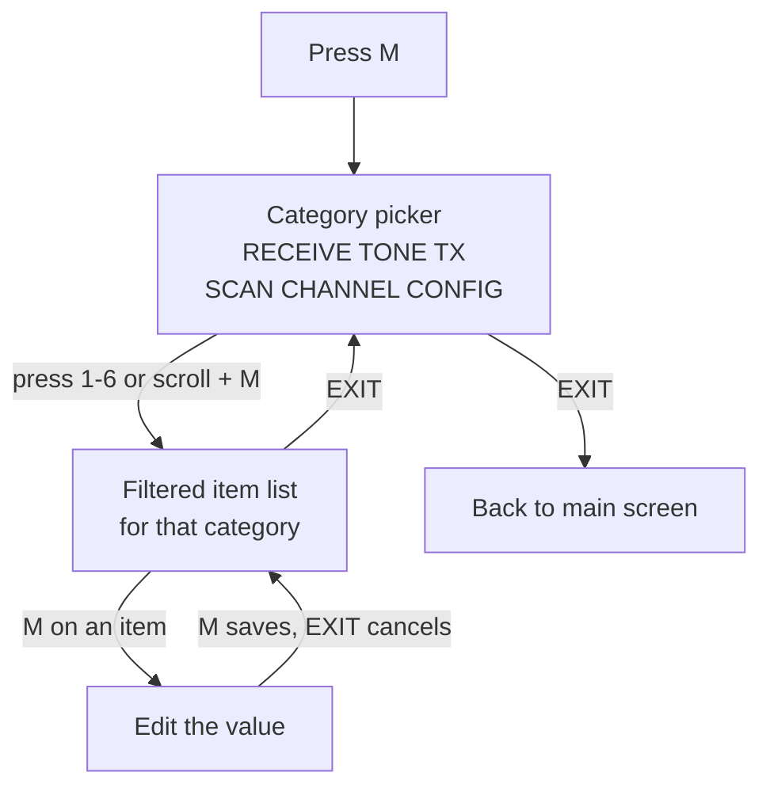
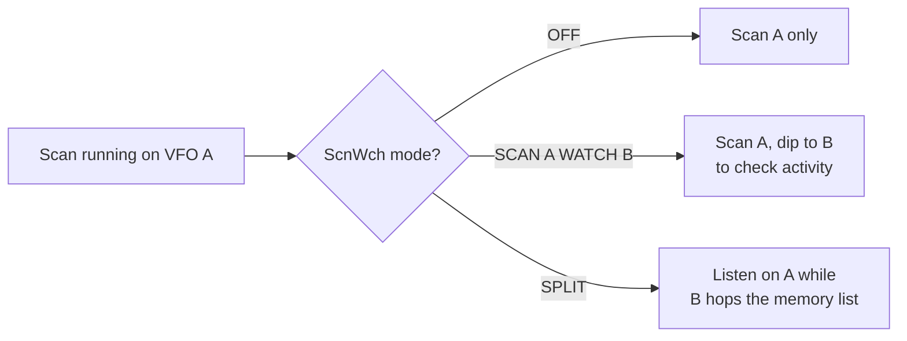

# VUURWERK menu reference

If you have flashed VUURWERK and gone looking for the familiar stock menu, you will find it gone. Where the factory firmware gives you one long numbered scroll of fifty-five cryptic items, VUURWERK sorts everything into six named categories, renames most items, folds in a live spectrum analyser, and adds a clutch of signature features you will not find anywhere else — a Scan-and-Watch mode, an About screen that reports the radio's own health, and a smart squelch that scores how likely a signal is to be speech. This page is the complete map: every normal menu item in one table, the notable ones explained in depth, and the hidden calibration block treated with the care it deserves.

A reminder before anything else: **VUURWERK runs on the original UV-K5 (V1) only** — the one built around the DP32G030 microcontroller (the chip that runs the radio). The later boards, the V2 (PY32F030) and V3 (PY32F071), will **not** boot this firmware and can only be rescued with a tool called K5TOOL. If you are unsure which board you have, stop and read [Firmware Flashing](outpost:entry/logbook73.guide.uv-k5/firmware-flashing) before you do anything. Nothing in the ordinary menu below can harm the radio; the hidden block near the end can, and it gets its own warning.

## How the VUURWERK menu is built

The stock radio hides its settings behind a single flat list — you either remember that squelch is item `01` or you scroll through everything to find it. VUURWERK throws that away and builds a **category menu** instead. Press **M** (the Menu/Confirm key) and you land on a picker showing six categories: `RECEIVE`, `TONE`, `TX`, `SCAN`, `CHANNEL` and `CONFIG`. Choose one and you drop into just the handful of items that belong to it.

The navigation is quick once it clicks:

- **In the picker**, press number keys **1**–**6** to jump straight into a category (`1`=RECEIVE, `2`=TONE, `3`=TX, `4`=SCAN, `5`=CHANNEL, `6`=CONFIG), or scroll with **▲/▼** and press **M**.
- **Inside a category**, scroll the items with **▲/▼** (the list wraps), or type the item's position number to jump to it. The radio **remembers where you were** in each category until you power off, so returning to a category you were just editing lands you back on the same item.
- **M** opens an item for editing; **M** again saves and steps back to the list; **EXIT** cancels the edit.
- **EXIT from the item list** returns you to the picker (not straight out), parked on the category you left. **EXIT from the picker** leaves the menu.

There is a seventh category, `UNLOCK`, that only appears once you have deliberately unlocked it. That is the hidden calibration block, covered right at the end. If you never unlock it, you never see it.

A note on one thing VUURWERK does **not** do: unlike stock, a long-press of **M** is not a "jump to last item" shortcut here — `M Long` is a fully configurable action key you assign yourself (more on that under [Side keys](#side-keys-and-the-menu-long-press)).

## Reading the six-character labels

The screen can only spare six characters for a menu name, so VUURWERK squeezes each one down: `TxODir` is the transmit offset direction, `BusyCL` is busy-channel lockout, `ScnWch` is Scan-and-Watch. They read more clearly than the stock four-letter codes, but a few still need decoding, and the table below spells every one out in full.

VUURWERK adds a genuine help: while you are browsing an item (before you open it to edit), the bottom row of the screen shows a **plain-language hint** in a tiny font for the trickier settings — `TxOffs` shows `REPEATER OFFSET FREQUENCY`, `STE` shows `MUTE SQUELCH TAIL ON RX END`. Around forty items carry a hint; the rest just show their category and position. If you are ever unsure what a cryptic label means, pause on it and read the hint line before you change anything.

## The full VUURWERK menu (all 65 items)

Every ordinary menu item, in the firmware's internal (source) order. The **Stock equivalent** column points to the factory item it grew from, so you can carry over what you already know; a dash means the feature is new in VUURWERK (or inherited from the egzumer firmware it forks from). Remember you will actually _meet_ these grouped by category, not in this flat order — but the order below is how they sit in the firmware and how the deeper explanations that follow are organised.

| Name     | What it does                                                     | Values                                                              | Stock equiv.  |
| -------- | ---------------------------------------------------------------- | ------------------------------------------------------------------- | ------------- |
| `Step`   | Tuning step for the current VFO                                  | `2.5` / `5` / `6.25` / `8.33` / `10` / `12.5` / `25` kHz (+ others) | `STEP`        |
| `TxPwr`  | Transmit power level                                             | `LOW` / `MID` / `HIGH`                                              | `TXP`         |
| `RxDCS`  | Digital code (DCS) an incoming signal must carry to open squelch | `OFF` / `D023N`–`D754N` / `D023I`–`D754I`                           | `R_DCS`       |
| `RxCTCS` | Sub-audible tone (CTCSS) an incoming signal must carry           | `OFF` / 50 tones `67.0`–`254.1` Hz                                  | `R_CTCS`      |
| `TxDCS`  | Digital code (DCS) sent with everything you transmit             | `OFF` / `D023N`–`D754N` / `D023I`–`D754I`                           | `T_DCS`       |
| `TxCTCS` | Access tone (CTCSS) sent under your audio                        | `OFF` / 50 tones `67.0`–`254.1` Hz                                  | `T_CTCS`      |
| `TxODir` | Repeater shift direction                                         | `OFF` / `+` / `-`                                                   | `SFT-D`       |
| `TxOffs` | Repeater offset amount                                           | `0`–`99.99999` MHz                                                  | `OFFSET`      |
| `W/N`    | FM bandwidth, wide or narrow                                     | `WIDE` / `NARROW`                                                   | `W/N`         |
| `Scramb` | Voice-inversion scrambler frequency                              | `OFF` / `2600`–`3500` Hz (11 steps)                                 | `SCR`         |
| `BusyCL` | Busy-channel lockout — no TX while the channel is busy           | `OFF` / `ON`                                                        | `BCL`         |
| `Compnd` | Audio compander (noise reduction) direction                      | `OFF` / `TX` / `RX` / `TX/RX`                                       | — (egzumer)   |
| `Demodu` | Demodulation mode                                                | `FM` / `AM` / `USB`                                                 | `AM`          |
| `ScAdd1` | Add current channel to scan list 1                               | `OFF` / `ON`                                                        | `S-ADD1`      |
| `ScAdd2` | Add current channel to scan list 2                               | `OFF` / `ON`                                                        | `S-ADD2`      |
| `ChSave` | Save current VFO into a memory channel                           | channel `0`–`last`                                                  | `MEM-CH`      |
| `ChDele` | Delete a stored memory channel                                   | channel `0`–`last`                                                  | `DEL-CH`      |
| `ChName` | Edit a channel's 10-character name                               | text entry                                                          | — (egzumer)   |
| `SList`  | Which scan list(s) the scanner uses                              | `LIST1` / `LIST2` / `ALL`                                           | `S-LIST`      |
| `SList1` | View/edit the channels in scan list 1                            | channel selection                                                   | `SLIST1`      |
| `SList2` | View/edit the channels in scan list 2                            | channel selection                                                   | `SLIST2`      |
| `ScnRev` | Scan resume mode                                                 | `TIMEOUT` / `CARRIER` / `STOP`                                      | `SC-REV`      |
| `NOAA-S` | NOAA weather-channel auto scan                                   | `OFF` / `ON`                                                        | `NOAA_S`      |
| `F1Shrt` | Upper side key, short-press action                               | side-function list                                                  | `F1Shrt`      |
| `F1Long` | Upper side key, long-press action                                | side-function list                                                  | `F1Long`      |
| `F2Shrt` | Lower side key, short-press action                               | side-function list                                                  | `F2Shrt`      |
| `F2Long` | Lower side key, long-press action                                | side-function list                                                  | `F2Long`      |
| `M Long` | Menu/M key, long-press action                                    | side-function list                                                  | `M Long`      |
| `KeyLck` | Automatic keypad lock after idle                                 | `OFF` / `AUTO`                                                      | `AUTOLk`      |
| `TxTOut` | Transmit time-out (stuck-mic cut-off)                            | `30 sec` / `1`–`9 min` / `15 min`                                   | `TOT`         |
| `BatSav` | Battery-save duty cycle                                          | `OFF` / `1:1` / `1:2` / `1:3` / `1:4`                               | `SAVE`        |
| `Mic`    | Microphone gain                                                  | `0`–`4` (shown as `+X.XdB`)                                         | `MIC`         |
| `MicBar` | Live mic-level bar during TX                                     | `OFF` / `ON`                                                        | — (audio bar) |
| `ChDisp` | What memory channels show on screen                              | `FREQ` / `CHANNEL` / `NAME` / `NAME+FREQ`                           | `MDF`         |
| `POnMsg` | Power-on screen message style                                    | `FULL` / `MESSAGE` / `VOLTAGE` / `NONE`                             | `PONMSG`      |
| `BatTxt` | Battery readout format on the status bar                         | `NONE` / `VOLTAGE` / `PERCENT`                                      | — (egzumer)   |
| `BackLt` | Backlight auto-off time                                          | `OFF` / `5`–`20 sec` / `1`–`4 min` / `ON`                           | `ABR`         |
| `BLMin`  | Backlight minimum (idle) brightness                              | `0`–`9`                                                             | — (egzumer)   |
| `BLMax`  | Backlight maximum (active) brightness                            | `1`–`10`                                                            | — (egzumer)   |
| `BltTRX` | Keep backlight lit during TX/RX                                  | `OFF` / `TX` / `RX` / `TX/RX`                                       | — (egzumer)   |
| `Beep`   | Keypad confirmation beep                                         | `OFF` / `ON`                                                        | `BEEP`        |
| `Voice`  | Spoken voice prompts                                             | `OFF` / `CHI` / `ENG`                                               | `VOICE`       |
| `Roger`  | End-of-transmission tone                                         | `OFF` / `ROGER` / `MDC`                                             | `ROGER`       |
| `STE`    | Squelch-tail elimination on RX end                               | `OFF` / `ON`                                                        | `STE`         |
| `RP STE` | Repeater squelch-tail delay                                      | `OFF` / `1`–`10` (×100 ms)                                          | `RP-STE`      |
| `1 Call` | One-key priority (call) channel                                  | channel `0`–`last`                                                  | `1-CALL`      |
| `AlarmT` | Alarm mode when the alarm action fires                           | `SITE` / `TONE`                                                     | `AL-MOD`      |
| `ANI ID` | Your DTMF auto-number ID                                         | code entry                                                          | `ANI-ID`      |
| `UPCode` | DTMF code sent at the start of a transmission                    | up to 16 digits                                                     | `UPCODE`      |
| `DWCode` | DTMF code sent at the end of a transmission                      | up to 16 digits                                                     | `DWCODE`      |
| `PTT ID` | When to send the up/down DTMF codes                              | `OFF` / `UP CODE` / `DOWN CODE` / `UP+DOWN CODE` / `APOLLO QUINDAR` | `PTT-ID`      |
| `D ST`   | Hear DTMF tones in the speaker as you key them                   | `OFF` / `ON`                                                        | `D-ST`        |
| `D Resp` | How the radio responds to a matching DTMF call                   | `DO NOTHING` / `RING` / `REPLY` / `BOTH`                            | `D-RSP`       |
| `D Hold` | DTMF auto-reset (hold) time                                      | `5`–`60` s                                                          | `D-HOLD`      |
| `D Prel` | DTMF pre-tone delay before the burst                             | `30`–`990` ms                                                       | `D-PRE`       |
| `D Decd` | DTMF decoding on/off for this channel                            | `OFF` / `ON`                                                        | `D-DCD`       |
| `D List` | Select/edit a stored DTMF contact                                | contacts `1`–`16`                                                   | `D-LIST`      |
| `D Live` | Show decoded DTMF digits live on screen                          | `OFF` / `ON`                                                        | — (egzumer)   |
| `AM Fix` | Automatic gain fix to stop AM overload                           | `OFF` / `ON`                                                        | `AM Fix`      |
| `VOX`    | Voice-operated transmit sensitivity                              | `OFF` / `1`–`10`                                                    | `VOX`         |
| `BatVol` | Live battery voltage and percentage readout (read-only)          | `X.XXV` + `NN%`                                                     | `VOL`         |
| `RxMode` | Dual-watch / cross-band receive behaviour                        | `MAIN ONLY` / `DUAL RX RESPOND` / `CROSS BAND` / `MAIN TX DUAL RX`  | `TDR`         |
| `Sql`    | Base squelch threshold                                           | `0`–`9`                                                             | `SQL`         |
| `ScnWch` | Scan-and-Watch / VFO-Split mode                                  | `OFF` / `SCAN A WATCH B` / `SCAN B WATCH A` / `SPLIT`               | — (VUURWERK)  |
| `About`  | Open the About / boot-health / battery screen                    | action (press M to open)                                            | — (VUURWERK)  |

Sixty-five items, versus the stock fifty-five — and that count depends on how the build was compiled, since a few items (`NOAA-S`, `MicBar`, `Voice`, `AlarmT`, the DTMF block, `VOX`, `AM Fix`) are optional and may be absent from a slimmed-down build. If an item in the table is missing from your radio, that is why.

## Tones & squelch

The tone family (`RxCTCS`, `TxCTCS`, `RxDCS`, `TxDCS`, `STE`, `RP STE`, `Scramb`) lives in the `TONE` category, plus `Sql` in `RECEIVE`. The core ideas are the same as [stock tones](outpost:entry/logbook73.guide.uv-k5/menus-tones) — **CTCSS** is a quiet sub-audible tone (below `300` Hz) sent under your voice that most repeaters demand before they will repeat you, and **DCS** is a digital equivalent — but VUURWERK sharpens a few of them.

- **`Sql` — squelch.** Set it by ear around `2`–`4`, exactly as on stock, but VUURWERK layers its **Smart Squelch** on top: the firmware scores how likely an opening signal is to be actual speech rather than a noise burst or a passing carrier, and leans on that to decide whether to unmute. In practice it means fewer false pops on a busy band at a given squelch number. You can still cycle squelch live from the main screen with **F+4**.
- **`TxCTCS` — transmit CTCSS.** When you set an access tone here, VUURWERK's **CTCSS Lead-In** briefly mutes your microphone for the first fraction of a second of each transmission (about 150 ms), so the tone reaches the repeater cleanly before your voice does. Some repeaters that occasionally clip the first syllable will decode more reliably as a result. Nothing to configure — it just happens when a TX tone is set.
- **`STE` — squelch-tail elimination.** This mutes the short burst of noise ("the tail") you would otherwise send at the end of an over as your carrier drops. Stock STE only tidied the CTCSS case cleanly; VUURWERK's version works for **both** CTCSS and DCS, so a DCS-toned simplex channel ends as neatly as a CTCSS one.
- **`RP STE` — repeater tail delay.** The complementary setting for _received_ audio: it suppresses the tail burst a repeater sends when it drops. Values run `OFF` then `1`–`10`, each step adding 100 ms of delay. Leave it `OFF` unless a specific repeater's tail annoys you, then nudge it up.
- **`Scramb` — scrambler.** Voice-inversion scrambling, `OFF` or one of eleven inversion frequencies (`2600`–`3500` Hz). Two honest cautions. First, it is **not encryption and gives no real privacy** — anyone with the same cheap radio undoes it instantly, and sending deliberately obscured speech is generally against your licence conditions on the amateur bands (check yours). Second, a VUURWERK quirk: the scrambler only actually keys on if the hidden `ScraEn` master switch is `ON` (see the [hidden menu](#the-hidden-calibration-menu)). Set `Scramb` alone and nothing happens.

A neat touch on both tone submenus: press **∗** (the star key) while editing `RxCTCS` or `RxDCS` and the radio starts a **background tone scan**, listening to an incoming signal and hunting for the CTCSS tone or DCS code it is using. An animated `SCAN...` with growing dots shows it working; when it finds the code it jumps you straight to the right value. From the main screen, **F+∗** runs the same code scanner on the current frequency — the quickest way to discover what tone a repeater wants.

## Scan, scan lists & the Scan-and-Watch trick

The `SCAN` category holds the scanner controls: `SList` (which list to scan — `LIST1`, `LIST2` or `ALL`), `SList1`/`SList2` (view and edit each list's channels, with the priority channels shown), `ScAdd1`/`ScAdd2` (add the current channel to a list), `ScnRev` (resume mode) and the signature `ScnWch`.

`ScnRev` — the resume mode — behaves as on stock but with clearer names: `TIMEOUT` pauses on a busy channel then resumes after a few seconds regardless; `CARRIER` holds while the signal is present and resumes only when it drops (the best all-round choice for following a conversation); `STOP` stays put on the first signal it finds. See [Scanning](outpost:entry/logbook73.guide.uv-k5/scanning) for how the lists themselves work.

The genuinely new item is **`ScnWch` — Scan-and-Watch**, one of VUURWERK's headline features. It has four settings:

- **`OFF`** — a normal scan, ignoring the other VFO.
- **`SCAN A WATCH B`** / **`SCAN B WATCH A`** — while scanning one VFO, the radio periodically ducks over to the _other_ VFO to check whether your favourite channel there has gone active. So you can scan a whole band on VFO A while keeping half an ear on your local repeater parked on VFO B. This "watch" is persistent: it re-arms every time you start a scan and survives a scan stopping, so it does not quietly switch itself off.
- **`SPLIT`** — VFO-Split mode: VFO B hops through your memory list one channel at a time, checking each for activity, while you keep listening on VFO A. The VFO B display walks visibly through the channels as it goes.

If you have ever wanted to monitor a calling channel while sweeping the band, `ScnWch` is the reason to run VUURWERK.

## Side keys and the menu long-press

Five items in `CONFIG` decide what the radio's buttons do: `F1Shrt` and `F1Long` (short and long press of the **upper** side key), `F2Shrt` and `F2Long` (the **lower** side key), and `M Long` (a long press of the **M** key). Each opens the same list of assignable actions, so you can wire any button to any function.

The action list (which entries appear depends on how the build was compiled) is:

`NONE` · `FLASH LIGHT` · `POWER` · `MONITOR` · `SCAN` · `VOX` · `ALARM` · `FM RADIO` · `1750HZ` · `LOCK KEYPAD` · `SWITCH VFO` · `VFO/MR` · `SWITCH DEMODUL` · `BLMIN TMP OFF` · `SPECTRUM`

Two are worth calling out. `SWITCH DEMODUL` cycles the demodulator FM → AM → USB from a button — handy if you switch between FM voice and SSB or airband often. `SPECTRUM` opens the live spectrum analyser, and `BLMIN TMP OFF` momentarily drops the backlight to nothing (useful at night). A sensible starting set: upper-short = `MONITOR` (force the squelch open to listen underneath your setting), upper-long = `SCAN`, lower-short = `FLASH LIGHT`.

On top of the side keys, VUURWERK keeps the family of **function-shortcut** combinations from the main screen — hold **F** and tap a number. These are worth learning because they save endless menu diving:

| Combo      | Action                                                         |
| ---------- | -------------------------------------------------------------- |
| `F + 0`    | Cycle demodulation `FM` → `AM` → `USB`                         |
| `F + 1`    | Cycle band (`50` → `144` → `430` …, VFO mode)                  |
| `F + 2`    | Swap active VFO A ↔ B                                          |
| `F + 3`    | Toggle VFO (frequency) ↔ MR (memory) mode                      |
| `F + 4`    | Cycle squelch `0`–`9`                                          |
| `F + 5`    | Launch the full-screen spectrum analyser                       |
| `F + 6`    | Cycle TX power `LOW` → `MID` → `HIGH`                          |
| `F + 7`    | Toggle the main-screen bandscope on/off                        |
| `F + 8`    | Toggle reverse repeater offset                                 |
| `F + 9`    | Jump to the band calling frequency / restore                   |
| `F + ∗`    | Run the CTCSS/DCS code scanner here                            |
| `F + EXIT` | Reset the VFO to clean simplex (clears tones, offset, reverse) |
| `F` (long) | Lock/unlock the keypad                                         |

`F + EXIT` deserves a mention: it strips the current VFO back to plain simplex FM — tones off, offset off, reverse off, scrambler off — in one press, without touching your saved memory channels. It is the fastest way to recover a VFO you have accidentally left toned or shifted.

## Display & backlight

The display group (`BackLt`, `BLMin`, `BLMax`, `BltTRX`, `BatTxt`, `POnMsg`, `Beep`, `ChDisp`) is where VUURWERK is noticeably richer than stock, which had only a single crude backlight timer.

- **`BackLt` — backlight auto-off time.** `OFF`, a spread of `5 sec` to `4 min`, or `ON` (always lit). VUURWERK adds a gentle **two-second fade** at the end rather than a hard cut, so the screen tapers off instead of snapping dark.
- **`BLMin` and `BLMax` — minimum and maximum brightness.** These are the real upgrade: rather than one on/off backlight, you set an idle dim level (`BLMin`, `0`–`9`) and a full-brightness active level (`BLMax`, `1`–`10`). Setting `BLMin` above `0` means the screen never goes fully dark, which is lovely for night use. The two are interlocked so the maximum always stays at least one step above the minimum, and both preview live as you adjust them.
- **`BltTRX` — backlight during TX/RX.** Choose whether the backlight lights while you transmit, receive, both or neither. Setting it to `RX` makes the screen wake whenever a signal comes in — a good way to catch activity across the room without leaving the backlight on permanently.
- **`BatTxt` — battery readout format.** Choose `NONE`, `VOLTAGE` or `PERCENT` for the small battery reading on the status bar. Voltage gives you the most honest picture of a pack's state; percentage is friendlier at a glance.
- **`ChDisp` — channel display mode.** `FREQ`, `CHANNEL` (number), `NAME`, or `NAME+FREQ` — the last showing both the label you gave a channel _and_ its frequency, which stock could not do.
- **`POnMsg` — power-on message.** `FULL`, `MESSAGE`, `VOLTAGE` or `NONE`. Set it to `VOLTAGE` for a battery check every time you switch on.

## Power & battery

Beyond `BatTxt`, three items concern power. `BatSav` (in `CONFIG`) sets the battery-save duty cycle — how much the receiver dozes between checks — with `1:2` or `1:3` a good everyday balance (`OFF` only when catching the very start of a call matters). `TxTOut` (in `TX`) is your stuck-mic time-out; `30 sec` up to `15 min`, with `2`–`3 min` a sensible personal back-stop.

`BatVol` is a read-only live readout of pack voltage and percentage, and VUURWERK's **Battery TX Monitor** keeps it updating even while you are transmitting — so you can watch the voltage sag under load, which is the single best clue to a tired battery. That sag figure also feeds the About screen (below).

## DTMF & signalling

VUURWERK folds the whole **DTMF** (touch-tone) block into the `TX` category rather than giving it its own section. It is legacy fleet-radio machinery — for ordinary amateur voice you can leave nearly all of it alone — but it is all present: `ANI ID` (your DTMF caller ID), `UPCode`/`DWCode` (codes sent at the start and end of a transmission), `PTT ID` (when to send them), `D ST` (hear the tones as you key them), `D Resp` (how to react to a decoded call), `D Hold`, `D Prel`, `D Decd`, `D List` (a 16-entry contact book) and `D Live`.

Two VUURWERK notes. `PTT ID` adds a fifth option beyond the stock four — **`APOLLO QUINDAR`**, which sends the little tone bursts you may recognise from Apollo mission audio, a piece of pure novelty. And `D Live` (inherited from egzumer) puts a **live DTMF decoder** on screen, showing incoming touch-tone digits as they arrive — genuinely useful if you are trying to read someone's signalling. The full meaning of each DTMF item is unchanged from [stock DTMF](outpost:entry/logbook73.guide.uv-k5/menus-dtmf); crucially, none of these codes count as identifying yourself — you must still give your callsign by voice.

## Audio: demodulation, compander, mic

Four items shape what you hear and send, and they sit in `RECEIVE` and `TX`.

- **`Demodu` — demodulation mode.** `FM`, `AM` or `USB`. This is a headline VUURWERK capability the stock radio lacks: **USB** gives you single-sideband receive, so the set can listen to SSB voice on the HF and VHF weak-signal segments (within the hardware's limits). Cycle it live with `F + 0`.
- **`AM Fix` — AM overload gain fix.** When you are in AM mode (airband, for instance), a strong signal can overload the demodulator and turn the audio to mush. `AM Fix` `ON` lets the firmware ride the receiver gain automatically to keep AM clean. Leave it on for airband listening.
- **`Compnd` — compander.** A companion noise-reduction trick that compresses your audio for transmission and expands it on receive, lifting quiet passages out of the noise. Set it to `TX`, `RX` or `TX/RX` only if the station you are working also uses companding — otherwise leave it `OFF`, as a mismatched compander sounds worse, not better.
- **`Mic` — microphone gain.** `0`–`4`, shown helpfully in real decibels (`+X.XdB`) rather than a bare number. Around `2`–`3` suits most people; get one honest audio report from a friend and set it once.

## The signature VUURWERK touches

Several of the firmware's best features are not really settings you change but behaviours that run all the time — the menu just gives you a window onto them. Worth knowing they exist:

- **`RxMode` — Intelligent Dual-Watch.** The stock `TDR` dual-watch grows up here into four modes: `MAIN ONLY` (no dual-watch), `DUAL RX RESPOND` (watch both VFOs and transmit on whichever went active — smarter than stock, which always keyed the default line), `CROSS BAND` (receive on one, re-transmit on the other), and `MAIN TX DUAL RX` (watch both but always transmit on the main). `DUAL RX RESPOND` fixes the classic stock trap of replying on the wrong channel.
- **`About` — the About screen.** Not a setting at all: highlight it and press **M** to open a screen that reports the radio's own **boot-health** check (VUURWERK probes the radio chip and a slice of the memory at every power-on and flags faults) and the battery **sag** figure. It is the first place to look if the radio ever behaves oddly. Reach it via `CONFIG` → `About`.

None of these need configuring beyond picking the mode you want — they are the reason the firmware feels more polished than stock even before you touch a menu.

## The hidden calibration menu

Everything above is safe to explore. This block is different, so treat it with respect — not fear. It holds the settings that govern **which bands the radio will transmit on** and the factory **calibration** figures, and a careless change here can leave the set transmitting where it should not, or slightly off-frequency. Before you touch any of it, **back up your radio's EEPROM** (its settings-and-calibration memory) using the flashing tool, so you can always restore the factory numbers — see [Firmware Flashing](outpost:entry/logbook73.guide.uv-k5/firmware-flashing) for how. With a backup in hand, there is nothing here you cannot undo.

Getting in is deliberately awkward, which is the point. The `UNLOCK` category only appears after you unlock it: open the `F Lock` item and select its first option (the plain frequency-lock preset) **ten times in a row** — the screen shows `READ MANUAL` while it counts your presses — and the full `UNLOCK ALL` option, and the hidden category, appear.

| Name     | What it does                                             | Values                                                                                         |
| -------- | -------------------------------------------------------- | ---------------------------------------------------------------------------------------------- |
| `F Lock` | Which bands the radio may transmit on (a set of presets) | `DEFAULT+` / `FCC HAM` / `CE HAM` / `GB HAM` / two band presets / `DISABLE ALL` / `UNLOCK ALL` |
| `Tx 200` | Enable transmit on the 200 MHz band                      | `OFF` / `ON`                                                                                   |
| `Tx 350` | Enable transmit on the 350 MHz band                      | `OFF` / `ON`                                                                                   |
| `Tx 500` | Enable transmit on the 500 MHz band                      | `OFF` / `ON`                                                                                   |
| `350 En` | Enable the 350 MHz receive band                          | `OFF` / `ON`                                                                                   |
| `ScraEn` | Master enable for the scrambler feature                  | `OFF` / `ON`                                                                                   |
| `FrCali` | Reference-crystal frequency calibration                  | `-50` to `+50`                                                                                 |
| `BatCal` | Battery-voltage calibration                              | `1600`–`2200`                                                                                  |
| `BatTyp` | Battery pack type / capacity                             | `1600mAh` / `2200mAh`                                                                          |
| `Reset`  | Factory reset                                            | `VFO` / `ALL`                                                                                  |

What to know before you change any of them:

- **`F Lock` and the `Tx 2/3/500` switches decide where you can transmit.** The presets (`FCC HAM`, `CE HAM`, `GB HAM`, and so on) restrict transmit to particular amateur allocations; `UNLOCK ALL` removes the restriction entirely. Only ever transmit within **your own licence conditions and your radio's type-approved bands** — unlocking the transmitter does not make it legal to key up wherever you like, and the budget final amplifier is not clean outside its design range. Set the preset that matches your licence and leave it.
- **`ScraEn`** is the master switch that makes the ordinary `Scramb` menu actually do something. Given the licence caution above, most operators leave it `OFF`.
- **`FrCali` (reference-crystal calibration) and `BatCal` (battery calibration)** are the true calibration items. `FrCali` nudges the radio's master frequency reference — get it wrong and every frequency the radio shows is slightly off. Change it only if you have a known-accurate reference to calibrate against, one small step at a time, and write down the original value first. `BatCal` tunes the voltage reading; adjust it only against a trusted meter.
- **`BatTyp`** tells the firmware whether you have the 1600 mAh or 2200 mAh pack, which corrects the percentage curve (and shortens the flashlight auto-off on the smaller pack). Set it to match your battery.
- **`Reset`** is the factory reset: `VFO` clears the working settings but keeps memories, `ALL` wipes everything and reboots. Both ask `SURE?` first. Reach for `ALL` only when you truly want a clean slate — and with an EEPROM backup, even that is recoverable.

The golden rule: change one thing at a time, note the value you started from, and if in doubt restore your backup. VUURWERK's own [deep-dive page](outpost:entry/logbook73.guide.uv-k5/firmware-vuurwerk) covers the philosophy behind these features in more depth, and [Firmware Flashing](outpost:entry/logbook73.guide.uv-k5/firmware-flashing) walks through backing up and restoring the EEPROM step by step.

## Key takeaways

- **VUURWERK is UV-K5 V1 (DP32G030) only** — the V2 (PY32F030) and V3 (PY32F071) boards will not boot it and need K5TOOL to recover. Match the firmware to your board via [Firmware Flashing](outpost:entry/logbook73.guide.uv-k5/firmware-flashing).
- The menu is **category-driven**, not a flat scroll: press **M**, pick one of six categories (`1`–`6` jump straight in), and the radio remembers your place in each. `EXIT` steps back to the picker, then out.
- The full ordinary menu is **65 items**; the trickier ones show a plain-language **hint line** while you browse. Learn the `F + number` shortcuts (`F+4` squelch, `F+5` spectrum, `F+6` power, `F+0` demod) to skip the menu entirely.
- The signature features are worth the flash: **`ScnWch`** Scan-and-Watch (monitor a second VFO while scanning), **`RxMode` `DUAL RX RESPOND`** (dual-watch that replies on the right channel), **`Demodu` USB** (SSB receive), smarter **squelch** and **backlight** (`BLMin`/`BLMax`), and the **`About`** boot-health screen.
- Everyday tone and squelch settings behave as on [stock](outpost:entry/logbook73.guide.uv-k5/menus-tones), but VUURWERK's `STE` works for DCS too, `TxCTCS` adds a lead-in mute, and the scrambler needs the hidden `ScraEn` switch on — and remains no substitute for privacy or legal cover.
- The **hidden `UNLOCK` category** (ten presses of `F Lock`'s first option) holds the TX-band and calibration controls. **Back up the EEPROM first**, change one value at a time, and only ever transmit within your licence conditions.

Next, weigh VUURWERK against egzumer, F4HWN and the others so you pick the firmware that fits how you operate: [Choosing a firmware](outpost:entry/logbook73.guide.uv-k5/firmware-choosing).
