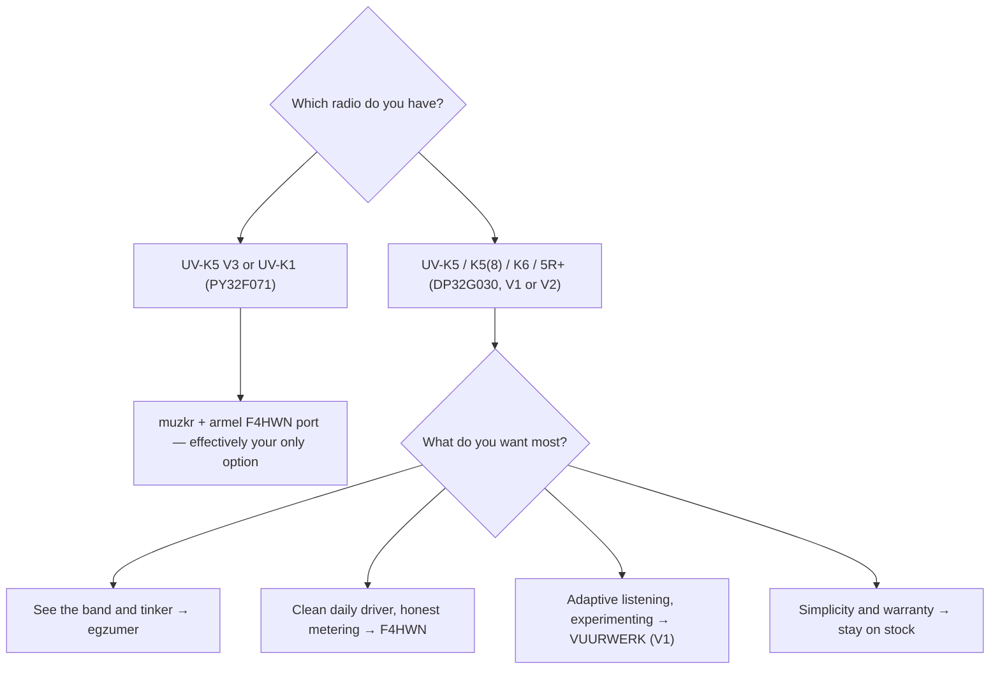
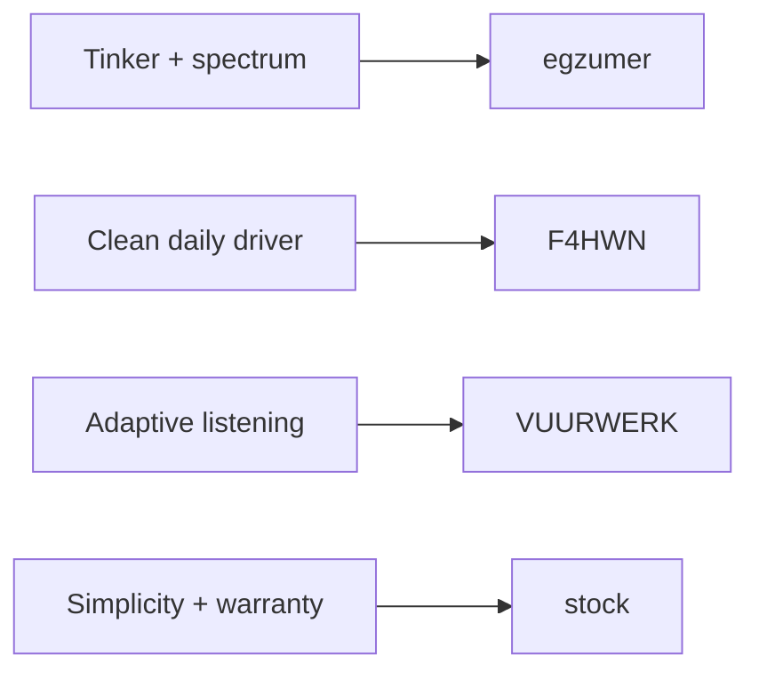

# Choosing a firmware and first boot

You have met the radios, the family tree and the three main firmwares in their own pages. Now comes the decision that ties them together: _which one do I actually put on my radio_ — and what happens the first time it lights up. This page is deliberately short on new features and long on judgement. We will pick for you by asking two questions in the right order, lay the four realistic options side by side, and then walk through the slightly disconcerting first boot so nothing surprises you when your radio reboots looking a little different from how you left it.

## The first question is never "which firmware?"

It is **"which chip do I have?"** — because that answer, not your taste, decides most of the shortlist for you. We covered this at length in the [firmware overview](outpost:entry/logbook73.guide.uv-k5/firmware-overview), so here is only the load-bearing summary:

- **DP32G030** — the original generation. The plain **UV-K5**, the **UV-K5(8)** / **UV-K6**, and the **UV-5R Plus** (hardware V1 and V2). This is where the whole classic firmware library lives.
- **PY32F071** — the newer generation. The **UV-K5 V3** and the compact **UV-K1** ("Kong Mini"). Different chip, different low-level code, its own firmware line.

Firmware built for one chip will not run on the other, and flashing across that line can **brick** the radio — leave it unable to start. So the very first branch of any sensible decision is the chip, and everything downstream depends on it:

If you own a **V3 or a UV-K1**, the decision is nearly made for you. The mainstream custom option for the PY32F071 chip is the **muzkr + armel port of F4HWN** — the only actively maintained, feature-complete community firmware for that hardware at the time of writing. There is no egzumer or VUURWERK build for it, because those projects target the older chip. So for a V3/K1 owner the real choice is binary: run the port, or stay on the factory firmware. Everything in the rest of this page about _what you want_ applies mainly to the **DP32G030** owners, who genuinely have several roads to choose between.

One nuance worth carrying over: **VUURWERK supports only the DP32G030 UV-K5 V1** by its own documentation — it treats V2 and V3 as unsupported. egzumer and mainline F4HWN run on the DP32G030 V1 _and_ V2 boards. So if you have a V2, VUURWERK is off your list even though your chip is "the right family". When a firmware's own release notes name the versions it supports, trust that over any general rule.

## The second question: what do you actually want?

Assuming you are on a DP32G030 radio with the field open, the honest way to choose is by temperament — what you reach for the radio to _do_. Four clean answers cover almost everyone.

**"I want to see the band and tinker." → egzumer.** egzumer is the community-standard base the others fork from, which makes it the safest place to learn. Its headline is the full-screen [spectrum analyser](outpost:entry/logbook73.guide.uv-k5/receive-everything) inherited from fagci (`F` + `5`), with a rich set of on-screen controls for scan step, vertical scale and a signal trigger so it only stops on real activity. You also get SSB/USB receive, the AM fix, two scan lists, and famously configurable side keys and long-press MENU. If you like reading the map before you drive, and you want the firmware every other guide assumes, start here.

**"I want a clean daily driver with metering I can trust." → F4HWN.** F4HWN (the "Fusion" edition) forks egzumer and adds a polished suite of `Set*` menus — a refined power ladder (`SetPwr`, from under 20 mW up to ~5 W), an **S-meter calibrated to the IARU Region 1 standard** rather than left to per-radio guesswork, tidy screen modes (`MAIN ONLY` / `DUAL` / `CROSS`), and up to **24 named scan lists**. The AM fix is simply on, always. If you want your signal-strength readings to mean something and your everyday operating to feel finished rather than experimental, this is the one — and, of course, it is _also_ the only route for a V3/K1 owner via the port.

**"I want the cleverest receiver, and I enjoy the bleeding edge." → VUURWERK (V1 only).** VUURWERK's pitch is "closed-loop" reception: instead of setting fixed values and hoping, it continuously measures noise, signal strength and audio and adjusts in real time. Its signature is a **voice-seeking spectrum** that scores each frequency for the _probability of human speech_, so carriers, birdies and pagers stay flat while conversations light up. It adds an adaptive squelch, real-time front-end gain staging, a polished transmit chain and a live bandscope. It is also the **newest** of the three, runs on a **brutally tight flash budget**, and its recent history is a run of bug-fix releases around the spectrum screen — so treat it as powerful but young, and run the latest release.

**"I want none of this fuss." → stay on stock.** There is no shame in it. The factory firmware transmits 2 m and 70 cm FM perfectly well, keeps your warranty intact, and cannot be bricked by a flashing mistake you never make. If you bought the radio to work your local [repeaters](outpost:entry/logbook73.handbook/repeaters) and nothing more, stock is a completely respectable answer — flashing is optional, not a rite of passage.

## The four options at a glance

All three custom firmwares descend from egzumer, so they _share_ the spectrum analyser, SSB/USB receive, the AM fix and configurable keys — the table shows where they diverge. "Difficulty" here means the effort of choosing and flashing a build, not daily use; every one of them is programmed for channels afterwards with [CHIRP](outpost:entry/logbook73.guide.uv-k5/getting-started).

|                       | **Stock**                     | **egzumer**                          | **F4HWN** (Fusion)                                  | **VUURWERK**                                                         |
| --------------------- | ----------------------------- | ------------------------------------ | --------------------------------------------------- | -------------------------------------------------------------------- |
| **Runs on**           | Whatever shipped (both chips) | DP32G030 (V1/V2)                     | Mainline: DP32G030 V1/V2 · **Port**: PY32F071 V3/K1 | DP32G030 **V1 only**                                                 |
| **Spectrum analyser** | No                            | Yes — fagci, `F`+`5`                 | Yes — improved, `F`+`5`                             | Yes — plus a **voice-seeking** mode and a live bandscope             |
| **SSB (USB) receive** | No — FM/AM only               | Yes                                  | Yes (inherited)                                     | Yes                                                                  |
| **S-meter**           | Crude bar                     | RSSI bar / Piotr022 S-meter          | **IARU-calibrated** (Classic/Tiny)                  | RSSI + a signal-quality "Q" meter                                    |
| **Scan lists**        | Basic                         | Two (`SList1`/`SList2`)              | Up to **24 named**                                  | Adaptive scan + `ScnWch` split/watch                                 |
| **Headline extra**    | Warranty & simplicity         | The standard base; configurable keys | `Set*` menu suite, power ladder, screen modes       | Closed-loop smarts: adaptive squelch, gain staging, refined TX chain |
| **Difficulty**        | None — as shipped             | Moderate — prebuilt images exist     | Moderate — editions/presets                         | Moderate — newest, tightest fit                                      |

Read the table as a shortlist maker, not a scoreboard. If you cannot decide, the default advice stands: **egzumer on a DP32G030 radio**, because it is the base everything else assumes and the one most tutorials are written for. You can always move to F4HWN or VUURWERK later — reflashing is a five-minute job once you have done it once.

## First boot: what to expect (and why it looks wrong)

Say you have flashed — the [flashing page](outpost:entry/logbook73.guide.uv-k5/firmware-flashing) covers the how safely — and you power the radio on for the first time. It is completely normal for that first boot to feel a little unnerving, so here is what actually happens and why none of it is a fault.

The first time a freshly flashed radio powers on, it runs a short **initialisation routine**: it writes fresh default settings into memory, may flash a brief "init" message, and then starts normally. The IJV firmware — a reception-focused UV-K5 firmware whose manual is unusually good — documents this plainly on its first-boot page, warning that your **VFO frequencies and some settings may have been reset to defaults**, and stressing that this is _expected and does not indicate a problem_. The same is broadly true across the family: a new firmware brings its own idea of defaults, so the radio you switch on is not quite the radio you switched off.

So your first ten minutes should be a calm settings pass, not a panic. In whatever firmware you chose, check and set:

1. **The TX band lock (`F Lock`).** Choose the region profile that matches your allocations — egzumer and F4HWN ship several (a general "ham" profile, plus stricter regional ones). This keeps transmit inside sensible bands; the "unlock everything" options exist but are your legal responsibility, not a default to reach for. Transmit only within your [licence conditions](outpost:entry/logbook73.handbook/getting-licensed).
2. **Transmit power.** Confirm it sits at a sensible level for local work rather than defaulting to maximum. On F4HWN the power ladder is finer-grained (`SetPwr`); everywhere, run the [lowest power](outpost:entry/logbook73.handbook/rf-power) that does the job.
3. **Battery type.** If your firmware offers a pack selector (`BatTyp`, 1600/2200 mAh, and 3500 on the F4HWN port), set it to your actual battery so the percentage reading is honest.
4. **Side keys and backlight.** Map the two side buttons to what you use most — monitor, scan, spectrum — and set a backlight time you can live with.
5. **Restore calibration if you touched it.** If your flashing process disturbed the factory calibration EEPROM, restore the backup you made _before_ flashing (you did make one — see the [flashing page](outpost:entry/logbook73.guide.uv-k5/firmware-flashing)).

Then, and only then, **reload your channels with CHIRP**. Because first boot may have wiped the VFOs and memories back to defaults, the tidy move is to keep your channel list in a CHIRP file and write it back after every flash — it takes seconds and means a reflash never costs you your local repeaters. Custom firmware ships a matching CHIRP driver for exactly this; you do not go back to stock just to edit memories.

A closing pointer worth bookmarking: firmware moves faster than any printed guide can, so treat the projects' own living documentation as the source of truth for details and defaults. IJV's online manual at **ijvradio.com** is a good example of the genre — a maintained, page-by-page reference of the kind each firmware keeps — and it is where you will find the current first-boot behaviour for that firmware spelled out. When a menu on your radio does not match what you read here, believe the radio and check the release notes.

## Try it yourself

Do this before you flash anything — it is a five-minute rehearsal that makes the real thing dull, which is exactly what you want:

1. **Write your decision down in one line.** Fill in the blanks from this page: _"My radio is a ____ , so its chip is ____ , so my candidates are ____ , and I am choosing ____ because \____."_ If you cannot complete that sentence without hedging, you are not ready to flash yet — reread the [overview](outpost:entry/logbook73.guide.uv-k5/firmware-overview) and finish it.
2. **Export your channels now.** Open CHIRP, read your radio (stock or not) and save the file somewhere safe, named for the radio. This is your insurance: whatever first boot resets, this file puts it back.
3. **Rehearse the first-boot pass on stock.** On your current firmware, walk through the five settings above — find the band lock, the power level, the battery type. Knowing where they live _before_ the layout changes under you makes the post-flash pass calm instead of a scavenger hunt.

Done well, choosing and first boot stop being a leap of faith and become a checklist — which is precisely how a habit that never bricks a radio is built.

## Key takeaways

- **Decide in two questions, in order.** First the chip: **DP32G030** (UV-K5/K5(8)/K6/5R+, V1/V2) versus **PY32F071** (UV-K5 V3 / UV-K1). Only then your taste — the chip does most of the shortlisting for you.
- **V3 / UV-K1 owners** have effectively one mainstream choice: the **muzkr + armel F4HWN port**. There is no egzumer or VUURWERK for that chip, so it is really "the port or stay on stock".
- **DP32G030 owners** choose by temperament: **egzumer** to see the band and tinker, **F4HWN** for a clean daily driver with an IARU-calibrated S-meter, **VUURWERK** (V1 only) for the cleverest adaptive receiver, or **stock** for simplicity and a kept warranty.
- If undecided, the sane default is **egzumer on a DP32G030 radio** — the base every other firmware and tutorial assumes; you can move to another later in minutes.
- **First boot runs an init routine and may reset your VFOs and settings to defaults — this is expected, not a fault.** Do a calm settings pass (band lock, power, battery type, side keys), restore calibration if you touched it, then reload channels with CHIRP.
- Keep your channels in a **CHIRP file** and treat each firmware's own **living manual** (IJV's `ijvradio.com` is a good example) as the current truth — firmware changes faster than any single guide.

With a firmware chosen and the radio settled after its first boot, you are ready to understand _why_ its settings do what they do — the physics behind the menus: [Radio Theory for the UV-K5](outpost:entry/logbook73.guide.uv-k5/theory).
