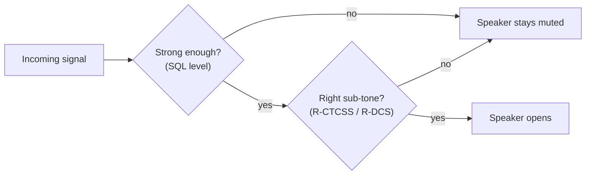
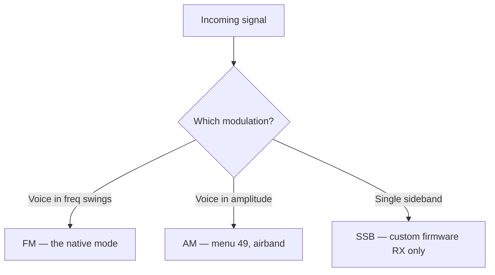

# What the settings really mean

Every menu on this radio is a knob on some piece of physics, and the manual describes the knob without ever telling you what it turns. You can memorise that `10 W/N` toggles wide and narrow, or `03 TXP` picks a power level — but you will set them badly until you know _why_ they exist and what is happening inside the box when you move them. This page is the "why" behind the controls you met in the menu chapters, using the UV-K5 as a worked example throughout. Nothing here is UV-K5-specific dogma; it is the same handful of ideas every radio in this handbook rests on, so wherever a concept has its own chapter we link straight to it.

## The receiver is a gate, not a wall

Start with `01 SQL`, squelch, because it teaches the whole mindset. An FM receiver with no signal on the frequency does not sit silent — it produces a loud, restless hiss, the sound of the receiver amplifying pure noise. Squelch is a **gate** that mutes the speaker until an incoming signal is strong enough to be worth hearing, then opens to let it through. It is entirely a receive-side comfort control: it changes nothing you transmit, and it never makes the radio more sensitive. A weak signal the radio can genuinely hear will still be muted if you set the gate too high.

That word _gate_ matters, because the UV-K5's squelch is coarse. The manual gives you levels `0`–`9`, but the jump from one number to the next is large and varies between individual radios. Level `0` leaves the gate wide open (constant hiss); `9` clamps it so tightly that only a strong local signal gets through, and you will miss weak ones. Most operators live around `2`–`4`: nudge it up until the hiss just stops between overs, and no further. When you deliberately want to listen _underneath_ the gate — to hear whether a weak station is buried in the noise — the **Monitor** function (short-press of Side Key 1 by default) forces the squelch fully open for as long as you hold it.

A tone squelch stacks a _second_ gate on top of the first, and it helps to picture both before we get to tones.



Only when _both_ gates pass does your speaker make a sound. If you set a receive tone (`05 R_CTCS` or `04 R_DCS`) and then panic because the radio has gone "dead", you have simply closed the second gate and nothing on frequency is sending the matching tone.

## Tones: a password, not a lock

The four tone menus (`04`–`07`) confuse more newcomers than anything else on the radio, and they are really one idea seen from two directions. A **sub-tone** is a quiet signal that rides continuously underneath your voice, too low to hear, that a radio uses as a password. There are two flavours. **CTCSS** (Continuous Tone-Coded Squelch System) sends a single low pitch, one of fifty standard tones from `67.0` to `254.1` Hz, sitting below the speech band and filtered out before it ever reaches the speaker. **DCS** (Digital-Coded Squelch) does the same job with a slow digital code — `D023`, `D754` and friends, each with a Normal or Reverse variant — and a radio set for one system will never answer the other.

The direction is the second half of the idea, and the UV-K5 labels it plainly:

- **T-** menus (`06 T_DCS`, `07 T_CTCS`) add the tone to what **you transmit** — this is how you open a repeater that demands an access tone.
- **R-** menus (`04 R_DCS`, `05 R_CTCS`) keep your speaker **silent unless** an incoming signal carries the tone you have set — the second gate above.

The everyday case is a [repeater](outpost:entry/logbook73.handbook/repeaters). Most repeaters will not relay you unless your signal carries a specific CTCSS access tone for their region, so you set `07 T_CTCS` to that tone and the radio sends it quietly whenever you key up. You normally leave the receive tone off, so you still hear everything the repeater sends back. (The older way into some repeaters is a momentary **1750 Hz tone burst**, which on the UV-K5 is the long-press of Side Key 1 — a one-shot tone, not the continuous CTCSS these menus produce.) The radio even offers a search: tune to a signal and press `F+*` to have it hunt for the tone in use.

Two rules keep you out of trouble. Never set both a CTCSS and a DCS tone on the same channel — a channel is one system or the other. And understand that tone squelch gives you **no privacy whatsoever**: anyone listening without a tone set still hears every word. It manages what _your_ speaker bothers you with; it is a password on your own attention, not a lock on the conversation.

## Shift and offset: talking on two frequencies at once

A repeater listens on one frequency and transmits on another, so it can receive and re-broadcast at the same time without deafening itself. To work through it, your radio has to do the mirror image: **receive** on the repeater's output and **transmit** on its input. Menus `08 SFT-D` and `09 OFFSET` set that up. `OFFSET` is the _gap_ between the two frequencies — on 2 m that is conventionally `0.600` MHz, on 70 cm `1.600` MHz, though your national band plan is the authority. `SFT-D` is the _direction_: `+` transmits above your receive frequency, `−` below, `OFF` for simplex (same frequency both ways).


The `+`/`−` icon on the display reminds you a shift is armed, and the **Reverse** function (`F+8`, the `R` icon) temporarily swaps TX and RX so you can hear whether the distant station is reachable directly on the input — a quick way to tell whether you actually need the repeater at all. Store the shift, offset and access tone together in each memory channel and you never think about any of it again; that is the whole point of the [configs](outpost:entry/logbook73.guide.uv-k5/configs) that follow this page.

## Bandwidth: how much room your voice takes

Menu `10 W/N` looks like a volume-ish quality setting and is nothing of the sort. FM carries your voice by swinging the carrier frequency up and down; how far it swings is the **deviation**, and deviation is what bandwidth controls. **Wide** (`WIDE`, the OEM's `16KΦF3E`) swings about ±5 kHz and occupies a 25 kHz channel; **Narrow** (`NARROW`, the `N` icon, `11KΦF3E`) swings about ±2.5 kHz into a 12.5 kHz channel. Wide sounds fuller and louder because there is more swing to recover; narrow fits twice as many channels into the same band, which is why most modern allocations moved to it.

```viz
{
  "type": "spectrum",
  "title": "Wide vs narrow FM — the same voice, half the room",
  "caption": "Wide FM (±5 kHz) fills a 25 kHz channel; narrow (±2.5 kHz) fits in half the space. The setting must match the channel and the other station, or the audio comes out wrong.",
  "xLabel": "Channel width",
  "components": [
    { "f": 28, "amp": 0.85, "width": 24, "label": "WIDE — ±5 kHz (25 kHz)", "tone": "primary" },
    { "f": 70, "amp": 0.85, "width": 11, "label": "NARROW — ±2.5 kHz (12.5 kHz)", "tone": "ink" }
  ],
  "noiseFloor": 0.04
}
```

The setting works on both transmit _and_ receive, and the failure modes are symmetrical. Transmit wide on a narrow channel and you **over-deviate**: your voice swings past the channel edges, splattering into the frequency next door and arriving loud and distorted. Transmit narrow where wide is expected and you sound quiet and muffled, because the far radio is listening for swings you are not making. On receive, a narrow setting throws away the outer parts of a wide signal (thin audio); a wide setting lets in more of the adjacent channel's noise. The rule is simply: **match the channel.** Note that bandwidth is a different thing from `02 STEP`, which only sets how far the tuning dial jumps — the channel _grid_, not the signal _width_. The [Filters](outpost:entry/logbook73.handbook/filters) chapter explains how a receiver carves out one channel and rejects its neighbours, and [Modulation](outpost:entry/logbook73.handbook/modulation) covers deviation in depth.

## Power: the lowest that works

`03 TXP` gives you `LOW`, `MID` and `HIGH`, and the discipline of a considerate operator is captured in one line: **run the lowest power that gets you through, and reach for HIGH only when you must.** The UV-K5's high setting is a genuine ~5 W or so — treat the "8 W" of some listings sceptically; the OEM spec is ≤5 W — and more power buys you a stronger signal at the far end. But it also flattens the battery faster, warms the radio against your head, and spreads more of your signal, wanted and spurious, around the band.

The reason "more" is not "better" is that radio range does not scale with power the way intuition suggests — doubling your watts moves the far-end signal by only 3 dB, half an S-point, while it halves your battery life. Through a repeater three miles away, one watt is usually full-quieting and HIGH gains you nothing; reaching a distant simplex station over difficult ground, you want everything the radio has. So power is a control you touch _constantly_, not a set-and-forget: LOW as your resting default, HIGH as a deliberate choice for a specific contact. The `H`/`M`/`L` icon shows where you stand, and `F+6` toggles it without diving into the menu. [RF Power](outpost:entry/logbook73.handbook/rf-power) works through the decibel maths if you want to see why the numbers land where they do.

## Why a cheap radio hears ghosts

Here is the honest bargain of this whole radio family. The UV-K5 will _receive_ from roughly 50 to 600 MHz — broadcast FM, airband, marine, business, the lot — and that breadth is genuinely useful. But wideband coverage at this price comes from a receiver with very little **filtering** in front of it. A good radio puts a tuned filter before its first amplifier so that only signals near your frequency ever get in. A cheap wideband front end amplifies a huge swathe of spectrum all at once, and then sorts it out later — which works beautifully until a _strong_ signal shows up.

When a nearby transmitter — a broadcast tower, a pager, a taxi base — is strong enough, it overloads the front-end amplifier and the receiver stops behaving linearly. The moment that happens, the amplifier starts _manufacturing_ signals that were never on the air: **images** (a real signal appearing at a second, wrong frequency), **intermodulation** (two strong signals mixing to create phantom third ones), and general **ghosts** that come and go as you move. You tune to an empty frequency and hear a broadcast station, or a repeater that is not there. None of it is on the antenna; the radio is generating it internally because it has been pushed too hard.

```viz
{
  "type": "spectrum",
  "title": "One strong signal, several ghosts",
  "caption": "A strong nearby transmitter (blue) can drive a cheap front end into making phantom signals (red) at frequencies where nothing is actually transmitting.",
  "xLabel": "Receive frequency",
  "components": [
    { "f": 40, "amp": 0.95, "label": "Real strong signal", "tone": "primary" },
    { "f": 18, "amp": 0.4, "label": "Ghost (image)", "tone": "danger" },
    { "f": 63, "amp": 0.33, "label": "Ghost (intermod)", "tone": "danger" },
    { "f": 82, "amp": 0.28, "label": "Ghost", "tone": "danger" }
  ],
  "noiseFloor": 0.05
}
```

This leads to the counter-intuitive fact that surprises every newcomer: **a better antenna can make reception worse.** A bigger, more efficient aerial delivers _more_ signal from _everything_, including the strong local sources that overload the front end. Fit a high-gain antenna near a busy transmitter site and you may hear more ghosts and fewer real signals than you did on the stock rubber duck. The cure is not more antenna but _less_ — an attenuator, a rubber duck, or on custom firmware a lower RF-gain setting — so you present the front end only as much signal as it can handle cleanly. If your radio suddenly seems full of stations that vanish when you turn the volume of the antenna down, you are seeing overload, not activity. The [Overload & Ghost Signals](outpost:entry/logbook73.handbook/overload-and-ghost-signals) chapter is the full story, and it is worth reading before you blame the radio for a fault that is really a strong neighbour.

## AM, FM and the SSB that firmware adds

A signal's **modulation** is how information is stamped onto the carrier, and a receiver has to _demodulate_ it with the matching method or it hears only noise. Stock UV-K5 firmware speaks two of these. **FM** (frequency modulation) is its native tongue — the voice is in the carrier's frequency swings, which is what everything above assumed. **AM** (amplitude modulation), where the voice rides in the carrier's _strength_, is used by the aviation band (108–137 MHz), and menu `49 AM` switches the radio into AM demodulation for exactly that range. Point an FM demodulator at an AM signal and it comes out garbled; the setting has to match the transmission.

The third mode, **SSB** (single sideband), is where custom firmware earns its keep. SSB is a stripped-down, spectrally frugal cousin of AM used across the HF bands and for weak-signal work — and demodulating it needs a precisely reinserted carrier that stock firmware simply does not provide. Because the radio is at heart a software-defined receiver, community firmware can add SSB _reception_ (not transmission) purely in code, along with a live spectrum display. Which firmware you can flash depends entirely on your radio's processor: the DP32G030-based sets (original UV-K5, K5(8), K6 and the V1/V2 5R) run egzumer, mainline-F4HWN and VUURWERK, while the newer PY32F071-based UV-K5 V3 and UV-K1 need the muzkr+armel port instead. **Flashing the wrong build for your MCU can brick the radio**, so confirm which processor you have before you touch anything — the [firmware-choosing](outpost:entry/logbook73.guide.uv-k5/firmware-choosing) page walks through it. The broader idea, that a receiver's "modes" are just software once the signal is digitised, is [Software-Defined Radio](outpost:entry/logbook73.handbook/software-defined-radio); the modes themselves live in [Modulation](outpost:entry/logbook73.handbook/modulation).



## Reading a waterfall

Once firmware gives the radio a spectrum display, you gain a new way of _seeing_ rather than just hearing. A spectrum view plots signal strength against frequency — tall spikes are strong signals, the flat carpet beneath them is the noise floor — so you can spot activity across a whole band at a glance instead of tuning blindly. A **waterfall** adds time: it scrolls that spectrum downward so each signal draws a vertical trail, and the _shape_ of the trail tells you what you are looking at.

```viz
{
  "type": "waterfall",
  "title": "Signals leave signatures on a waterfall",
  "caption": "A steady carrier draws a solid line, an FM voice channel a fat band, CW a dotted trail, SSB a ragged column — you learn to read a band by its shapes.",
  "xLabel": "Frequency",
  "yLabel": "Time (scrolling down)",
  "signals": [
    { "f": 20, "kind": "carrier" },
    { "f": 42, "kind": "fm", "width": 8 },
    { "f": 62, "kind": "cw" },
    { "f": 82, "kind": "ssb", "width": 5 }
  ]
}
```

A fat, steady band is an FM voice channel; a thin solid line is an unmodulated carrier; a dotted trail is Morse keying on and off; a ragged column that thickens and thins with speech is SSB. On the UV-K5's small screen the effect is crude compared with a computer SDR, but it is enough to answer "is anything happening on this band?" without turning the dial across a hundred channels. [FFTs & Waterfalls](outpost:entry/logbook73.handbook/ffts-and-waterfalls) explains how the maths turns a stream of samples into that picture.

## The scrambler is not encryption

One menu deserves a blunt correction. `11 SCR` is a **scrambler**, and the marketing word tempts people into thinking it hides their conversation. It does not. This is _analogue voice inversion_: it flips the audio spectrum so speech comes out as gibberish to a plain FM receiver — but the inversion is trivial to reverse, another UV-K5 set to the same `SCR` value decodes it instantly, and it offers no meaningful secrecy at all. Treat it as obfuscation, not encryption. More to the point, on the amateur bands scrambling or encoding your speech to obscure its meaning is generally **not permitted** — amateur radio is an open service, and your licence conditions almost certainly require your transmissions to be intelligible. Leave `SCR` off unless you are on a service that specifically allows it and you understand it protects nothing.

## Try it yourself

You can watch overload happen with the stock radio and no extra kit. Find a frequency you know is empty and set `01 SQL` to `0` so the gate stays open — you should hear only hiss. Now hold the radio close to a strong source (near a broadcast FM tower, or beside a running microwave oven or an LED-lit room) and slowly tune across a band, listening for signals that appear where nothing should be and fade as you move the radio. Those are ghosts your front end is inventing. Then try the opposite: pull the antenna's effective signal _down_ — grip the aerial, or if you have a spare rubber duck swap the big antenna for it — and watch the phantom stations disappear while the genuine strong local signal stays put. That single experiment tells you more about why "better antenna, worse reception" is real than any amount of reading, and it is exactly the reasoning you will apply when you build sensible presets on the next page.

## Key takeaways

- **Squelch is a gate, not sensitivity** — `01 SQL` mutes weak audio, it never makes the radio hear more; a receive tone (`04`/`05`) stacks a _second_ gate that silences everything not carrying your password.
- **Tones are a password, not a lock** — `T-` sends the sub-tone to open a [repeater](outpost:entry/logbook73.handbook/repeaters), `R-` silences your speaker until it hears one; CTCSS is one analogue pitch, DCS a digital code, and neither gives any privacy.
- **Shift and offset** (`08`/`09`) let you receive and transmit on different frequencies so you can work through a repeater; store them with the channel and forget them.
- **Bandwidth must match the channel** — wide (±5 kHz) or narrow (±2.5 kHz) is about [deviation](outpost:entry/logbook73.handbook/modulation) and channel width, not quality; mismatch it and you over-deviate or sound muffled.
- **Lowest power that works** — `03 TXP` doubling your watts moves the far end only ~3 dB but halves your battery; keep LOW as default, HIGH as a deliberate choice ([RF Power](outpost:entry/logbook73.handbook/rf-power)).
- **Wideband RX has a price** — a cheap front end overloads on strong local signals and manufactures [ghosts and images](outpost:entry/logbook73.handbook/overload-and-ghost-signals), which is why a _better_ antenna can make reception worse.
- **Modes are software, but MCU-specific** — stock does FM and airband AM (`49`); SSB-RX and a spectrum view come from custom firmware, and you must match the build to your processor (DP32G030 vs PY32F071) or risk bricking the radio. And `11 SCR` scrambling is not encryption and usually not legal on the amateur bands.

With the physics behind the controls clear, the next step is turning it into settings you can actually load — worked, copy-me presets for repeaters, simplex, monitoring and travel, in [Ready-made configs](outpost:entry/logbook73.guide.uv-k5/configs).
