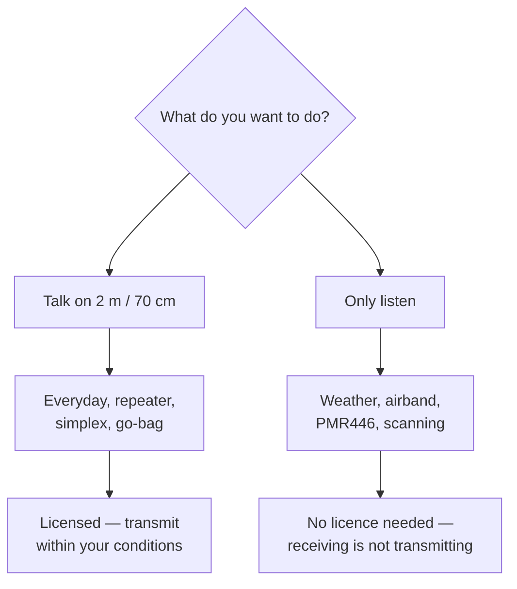
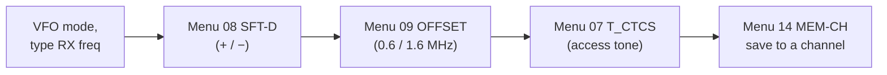
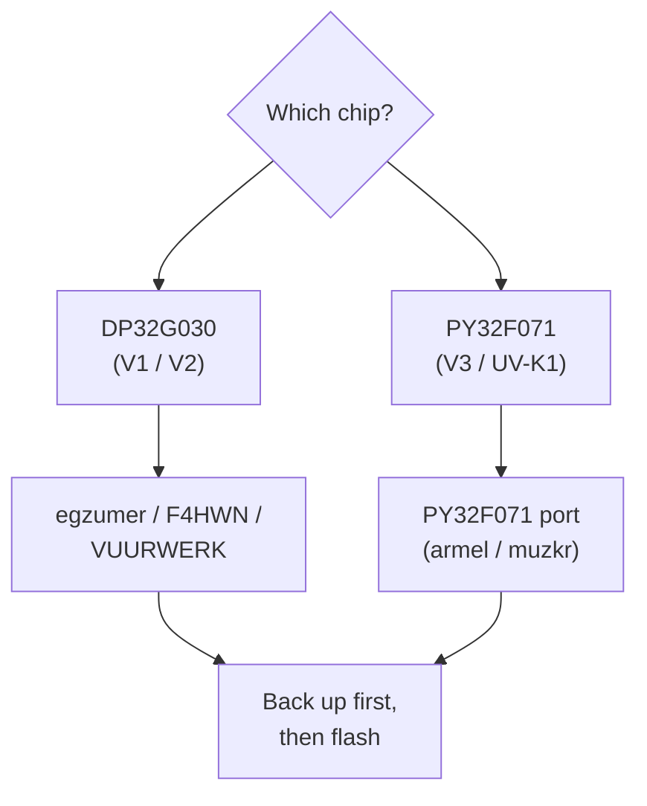

# Ready-made configurations

The quickest way to enjoy a UV-K5 is to stop reading the menu and start using it — and the fastest route there is to copy a setup that already works. This page is a set of ready-made configurations: the everyday one for a newly licensed operator, a repeater channel worked through in full, a plain simplex channel, and several receive-only setups for weather, airband, licence-free traffic and band-scanning. Each is a short table of menu numbers and values you can key straight in, with a note on what it is for and where it earns its keep.

## How to use these configs

Everything below is expressed as **menu number → value**, because that is how the UV-K5 thinks. To set any item, press `M` (the Menu/Confirm key), key the number or step to it with `▲`/`▼`, press `M` again to open it, choose the value with `▲`/`▼`, and press `M` once more to save. `EXIT` backs you out without changing anything, and a long-press of `M` jumps you back to the last item you touched. If that dance is unfamiliar, [Getting Started](outpost:entry/logbook73.guide.uv-k5/getting-started) walks through it and the [menu reference](outpost:entry/logbook73.guide.uv-k5/menu-reference) gives the full meaning of every item.

One rule saves a lot of confusion. **In channel (memory) mode the UV-K5 refuses to change most per-channel settings** — tones, wide/narrow, step, the offset. So you build a channel in **frequency (VFO) mode**, get every value right, and _then_ store it with **menu 14 (MEM-CH)**. Switch between the two modes with `F` then `3`. Better still, do the whole job in **CHIRP** — the free programming software (the `uvk5-chirp-driver` talks to the radio over the same cable) turns an afternoon of thumb-aching menu-diving into a five-minute table you can edit, reorder and back up. Every config here can be typed into CHIRP just as easily as into the radio.

## The universal baseline

Set these once and every config below inherits them. They encode the good manners this guide keeps pushing — lowest sensible power, busy-channel lockout on, no roger beep, VOX off — plus a few quality-of-life choices. Where a config wants something different, it says so.

| Menu | Name   | Value     | Why                                                                                            |
| ---- | ------ | --------- | ---------------------------------------------------------------------------------------------- |
| 01   | SQL    | `4`       | Silences the hiss but still opens for real signals; nudge up in strong RF, down for weak ones  |
| 03   | TXP    | `LOW`     | The UV-K5 has three levels (Low/Mid/High); Low does the job most of the time and saves battery |
| 10   | W/N    | `NARROW`  | 2 m/70 cm FM is 12.5 kHz narrow-band in most of Region 1                                       |
| 12   | BCL    | `ON`      | Busy-channel lockout — refuses to transmit on top of an occupied channel                       |
| 15   | SAVE   | `1:3`     | Battery save; note it steps down whenever dual-watch is on                                     |
| 16   | VOX    | `OFF`     | Hands-free transmit trips on coughs and background noise — leave it off                        |
| 17   | ABR    | `5` (5 s) | Backlight timeout; long enough to read, short enough to save battery                           |
| 20   | BEEP   | `ON`      | The keypress confirmation is genuinely useful while you learn the radio                        |
| 22   | VOICE  | `OFF`     | The spoken menu prompts wear thin fast                                                         |
| 25   | AUTOLK | `ON`      | Auto-locks the keypad so a pocket cannot re-tune you                                           |
| 28   | STE    | `ON`      | Tail-tone elimination — kills the "kerchunk" of noise at the end of a simplex over             |
| 47   | ROGER  | `OFF`     | No roger beep; it adds nothing on the amateur bands and annoys people                          |

**Dual-watch (menu 18, TDR)** is deliberately left out of the baseline because the right answer depends on the config — on when you want to watch two channels, off when you want maximum battery life. Each setup below tells you which.

A word on **power**, because it runs through everything. The UV-K5's Low is around 1 W, Mid a couple of watts, High the radio's full output (the spec is ≤ 5 W — treat any "8 W" marketing claim sceptically). All three sit comfortably inside any amateur allowance — a UK Foundation licensee has far more headroom than the radio can use — so "run low power" is never about the licence, it is about good practice: less battery drain, less interference to distant users, a cleaner signal. Turn it up only when Low genuinely will not reach. The reasoning is in [RF Power](outpost:entry/logbook73.handbook/rf-power). You can also flick power on the fly with `F` then `6`.

## 1 · UK Foundation operator — everyday

This is the "do this first" configuration: the baseline above, plus the handful of channels a newly licensed operator actually uses. Programme the calling channels and your local [repeaters](outpost:entry/logbook73.handbook/repeaters), turn on dual-watch, and you are on the air properly.

| Menu | Name | Value    | Notes                                                           |
| ---- | ---- | -------- | --------------------------------------------------------------- |
| 02   | STEP | `12.5K`  | The 2 m and 70 cm channel grid in Region 1                      |
| 10   | W/N  | `NARROW` | UK 2 m/70 cm FM is now 12.5 kHz narrow-band                     |
| 18   | TDR  | `CHAN_A` | Dual-watch — hear the calling channel _and_ your local repeater |
| 03   | TXP  | `LOW`    | Around town; step to Mid/High only to reach a distant machine   |

Then store these as memory channels (built in VFO mode, then saved with menu 14):

| Purpose              | RX freq        | Menu 08 SFT-D | Menu 09 OFFSET | TX tone (menu 07)       |
| -------------------- | -------------- | ------------- | -------------- | ----------------------- |
| 2 m FM calling       | `145.500`      | `OFF`         | —              | none                    |
| 70 cm FM calling     | `433.500`      | `OFF`         | —              | none                    |
| Local 2 m repeater   | e.g. `145.700` | `−`           | `00.60000`     | repeater's listed CTCSS |
| Local 70 cm repeater | e.g. `433.000` | `+`           | `01.60000`     | repeater's listed CTCSS |

The **calling channels** are simplex — no shift, no tone — where you put out a call before moving to a working frequency. The **repeater** channels are the fiddly part, so the next section walks one through end to end. Transmit only on 2 m and 70 cm within your amateur allocation, at your licensed power; if you are not yet licensed you may programme and _listen_ to all of this legally, and read [Getting Licensed](outpost:entry/logbook73.handbook/getting-licensed) when you are ready to talk.

## 2 · A repeater channel, worked through

A [repeater](outpost:entry/logbook73.handbook/repeaters) listens on one frequency and re-transmits on another, so your radio has to transmit **shifted** away from the frequency it receives, and usually send a **sub-audible CTCSS tone** to unlock the machine. Three menu items do the work: the shift direction (menu 08, SFT-D), the offset size (menu 09, OFFSET) and the transmit tone (menu 07, T_CTCS). Do it in VFO mode, in this order:

**Worked example — a UK 2 m repeater on `145.700` with a 77.0 Hz tone:**

1. `F` + `3` to be sure you are in VFO (frequency) mode, then key `145.700`.
2. Menu **08 SFT-D** → `−` (on 2 m the repeater transmits below its input; UK convention is a −0.6 MHz shift).
3. Menu **09 OFFSET** → `00.60000` (0.6 MHz).
4. Menu **07 T_CTCS** → step to `77.0` (whatever tone the repeater's listing gives — UK tones run 67.0–118.8 Hz by region).
5. Menu **14 MEM-CH** → pick a channel number, confirm the "SURE?" prompt.

The offsets are conventions, not universal: **−0.6 MHz on 2 m, +1.6 MHz on 70 cm** in the UK; much of Europe uses −7.6 MHz on 70 cm and North America ±5 MHz, so check your national band plan. Menu **07 (T_CTCS)** sends the tone; you normally leave **05 (R_CTCS)** off so you still hear everything on the output. A handful of older machines want a **1750 Hz toneburst** instead of CTCSS — the default long-press of Side Key 1 sends it. And if you do not know a repeater's tone, tune to it while it is transmitting and press `F` then `*` to have the radio search for the tone, then save it. If you never hear yourself come back through the repeater, the usual culprits are a wrong or missing tone, the wrong shift direction, or simply being out of range — all in [Troubleshooting](outpost:entry/logbook73.guide.uv-k5/troubleshooting).

## 3 · A simplex working channel

Simplex means transmit and receive on the same frequency, with no repeater in between — how you talk directly to another station within range. It is the simplest possible channel: no shift, no tone.

| Menu | Name   | Value    | Notes                                                           |
| ---- | ------ | -------- | --------------------------------------------------------------- |
| 08   | SFT-D  | `OFF`    | No shift — you transmit where you receive                       |
| 07   | T_CTCS | `OFF`    | No access tone needed on an open simplex channel                |
| 10   | W/N    | `NARROW` | Narrow FM to match everyone else on 12.5 kHz                    |
| 03   | TXP    | `LOW`    | Plenty for a local contact; step up only if the other end fades |

Build it in VFO mode, key the frequency (say a 2 m simplex channel your local group uses, or the `145.500` calling channel to answer someone off the call frequency), and save with menu 14. A useful habit on repeater work is **reverse** (`F` then `8`), which temporarily swaps transmit and receive so you can hear whether the station you are working is close enough to reach **direct** — if you can, drop to a simplex channel and spare the repeater. Tap it, listen, tap it back.

## 4 · Weather / NOAA monitor (receive only)

The UV-K5 has a built-in weather-radio receiver: press `F` then `5` and it scans the ten **NOAA** channels around 162 MHz, and menu **50 (NOAA_S)** turns on automatic alert monitoring so it breaks in when the weather service transmits a warning tone. This is genuinely useful — but honestly regional. NOAA Weather Radio is a **US and Canadian** National Weather Service network; those ten channels only carry traffic in North America. Elsewhere (the UK included) the frequencies exist but nobody is broadcasting on them, so `F` + `5` finds silence. There is no European equivalent to store here — for weather in Region 1 you are better off with an ordinary forecast, and this config is one to remember if you travel.

| Menu | Name   | Value   | Notes                                                                |
| ---- | ------ | ------- | -------------------------------------------------------------------- |
| 50   | NOAA_S | `ON`    | Auto weather-alert monitoring (only meaningful in the US/Canada)     |
| 01   | SQL    | `2`–`4` | Enough to silence hiss; weather broadcasts are strong and continuous |

Receiving weather is legal anywhere the radio can hear it. As with every listen-only setup below, receiving is never transmitting.

## 5 · Airband listening (menu 49 AM, receive only)

Here the UV-K5 pulls decisively ahead of a UV-5R. Aviation uses **AM** (amplitude modulation), and unlike the older radio the UV-K5 has a real **AM detector**: menu **49 (AM)** switches it on, and it is valid across the **108–136 MHz** airband. The radio's receive range starts at 50 MHz, so the whole civil airband is in reach — tower, approach and en-route frequencies all receive properly near an airfield.

| Menu | Name | Value   | Notes                                                                            |
| ---- | ---- | ------- | -------------------------------------------------------------------------------- |
| 49   | AM   | `ON`    | Switches to AM detection — only works while tuned to 108–136 MHz                 |
| 01   | SQL  | `0`–`2` | Open it right up; AM signals are quiet and will not always break a tight squelch |
| 18   | TDR  | `OFF`   | Single channel, all attention on the one signal                                  |

Two honest caveats. The UV-K5's front end is wide open and lightly filtered, so near a strong transmitter you may hear an aircraft "appear" where none is — that is [front-end overload](outpost:entry/logbook73.handbook/overload-and-ghost-signals), not a ghost plane. And the stock AM detector still saturates on very strong signals; the **AM-fix** feature in egzumer's [custom firmware](outpost:entry/logbook73.guide.uv-k5/firmware-egzumer) dynamically trims the front-end gain and cleans this up noticeably. Either way, **airband is receive-only**: you are never permitted to transmit on aviation frequencies.

## 6 · PMR446 monitoring (receive only)

[PMR446](outpost:entry/logbook73.handbook/uhf) is the European licence-free band families and event teams use — eight analogue channels around 446 MHz, 12.5 kHz narrow FM, at a fraction of a watt. The UV-K5 will _hear_ them perfectly, which makes it handy for keeping an ear on a group. **It cannot legally transmit there:** PMR446 requires a type-approved radio with a fixed antenna and a 0.5 W ERP limit, and the UV-K5 — a detachable-antenna, multi-watt transceiver — meets none of those conditions. So this is monitoring and awareness only.

| Menu | Name | Value    | Notes                                    |
| ---- | ---- | -------- | ---------------------------------------- |
| 02   | STEP | `12.5K`  | The PMR446 channel spacing               |
| 10   | W/N  | `NARROW` | PMR446 is narrow-band FM                 |
| 01   | SQL  | `3`–`4`  | Enough to silence the hiss between overs |

The eight analogue channels (Region 1):

| Ch  | Frequency   | Ch  | Frequency   |
| --- | ----------- | --- | ----------- |
| 1   | `446.00625` | 5   | `446.05625` |
| 2   | `446.01875` | 6   | `446.06875` |
| 3   | `446.03125` | 7   | `446.08125` |
| 4   | `446.04375` | 8   | `446.09375` |

North America's equivalent is **FRS/GMRS** on different frequencies (462/467 MHz) — the same idea, another band plan; if you are there, store those instead. To actually _talk_ on the licence-free channels, buy a cheap type-approved PMR446 or FRS handset: match the radio to the licence, not the other way round.

## 7 · Scanner & spectrum listening

The stock firmware scans a channel list happily — add a channel to a scan list with menu **26 (S-ADD1)** or **27 (S-ADD2)**, pick which list is live with menu **32 (S-LIST)**, set how a scan resumes with menu **23 (SC-REV)** (`TO` resumes after a pause, `CO` waits for the signal to drop, `SE` stops and stays), then long-press `*` to start. [Scanning](outpost:entry/logbook73.guide.uv-k5/scanning) covers this in full.

| Menu | Name   | Value   | Notes                                                            |
| ---- | ------ | ------- | ---------------------------------------------------------------- |
| 23   | SC-REV | `CO`    | Resume when the signal drops — best for following a conversation |
| 26   | S-ADD1 | `ON`    | Add the current channel to scan list 1 (do this per channel)     |
| 32   | S-LIST | `LIST1` | Make list 1 the active scan list                                 |

The killer feature, though, needs **custom firmware**. Flash **egzumer** (or a fork such as F4HWN or VUURWERK — see the note below on matching your MCU) and `F` + `5` opens the **fagci spectrum analyzer**: a full-screen band scope that sweeps a range and shows you every active carrier at a glance, so you find activity by _looking_ instead of listening channel by channel. Inside the scope, keys `1`/`7` change the scan step, `*`/`F` set the RSSI trigger so it only stops on real signals, Side Key 1 blacklists a stubborn birdie, and `PTT` tunes straight to the peak under the cursor. egzumer also adds a **scan-ranges** mode (set a start and stop frequency from channel mode) and **SSB/USB** receive via its `Demodu` menu, turning the radio into a rough-and-ready listening scope for the SDR-curious. None of this exists on stock firmware. If you want to understand what a band scope is showing you, [Software-Defined Radio](outpost:entry/logbook73.handbook/software-defined-radio) is the companion read.

## 8 · Emergency go-bag

A UV-K5 is small, cheap and sips battery, which makes it an ideal radio to charge, programme, and forget in a rucksack until you need it. The configuration is really a _channel plan_ plus a storage discipline.

| Menu | Name   | Value | Notes                                                                   |
| ---- | ------ | ----- | ----------------------------------------------------------------------- |
| 03   | TXP    | `LOW` | Conserve battery; step up only to reach a repeater                      |
| 15   | SAVE   | `1:4` | Deepest battery save for standby                                        |
| 17   | ABR    | `1`   | Minimal backlight                                                       |
| 18   | TDR    | `OFF` | One channel, maximum endurance (switch on when actively monitoring two) |
| 25   | AUTOLK | `ON`  | Nothing gets nudged in the bag                                          |

Build a single set of memories that mixes **transmit-capable** amateur channels with a **listen-only** situational-awareness list:

| Memory                      | Purpose                                                                |
| --------------------------- | ---------------------------------------------------------------------- |
| Local 2 m / 70 cm repeaters | Your everyday machines — most likely to carry traffic and be monitored |
| `145.500` / `433.500`       | 2 m and 70 cm FM calling — where to call if the repeaters are down     |
| PMR446 ch 1–8               | Listen for family, neighbours and event teams (receive only)           |
| Local news / broadcast FM   | `F` + `0` toggles the 65–108 MHz FM broadcast radio for bulletins      |

Storage matters as much as programming. **Keep the battery charged** — lithium cells self-discharge, so top it up every few months and store around half to two-thirds charge for longevity. Drop a **charged spare battery** and the programming cable in the bag. And remember the licensing reality: in an emergency you may always _listen_ on anything the radio can hear, but you may only _transmit_ within your licence — so being licensed, with your local repeaters and calling channels already stored, is what turns this from a scanner into a communications tool.

## 9 · Flashed-radio starter — get the MCU right first

Before you flash anything, one fact decides everything: **the UV-K5 family splits by the chip inside.** The original UV-K5, UV-K5(8), UV-K6 and UV-5R (the v2.1.27-class "V1/V2" radios) use the **DP32G030** microcontroller. The newer **UV-K5 V3** and the **UV-K1** ("Kong Mini") use a completely different chip, the **PY32F071**. Custom firmware is compiled for one chip or the other, and **flashing the wrong image can brick the radio** — a DP32G030 build simply is not the right code for a PY32F071 part, and vice-versa.

| MCU      | Radios                                                 | Firmware to use                                |
| -------- | ------------------------------------------------------ | ---------------------------------------------- |
| DP32G030 | UV-K5, UV-K5(8), UV-K6, UV-5R (v2.1.27-class, "V1/V2") | egzumer, mainline-F4HWN, VUURWERK              |
| PY32F071 | UV-K5 V3, UV-K1 ("Kong Mini")                          | the PY32F071 port (muzkr + armel `uv-k1-k5v3`) |

If the box or listing says **V3** or **K1**, egzumer is the _wrong_ firmware — send those readers to the PY32F071 port instead. When in doubt, do not flash: read [Choosing your firmware](outpost:entry/logbook73.guide.uv-k5/firmware-choosing) to confirm the generation. Then, whichever camp you are in, **back up before you write anything** — save your original firmware and EEPROM with a tool like K5TOOL, k5prog or CHIRP so a bad flash is recoverable. For a DP32G030 radio, egzumer's own in-browser web flasher (`egzumer.github.io/uvtools`) writes the packed image; you put the radio into its bootloader by holding `PTT` while switching on, connect the programming cable, and flash. The full walk-through is in [Firmware flashing](outpost:entry/logbook73.guide.uv-k5/firmware-flashing).

A good **first egzumer setup**: map the side keys deliberately — Side 1 short = Monitor, Side 1 long = Flashlight, Side 2 short = Scan, Side 2 long = Spectrum, with the long-press `M` action as a third shortcut. Set `BatTyp` to match your pack (1600 or 2200 mAh) so the battery percentage is honest, run `BatCal` against a meter, and pick the right `F Lock` region profile (`GB HAM`, `CE HAM`, `FCC HAM`…) so transmit stays inside your legal bands. Leave the `UNLOCK ALL` and hidden TX-band options alone unless you fully understand the licensing consequences of transmitting out of band.

## Try it yourself

Pick the one config that matches how you will use the radio today and build it now — it takes ten minutes:

1. **Set the universal baseline** (the table near the top) — twelve menu items, and every setup inherits them.
2. **Programme two channels in VFO mode:** `145.500` as a plain simplex channel, and your nearest 2 m repeater with SFT-D `−` (menu 08), OFFSET `00.60000` (menu 09) and its tone in T_CTCS (menu 07). Save each with **menu 14 (MEM-CH)**.
3. **Switch to channel mode** (`F` + `3`) and confirm you cannot change the tone there — proof of the "set it in VFO mode first" rule.
4. **Turn on dual-watch** (menu 18) and watch the radio flick between your two channels, catching a call on either.
5. **When you have more than a handful of channels**, stop doing it by hand — type the lot into CHIRP, reorder them, and keep the file as a backup a factory reset cannot touch.

## Key takeaways

- Every config is **menu number → value**; set the **universal baseline once** (BCL on, Low power, roger off, VOX off) and each setup inherits it.
- Build channels in **VFO mode then save** with menu 14 — channel mode will not let you change tones, bandwidth, shift or step — and for anything past a few channels use **CHIRP** and keep a backup.
- A **repeater** channel is three items in order: shift direction (08), offset (09) and TX tone (07); the calling channels `145.500`/`433.500` are plain simplex with none of that.
- The receive-only setups are legal without a licence, but each has a scope: **NOAA weather** only carries traffic in North America, **airband works properly** here thanks to menu 49's real AM detector, and **PMR446 you may monitor but never transmit** on with a UV-K5.
- The **spectrum analyzer** and SSB receive need **custom firmware**, and custom firmware is **MCU-specific**: egzumer/F4HWN/VUURWERK for the DP32G030 (V1/V2), the PY32F071 port for the V3/UV-K1. **Back up first, and never flash across the divide.**

When one of these setups does not behave — no repeater, a dead channel, ghost signals — head to [Troubleshooting](outpost:entry/logbook73.guide.uv-k5/troubleshooting), where every common "why won't it…" has an answer.
