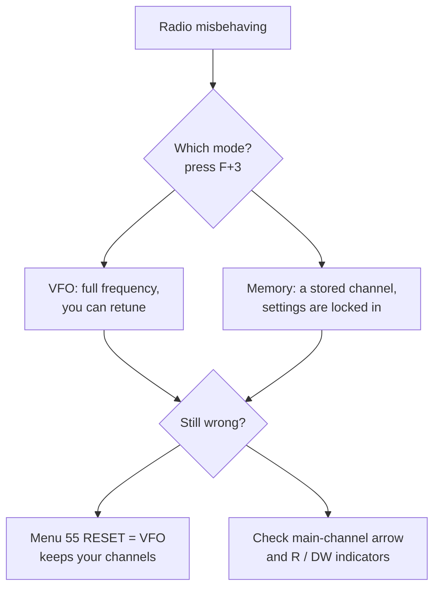
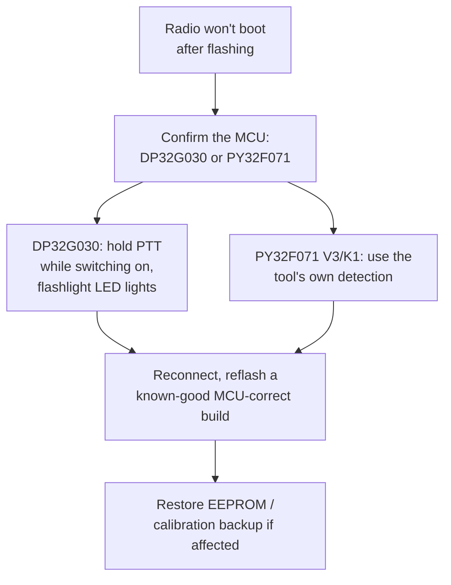

# Troubleshooting

Sooner or later the UV-K5 will do something baffling — it keys up but nobody answers, it sits silent on a busy channel, it refuses to transmit at all, or it stops booting the day after you flashed a shiny new firmware. Almost none of these are faults. They are settings, and once you know where each one hides, most take under a minute to put right. This page is a fault-finding index: the symptom, the likely cause, and the fix, working from the ordinary radio problems through to the ones that only bite people who have flashed custom firmware.

One note before you start. The menu numbers below are the **stock firmware** numbers from the digest (SQL is `01`, TXP is `03`, and so on). Custom firmware — egzumer, mainline-F4HWN, VUURWERK — renames and renumbers the whole menu, so if you are running one of those, match on the **name** of the setting, not the number. Where a fix is firmware-specific, it says so.

## Before you diagnose anything: the sanity checks

Two habits catch a surprising share of "my radio is broken" reports.

First, **know which channel you are actually on**. Press `F+3` (VFO/MR) and look: in frequency (VFO) mode the display shows a full frequency you can tune with the keypad; in memory (channel) mode it shows a stored channel and you cannot retune it. Half of all "it won't let me change the tone" problems are simply someone editing in the wrong mode. And check the **main-channel arrow** and the `DW` (dual-watch) indicator — the radio transmits on whichever channel the arrow marks, which is not always the one you are looking at. `F+2` swaps main channels; `F+8` is reverse (`R` on screen), which quietly swaps your transmit and receive frequencies.

Second, when in doubt, **reset the settings but keep your channels**. Menu `55 RESET` offers `VFO` (reset settings, keep stored channels) and `ALL` (wipe everything back to factory). `VFO` is the gentle option and it cures a lot of "I changed something and now it's odd" states without costing you your memories. Keep a [CHIRP](outpost:entry/logbook73.guide.uv-k5/menus-channels) backup so even `ALL` is no loss.

## It won't transmit

You press `PTT` and nothing goes out — no red LED, or the LED lights but no power leaves the antenna. Work down this list in order; the causes are ranked roughly by how often they are the real one.

| Symptom                                               | Likely cause                                                                         | Fix                                                                                                                 |
| ----------------------------------------------------- | ------------------------------------------------------------------------------------ | ------------------------------------------------------------------------------------------------------------------- |
| No red TX LED at all, brief beep or `TX` won't appear | You are **out of the transmit band** for your market version                         | Move inside the type-approved TX range — see the version table below. Stock firmware blocks TX outside it by design |
| Red LED lights but reported audio/reach is poor       | **TX power** set to `LOW` (menu `03 TXP`)                                            | Nudge to `MID`/`HIGH` only if you genuinely need reach                                                              |
| Keys up on a clear channel, refuses on a busy one     | **Busy-channel lockout** (menu `12 BCL = ON`)                                        | Working as intended — it refuses to transmit over an occupied channel. Wait, or set `BCL = OFF` if you must         |
| Transmits for a few seconds then cuts off             | **Time-out timer** (menu `21 TOT`) reached                                           | Release `PTT`, let it reset, and keep overs shorter; raise `TOT` if you really need longer keydowns                 |
| Won't transmit in channel mode on a specific memory   | That channel was **stored with TX disabled**, or with a shift that lands out of band | Re-check the channel in VFO mode; re-save it                                                                        |

The single biggest gotcha is the **transmit band**. The UV-K5 receives roughly 50–600 MHz, but it is only _designed and type-approved to transmit_ on the amateur segments, and exactly which segments depends on the market version the radio was built as:

| Version   | VHF TX        | UHF TX                      |
| --------- | ------------- | --------------------------- |
| FCC       | `144–148 MHz` | `420–450 MHz`               |
| CE / UKCA | `144–146 MHz` | `430–440 MHz`               |
| "NORMAL"  | `136–174 MHz` | `350–400` and `400–470 MHz` |

If you try to key up on, say, `446 MHz` [PMR446](outpost:entry/logbook73.handbook/uhf) or an airband frequency, a stock CE radio simply will not transmit — and that is correct behaviour, because you are not licensed to transmit there. Custom firmware or a patch can _unlock_ out-of-band TX, but as [Firmware Overview](outpost:entry/logbook73.guide.uv-k5/firmware-overview) stresses, that is a capability, not a permission: you may only transmit within your licence and your national allocation, at permitted power, and your regulator (Ofcom in the UK, the FCC in the US, and their equivalents elsewhere) is the authority. A UV-K5 that "won't transmit" on marine or air is usually a radio doing exactly the right thing.

```mermaid
flowchart TD
  A["Press PTT, nothing goes out"] --> B{"Red TX LED?"}
  B --> C["No LED: out of TX band<br/>for your version"]
  B --> D["LED lit but weak"]
  C --> E["Move inside the amateur<br/>TX segment"]
  D --> F{"On a busy channel?"}
  F --> G["Yes: BCL (menu 12)<br/>locked you out"]
  F --> H["No: raise TXP (menu 03)<br/>or check TOT (menu 21)"]
```

## I can't open the repeater

You can hear the [repeater](outpost:entry/logbook73.handbook/repeaters) but keying up gets no response — no tail, no beep, no "kerchunk". A repeater is fussy in four ways, and all four must be right at once.

**1 · The access tone.** Nearly every repeater will only open for a station sending the correct sub-audible **CTCSS** tone (or **DCS** code). That is the number-one cause. On stock firmware the _transmit_ tone lives in menu `07 T_CTCS` (CTCSS) or `06 T_DCS` (DCS) — note these are the **T**ransmit items; the `04`/`05` R_ items only affect what you hear, not what unlocks the machine. Set `T_CTCS` to the repeater's published tone. If you cannot find it, tune to the repeater's output while someone is talking and use the tone-search shortcut `F+*` (SER) to let the radio find it for you, then save it. A few older machines want a **1750 Hz toneburst** instead — that is the long-press of Side Key 1 by default. [Tones and Codes](outpost:entry/logbook73.guide.uv-k5/menus-tones) covers the difference.

**2 · The shift.** A repeater listens on one frequency and transmits on another, so your radio must transmit _offset_ from where it receives. Set the direction in menu `08 SFT-D` (`+` or `−`) and the amount in menu `09 OFFSET`. Get the **direction** wrong and you transmit on the repeater's _output_ — it never hears you. UK conventions are `−0.6 MHz` on 2 m and `+1.6 MHz` on 70 cm; much of Europe uses `−7.6 MHz` on 70 cm and North America ±5 MHz, so check your national band plan. A quick test: press `F+8` (reverse) and see whether you can now hear the _input_ — if signals appear, your offset is landing where you expect.

**3 · Power and position.** A repeater is usually high up and far away. If you are indoors with the stock whip on `LOW`, you may simply not be reaching it. Try `HIGH` (menu `03`), step outside, or get the antenna to a window. Height and a better antenna beat watts — the [Antennas](outpost:entry/logbook73.handbook/antennas) chapter explains why.

**4 · The obvious one.** Confirm you have the repeater's **input/output the right way round** and that it is actually in range and on the air. Listen first: if you never hear the repeater's own traffic, no amount of tone-fiddling will help.

## The receiver is silent

The radio is on, tuned, and hears nothing — or hears far less than it should.

| Symptom                                               | Cause                                                                                              | Fix                                                                                       |
| ----------------------------------------------------- | -------------------------------------------------------------------------------------------------- | ----------------------------------------------------------------------------------------- |
| Dead quiet, no hiss even off-channel                  | **Squelch too high** (menu `01 SQL`)                                                               | Lower it. `SQL = 0` opens fully; `3–4` is a normal working level                          |
| Silent on a channel where you _know_ there is traffic | A **receive tone** is set (menu `04 R_DCS` / `05 R_CTCS`) and the incoming signal doesn't match it | Set the R_ tone to `OFF`/`0` unless you deliberately want tone-gated RX                   |
| Airband stations barely there or distorted            | **AM mode off** (menu `49 AM`)                                                                     | Turn `AM = ON` — it is only valid on `108–136 MHz`. Air is AM; the FM detector mangles it |
| Weak everywhere, was fine before                      | Wrong **bandwidth** (menu `10 W/N`), or antenna loose                                              | Match `W/N` to the traffic; check the SMA antenna is seated                               |
| Hear a strong signal but it fades in and out oddly    | You are in **reverse** (`R` on screen, `F+8`) or on the wrong VFO                                  | Cancel reverse; check the main-channel arrow                                              |

The two that trip people most are **squelch** and a **receive tone left set**. If a channel that should be busy is stone dead, suspect a stray CTCSS/DCS in `04`/`05` before anything else — tone-gated receive silences everything that isn't sending your exact tone, which is easy to switch on by accident during a tone search. And remember that on stock firmware **airband needs `49 AM = ON`**: the UV-K5 can receive `108–136 MHz` AM, but with the AM detector off you get a thin, distorted ghost of the signal at best.

## Ghost signals, birdies and overload

You hear a station that cannot really be there — a broadcast tune on an amateur channel, a taxi firm on a repeater output, a signal that appears every time a strong local transmitter keys up. This is not a fault in your channel settings; it is the price of a cheap, wideband, lightly-filtered front end.

The UV-K5, like the [UV-5R](outpost:entry/logbook73.guide.uv-5r/overview), has a broad receiver with little selectivity ahead of it. Near masts, city-centre sites, or a strong pager/broadcast transmitter, strong signals **overload** the front end and mix together to produce phantom "intermod" products on frequencies where nothing is actually transmitting. A bigger or higher antenna makes it _worse_, because it feeds the receiver more of everything. Tell-tales: the ghost appears only when a known strong signal is active, it shows up on implausible channels, or it vanishes if you switch to the stock rubber duck or step away from the transmitter site.

Fixes, cheapest first: **raise the squelch** so the phantoms don't open it; **switch to a smaller/less efficient antenna** in a strong-signal location; and for a fixed installation, fit a **band-pass filter** ahead of the radio to keep the wanted band and reject the rest. The full explanation, with worked examples, is in [Overload and Ghost Signals](outpost:entry/logbook73.handbook/overload-and-ghost-signals). Some steady whistles are **birdies** — internally-generated spurious carriers from the radio's own oscillators — and those you simply learn to recognise and ignore.

## Scanning misbehaves

Scanning stops on nothing, or stops on everything, or never reaches the channels you want. Three settings govern it.

- **It won't stay stopped on a busy channel, or resumes too fast.** Menu `23 SC-REV` sets scan resume: `TO` (time — resume 5 s after the signal stops), `CO` (carrier — hold until the signal drops, then resume), and `SE` (search — stop and _stay_ on the first signal found). If a scan blinks past active channels, try `CO`; if you want it to lock onto the first thing it finds, use `SE`.
- **It never scans the channel you care about.** In memory mode, a channel is only scanned if it is _in the active scan list_. Add the current channel with menu `26 S-ADD1` (list 1) or `27 S-ADD2` (list 2), pick which list is active with menu `32 S-LIST`, and review the lists in `33 SLIST1` / `34 SLIST2`. A channel added to list 2 will never appear when list 1 is the active one.
- **It stops on a dead-quiet channel every pass.** That channel almost certainly has a **receive tone** set (`04`/`05`), so it opens on tone-matched noise, or its squelch is set too low. Fix the tone or the squelch on that memory.

Start a scan with a long-press of `*`, and `Up`/`Down` reverses the scan direction while it runs. If scanning behaves oddly _only_ on custom firmware, its scan lists and resume logic differ from stock — see [Scanning](outpost:entry/logbook73.guide.uv-k5/scanning).

## NOAA and broadcast FM quirks

Two of the fast keys have their own small surprises.

`F+5` starts **NOAA weather-channel receive** (ten channels; a North-American service — you will hear nothing on it outside NOAA coverage, which is normal). Menu `50 NOAA_S` turns on automatic weather-alert scanning. If NOAA is silent where NOAA _should_ work, check `50` and that you are on the weather channels rather than a stored memory.

`F+0` toggles the **broadcast FM radio** (`65–108 MHz`). Inside it, `Up`/`Down` tunes, `F+2` auto-stores stations and `F+3` stores manually — so if "my FM presets vanished" it is usually an auto-store overwriting them. Keying `PTT` while listening to FM interrupts the broadcast, transmits on your amateur channel, then drops you back — occasionally mistaken for a fault. If broadcast FM is dead, confirm you actually entered it with `F+0` rather than tuning a VFO to `98 MHz` (which stock TX will refuse and stock FM-narrow will receive poorly).

## CHIRP or the flasher won't connect

Programming and flashing both talk to the radio over the same USB cable, and the same three things break the connection.

- **No port appears / "cannot open port".** You are missing the **CH340 USB-serial driver**, or the wrong port is selected. Install CH340, then pick the port that appears when you plug the cable in.
- **Connects then fails part-way.** The **cable is not fully seated**. These Kenwood-style 2-pin plugs need a firm push into the speaker/mic jacks; a millimetre out and it half-works. Reseat it and keep the radio still.
- **Browser flasher won't start.** The web tools (egzumer UVTools, whosmatt UVMOD, armel UVTools2) use the Web Serial API, which needs a **Chromium browser** (Chrome/Edge/Opera) — UVTools2 also accepts **Firefox 151+**. Ordinary Firefox or Safari simply will not connect.
- **CHIRP reads garbage or times out.** Make sure the radio is **on, unlocked, volume up**, and that you picked the correct model. CHIRP is for **channels only** — it is not a firmware flasher.

## Flashing went wrong

This is the section that matters most, because a flashing mistake is the one problem that can genuinely damage the radio. Before you touch any of it, hold the two facts from [Firmware Flashing](outpost:entry/logbook73.guide.uv-k5/firmware-flashing) in your head: firmware is **MCU-specific**, and per-radio **calibration must be backed up first**.

The MCU split, one more time, because it is the whole game:

| Radio                          | MCU        | Firmware line                                         |
| ------------------------------ | ---------- | ----------------------------------------------------- |
| UV-K5, UV-K5(8)/K6, UV-5R Plus | `DP32G030` | egzumer / mainline-F4HWN / VUURWERK (DP32G030 builds) |
| UV-K5 V3, UV-K1 (Kong Mini)    | `PY32F071` | armel's UV-K1/K5-V3 line (PY32F071 builds)            |

Some **late-production UV-K5(8) v2.0** units were reported to ship with different silicon — confirm the exact chip before flashing one of those.

**"Won't boot after a flash."** Do not panic and do not assume it is bricked. On DP32G030 radios the **bootloader lives separately from the main app**, so a bad app flash almost always leaves the bootloader intact — which means you can flash again. Re-enter flash mode and reflash a known-good, **MCU-correct** image:

On a DP32G030 set, enter flash mode by **holding `PTT` while switching the radio on** — the flashlight LED lighting up confirms you are in the bootloader. Reconnect the cable, open the correct flasher, select the port, and write a build that matches the MCU. For V3/K1, follow the tool's (UVTools2 / quansheng_toolkit) own detection rather than the PTT trick. During the write the top LED flashes — **never** unplug the cable, pull the battery, or let the PC sleep mid-write, as an interrupted write is what turns a recoverable radio into a hard brick.

**Flashed the wrong MCU's firmware.** This is the number-one brick risk — a DP32G030 build on a PY32F071 radio, or the reverse. If the bootloader survived, re-enter flash mode and write the correct build. If the write killed the bootloader itself, the serial path can no longer recover it, and the community's hardware fallback is **SWD**: attaching a generic ST-Link programmer to the MCU's SWD pads and reflashing directly. That means opening the radio and some basic SWD knowledge, and the exact pinout and images differ between DP32G030 and PY32F071 — verify against a current community guide before attempting it. Prevention is far cheaper than cure: **match the MCU, and don't interrupt the write.** Newer tools like knoinok's quansheng_toolkit add an "anti-brick allowlist" that refuses incompatible firmware/MCU combinations in the first place.

**TX power wrong or metering off after a flash — lost calibration.** Every UV-K5 is **individually factory-calibrated** (TX power per band, RSSI, battery, crystal trimming) and that calibration lives in the EEPROM, above roughly `0x1d00`. Quansheng does not publish it and there is no clean factory restore, so if a botched flash or an EEPROM erase wiped it, your only real cure is the **backup you took before flashing**. Restore it: your dumped `.raw` on a DP32G030 radio via k5prog / k5prog-win / K5TOOL, or via UVTools2 / quansheng_toolkit on a V3/K1 (the latter does byte-for-byte verification). If you never backed up, k5prog ships a reference `uvk5_original_eeprom.raw` that can _resurrect_ a dead radio, but it is a generic image — not _your_ unit's calibration — so TX power and metering will be approximate. When writing EEPROM, always prefer the safe mode that skips the calibration region (k5prog `-W`) over the "write everything" mode (`-B`, which the author literally calls "brick my radio").

## Try it yourself

Build the two-minute muscle memory that makes future faults obvious:

1. **Learn the reverse trick.** Tune to a local repeater output, press `F+8`, and confirm you can now hear the input side (or silence). Press `F+8` again to cancel. Now the "wrong offset direction" fault will never fool you.
2. **Provoke, then cure, a silent receiver.** On a busy channel, set a receive tone in menu `05 R_CTCS`, watch it go dead, then set it back to `OFF` and hear it return. That is the single most common "my radio is broken" report, reproduced on purpose.
3. **If you flash firmware, rehearse recovery _before_ you need it.** With a DP32G030 radio, hold `PTT` while switching on and confirm the flashlight LED lights — that is bootloader mode, your escape hatch. Knowing it works turns a scary "won't boot" into a routine reflash.

## Key takeaways

- **Most "faults" are settings.** Check which mode you are in (`F+3`), the main-channel arrow, and reverse (`F+8`) before assuming hardware trouble; menu `55 RESET = VFO` cures many odd states without losing channels.
- **Won't transmit** is usually out-of-band (wrong market version), `LOW` power, or **busy-channel lockout** (menu `12`) doing its job — refusing out-of-band TX is correct, not broken.
- **Can't open a repeater** almost always means the **transmit tone** (menu `07 T_CTCS`) is missing or wrong, or the **shift direction** (menu `08`) is backwards; get tone, offset, direction, power and range all right at once.
- **Silent receive** is squelch too high (`01`) or a stray **receive tone** (`04`/`05`); **airband needs `49 AM = ON`**. **Ghost signals** are front-end overload — raise squelch, use a smaller antenna, or fit a band-pass filter.
- **Scan quirks** trace to `23 SC-REV` (resume mode) and the **scan lists** (`26`/`27`/`32`); a channel not in the active list is never scanned.
- **Flashing failures**: a radio that won't boot is usually still flashable — re-enter the bootloader (hold `PTT` + power on) and reflash an **MCU-correct** image. Never flash the wrong MCU's firmware, never interrupt a write, and **always back up calibration first** so lost trimming can be restored.

With the radio behaving, the last step is to keep it that way — [Best Practices](outpost:entry/logbook73.guide.uv-k5/best-practices) gathers the operating habits that stop most of these problems ever appearing.
