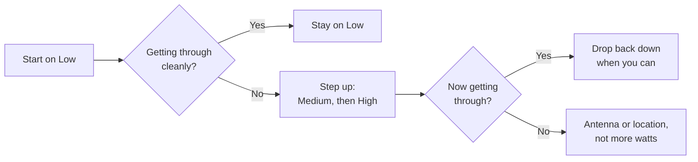
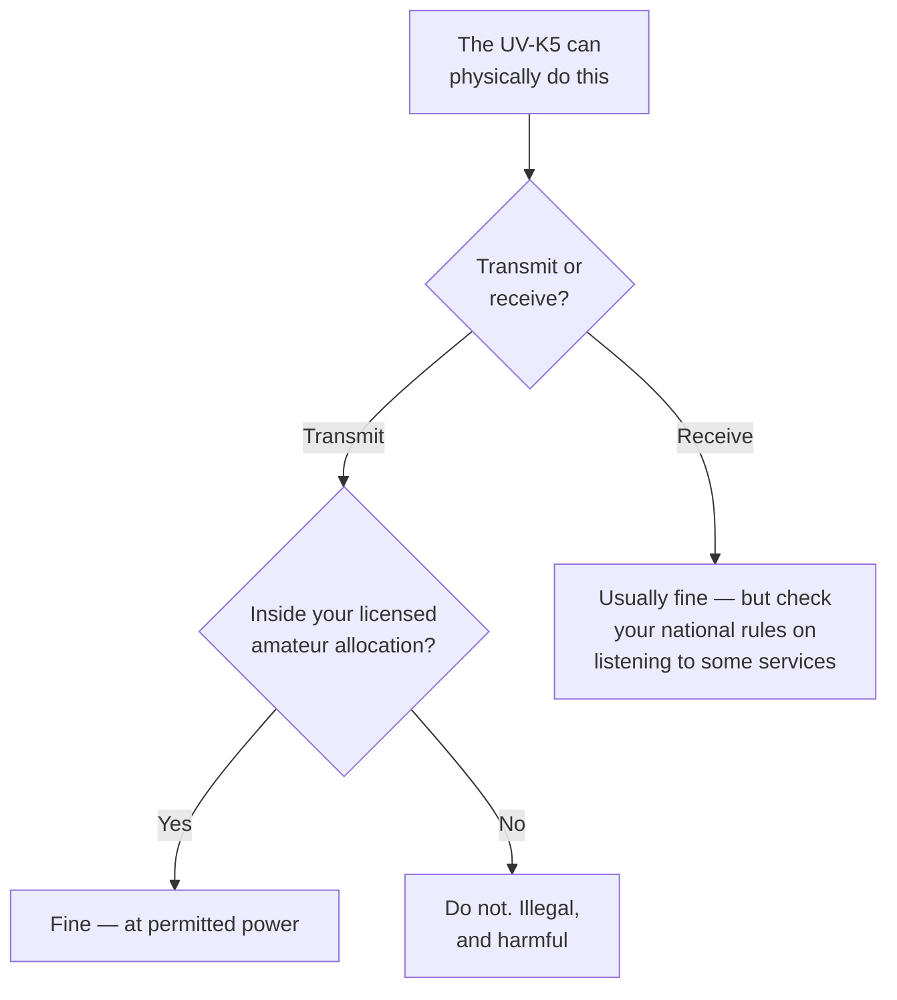
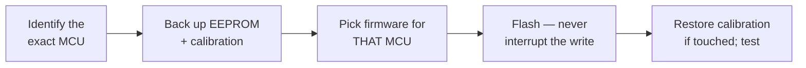

# Best practices and etiquette

A cheap radio in careful hands is a joy; a cheap radio in careless hands is the reason someone, somewhere, is drafting a complaint to the regulator. The UV-K5 will happily do things you must not do with it — transmit out of band, blast a roger beep on a repeater, sit on a busy channel with the squelch wide open. None of that is the radio's fault. This closing page gathers the habits that make you a good operator on a budget handset: run it clean, run it legal, run it considerately, and it will earn its keep for years.

Everything here applies whether you are on stock firmware or one of the custom builds ([egzumer](outpost:entry/logbook73.guide.uv-k5/firmware-egzumer), [F4HWN](outpost:entry/logbook73.guide.uv-k5/firmware-f4hwn), [VUURWERK](outpost:entry/logbook73.guide.uv-k5/firmware-vuurwerk)). Good manners do not change when you flash new code — if anything, custom firmware hands you more rope, because it unlocks capabilities the stock radio deliberately fenced off.

## Power discipline: the lowest that works

The UV-K5 gives you three transmit-power levels — **High, Medium and Low** — set in **menu 03 (TXP)** or flipped on the fly with **`F` then `6`**. The screen shows `H`, `M` or `L`. The whole of amateur best practice on power fits in one sentence: **use the lowest level that gets you through reliably, and no more.**

This is not about your licence. Every level the UV-K5 offers sits comfortably inside any amateur allowance — the manual specs stock transmit at 5 W or below, and most licences give you far more headroom than that. Running Low is about everything else:

- **Less interference.** A watt into a repeater a few miles away is plenty. Five watts does not make you clearer — it just splashes further and steps on distant stations sharing the same channel.
- **Less battery drain.** Transmit is where a handheld's battery goes to die. Low power roughly triples your talk time over High.
- **A cleaner signal.** Budget finals run hottest and dirtiest flat out; backing off keeps the transmitter linear and your audio clean.

The rule of thumb: start on Low. If someone says you are weak or scratchy, or you genuinely cannot raise the repeater, step up to Medium, then High. Turn it back down when you no longer need it. Height and a decent antenna beat brute watts every single time — the physics is in [RF Power](outpost:entry/logbook73.handbook/rf-power).

## Transmit only in-band — the line that matters most

This is the single most important paragraph on the page, so read it twice. **The UV-K5 can be made to transmit far outside the amateur bands. You must not do it.**

Out of the box, the radio's designed transmit range is the amateur allocations — roughly `136–174 MHz` and `400–470 MHz`, and the exact edges depend on your market version (the CE/UKCA version is tighter than the "NORMAL" one). But the receiver spans a huge window, roughly **50–600 MHz**, and firmware patches or a market-unlock can widen transmit to match. That is a **capability, not a permission**. The radio not stopping you means nothing; the law still does.

In essentially every country you may only transmit on frequencies your licence and your national allocation permit, at permitted power, for permitted purposes. Transmitting outside that — on the air band, marine channels, PMR446/FRS, public-safety or business frequencies — is illegal and can cause genuinely dangerous interference to services people depend on. Your national regulator is the authority (Ofcom in the UK, the FCC in the US, and their equivalents elsewhere), not the radio's menu system.

**Receiving is a different, gentler story.** The UV-K5 will happily listen across its whole range, and in many countries wideband receive is fine. But not everywhere: some countries restrict listening to certain services, or restrict _acting_ on what you hear. Two more receive-side cautions worth stating plainly:

- **The scrambler (menu 11, SCR) is not encryption.** It is analogue voice inversion — it garbles your audio to anyone without the same setting, but it is trivially undone, provides no real privacy, and is **not permitted on the amateur bands** in most jurisdictions, which require plain, un-obscured speech. Leave it off.
- **Some services you can hear, you may not decode, record or repeat.** If in doubt, listen and stay quiet, and check your national rules.

## Courtesy on the air: beeps and tails

The UV-K5 can end each over with a **roger beep** — menu 47 (ROGER), which offers `OFF`, a `ROGER` "frog" tone, or an `MDC` data burst. On the amateur bands the kind answer is **`OFF`**. A roger beep adds nothing a simple "over" does not, and a channel full of chirping radios is wearing. There is one honest exception: if you are working weak simplex with a specific partner who has agreed it, a roger beep genuinely helps signal "I've finished, your turn" when audio is marginal. Agree it first; do not inflict it on a repeater or a net.

**Tail-tone elimination** is the courteous cousin. When you release the PTT on FM simplex, there is a brief burst of noise — the "kerchunk" — as the other radio's squelch closes. **Menu 28 (STE)** eliminates it on your simplex transmissions; **menu 29 (RP-STE)** handles the equivalent tail through a repeater. Turning both `ON` is a small kindness that makes every over you send end cleanly. It is the sort of setting you enable once and forget.

Two more habits that cost nothing:

- **Leave a gap between overs.** A second or two lets someone with priority traffic — or an emergency — break in. On a repeater it also lets the machine reset its timer.
- **Identify with your callsign** as your licence requires. The radio's DTMF PTT-ID (menu 43) and ANI code (menu 36) are _not_ a substitute for saying your callsign in plain voice.

## Sensible scanning

Scanning is where a lot of new operators quietly become a nuisance without realising. The UV-K5 scans its active scan list and resumes according to **menu 23 (SC-REV)**: `TO` resumes on a timer, `CO` waits for the carrier to drop, `SE` stops and stays on the first signal it finds. Pick the resume mode to match what you are doing, and keep two things in mind.

First, **do not transmit blind out of a scan.** When the radio stops on a busy channel it is easy to key up out of reflex — but you may have landed on a repeater, a net in progress, or a channel you have no business transmitting on. Look at what the radio has actually stopped on before you touch the PTT. **Busy-channel lockout (menu 12, BCL)** is your friend here: set `ON` and the radio refuses to transmit on top of an occupied channel.

Second, **keep your scan lists honest.** The stock firmware gives you two lists (menus 26/27 add a channel to list 1 or list 2; menu 32 chooses which is active). Put transmit-capable amateur channels in one and pure listen-only frequencies in another, so you are never one careless keypress from transmitting somewhere you should not.

## Battery and antenna care

Two pieces of hardware keep a UV-K5 alive: the battery and the antenna. Treat both kindly.

**The antenna first, because it comes with a hard rule: never transmit without an antenna fitted.** With nothing on the SMA socket, the transmitter's power has nowhere to go, reflects straight back into the finals, and can damage the set — sometimes instantly, sometimes as a slow death. The same applies to a badly mismatched or broken antenna. If you fit an aftermarket whip or a mag-mount, check it presents a sensible match before you lean on it; the _why_ and the _how_ live in [SWR](outpost:entry/logbook73.handbook/swr). A better antenna is the single biggest upgrade you can make to a UV-K5 — but a bigger antenna also feeds the radio's broad, lightly filtered front end more of everything, so expect a little more [overload and ghost signals](outpost:entry/logbook73.handbook/overload-and-ghost-signals) near strong transmitter sites. That is the budget-receiver trade-off, not a fault.

**The battery** is a lithium cell, and lithium chemistry has preferences:

| Do                                                       | Don't                                                         |
| -------------------------------------------------------- | ------------------------------------------------------------- |
| Store around half to two-thirds charge for the long term | Store fully flat for months — it can drop below recovery      |
| Top up every few months if the radio lives in a bag      | Leave it cooking in a hot car or on a windowsill              |
| Keep a spare warm in an inside pocket in the cold        | Rely on the last bar in freezing weather — cold saps capacity |
| Charge on the supplied base or a decent Type‑C supply    | Trust a no-name high-current charger to know when to stop     |

The **transmit time-out timer (menu 21, TOT)** is a battery-and-courtesy safety net worth setting to a few minutes: if the PTT sticks in a pocket or you lean on it by accident, the radio stops transmitting instead of flattening the battery and jamming a channel.

## RF safety, briefly and calmly

A handheld at a few watts is low-risk, but two sensible habits cost nothing. **Keep the antenna away from your face and eyes** when transmitting — hold the radio a little away from your head rather than pressed against your cheek, and never look straight down a transmitting antenna at close range. And **do not transmit at high power for long stretches with the antenna touching skin.** None of this is cause for alarm; it is the same "a little distance is free" thinking covered in [RF Power](outpost:entry/logbook73.handbook/rf-power). If you move to an external antenna and higher duty-cycle use, that guide has the exposure basics.

## Firmware hygiene

If you flash custom firmware — and much of this guide is about doing exactly that — a handful of disciplines separate a smooth upgrade from a bricked radio. They all come down to _back up, match the chip, and don't interrupt._

**Match the MCU — this is the number-one way to brick a UV-K5.** The family splits across two silicon platforms, and firmware is not interchangeable:

| Radios                            | MCU        | Firmware line                                      | Tools                                           |
| --------------------------------- | ---------- | -------------------------------------------------- | ----------------------------------------------- |
| UV-K5, UV-K5(8)/UV-K6, UV-5R Plus | `DP32G030` | egzumer / mainline‑F4HWN / VUURWERK (V1/V2 builds) | egzumer UVTools, whosmatt UVMOD, k5prog, K5TOOL |
| UV-K5 V3, UV-K1 (Kong Mini)       | `PY32F071` | the muzkr + armel port (V3/K1 builds)              | UVTools2, knoinok's quansheng_toolkit           |

Flashing a DP32G030 build onto a PY32F071 radio, or the reverse, can brick it — and vice-versa is not idle caution, it is the most common failure story in the community. Confirm the exact chip _before_ you flash, and be extra careful with late-production UV-K5(8) units, some of which reportedly shipped with different silicon again. [Choosing your firmware](outpost:entry/logbook73.guide.uv-k5/firmware-choosing) walks through identifying your radio.

**Back up before you write anything.** Every UV-K5 is individually factory-calibrated — transmit power per band, frequency and metering trims — and that calibration lives in EEPROM, in the region roughly above `0x1d00`. Quansheng does not publish it, it is unique to your radio, and there is no clean factory restore. Wipe it and your power and metering go wrong for good. So dump the EEPROM to a file first (k5prog `-r`, or K5TOOL, on DP32G030; UVTools2 or quansheng_toolkit on V3/K1) and keep that file safe off the radio. Firmware flashing usually leaves calibration alone, but a wrong-MCU or interrupted write can still destroy it — which is exactly why you back up first.

**Keep a known-good image.** Hang on to the stock firmware, or whichever build you know works, so you always have something safe to fall back to. If a flash goes wrong the bootloader usually survives, so you can re-enter flash mode (hold `PTT` while powering on — the flashlight LED confirms it, on DP32G030 sets) and re-flash a correct build.

**Never interrupt a write.** While the top LED is flashing, do not unplug the cable, pull the battery, or let the PC sleep. A seated cable, the right CH340 driver, and a Chromium browser (or Firefox 151+ for UVTools2) prevent most half-written disasters. The full sequence is in [Flashing](outpost:entry/logbook73.guide.uv-k5/firmware-flashing).

## Being a good custodian of a cheap radio's reputation

The UV-K5 and its Baofeng cousins have a mixed reputation, and how they are used matters more than what they cost. A budget handset run by a careful operator — clean signal, low power, dead in-band, courteous on the channel — can sound every bit as considerate as premium equipment. The same handset run carelessly is why some clubs sigh when they see one.

You get to decide which story your radio tells. Programme your local [repeaters](outpost:entry/logbook73.handbook/repeaters) and calling channels properly. Run the lowest power that works. Keep every transmission inside your allocation. Turn the roger beep off, the tail-tone elimination on, and leave a gap for the next person. Back up before you flash and match the chip. Do those things and you are not just operating a cheap radio well — you are quietly making the case that the price of the box has nothing to do with the quality of the operator behind it.

## Try it yourself

Spend ten minutes turning your UV-K5 into a well-mannered radio:

1. **Set power to Low** — menu 03 (TXP) or `F`+`6` until the screen shows `L`. Make Low your resting default.
2. **Roger beep off, tail-tones on** — menu 47 (ROGER) to `OFF`; menu 28 (STE) and menu 29 (RP-STE) to `ON`.
3. **Busy-channel lockout on** — menu 12 (BCL) to `ON`, so the radio won't transmit over someone.
4. **Set a time-out timer** — menu 21 (TOT) to a few minutes, so a stuck PTT can't flatten the battery.
5. **Check your antenna is fitted and sound** _before_ you ever key up — and never transmit without one.
6. **If you plan to flash**, dump your EEPROM to a file today and label it with your radio's MCU, so the backup exists before you need it.

## Key takeaways

- **Run the lowest power that works** — start on Low (menu 03 / `F`+`6`), step up only when you must, drop back when you can. It saves battery, cuts interference, and keeps your signal clean.
- **Transmit only inside your licensed allocation.** The UV-K5 _can_ be made to transmit out of band — that is a capability, never a permission. Receiving is usually fine; check your national rules, and remember the scrambler (menu 11) is not encryption and not for the amateur bands.
- **Be courteous:** roger beep `OFF` (menu 47), tail-tone elimination `ON` (menus 28/29), a gap between overs, and your callsign in plain voice.
- **Scan sensibly** — set the resume mode (menu 23), keep busy-channel lockout on (menu 12), and never key up blind out of a scan.
- **Never transmit without an antenna**, keep it away from your face, and look after the lithium battery — store it part-charged, keep it warm in the cold, set a time-out timer (menu 21).
- **Firmware hygiene:** identify the MCU (`DP32G030` vs `PY32F071`), back up EEPROM and calibration first, flash only the matching build, keep a known-good image, and never interrupt a write.
- **A cheap radio, run cleanly and legally, is indistinguishable on the air from an expensive one** — you are the custodian of its reputation.

That is the whole guide. You now know this little radio from its stock menus to its custom firmware, from receiving everything to transmitting responsibly — so head back to the [UV-K5 guide contents](outpost:entry/logbook73.guide.uv-k5) to revisit any chapter, or wander into the wider [handbook](outpost:entry/logbook73.handbook) and put it all on the air. Enjoy the radio; operate it well.
