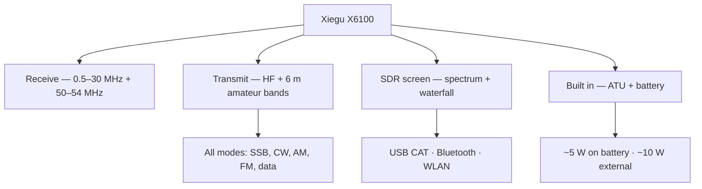
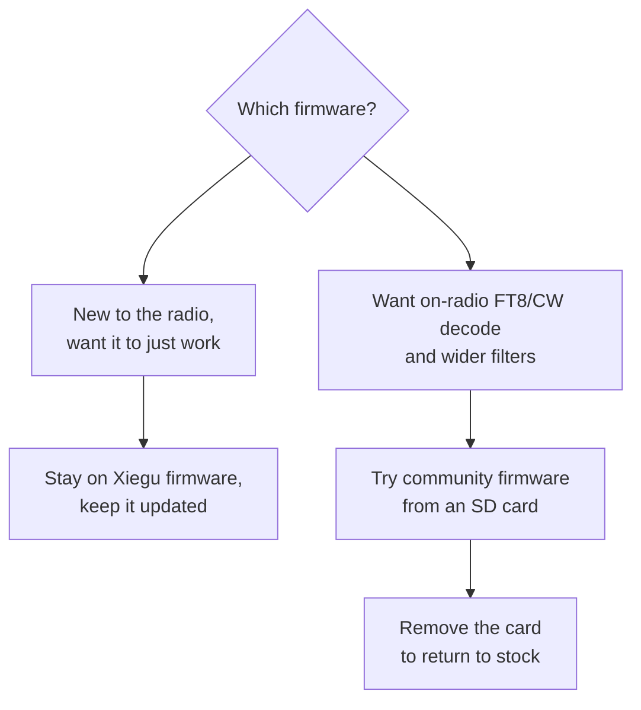

# Why the X6100 (HF in your hand)

Most amateurs meet high frequency for the first time through a rig the size of a car battery, bolted to a desk and wired to a mains supply. The Xiegu X6100 is the opposite proposition: a shortwave transceiver that fits in a coat pocket, runs off its own battery, tunes and matches its own antenna, and paints the whole band in front of you on a colour screen. It is a proper software-defined radio — HF and 6 m, every mode — shrunk to something you can carry up a hill. This guide's job is to make that little machine make sense: to explain what every knob, button-menu and setting does, in plain English, whether this is your first HF radio or your fifth.

## What the X6100 actually is

Strip away the marketing and the X6100 is a **compact, all-mode HF plus 50 MHz QRP transceiver built on a software-defined radio (SDR) platform**, with a spectrum display and waterfall, a built-in automatic antenna tuner, and an internal rechargeable battery — the whole station, minus an antenna, in one hand-sized box.



Unpacked into plain terms, that means:

- **It covers all of shortwave and a slice of 6 m.** The receiver tunes continuously from `0.5` to `30 MHz` and again from `50` to `54 MHz`, so it hears everything from the [medium-wave](outpost:entry/logbook73.handbook/hf) broadcast band up through the amateur HF bands to the low end of VHF. It _transmits_ on the amateur bands only — the segments you are licensed for — and exactly which band edges are enabled varies a little by region and firmware, so verify them on your own unit rather than trusting a printed figure.
- **It works every mode an HF operator uses.** SSB (upper and lower sideband) for voice, CW for Morse, AM and FM, and data modes such as [FT8](outpost:entry/logbook73.handbook/ft8) — the modern weak-signal mode — through a connected computer. There is even a built-in modem for RTTY, CW and PSK so you can send and read those without a laptop at all.
- **It carries its own tuner and its own power.** A built-in automatic [antenna tuner](outpost:entry/logbook73.handbook/antennas) (ATU) squeezes a workable match out of an imperfect antenna at the press of a button, and an internal lithium battery means you can switch it on with nothing plugged in but an aerial.
- **It shows you the band, not just a frequency.** A 4-inch, `800 × 480` non-touch colour display shows a live spectrum and a scrolling waterfall — a picture of the radio activity around you, which is the single feature newcomers find most transformative. Five physical soft-keys, the knobs and the hand microphone operate it.
- **It talks to computers and accessories.** USB carries computer control (CAT) and two-way digital-mode audio; Bluetooth and 2.4 GHz Wi-Fi support model- and firmware-specific peripherals and networking. A keyboard or mouse is the dependable stock Bluetooth use. Xiegu's product page advertises wireless audio, but the detailed stock manual says a headset may pair without routing either receive audio or its microphone, so this guide does not promise headset audio. The radio also includes a standing-wave scanner, stored voice and text messages, and CW auto-call.

This is not a toy or a starter throwaway. It sits in the middle of the portable-HF market and offers a broad feature set in a compact package. It has real weaknesses, which we will name honestly in a moment, but it is a serious little radio.

## "SDR" and "QRP" at a glance

Two pieces of jargon are stamped all over this radio, and both are worth thirty seconds now because they shape everything about how it behaves.

**SDR — software-defined radio.** In an old-fashioned receiver, tuning, filtering and demodulating a signal are done by physical circuits: coils, crystals, tuned cans you could point to on a circuit board. In a software-defined radio, the incoming signal is digitised almost as soon as it arrives — the X6100 samples it at 24-bit resolution — and from that point on the "radio" is _maths_ running on a processor. Changing the filter bandwidth, reducing noise, or slicing a signal out of the din is a software operation, not a hardware one. The deep story is in [Software-Defined Radio](outpost:entry/logbook73.handbook/software-defined-radio) and [I/Q Signals](outpost:entry/logbook73.handbook/iq-signals), and it is worth reading — but the payoff you will feel immediately is that screen.

Because the radio has already turned the band into numbers, it can run a **Fast Fourier Transform** — a mathematical prism that splits the incoming jumble into its individual frequencies — and draw the result. That is your spectrum display (signal strength across a slice of band, right now) and your **waterfall** (the same picture scrolling downward through time, so a signal that came and went leaves a visible streak). [FFTs and Waterfalls](outpost:entry/logbook73.handbook/ffts-and-waterfalls) explains the idea in full.

```viz
{
  "type": "waterfall",
  "title": "A slice of an HF band, as the X6100 draws it",
  "caption": "Time scrolls downward, frequency runs across. A steady CW note, two SSB voices of different widths, and a block of FT8 signals each leave a recognisable signature — the waterfall lets you see activity before you can hear it.",
  "xLabel": "frequency across the band segment",
  "yLabel": "time (scrolling down)",
  "signals": [
    { "f": 15, "kind": "cw" },
    { "f": 34, "width": 7, "kind": "ssb" },
    { "f": 52, "width": 7, "kind": "ssb" },
    { "f": 78, "width": 12, "kind": "ft8" }
  ]
}
```

Once you have operated with a waterfall you will not want to go back. Instead of tuning slowly across a band hoping to stumble onto a signal, you _see_ the signals — a sharp vertical line is a CW carrier, a fuzzy band is an SSB voice, a neat rank of parallel streaks is FT8 — and tune straight to them.

**QRP — low-power operating.** "QRP" is an old Morse abbreviation that came to mean "reduce power," and by convention it labels stations running about **5 watts or less**. The X6100 puts out around `5 W` on its internal battery and up to about `10 W` from an external supply — modest figures next to a 100 W desk rig. That sounds like a handicap and sometimes is, but low power is a discipline with real rewards: it is kinder to your battery, it forces you to put your effort into a good antenna (which matters far more than watts), and working the world on a handful of watts is one of the genuine thrills of the hobby. [RF Power](outpost:entry/logbook73.handbook/rf-power) puts watts, decibels and "how far will this get me?" into perspective. The short version: on HF, [propagation](outpost:entry/logbook73.handbook/propagation) and your antenna decide most of the outcome, and 5 W into a decent wire on a good band routinely crosses oceans.

## Who this radio suits

The X6100 was built for one thing above all — **being carried** — and that shapes who gets the most from it.

- **The portable and outdoor operator.** For [Summits on the Air](outpost:entry/logbook73.handbook/making-contacts) (SOTA), Parks on the Air (POTA), holidays, or simply operating from the garden, a self-contained radio with its own battery and tuner is close to ideal. Throw a wire in a tree, press the tune button, and you are on the air.
- **The newcomer to HF who wants a gentle way in.** The waterfall makes the invisible visible and the built-in tuner accommodates a practical range of antenna mismatch. If VHF/UHF handhelds were your start and HF is the next frontier, this is an approachable bridge.
- **The experienced operator wanting a light second rig.** Plenty of people own a big station radio and want something to grab for a weekend away. The X6100 fills that compact portable slot.

It suits you less well as a _primary home station_ if you live somewhere electrically noisy or close to strong broadcast transmitters — for reasons we come to under "what it is not." Its intended job is portable low-power HF.

## An honest word on firmware

Here is where candour matters most, because the X6100's firmware is genuinely part of the ownership experience — more so than on almost any other radio in its class.

The X6100 is, underneath, a small Linux computer driving radio hardware, and it carries **two separate firmware version numbers**: an **APP** version (the Linux user interface you see) and a **BASE** version (the code running the radio hardware). Seeing two different numbers confuses newcomers, but it is normal — they update independently. Xiegu's firmware history has been, frankly, bumpy: features and bug-fixes arrived over many releases, and at least one build (V1.1.8, in 2024) was **withdrawn after users found it broke transmit**, then fixed in the next release. Current builds are far more polished than the early ones — the once-illegible red-on-green text is gone, noise reduction improved, and the spectrum gained a cursor mode — but the lesson stands: **check which firmware your radio is running, keep it reasonably current, and read the release notes before you update.** One firmware rule is not optional: recent Xiegu updates have required a **factory reset after upgrading**, and skipping it can corrupt the band data so the radio refuses to change bands or shows a frequency of `0`. We cover the update and reset procedure carefully in [The GEN Settings Menu](outpost:entry/logbook73.guide.x6100/gen-settings). (Firmware version numbers move quickly, so treat any specific version or date in this guide as a snapshot, not gospel — verify against Xiegu's current downloads.)

There is a second, happier half to the firmware story. Because the interface runs on Linux, the X6100 has an unusually active **community firmware scene**. The best-known alternative began as a downloadable SD-card image (originally R1CBU's; its open-source line is now maintained by gdyuldin as OpenX6100, and a separate project, OpenX6X00, covers both the X6100 and X6200) that **boots entirely from the memory card** — so it changes nothing permanent, and removing the card returns you to the stock Xiegu firmware. It adds genuinely useful things the stock firmware lacks or does less well: on-radio FT8 and CW decoding, wider and more flexible filters, a logbook, and more. Xiegu treats third-party firmware as voiding the warranty, but the SD-boot approach is reversible, which is what makes it worth mentioning to a newcomer at all.



You do not have to touch community firmware to enjoy this radio, and if in doubt, don't — this guide is written around the official Xiegu firmware, with community-firmware differences flagged where they matter. But it is honest and useful to know the option exists. [Custom Firmware](outpost:entry/logbook73.guide.x6100/custom-firmware) explains the projects, how to try one from a card and how to go back.

## What it is, and what it is not

Knowing a tool's limits is part of using it well, so here is the straight list.

**What it is:**

- A capable, genuinely portable SDR HF/6 m transceiver with a spectrum-and-waterfall display that is a real joy to operate.
- All-mode, with a built-in ATU, an internal battery, and a rich set of connections — CAT control, Bluetooth, Wi-Fi, and the ports to run data modes.
- Strong value: it does things that cost far more elsewhere, and it does most of them well.

**What it is not:**

- **It is not a strong-signal fortress of a receiver.** Its front end is a direct-conversion SDR with switched band-pass filters and no [roofing filter](outpost:entry/logbook73.handbook/receivers) — which keeps it compact, but means that near a powerful medium-wave or shortwave broadcast transmitter the receiver can **overload**, serving up voices behind CW, broadcast bleed-through, and phantom signals that are not really there. This is a commonly reported X6100 limitation, though away from strong transmitters many operators rarely meet it. Mitigations include switching in the attenuator, reducing RF gain and, after identifying the interfering band, choosing a suitable external reject filter. [Overload and Ghost Signals](outpost:entry/logbook73.handbook/overload-and-ghost-signals) explains the mechanism, and we return to it in the receiver chapters.
- **It is not a 100 W contest station.** It is QRP by design; if you want to work marginal openings with brute force, it is the wrong tool (though it happily drives an external amplifier).
- **It is not a native FT8 appliance on stock firmware.** Data modes work beautifully, but by connecting a computer running the usual software — the radio provides the CAT control and audio; the PC does the decoding. (Community firmware changes this.)
- **Its audio is functional, not hi-fi.** The tiny internal speaker is best thought of as an "is anyone there?" monitor; for serious listening, headphones transform the radio. One wiring trap to remember from day one: the headphone/speaker socket is **stereo**, and plugging in a _mono_ plug shorts the output and silences it — always use a stereo (TRS) plug.
- **Mind the battery-documentation versions.** The current manufacturer V1.6 manual specifies the built-in pack as `3500 mAh, 7.4 V` (about 26 Wh); older English material says 3000 mAh and some old marketing printed 12 V. Treat `7.4 V` as the chemistry and check the label/health of the pack actually fitted rather than using an old capacity figure to predict runtime.

None of these are deal-breakers for the radio's intended job. They are the honest trade-offs of putting a capable SDR HF station into a pocket at this price.

## A word on safety and the licence

Because the X6100 _transmits_, a little care keeps you, your radio and your neighbours happy.

- **The licence comes first.** You may only transmit if you hold the appropriate amateur licence, and only within the band segments and power limits your licence allows — check your national band plan and licence conditions before you key up. Receiving is unrestricted and a fine way to learn while you study; [Getting Licensed](outpost:entry/logbook73.handbook/getting-licensed) explains how to earn the right to transmit. Never transmit outside the amateur allocations.
- **Never transmit without an antenna (or a dummy load).** A transmitter with nowhere to send its power reflects it back on itself and can be damaged. Fit the antenna, and let the [SWR](outpost:entry/logbook73.handbook/swr) reading and the ATU confirm a good match before you run any power. Do not touch the antenna while transmitting.
- **Power it correctly.** The external DC input takes roughly `9` to `15 V` — **never more than 15 V**, never AC, and never with the polarity reversed, any of which can destroy the radio. On long, high-duty transmissions (FT8 especially) the radio warms up; give it breaks and some airflow.
- **Look after the battery.** It is a lithium pack: store it around 40–50% charge if the radio will sit unused, keep it out of heat, and expect it to want replacing after a few years — normal for any lithium cell.

That really is the whole of the safety story for a radio this size: right licence, right band, always an antenna, sane voltage, and a bit of respect for the battery.

## Try it yourself

You do not need a licence — or even to transmit — to start learning this radio today.

1. **Just listen.** With the antenna connected and the battery charged, power on, choose a busy HF band (40 m in the evening, 20 m by day), and watch the waterfall for a few minutes before you touch the tuning knob. See how a CW signal looks different from an SSB voice, and how activity comes and goes.
2. **Tune by eye.** Spot a signal on the waterfall and tune straight onto it, rather than sweeping blindly. This is the SDR habit that changes how you operate.
3. **Find your firmware.** Have a look for the version screen (we map every menu in the [Menu Reference](outpost:entry/logbook73.guide.x6100/menu-reference)) and note your APP and BASE versions — you will want them if you ever ask for help or plan an update.
4. **Read the band, then read the [handbook](outpost:entry/logbook73.handbook).** When you wonder _why_ the noise floor sits where it does, or why a strong broadcaster smears across the display, the theory chapters linked above turn curiosity into understanding.

## Key takeaways

- The X6100 is a **pocket-sized, all-mode SDR transceiver for HF and 6 m**, with a spectrum-and-waterfall screen, a built-in automatic tuner and its own battery — a genuine portable HF station, not a starter throwaway.
- **SDR** means the radio is defined in software, which is what gives you the waterfall — a picture of the band that lets you _see_ signals before you hear them; **QRP** means it runs low power (~5 W on battery, ~10 W external), where a good antenna and propagation matter far more than watts.
- It suits **portable and outdoor operating**, a **gentle route into HF**, and a **light second rig** — less so a primary station in a strong-signal or electrically noisy location.
- **Firmware is a real topic**: two version numbers (APP and BASE), a bumpy update history that has steadily improved, a mandatory factory reset after recent upgrades, and a reversible SD-card community firmware for those who want on-radio FT8, CW decode and wider filters.
- Its honest limits are a **front end that can overload near strong broadcasters** (cured cheaply with the attenuator, RF gain and a broadcast-reject filter), **modest audio** (use headphones, and always a stereo plug), and a battery that is really a 7.4 V pack despite the "12 V" label.
- **Transmit only with the right licence, in the right band segments, and never without an antenna** — keep the DC input under 15 V, and look after the lithium battery.

With the big picture in place, it is time to pick the radio up and learn our way around it — the panel, the knobs, the button-menus and the screen — in [Getting Started: Panel, Knobs, Menus & Power](outpost:entry/logbook73.guide.x6100/getting-started).

---

_Firmware-specific statements in this guide (the V1.1.8 withdrawn build, the APP V1.2.0 / BASE V1.1.9 baseline, the V1.2.0 factory-reset requirement and current-build behaviour) were last verified against Xiegu's published manual, tutorials and releases on **28 August 2026**. Firmware moves quickly — check the release notes for anything newer._
