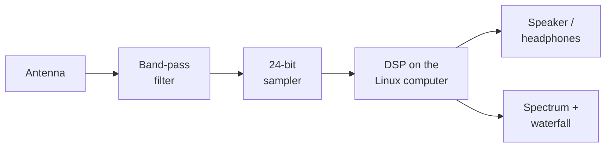
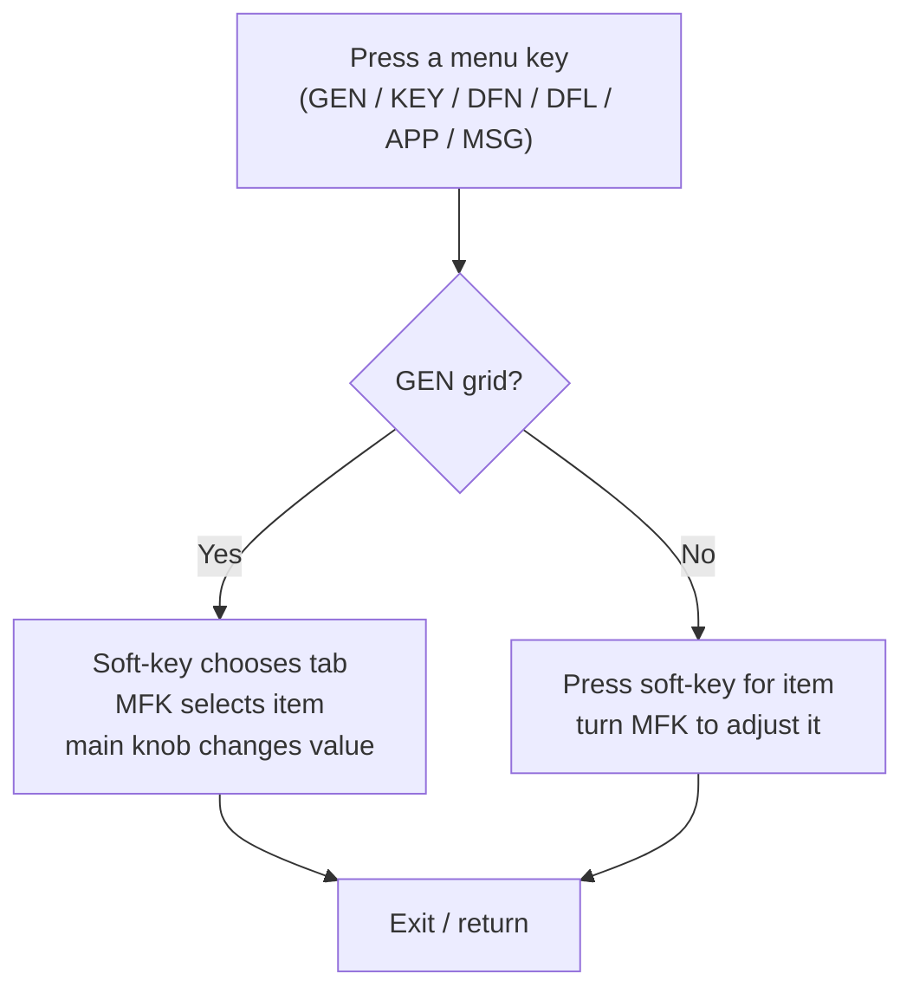

# Getting started: panel, knobs, menus and power

Pick the X6100 up and the first thing you notice is that it does not look like a traditional radio. In place of a row of knobs and a small numeric display there is a bright colour screen carrying a live picture of the radio spectrum, a scrolling waterfall beneath it, and only a handful of physical controls around the edge. That is because most of this radio is software: the knobs and keys are just a way of telling a small computer what to do. This chapter walks you round every control, shows you what the screen is telling you, and gets you from a cold radio to a powered-up, antenna-connected, ready-to-listen station — so that everything after it makes sense.

## What you are actually holding

The X6100 is a **software-defined radio** (SDR). Rather than filtering and detecting a signal with a chain of dedicated tuned circuits, it digitises the incoming radio energy very early — with 24-bit sampling — and then does the real work (filtering, demodulation, noise reduction, drawing that spectrum picture) in software running on a small built-in computer. If that idea is new, the full story is in [Software-Defined Radio](outpost:entry/logbook73.handbook/software-defined-radio); for now, this diagram is the whole shape of it.



Two consequences of that design run through the whole guide. The good one: because the radio has already turned the band into numbers, it can _draw_ it for you — the spectrum display and waterfall that make the X6100 so pleasant to tune are essentially free. The awkward one: the front end (the part before the sampler) is deliberately simple, so very strong signals can overload it — a real quirk we meet properly in later chapters. Do not worry about it yet.

One thing to settle before anything else. The X6100 **transmits** on the amateur HF bands and 6 m, at up to 10 W. Transmitting is a licensed activity: you may only key up if you hold an appropriate amateur licence, and only within the band segments and power your licence allows. Ordinary amateur/broadcast receive-only exploration is generally available without an amateur transmitting licence, but protected communications and receiver rules vary by country, so follow local law. If you are not yet licensed, read [Getting Licensed](outpost:entry/logbook73.handbook/getting-licensed); until then, treat this as a capable shortwave receiver without transmitting.

## The front panel, in prose

Everything you touch in normal operation lives on the front face or the top edge. Take them a group at a time; the names settle in fast once you have used them.

**The power button** sits on the left of the front panel. **Press and hold it** to switch the radio on — it takes a few seconds to boot, because a small Linux computer is starting up inside. To switch off, **press and hold it again** and let the radio shut its computer down cleanly — that takes a few seconds, so do not pull the power the moment the screen goes dark. It is a deliberate press-and-hold both ways, so the radio never wakes or sleeps in your bag by accident.

**The VOL/SQL/RFG knob**, one of the two knobs on the left of the panel, is the busiest control on the radio because it does three jobs in one. By default it sets **volume**. **Short-press** it and it becomes the **squelch** control; short-press again and it becomes the **RF gain** control; press once more and you are back to volume. Whichever of the three is currently selected, you **turn** the knob to adjust it. We give each of those three jobs its own section below, because getting them straight early saves a great deal of "why has it gone quiet?" confusion later.

**The MFK knob** ("multi-function knob"), the other left-hand knob, is the radio's general-purpose selector. Its everyday job is user-assignable. In a **GEN grid**, turn MFK to move the dashed selection box and use the main knob to change the selected value. In direct **KEY/DFN/DFL/APP/MSG** pages, press the physical soft-key under the item and then turn MFK to adjust that item. That distinction is the control grammar to remember.

**The main tuning knob** is the big weighted wheel on the right — the one your right hand falls onto naturally. In normal use you **turn it to tune the frequency**. Inside a **GEN** tab, it changes the value of the item selected with MFK. Direct task menus use their soft-key plus MFK instead. (Xiegu's translated documentation may call this knob "the larger impeller"; that just means the tuning wheel.)

**The lock button**, on the right beside the main knob, has two separate jobs and it is worth knowing both. **Press and hold it for two seconds** to **lock the main tuning knob**, so a knock cannot slide you off frequency; hold two seconds again to unlock. A padlock icon on the screen shows when the lock is on. **Short-press** the same button — when the knob is unlocked — to step the **screen backlight** brightness (⭐): five levels when you are running on the internal battery, ten when you are on external power. That backlight step is the single biggest lever you have over battery life, so on a long day away from mains power, run it dim.

**The TR indicator** — a small light near the top-left, labelled for "power supply / transmit-receive" — glows **green** once the radio has finished booting and is receiving, and turns **red** the instant you transmit. It is your at-a-glance confirmation that the radio has actually keyed up. (During charging the same light means something different, covered under power below.)

**The five soft-buttons** run in a row directly beneath the screen. They have no fixed job: each one does whatever the screen shows above it at that moment. Open a menu and the five labels along the bottom of the display change to match — so these buttons are how you pick tabs, pages and options once a menu is up. Get comfortable with the idea that **the bottom of the screen always tells you what the five buttons currently do**, and the radio stops feeling cryptic.

### The six menu keys

Down the left side of the front panel is a column of six labelled keys. Each one opens a different **task menu** — a self-contained set of related settings — onto the screen and the five soft-buttons. This is the heart of how the X6100 is organised, so learn what each opens now; the detail comes in later chapters.

- **GEN** — the **general settings** menu: the radio's core configuration, arranged in tabbed pages (radio, display, system settings and the memory editor). This is where most set-and-forget choices live. Full treatment in [The GEN Settings Menu](outpost:entry/logbook73.guide.x6100/gen-settings).
- **KEY** — the **CW keyer** (the manual calls a Morse key a "tapper"): keyer speed, iambic mode, sidetone and the like. See [CW: the Keyer, Messages & Auto-call](outpost:entry/logbook73.guide.x6100/cw-keyer).
- **DFN** — the **digital-function** menu: the DSP noise tools — noise reduction (NR), the noise blanker (NB) and the manually placed digital notch (DNF). Covered in [DFN & DFL: DSP, Noise Reduction & Filters](outpost:entry/logbook73.guide.x6100/dsp-filters).
- **DFL** — the **digital-filter** menu: the receive passband — how wide a slice of the band you actually listen through — with editable presets. Same chapter as DFN.
- **APP** — the **function/applications** menu: the built-in data **modem** (RTTY/CW/BPSK decode), the **SWR scanner** (a plot of your antenna's match across a band) and the **voice call** player. The tuner and scanner get [The Antenna Tuner & SWR Scanner](outpost:entry/logbook73.guide.x6100/atu-swr); the modem is in [Connectivity](outpost:entry/logbook73.guide.x6100/connectivity).
- **MSG** — the **messages** store: five preset **text** messages (for CW, RTTY and BPSK) and, on a second page, five recordable **voice** messages, for calling CQ or contesting without wearing out your voice or your fist.

We will not open any of these fully in this chapter — that is what the [Menu & Button Reference](outpost:entry/logbook73.guide.x6100/menu-reference) and later chapters are for. Remember only the split grammar: GEN uses MFK-select/main-knob-change, while direct task menus use the item's physical soft-key then MFK.

## The top edge and the sides

The **top edge** carries the buttons you press _while operating_ rather than while configuring: the **PTT** (push-to-talk) on the body itself, mode buttons **AM|FM**, **CW** and **SSB**, plus **V/M** (swap between tuning a frequency and recalling a stored channel), **A/B** (swap between the two VFOs), **AGC**, **PRE** (preamp/attenuator), **FST** (fast tuning step), **ATU** (the antenna tuner) and a pair of left/right buttons. In VFO mode those arrows step down/up through the selected band set; in MEMO mode they step through stored channels. These are the controls of day-to-day operating, so we meet them where they belong — in [Tuning, VFOs & Modes](outpost:entry/logbook73.guide.x6100/tuning-modes) and [The Antenna Tuner & SWR Scanner](outpost:entry/logbook73.guide.x6100/atu-swr) — rather than here.

### The supplied hand microphone

The multifunction hand microphone repeats the operating controls where your thumb can reach them. Current V1.6 and the extended stock manual document this inventory:

| Control                      | What it does                                                                    |
| ---------------------------- | ------------------------------------------------------------------------------- |
| `SPCH/LOCK` / `LOCK`         | Short-press locks/unlocks the main tuning wheel; older faceplates say SPCH/LOCK |
| `PTT`                        | Transmits while held in normal PTT mode                                         |
| `UP / DOWN`                  | VFO: frequency step up/down; MEMO: previous/next memory channel                 |
| Status LED                   | Shows microphone/radio operating status                                         |
| Numeric keypad + `F-INP/ENT` | Direct amateur-band selection or typed frequency entry, then ENT to commit      |
| `FIL`                        | Cycles receiver filter presets 1–3                                              |
| `MODE`                       | Selects AM, NFM, CW/CWR, LSB/L-DIG or USB/U-DIG                                 |
| Function LED                 | Indicates a function-key action                                                 |
| `F1 / F2`                    | User assignments from RADIO SETTING2                                            |
| `MW`                         | Short-press writes the current VFO into the selected memory channel             |
| `V/M`                        | Short-press switches VFO/MEMO operation                                         |
| `XFC`                        | Short: swap VFO A/B; long: copy foreground VFO to background                    |
| `TUNER/CALL`                 | Short: tuner in/out; long: start an automatic tune                              |

Some microphone faceplates carry `144`/`430` legends even though the X6100 does not cover 2 m or 70 cm; those unsupported legends are inert, not extra receive coverage or transmit permission. Test lock, F1/F2 and memory-writing while receiving before trusting them in a live contact.

The **connectors** are split across the two side panels. On the **left**:

- **ANT** — a **BNC** socket, 50 ohm, where your antenna goes.
- **I/Q OUT** — a 3.5 mm stereo jack that outputs the raw **I/Q** signal, so you can feed a computer running SDR software from the X6100's front end. If that means nothing yet, [I/Q Signals](outpost:entry/logbook73.handbook/iq-signals) explains it; most operators never use this jack.
- **DC IN** — the external-power barrel socket (5.5 × 2.5 mm). **Never feed it more than 15 V DC** — the manual is emphatic, and exceeding it can seriously damage the radio.

On the **right**:

- **CARD** — a microSD slot used by stock firmware for updates and for backup/transfer of memory channels and voice-keyer recordings. Community environments may add other SD-card workflows, including logs; do not assume those are stock features.
- **DEV** — a USB-C port (the "slave" port) that connects the radio to a computer for **CAT control** and digital-mode audio. This is the port you use for FT8 and computer logging; see [Connectivity](outpost:entry/logbook73.guide.x6100/connectivity).
- **HOST** — a USB "host" port for peripherals: a keyboard or mouse, wired or via the radio's wireless support.
- **S/P** — the external **speaker/headphone** jack (3.5 mm **stereo**). **Use a stereo (TRS) plug here.** The manufacturer warns that a mono TS plug shorts the audio output and can damage the device, as well as causing silence. The internal speaker is small and, frankly, tinny; for weak-signal listening, correctly wired headphones transform the radio.
- **KEY** — a 3.5 mm jack for a Morse key or paddle.
- **ACC** — a 3.5 mm accessory jack carrying band and transmit signals for controlling an external amplifier.
- **MIC** — an RJ45 socket for the supplied hand microphone.

## The screen and the waterfall

The 4-inch, **800 × 480** colour display is the radio's face, and reading it fluently is most of learning the X6100. It has no touch input: the five physical soft-keys, knobs, dedicated keys and hand microphone operate what you see. Do not be intimidated by how much it shows — every element is answering a simple question, and you can ignore most of them at first.

Across the top sit your two **VFOs** (A and B — two independent frequency memories you flip between), the current mode, and a row of small **status icons**: `ATU` when the tuner is in circuit, `SQL` for squelch, `NB`/`NR`/`DNF` when those noise tools are on, `SPL` for split operation, plus lock, USB, Bluetooth, WLAN and battery indicators. An **S-meter** shows received signal strength, with a numeric **dBm** readout for the technically minded.

The large central area is the part that makes an SDR special: a live **RF spectrum** — a graph of signal strength against frequency across the slice of band you are tuned to — with a **waterfall** scrolling beneath it, painting that same spectrum over time so that a signal which comes and goes leaves a visible trail. There is also a smaller **audio (AF) spectrum** showing the pitch content of what you are actually hearing. The waterfall is not decoration: it is how you _see_ a weak CW signal, an empty gap to call in, or an FT8 pile-up before you have decoded a single character. The theory of how those pictures are built is in [FFTs and Waterfalls](outpost:entry/logbook73.handbook/ffts-and-waterfalls); here is what one looks like in practice.

```viz
{
  "type": "waterfall",
  "title": "The X6100 waterfall — four signals, four signatures",
  "caption": "Newest signals are at the top, scrolling down as time passes. A steady CW carrier draws a thin vertical line, an SSB voice a wider smear, and an FT8 signal switches on and off in a regular rhythm — you learn to read the band at a glance.",
  "signals": [
    { "f": 18, "kind": "cw" },
    { "f": 40, "kind": "ssb", "width": 6 },
    { "f": 64, "kind": "ft8", "width": 5 },
    { "f": 84, "kind": "carrier" }
  ],
  "xLabel": "frequency across the tuned band",
  "yLabel": "time (scrolling downward)"
}
```

The labels along the bottom of the screen correspond to the five physical buttons directly below them. In GEN, MFK selects and the main knob changes; direct task pages use their soft-key then MFK. A supported external mouse on `HOST` can provide a pointer where implemented. Icons, colours and layout have shifted between firmware versions, so a different-looking screen is not automatically a fault.

## Powering on and off

With a charged battery (or an external supply connected — see below), **press and hold the power button** until the screen lights and the radio boots. Booting takes a few seconds longer than a conventional radio because the internal computer is starting; wait for the spectrum to appear and the **TR indicator to settle green**. To switch off, **hold the power button** until the screen goes dark, then give it several seconds more to finish shutting down before you disconnect anything. Always shut down this way rather than pulling the power — it is a small computer, and a clean shutdown keeps its settings and memories tidy.

## Volume, squelch and RF gain: one knob, three jobs

The VOL/SQL/RFG knob repays a moment's proper attention, because two of its three jobs are the settings newcomers most often get in a muddle.

**Volume** is exactly what you expect — the loudness of the speaker or headphones. It is the knob's default job; if you have pressed it into another mode and want plain volume back, short-press until the on-screen label reads volume again.

**Squelch** (SQL) is the gate that mutes the receiver when no signal is present, so you are not listening to a hiss all day. Short-press the knob to select squelch, then turn it so the background noise _just_ falls silent — no further. ✅ Set it only high enough to kill the hiss: wind it up too far and the same gate also shuts out weak, wanted signals, leaving you convinced the band is dead when it is merely gated. On the quiet HF bands many operators run squelch fully open (off) and just listen to the noise, because a genuine weak signal is easy to miss behind an over-tight gate.

**RF gain** (RFG) is the one that looks like a fault when you first meet it. It sets how much amplification the receiver applies to everything coming in. ⭐ Turned fully up (maximum gain) the radio is at its most sensitive — right for a quiet band and weak signals. But on a crowded, noisy band, or near a strong station, full gain lets the receiver overload: signals splatter, voices appear where they should not, and the noise floor rises. **Backing RF gain off** calms all of that, often dramatically, and is one of the most useful reflexes an HF operator develops. If your X6100 suddenly sounds harsh and crowded, reach for RF gain before you blame the radio. Because the X6100's front end is easily overloaded, this control earns its keep more here than on many pricier rigs — the reasoning is unpacked in [Receivers](outpost:entry/logbook73.handbook/receivers).

The trap to avoid: because all three share one knob, it is easy to turn the knob expecting volume and actually be moving squelch or RF gain. Glance at the on-screen label before you turn, and the muddle disappears.

## The backlight

As noted above, a **short press of the lock button** (while the knob is unlocked) steps the screen brightness. ⭐ It is worth setting deliberately rather than leaving at maximum: the screen is the radio's single largest power draw, so on the internal battery a dim backlight can add a meaningful stretch to your operating time. Indoors on external power, run it as bright as you like.

## Power: the internal battery and external supply

Here is a distinction to fix in your mind, because it changes how much power you transmit. The X6100 will run two ways, and **how you power it sets your maximum output**:

| Powered from         | SSB / CW / FM output | AM carrier | Notes                                              |
| -------------------- | -------------------- | ---------- | -------------------------------------------------- |
| **Internal battery** | ~5 W                 | ~1.5 W     | Fully portable; lower output preserves the battery |
| **External 13.8 V**  | ~10 W                | ~2.5 W     | Full output; supply must give at least ~3.5 A      |

Both figures count as **QRP** — the amateur term for low-power operating, usually taken as 5 W or less, with 10 W sitting right at its upper edge — and 5 W of well-placed HF can cross oceans. If those numbers seem small, [RF Power](outpost:entry/logbook73.handbook/rf-power) puts them in perspective; the short version is that on HF, the antenna matters far more than the last few watts.

The **internal battery** is a two-cell lithium pack. The current manufacturer V1.6 manual specifies `3500 mAh, 7.4 V` (about 26 Wh); older English material says 3000 mAh, so use the pack actually fitted when estimating runtime. Charging is enabled by **CHARGER** in RADIO SETTING1. Current V1.6 service guidance says the first four charge cycles take `8–10 hours`; do not interrupt those calibration cycles merely because an older guide suggests a shorter universal time.

The indicator wording differs by official source. EU v1.1.7 release notes define **blinking green = charging**, **steady green = complete**, and **off = CHARGER disabled**. Current manufacturer V1.6, specifically for powered-off charging, says **green lit = charging**, **red lit = battery abnormal**, and **off = disabled**, with remaining capacity checked by powering on. No current source says red must flash. Treat the display capacity and the documentation channel for your installed build as authoritative; stop charging for heat, swelling, smell or a red abnormal indication. For storage, leave the pack around **40–50%** charged.

For **external power**, use a clean 13.8 V DC supply rated for at least 3.5 A, connected to the DC IN barrel with correct polarity. Two firm rules from the factory manual: **observe polarity** (reverse polarity can seriously damage the radio), and **never exceed 15 V DC** on that socket. The supplied charging adapter charges the battery but is _not_ a transmit power supply — do not try to run the radio at full output from it. For the deeper reasons behind clean supply and RF interference, the handbook's power material is the place to go.

## Connecting an antenna

Screw or push your antenna's connector onto the **BNC ANT** socket on the left panel. The X6100 expects a **50 ohm** antenna, the amateur standard, and the golden rule of every transmitter applies with full force: **never transmit without an antenna (or a proper dummy load) connected.** A transmitter with nowhere to send its power reflects that power back on itself, and can be damaged. On receive there is no such danger — you can listen on almost anything, even a random length of wire clipped to the socket.

The X6100 has a built-in **automatic ATU** (antenna tuner) that can massage a slightly-mismatched antenna into something the radio is happy transmitting into — useful with the compromise antennas of portable operating. It is a _limited-range_ tuner (it will not rescue a wildly wrong antenna), and it has its own chapter: [The Antenna Tuner & SWR Scanner](outpost:entry/logbook73.guide.x6100/atu-swr). The concepts underneath — why impedance and standing waves matter — live in [SWR](outpost:entry/logbook73.handbook/swr), [Impedance](outpost:entry/logbook73.handbook/impedance) and [Antennas](outpost:entry/logbook73.handbook/antennas). For your first listening session none of that matters: connect any antenna, tune around, and enjoy the band.

## How the menu system works

Pull the threads together and the X6100's menu system is genuinely simple, despite the six keys and the busy screen. It works the same way every time:



In words: **a menu key opens its menu.** In GEN, a soft-key chooses the tab, MFK selects an item and the main knob changes it. In direct KEY/DFN/DFL/APP/MSG pages, press the physical soft-key for the displayed item and turn MFK to adjust it; pressing KEY, DFN or MSG again reaches page two. The next chapter lays out the full vocabulary.

## Try it yourself

With a charged battery and any antenna on the BNC:

1. **Power up and wait for green.** Hold the power button, watch it boot, and let the TR indicator settle green before you do anything else.
2. **Learn the one-knob-three-jobs dance.** Turn the top-left knob for volume. Short-press it, watch the on-screen label change to squelch, and set the hiss to _just_ silent. Short-press again to RF gain, and try backing it off on a busy band — hear how the crowding calms.
3. **Read the waterfall.** Tune the main knob slowly across a busy band (40 m in the evening, 20 m in daylight) and watch signals paint themselves onto the waterfall. Try to spot a CW line, an SSB smear and — if you find them — the steady on/off blocks of FT8.
4. **Dim the screen.** Short-press the lock button a few times and watch the backlight step. Note how many levels you get (five on battery, ten on external power).
5. **Open and close a menu.** Press **GEN**, turn the MFK to move between items, turn the main knob to change one, and press **GEN** again to leave. You have just used the grammar that drives the entire radio.

Nothing in that exercise transmits. It is suitable receive-only practice where local receiver/protected-communications rules permit.

## Key takeaways

- The X6100 is a **software-defined radio**: it digitises the band and does the work in software, which is why it can draw you a live spectrum and waterfall — and why its simple front end can overload on strong signals.
- Around the screen sit a **power button**, the **VOL/SQL/RFG knob**, **MFK**, the **main tuning knob**, lock/backlight, TR indicator and five screen-labelled physical soft-buttons.
- Six left-side keys open six menus. **GEN** uses MFK-select/main-knob-change; **KEY/DFN/DFL/APP/MSG** use the physical soft-key for the item and MFK to adjust it.
- **RF gain** is your friend on a crowded band; back it off before blaming the radio, and set **squelch** only just high enough to kill the hiss.
- Power sets your output: about **5 W on the internal battery, 10 W on external 13.8 V** — both proper QRP; never feed DC IN more than 15 V, and mind the polarity.
- **Never transmit without an antenna or dummy load**, use a **stereo (TRS) plug** in the S/P jack, and remember that transmitting needs the appropriate **licence** and band privileges; receive-only use still follows local law.

Now that you can find your way around the radio, the next step is the full map of every button-menu and setting — the [Menu & Button Reference](outpost:entry/logbook73.guide.x6100/menu-reference).
