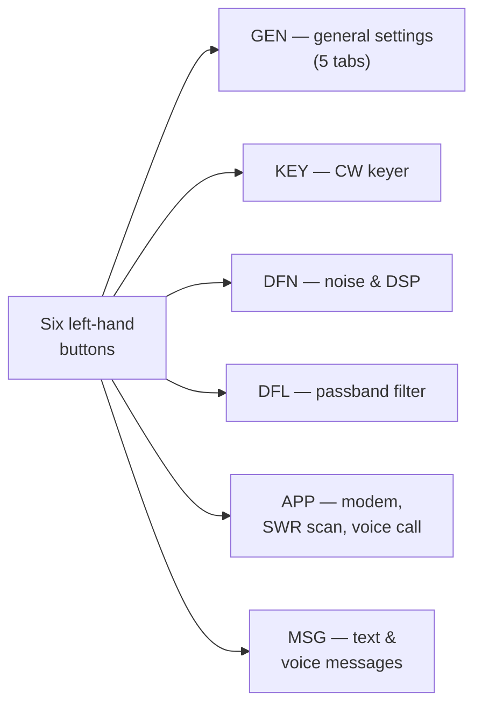

# Menu and button reference at a glance

Six buttons grouped to the left of the screen, a row of small buttons across the top, two knobs, five blank soft-keys under the screen — that is the entire control surface of the X6100, and once you know which door each button opens, the radio stops being a puzzle. This page is the map. Every button-menu and every setting sits here in one scannable list, each with a one-line description, a sensible starting value, and a link to the chapter that tells the whole story. Use it two ways: as a **quick reminder** when you half-remember what a setting does, and as an **index** into the deep-dive chapters when you want the full explanation.

The **Set to** column is a sensible starting point, not gospel — the reasoning lives in the linked chapter. HF is a global hobby, so where a value depends on your band plan, the note says so: **check your national band plan and licence conditions**. The receiver roams far wider than you may legally transmit — you may only key up on the amateur segments your [licence](outpost:entry/logbook73.handbook/getting-licensed) permits.

## How to read this page

Each item carries a one-glance verdict, the same key used throughout this guide:

| Symbol | Meaning                                                    |
| ------ | ---------------------------------------------------------- |
| ✅     | Set it like this and forget it — right for almost everyone |
| ⭐     | Genuinely useful, depending on how you operate             |
| ⚠️     | Advanced — understand it before you change it              |
| ❌     | Leave it off unless you have a specific reason             |

**Reaching a setting.** Press one of the six left-hand buttons (**GEN**, **KEY**, **DFN**, **DFL**, **APP**, **MSG**) and a row of labels appears above the five soft-keys (buttons 10–14) under the screen. Press the soft-key under a label to open it. For the plainer menus (KEY, DFN, DFL, APP, MSG) the items sit directly on those five soft-keys. Three of them — **KEY, DFN and MSG** — hold more than fit at once, so pressing the same panel button **again pages to a second screen**, which the manual marks `<1>` and `<2>`. GEN is deeper: its five soft-keys are _tabs_ that open a grid of items. In that grid you **rotate the MFK knob** to move the dashed selection box onto an item, then **rotate the main knob** to change its value; the soft-keys along the bottom then read (left to right) restore-defaults, decrease (−), increase (+), set-as-shortcut, and exit. One caveat before the tables: the names and defaults below follow the current stock manual, but firmware versions rename and reshuffle labels — if your unit reads differently, match by meaning (see the note at the end).

## The control surface at a glance

Everything else you touch daily lives on the **top edge** (mode, VFO and tuning buttons) or on the **two knobs**. Those are not menus, so they are listed first as a quick reference, then the six button-menus follow in order.

## The top-panel buttons

Along the top of the case sit the buttons you press most: the mode switches, the VFO and step controls, and the receiver front-end. None of them opens a menu — each is a direct action, and most are explained in depth in the tuning and DSP chapters.

| Button     | What it does                                                                    | See                                          |
| ---------- | ------------------------------------------------------------------------------- | -------------------------------------------- |
| **PTT**    | Push to transmit (also on the hand mic); TX indicator turns red                 | [Tuning & Modes](outpost:entry/logbook73.guide.x6100/tuning-modes) |
| **AM\|FM** | Switch the current VFO to AM or FM                                              | [Tuning & Modes](outpost:entry/logbook73.guide.x6100/tuning-modes) |
| **CW**     | Switch to CW (press again for CWR, the reversed sideband)                       | [The CW Keyer](outpost:entry/logbook73.guide.x6100/cw-keyer)       |
| **SSB**    | Cycle `LSB → L-DIG → USB → U-DIG`; choose voice or digital variant deliberately | [Tuning & Modes](outpost:entry/logbook73.guide.x6100/tuning-modes) |
| **V/M**    | Short: VFO↔memory; long: copy the selected memory to VFO (`M→V`)                | [Tuning & Modes](outpost:entry/logbook73.guide.x6100/tuning-modes) |
| **A/B**    | Short: swap active VFO; long: copy active VFO into the other (`A=B`)            | [Tuning & Modes](outpost:entry/logbook73.guide.x6100/tuning-modes) |
| **FST**    | Cycle the documented `10 / 100 / 1000 Hz` tuning steps                          | [Tuning & Modes](outpost:entry/logbook73.guide.x6100/tuning-modes) |
| **◄ / ►**  | VFO: previous/next selected band; MEMO: previous/next stored channel            | [Tuning & Modes](outpost:entry/logbook73.guide.x6100/tuning-modes) |
| **AGC**    | Short: cycle AUTO→OFF→SLOW→FAST; long: toggle split (`SPL`)                     | [DFN & DFL: DSP](outpost:entry/logbook73.guide.x6100/dsp-filters)  |
| **PRE**    | Short-press toggles preamp/bypass; long-press toggles the attenuator            | [DFN & DFL: DSP](outpost:entry/logbook73.guide.x6100/dsp-filters)  |
| **ATU**    | Short-press to engage the tuner, long-press (~1 s) to run a tune                | [ATU & SWR Scanner](outpost:entry/logbook73.guide.x6100/atu-swr)   |

Two repay a moment now. **AGC** has fine parameters buried in GEN (below), but the top button is usually all you need — the APP V1.2.0 guidance favours AGC-SLOW for AM/SSB voice and AGC-FAST for CW detail. **PRE** matters more than its size suggests: short-press toggles the preamp/bypass, while long-press toggles ATT. Below 14 MHz the [receiver](outpost:entry/logbook73.handbook/receivers) is happier with the preamp off, and the current manufacturer V1.6 manual recommends ATT when a strong signal rises above about `−50 dBm`.

## The knobs, the lock and the soft-keys

| Control              | What it does                                                                  | Set to                                      |
| -------------------- | ----------------------------------------------------------------------------- | ------------------------------------------- |
| **VOL/SQL/RFG knob** | Turns the volume; a short **press cycles** it to squelch depth, then RF gain  | ⭐ drop RF gain on a noisy low band         |
| **Main knob**        | Tunes frequency; changes the selected value inside GEN grids                  | —                                           |
| **MFK knob**         | GEN: selects; direct task menu: adjusts the pressed soft-key item; assignable | ⭐ leave default until you have a favourite |
| **Lock button**      | Long-press (~2 s) locks the main knob; short-press steps the screen backlight | ✅ lock before it goes in a bag             |

The VOL knob's triple job is the most useful trick on the radio and the one newcomers miss: a quick press turns it into a **squelch** control, another into an **RF gain** control, then back to volume — the tag at the top-left of the screen shows which is live. Reducing RF gain on a crowded low band, rather than reaching for volume, is often what turns a wall of noise back into a readable signal.

## GEN — the general settings menu

**GEN** is the radio's core configuration, and its five soft-keys are tabs: **RADIO SETTING 1**, **RADIO SETTING 2**, **DISPLAY SETTING**, **SYSTEM SETTING** and **MEMORY SETTING** (called MEMORY EDIT in older English material). Full explanations, item by item, are in [The GEN Settings Menu](outpost:entry/logbook73.guide.x6100/gen-settings).

### RADIO SETTING 1

The everyday radio configuration — gain, power, microphones, charging and the APP V1.2.0 spectrum cursor.

| Item        | What it does                                                                  | Set to                                                         |
| ----------- | ----------------------------------------------------------------------------- | -------------------------------------------------------------- |
| AGC SLOW    | Slow AGC release time constant in milliseconds (APP V1.2.0 wording)           | ⭐ record the default; favour for AM/SSB voice                 |
| AGC FAST    | Fast AGC release time constant in milliseconds (APP V1.2.0 wording)           | ⭐ record the default; favour for CW detail                    |
| AGC HANG    | Whether gain "hangs" briefly after a signal                                   | ⚠️ leave the installed default to start                        |
| TX POWER    | Transmit power                                                                | ⭐ lowest that works (≤5 W battery, ≤10 W ext)                 |
| MIC SEL     | Which microphone is live — built-in or hand mic; older builds may add AUTO    | ✅ match the mic/PTT you use                                   |
| I-MIC GAIN  | Gain of the built-in microphone                                               | ⭐ installed/default 20 in extended stock docs; adjust cleanly |
| H-MIC GAIN  | Gain of the hand microphone                                                   | ⭐ installed/default 20 in extended stock docs; adjust cleanly |
| LINE IN LV  | Audio input level from a PC (data modes)                                      | ⭐ set for clean output with little ALC                        |
| LINE OUT LV | Audio output level to a PC (data modes)                                       | ⭐ set so the PC decodes cleanly                               |
| MONI LEVEL  | Monitor level — hear your own transmitted audio                               | ⭐ 0 off; raise briefly to check audio                         |
| PTT MODE    | `NORMAL` hold-to-talk or firmware-dependent `TOGGLE` latch behaviour          | ✅ NORMAL                                                      |
| BANDSTACK   | `HAM BAND` or `ALL BAND` scope for the top band arrows                        | ✅ HAM BAND                                                    |
| S/P MODE    | Routes the S/P jack to a speaker or headphones                                | ✅ match what is plugged in                                    |
| CHARGER     | Enables charging of the internal battery from external power                  | ✅ ON to charge; ⭐ OFF for desk operation                     |
| CENTER MODE | ON keeps the tuned frequency centred; OFF enables APP V1.2.0's movable cursor | ⭐ ON normally; OFF to tune with the cursor                    |

**TX POWER** is the item to respect: the X6100 makes roughly 5 W on its internal battery and up to 10 W on a 13.8 V supply, and running the lowest power that reaches your contact is both good manners and kinder to the battery and the finals — the reasoning is in [RF Power](outpost:entry/logbook73.handbook/rf-power). In APP V1.2.0 the first two AGC fields are **AGC SLOW** and **AGC FAST**, measured in milliseconds; Xiegu recommends the slow behaviour for smoother AM/SSB speech and the fast behaviour for CW detail. The release notes do not publish universal default numbers, so note your installed values before experimenting rather than copying one from another firmware build.

### RADIO SETTING 2

Receiver/transmitter offsets and hand-microphone shortcuts. The current manufacturer V1.6 manual lists exactly these five items.

| Item      | What it does                                                    | Set to                                   |
| --------- | --------------------------------------------------------------- | ---------------------------------------- |
| RIT       | Receive incremental tuning — nudge RX without moving TX         | ⭐ 0 off; use to net a drifting station  |
| XIT       | Transmit incremental tuning — nudge TX without moving RX        | ⭐ 0 off                                 |
| SPLE      | Split operation — transmit and receive on different frequencies | ⚠️ OFF unless working split (DX/pile-up) |
| HANDLE F1 | Assigns the hand microphone's F1 shortcut                       | ⭐ choose a function you use and test it |
| HANDLE F2 | Assigns the hand microphone's F2 shortcut                       | ⭐ choose a different useful function    |

Older English menu descriptions and some installed builds additionally expose **IQ OUT EN** here. That is a legacy/firmware-dependent control, not a sixth current V1.6 table item. Where present, it enables the physical **I/Q OUT** socket so raw [in-phase and quadrature signals](outpost:entry/logbook73.handbook/iq-signals) can feed an external SDR. Leave it off unless you are actually using that output.

### DISPLAY SETTING

How the spectrum and waterfall are drawn, and the backlight.

| Item        | What it does                                       | Set to                                        |
| ----------- | -------------------------------------------------- | --------------------------------------------- |
| RF FFT AVE  | Averaging (smoothing) of the RF spectrum trace     | ⭐ a little smoothing steadies the trace      |
| RF FFT REF  | Reference level of the RF spectrum (default 0 dBm) | ⭐ set so signals fill the display            |
| FFT SPAN    | Width of spectrum shown around the tuned frequency | ⭐ wide to survey; narrow to inspect          |
| FFT PK HOLD | Holds recent RF-spectrum peaks on screen           | ⭐ useful for brief signals; off if cluttered |
| WF REF      | Reference offset of the waterfall (default 0 dBm)  | ⭐ set for good contrast against the noise    |
| AF FFT AVE  | Averaging of the audio (AF) spectrum               | ⭐ taste                                      |
| AF FFT REF  | Reference level of the audio spectrum              | ⭐ taste                                      |
| BL LEVEL    | Screen backlight brightness (default 5)            | ✅ lower it to save battery outdoors          |
| AUDIO SCOPE | Shows or hides the audio-frequency spectrum        | ⭐ on for CW/data alignment; otherwise taste  |

These control how the [FFT spectrum and scrolling waterfall](outpost:entry/logbook73.handbook/ffts-and-waterfalls) look — reference sets the floor the display is measured from, averaging trades a jumpier trace for one that reveals weak, steady signals. They change only the _picture_, never what the receiver hears.

### SYSTEM SETTING

The housekeeping tab — clock, firmware and the wireless links.

| Item             | What it does                                                  | Set to                                                    |
| ---------------- | ------------------------------------------------------------- | --------------------------------------------------------- |
| TIME SETTING     | Set the real-time clock                                       | ✅ set to UTC for clean logging                           |
| SYSTEM INFO      | Shows the installed APP and BASE versions                     | ✅ record both before an update or support request        |
| FIRMWARE UPGRADE | Apply the matching BASE image after the APP/system-card stage | ⚠️ this is stage two; follow the package tutorial exactly |
| WLAN             | Join a 2.4 GHz wireless network                               | ⭐ as needed — see connectivity                           |
| BLUETOOTH        | Pair a keyboard or mouse; do not rely on stock headset audio  | ⭐ as needed — see the documented contradiction           |
| WFSERVER         | Starts the network waterfall/control server                   | ⚠️ only on a trusted LAN and when deliberately used       |
| FACTORY RESET    | Restore all settings to factory defaults                      | ⚠️ back up first; required after APP V1.2.0               |

Open **SYSTEM INFO** and record both version numbers before asking for help or updating: APP V1.2.0 is paired with BASE V1.1.9 in the current official package, but the screen on your own radio is the authority. A stock update is a two-stage operation: write the supplied `x6100udimg.img` as a bootable flash-card image for the automatic APP/system stage, remove that card after shutdown, boot normally, then use **FIRMWARE UPGRADE** for the matching BASE image. Follow the [official X6100 update tutorial](https://xiegu.eu/sdm_downloads/xiegu-x6100-firmware-update-tutorial/) and the target release notes without omitting a step. **WLAN** and **BLUETOOTH** are covered in [Connectivity](outpost:entry/logbook73.guide.x6100/connectivity); the mandatory post-update reset is why **FACTORY RESET** matters.

### MEMORY SETTING

The X6100 holds **200 memory channels**. The current manufacturer V1.6 manual labels this tab MEMORY SETTING; older English material calls it MEMORY EDIT. Its four non-blank soft-key actions are:

| Item       | What it does                                          | Set to                              |
| ---------- | ----------------------------------------------------- | ----------------------------------- |
| TAG        | Name the current channel                              | ⭐ name them so the list reads well |
| ERASE MEMO | Clear the selected channel                            | ⭐ housekeeping                     |
| SAVE VFO   | Store the current VFO (frequency, mode…) to a channel | ✅ save anything you use twice      |
| EXIT       | Leave the memory-setting page                         | —                                   |

Older manuals/builds may show a `MARK`/house favourite action. It is not part of the current V1.6 four-action inventory, so do not promise it on every unit.

## KEY — the CW keyer

Press **KEY** for the Morse keyer settings; press it again for the second page. Full treatment, including wiring a paddle, is in [CW: the Keyer, Messages & Auto-call](outpost:entry/logbook73.guide.x6100/cw-keyer).

**Page `<1>`**

| Item       | What it does                                         | Set to                                     |
| ---------- | ---------------------------------------------------- | ------------------------------------------ |
| KEY TYPE   | `MANUAL`, `AUTO-LEFT` or `AUTO-RIGHT`                | ✅ match straight key or paddle handedness |
| KEY SPEED  | Keyer sending speed in words per minute (default 15) | ⭐ your comfortable CW speed               |
| IAMBIC     | Iambic keyer mode A or B (default IAMBIC-B)          | ⭐ match your muscle memory                |
| TONE       | Sidetone pitch you hear when keying (default 800 Hz) | ⭐ 600–800 Hz, whatever is easy on the ear |
| TONE LEVEL | Volume of that sidetone (default 10)                 | ⭐ comfortable                             |

**Page `<2>`**

| Item        | What it does                                                  | Set to                                |
| ----------- | ------------------------------------------------------------- | ------------------------------------- |
| QSK TIME    | Full break-in delay — how quickly RX returns between elements | ⭐ must be ON to actually transmit CW |
| DI/DA RATIO | Weighting of dash length to dot length (default 3.0)          | ⚠️ 3.0 is standard; leave it          |
| CW TRAINER  | A practice mode that keys the sidetone but not the TX         | ⭐ ON to practise, ❌ OFF to operate  |

The trap worth flagging here: with QSK disabled you will _hear_ your sidetone but the radio will **not transmit** — a classic "why is nobody answering my CW?" moment.

## DFN — noise reduction, blanker and manually placed notch

Press **DFN** for the [digital noise tools](outpost:entry/logbook73.handbook/filters), and again for the second page. All explained in [DFN & DFL: DSP, Noise Reduction & Filters](outpost:entry/logbook73.guide.x6100/dsp-filters).

**Page `<1>`**

| Item     | What it does                                   | Set to                                |
| -------- | ---------------------------------------------- | ------------------------------------- |
| NR       | Noise reduction on/off (DSP smoothing of hiss) | ⭐ ON in noise, OFF on a clean signal |
| NR DEPTH | How aggressively NR works                      | ⭐ as little as clears the noise      |
| NB       | Noise blanker on/off (kills short pulse noise) | ⭐ ON for ignition/electrical clicks  |
| NB WIDTH | Width of the pulses the blanker acts on        | ⭐ tune to the noise                  |
| NB LEVEL | Pulse-suppression depth (0–100; default 10)    | ⭐ raise only as far as clears clicks |

**Page `<2>`**

| Item       | What it does                                             | Set to                                      |
| ---------- | -------------------------------------------------------- | ------------------------------------------- |
| DNF        | Digital notch — removes a steady whistle you place it on | ⭐ ON to kill a carrier/heterodyne          |
| DNF CENTER | Centre frequency of the notch (default 1000)             | ⚠️ turn to place the notch by hand          |
| DNF WIDTH  | Width of the notch (default 50)                          | ⚠️ narrow removes the tone, keeps the voice |

Push **NR** and **NR DEPTH** only as far as they clear the noise — over-driven, it makes voices hollow and "underwater". The blanker (NB) is the opposite tool: useless against hiss, superb against the sharp _tick-tick_ of electrical interference.

## DFL — the passband filter

Press **DFL** for the receive [passband filter](outpost:entry/logbook73.handbook/filters). It holds three editable presets plus two actions.

| Item    | What it does                                         | Set to                                       |
| ------- | ---------------------------------------------------- | -------------------------------------------- |
| FILTER1 | Filter preset 1 (typically your widest)              | ⭐ wide for SSB (~2.4–2.8 kHz)               |
| FILTER2 | Filter preset 2                                      | ⭐ medium                                    |
| FILTER3 | Filter preset 3 (typically your narrowest)           | ⭐ narrow for CW/crowded bands (~300–500 Hz) |
| DEFAULT | Restore the current preset to its default parameters | ⭐ if you lose track of an edit              |
| CLOSE   | Exit the filter interface                            | —                                            |

Inside a preset you shape the passband by dragging its two edges with the MFK knob: a short press of the knob switches between the **L-CUT** edge (the red box, the _low_ cut) and the **H-CUT** edge (the blue box, the _high_ cut). Narrowing the gap between them rejects more adjacent noise — but the warning in the manual is real: pull the two edges closer than the signal is wide and you will cut the wanted signal out entirely and hear nothing. Each preset remembers separate settings per mode, so your CW filters and SSB filters do not tread on each other.

## APP — modem, SWR scan and voice call

Press **APP** for the three "applications": the data modem, the antenna scanner, and the voice caller.

| Item       | What it does                                                         | See                                               |
| ---------- | -------------------------------------------------------------------- | ------------------------------------------------- |
| MODEM      | Built-in RTTY / CW / BPSK encode-and-decode (no PC needed)           | [Connectivity](outpost:entry/logbook73.guide.x6100/connectivity)        |
| SWR SCAN   | Plots the antenna's SWR across a range of frequencies                | [ATU & SWR Scanner](outpost:entry/logbook73.guide.x6100/atu-swr)        |
| VOICE CALL | Plays a pre-recorded voice message (a stored CQ or call) on transmit | [The CW Keyer & Messages](outpost:entry/logbook73.guide.x6100/cw-keyer) |

### MODEM sub-menu

Inside MODEM the soft-keys carry the decoder's settings across two groups. Use the displayed `<1>/<2>` page action to switch between them; MODE/FC/RATE/SHIFT occupy the first group, while AFC/SQL/CLEAR/EXIT occupy the second.

| Item       | What it does                                               | Set to                                        |
| ---------- | ---------------------------------------------------------- | --------------------------------------------- |
| MODE       | Choose RTTY, CW or BPSK                                    | ⭐ match the signal you are decoding          |
| FC/TONE    | Carrier / sidetone (mark) frequency the decoder centres on | ⭐ line up with the signal in the AF spectrum |
| RATE/SPEED | Baud rate (RTTY/BPSK) or code speed (CW)                   | ⭐ 45 baud RTTY, 31 for BPSK31, match CW WPM  |
| RTTY SHIFT | The mark–space (frequency) shift for RTTY                  | ⭐ 170 Hz is the amateur standard             |
| AFC        | Automatic frequency control — tracks a drifting signal     | ⭐ ON to lock onto the signal                 |
| SQL        | Modem squelch — mutes decoding of pure noise               | ⭐ raise until noise stops printing junk      |
| CLEAR      | Wipe the decoded-text window                               | —                                             |
| EXIT       | Leave the MODEM screen                                     | —                                             |

The built-in **MODEM** is a lovely field feature — it decodes and sends RTTY, CW and BPSK with nothing but the radio and the MSG presets below. It is not the same as FT8: modes like [FT8](outpost:entry/logbook73.handbook/ft8) still need a PC over USB, the subject of [Connectivity](outpost:entry/logbook73.guide.x6100/connectivity). Current **SWR SCAN** offers `SPAN`, `SPEED` and `EXIT`, and draws the classic [SWR](outpost:entry/logbook73.handbook/swr) dip so you can see where your antenna is happy — covered with the tuner in [ATU & SWR Scanner](outpost:entry/logbook73.guide.x6100/atu-swr).

## MSG — text and voice messages

Press **MSG** for the message store; press it again to switch between the text page and the voice page. These presets are what the MODEM and VOICE CALL features send. Full detail in [CW: the Keyer, Messages & Auto-call](outpost:entry/logbook73.guide.x6100/cw-keyer).

**Page `<1>` — text messages** (five slots, sent as CW / RTTY / BPSK)

| Item          | What it does                                            | Set to                             |
| ------------- | ------------------------------------------------------- | ---------------------------------- |
| MSG 1 … MSG 5 | Five preset text strings for automatic sending          | ⭐ store your call, a CQ, a report |
| KEYBOARD      | Open the on-screen keyboard (MFK selects, press enters) | —                                  |
| DELETE        | Delete the previous character                           | —                                  |
| SPACE         | Insert a space                                          | —                                  |
| SAVE          | Save the edited message and leave                       | ✅ use after editing               |
| EXIT          | Leave without the save-and-exit action                  | ⚠️ check before abandoning edits   |

**Page `<2>` — voice messages** (five slots, up to 1 min 30 s each)

| Item          | What it does                             | Set to                                   |
| ------------- | ---------------------------------------- | ---------------------------------------- |
| MSG 1 … MSG 5 | Five recorded voice clips for VOICE CALL | ⭐ record a CQ to save your voice on SSB |
| RECORD        | Start recording the selected slot        | —                                        |
| PLAY          | Review the selected recording            | —                                        |
| STOP          | Stop recording or playback               | —                                        |
| EXIT          | Leave the voice-message page             | —                                        |

A recorded CQ saves your voice during a long SSB session or contest. Current V1.6 documents the **hand microphone** as the recording source; do not assume the built-in mic records these slots. Turn **MONI LEVEL off** while recording or you may capture an echo.

## A word on firmware and labels

Because the screen is drawn by a small Linux computer, two things follow for a reference like this. Xiegu ships **two firmware version numbers** — APP (the interface) and BASE (the radio hardware) — and has renamed tabs, moved items and changed defaults across releases. And a lively **community firmware** scene rearranges the menus wholesale and adds features (native FT8, a CW decoder, wider filters, a logbook) while booting from the SD card, so you can remove it to return to stock. The tables above reconcile the operations manual with the current official **APP V1.2.0 / BASE V1.1.9** package: if your unit's wording differs, match by meaning and record both installed versions in **GEN → SYSTEM SETTING → SYSTEM INFO**. The whole firmware picture is in [Why the X6100](outpost:entry/logbook73.guide.x6100/overview).

## Try it yourself

Nothing here transmits, so all of it is safe to explore even before you are licensed:

1. **Tour the six buttons.** Press GEN, KEY, DFN, DFL, APP and MSG in turn and watch the soft-key row change under the screen. Press KEY, DFN and MSG a second time to see the `<2>` page appear. You have just seen the whole control surface.
2. **Find the VOL knob's three jobs.** Short-press the VOL/SQL/RFG knob and watch the top-left tag cycle Volume → SQL → RF gain. On a busy band, drop the RF gain and hear the noise fall.
3. **Open a filter.** Press DFL, choose FILTER3, and drag the L-CUT (red) and H-CUT (blue) edges together with the MFK knob — watch the passband narrow on screen. Press DEFAULT to undo.
4. **Read your firmware.** Go GEN → SYSTEM SETTING → SYSTEM INFO and note both the APP and BASE versions. Write them down; you will want them if you ever ask for help.

## Key takeaways

- The X6100's whole control surface is **six left-hand button-menus** (GEN, KEY, DFN, DFL, APP, MSG), a row of **top-panel buttons** (modes, VFO, AGC, PRE, ATU), and **two knobs** — this page indexes all of it.
- **GEN** is the deep one, with five tabs; you _select_ items with the **MFK** knob and _change_ them with the **main** knob.
- The two settings worth burning into memory: **TX POWER as low as works** (good manners, longer battery), and **the VOL knob's press-to-cycle** into RF gain (your best weapon against a noisy band).
- **KEY/MSG** are the CW keyer and message store, **DFN/DFL** are the noise tools and passband filter, and **APP** holds the data modem, the SWR scanner and the voice caller.
- Labels and defaults **shift between firmware versions** and change again on community firmware — match by meaning, and check your APP/BASE versions in **SYSTEM INFO**.
- You may explore every one of these menus unlicensed; you may only **transmit** within your national band plan and licence conditions.

With the map in hand, the next chapter puts it to work — getting around the bands, choosing a mode, and making your first contact: [Tuning, VFOs & Modes](outpost:entry/logbook73.guide.x6100/tuning-modes).
