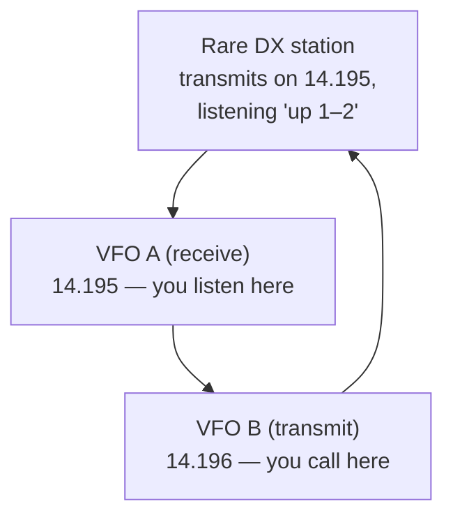
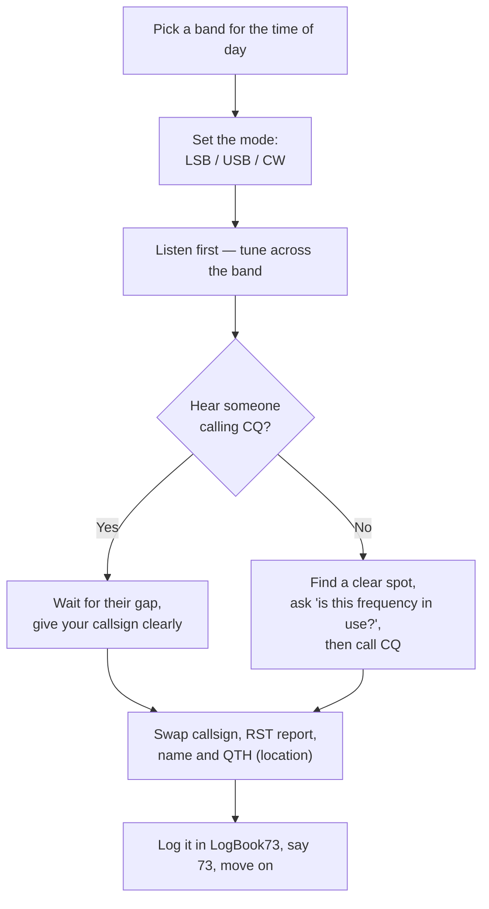

# Tuning, VFOs and modes (SSB / CW / AM / FM / data)

Everything you do on the X6100 — chasing a rare station across the world, ragchewing on 40 metres of an evening, answering a CQ in Morse — starts with three questions: _where_ on the dial you are, _which band_ you want, and _how_ the signal is dressed up so you can understand it. Answering those three well is most of the skill of HF operating, and because the X6100 is a [software-defined radio](outpost:entry/logbook73.handbook/software-defined-radio) with a spectrum and waterfall staring back at you, it helps you find your way more than any knob-and-needle rig could. This chapter is the everyday driving lesson: the two VFOs, the tuning knob and step, band and mode selection, the fine-tuning tricks (RIT, XIT and split), the meters, AGC, and how a plain HF contact unfolds.

A word before we key up. The X6100 **receives** right across 0.5–30 MHz and 50–54 MHz. Ordinary broadcast/amateur listening generally needs no amateur transmitting licence, but protected-communications and receiver rules vary, so follow local law. It only **transmits** inside the amateur bands, and only if you hold the appropriate licence and stay within the segments and power it allows. [Getting Licensed](outpost:entry/logbook73.handbook/getting-licensed) explains how.

## Two VFOs: A and B

A **VFO** — Variable Frequency Oscillator — is just the radio's idea of "the frequency you are on". The X6100 keeps two, **VFO A** and **VFO B**, and shows both: the big number across the top is the _active_ VFO, and a smaller readout top-right shows the other waiting in the wings. Only one is live — the one your tuning knob, PTT and mode buttons act on.

- **What it does:** a short press of the top [`A/B`] button swaps which VFO is active. Frequency, band and mode are remembered separately, so A can sit on 40 m LSB while B holds 20 m USB.
- **Inside:** each VFO is a complete tuning state. Long-press the body `A/B` key for **A=B**—copying the active VFO into the other before offsetting one for split. On the current V1.6 control map, the hand microphone's `XFC` short press swaps A/B and its long press copies the foreground VFO into the background. Verify the on-screen result after any firmware change.
- **Why it exists:** two VFOs let you hold a second frequency ready — your home net on one while you tune around on the other, and, the big one, **split operation** (listen on one, transmit on the other).
- **UK recommendation:** ✅ for normal contacts you live on one VFO. Learn `A/B` now; you will need both the day you work your first pile-up.
- **Common mistakes:** nudging `A/B` by accident and jumping bands — if the big frequency looks wrong, check which VFO letter is highlighted.

## Tuning: the main knob, the step and direct entry

The large knob on the right is the **main tuning knob**: clockwise goes up in frequency, anticlockwise down. What is less obvious is that it moves only _one digit_ at a time — the **underlined digit** on the display. That underline is your tuning cursor, and the [`FST`] (fast step) button moves it.

### FST — the tuning step — ✅ match it to the job

The step is how far one click of the knob moves you.

- **What it does:** [`FST`] cycles the documented **10 / 100 / 1000 Hz** main-tuning steps. A finer step creeps precisely onto a signal; a coarser step slews across the band. The receiver's underlying tuning resolution is a separate specification, so do not read “1 Hz resolution” elsewhere as another FST-button position.
- **Why it exists:** SSB and CW have no fixed channels — you tune continuously — so you constantly trade speed for precision. A big step to _find_ activity, a small step to _zero in_.
- **Typical values:** 10 Hz for fine SSB/CW work; 100 Hz or 1 kHz to move around.
- **UK recommendation:** ✅ leave it around **10 Hz** for everyday SSB and nudge coarser only when travelling across a band; use a fine step to zero-beat CW.
- **Example:** a faint SSB voice sounds slightly "ducky"; a couple of 10 Hz clicks brings the pitch natural — the last few hertz a coarse step would skate over.
- **Common mistakes:** fine-tuning SSB with a 1 kHz step and never getting the voice right; leaving a huge step set and shooting past a weak station.

For a known frequency, skip the knob: on the hand microphone press [`F-INP ENT`], key the digits (for 14.25000 MHz: `1 4 2 5 0 0 0`), then [`F-INP ENT`] again. APP V1.2.0 also adds a movable spectrum cursor: set `CENTER MODE` to `OFF`, then use the frequency wheel to position the cursor on a visible signal. That is a physical-control feature, not screen touch, and earlier firmware behaves differently.

The smaller **MFK** knob on the left is user-assignable in normal operation. In GEN it selects an item while the main knob changes the value; in direct KEY/DFN/DFL/APP/MSG pages you press the physical soft-key for the item and turn MFK to adjust it. Think of the main knob as the frequency wheel, not a universal menu-value control.

## Choosing a band

HF is carved into **bands** — slices of spectrum with their own character and their own rules. In **VFO** mode the X6100's two top arrow buttons (left/right, items 38/39) step through the band set selected by `BANDSTACK`. In **MEMO** mode those same arrows step through stored channels.

```
1.8 → 3.5 → 7 → 10 → 14 → 18 → 21 → 24 → 28 → 50 MHz
```

With `BANDSTACK = HAM BAND`, the VFO arrows traverse amateur bands. `ALL BAND` adds the general-coverage receive ranges to that traversal; it never grants permission or capability to transmit outside the amateur allocation. The hand microphone's numeric keys give **direct band access**. This setting controls arrow-navigation scope, not a promise about per-band last-frequency memories; see [GEN settings](outpost:entry/logbook73.guide.x6100/gen-settings).

Remember the split personality of the coverage: you can _tune_ the receiver anywhere from 0.5–30 MHz and across 6 m — shortwave broadcasters, time signals and utility stations all live between the amateur bands — but the moment you press PTT it transmits only inside the amateur segments, and outside them will not key up at all. Which segments exactly depends on your radio's region and firmware, so **verify the transmit edges on your own unit and against your national band plan**.

| Band     | Common name        | Typical daytime/night character      | Usual voice sideband |
| -------- | ------------------ | ------------------------------------ | -------------------- |
| 1.8 MHz  | 160 m ("top band") | Night; regional                      | LSB                  |
| 3.5 MHz  | 80 m               | Regional by day, wider at night      | LSB                  |
| 7 MHz    | 40 m               | The reliable all-rounder             | LSB                  |
| 10.1 MHz | 30 m               | CW and data only — no voice          | (CW/data)            |
| 14 MHz   | 20 m               | Daytime DX workhorse                 | USB                  |
| 18 MHz   | 17 m               | Daytime DX in good sun               | USB                  |
| 21 MHz   | 15 m               | Daytime long-haul                    | USB                  |
| 24.9 MHz | 12 m               | Sporadic, sun-driven                 | USB                  |
| 28 MHz   | 10 m               | Spectacular when open, dead when not | USB                  |
| 50 MHz   | 6 m                | The "magic band"                     | USB                  |

Which band is _open_ depends on the ionosphere and the time of day — the subject of [Propagation](outpost:entry/logbook73.handbook/propagation), with the character of the HF bands themselves in [HF](outpost:entry/logbook73.handbook/hf). The beginner's short version: 40 m almost always has something on it, 20 m is the daytime DX band, and the higher bands come alive with the sun.

## Choosing a mode

The **mode** is how your voice, Morse or data is stamped onto the radio wave, and how the receiver undoes that into something intelligible. Pick the wrong one and a strong, clear signal comes out as unlistenable mush. The X6100's native modes are set from three top buttons:

- [`SSB`] — cycles **LSB → L-DIG → USB → U-DIG**. `L/U-DIG` are the matching lower/upper digital variants; stock FT8 normally needs `U-DIG` / `USB-DIG`, not USB voice.
- [`CW`] — Morse, toggling **CW ↔ CW-R** (CW-reverse).
- [`AM|FM`] — toggling **AM ↔ FM**.

| Mode     | What it is                                | Where you use it                                                              |
| -------- | ----------------------------------------- | ----------------------------------------------------------------------------- |
| **LSB**  | Lower-sideband voice                      | 160/80/40 m voice — below 10 MHz                                              |
| **USB**  | Upper-sideband voice                      | 20 m and up, and 6 m — above 10 MHz                                           |
| **CW**   | On/off keyed Morse carrier                | Every band; the most efficient weak-signal voice-free mode                    |
| **CW-R** | CW with the beat note on the _other_ side | Dodging an interfering signal (see below)                                     |
| **AM**   | Full amplitude modulation with carrier    | Legacy AM voice nets; shortwave broadcast listening                           |
| **FM**   | Frequency modulation                      | 10 m and 6 m FM simplex and repeaters                                         |
| **Data** | USB-DIG (`U-DIG` on some displays)        | FT8 and other sound-card modes via a PC, with the digital audio path selected |

Most of your life will be **SSB** and **CW**. AM and FM matter on HF only in corners — AM for a few vintage-flavoured nets and for broadcast _listening_, FM at the top of 10 m and on 6 m. For [FT8](outpost:entry/logbook73.handbook/ft8), JS8 and other computer sound-card modes, select **USB-DIG** (shortened to **U-DIG** on some firmware), not ordinary USB voice: the digital mode selects the radio's line-audio path and keeps speech processing out of the tones. The X6100's own **built-in modem** (in the `APP` menu) separately handles **RTTY, CW and PSK** on the radio itself; stock firmware still needs a computer for FT8, while community firmware can add native FT8.

### LSB below 10 MHz, USB above — the sideband convention

This is the single rule that confuses every newcomer. [Single sideband](outpost:entry/logbook73.handbook/modulation) builds an ordinary AM signal — a carrier with a matching sideband above and below — then throws away the carrier _and one whole sideband_, since each sideband already carries a full copy of your voice. All the power goes into what is left, which is why SSB beats AM for efficiency.

```viz
{
  "type": "spectrum",
  "title": "Single sideband — one sideband, carrier suppressed",
  "caption": "SSB removes the carrier and one whole sideband, so all your power goes into the voice. Keep the upper block and it is USB; keep the lower and it is LSB. Amateur convention: LSB below 10 MHz, USB above.",
  "components": [
    { "f": 40, "amp": 0.15, "label": "suppressed carrier", "tone": "muted" },
    { "f": 42, "amp": 0.85, "width": 22, "label": "upper sideband (USB)", "tone": "primary" }
  ],
  "noiseFloor": 0.06,
  "xLabel": "frequency"
}
```

Keep the sideband _above_ where the carrier was and you have **USB**; keep the one _below_ and you have **LSB**. Neither is technically better — but the receiver must use the _same_ sideband as the transmitter, or the voice comes out garbled and inverted. So amateurs agreed a convention decades ago, born of the crystal filters early rigs shared between transmit and receive: **LSB below 10 MHz (160, 80, 40 m); USB on everything above (20 m up, plus 6 m).** Data modes and 60 m are USB too.

- **UK recommendation:** ✅ match the convention: LSB on 40/80/160 m, USB on 20 m and up. The `SSB` key moves through the four-item voice/digital sequence, so watch the full label rather than assuming one press always reaches the opposite voice sideband.
- **Example:** you tune 7.150 MHz and hear a distorted “monster voice” on USB. Press `SSB` through the sequence until the display reads `LSB`; do not stop on `U-DIG` or `L-DIG` for an ordinary voice QSO.
- **Common mistakes:** transmitting on the wrong sideband (nobody reads you, and you may splatter where you should not); treating the convention as a _law of physics_ — a few nets deliberately break it, so let your ears be the judge.

### CW-R, AM and FM

**CW-R** puts the Morse beat note on the opposite side of the tuned frequency; you do not need it for normal Morse, but when an interferer sits right next to your station, flipping to CW-R moves it to the other side of your passband and often clears it (⭐ a useful trick once you are comfortable on CW). **AM** you will mostly use to _listen_ to broadcasters — a wide filter sounds lovely — since the X6100 transmits AM only at modest carrier power. **FM** makes sense only at the FM ends of 10 m and 6 m, where a handful of simplex channels and repeaters live.

## RIT and XIT: nudging one frequency alone

Sometimes you want to move your _receive_ frequency a little without moving your _transmit_, or vice versa. That is what RIT and XIT are for, and they live in the **RADIO SETTING2** page of the GEN menu.

### RIT — Receiver Incremental Tuning — ⭐ the clarifier

- **What it does:** offsets _only_ where you listen — by a small amount — leaving your transmit frequency exactly where it was. Old rigs called it the "clarifier" — a perfect description.
- **Why it exists:** the other station may be slightly off your frequency (drift, or imprecise tuning). Rather than move _your_ transmit and risk chasing them around, you nudge your _receive_ until their voice sounds natural, and you both stay put.
- **Typical values:** a few hundred hertz usually does it.
- **UK recommendation:** ⭐ reach for RIT when a station sounds slightly high or low in pitch but you are otherwise in contact. Zero it and switch it off the moment the QSO ends, or your next contact starts with a mysterious offset.
- **Common mistakes:** leaving RIT on with a big offset, then calling CQ and hearing nothing — because you are _listening_ kilohertz away from where you _transmit_.

### XIT — Transmitter Incremental Tuning — ⭐ the mirror image

- **What it does:** offsets _only_ where you transmit, leaving your receive fixed.
- **Why it exists:** the poor man's split. If a station is listening slightly off its transmit frequency, XIT shifts _your_ transmit to meet it while you keep listening where it is — split's job for a small shift, without a second VFO.
- **UK recommendation:** ⭐ handy for a small transmit nudge; for more than a couple of kHz, or when the DX is deliberately "listening up", use proper split.
- **Common mistakes:** confusing it with RIT — remember **R**IT moves **R**eceive, **X**IT moves transmit — and, again, forgetting to zero it afterwards.

## Split operation

**Split** means listening on one VFO and transmitting on another — the tool for working rare DX. When a much-wanted station appears, hundreds call at once on its frequency and nobody can hear anything, so the DX operator _listens on a different frequency from the one it transmits on_ — usually a kHz or two "up" — and callers spread out across that little window. Split is how you get into it.



On the X6100 the ingredients are the two VFOs and the **SPLE** (split enable) switch in RADIO SETTING2.

- **What it does:** with split on, the radio receives on the active VFO and transmits on the other. Set VFO A to the DX station's transmit frequency, VFO B a little above it, turn `SPLE` on, and now you _hear_ the DX on A and _call_ on B. Long-press the body `A/B` key—or, on the current hand-mic map, long-press `XFC`—to copy the foreground VFO into the other before offsetting one.
- **Why it exists:** a strong DX station is deaf to a wall of callers on one frequency; spreading them across a receive window lets the operator pick individuals out.
- **UK recommendation:** ⚠️ not for everyday chat — a normal QSO is _simplex_, both stations on one frequency. Learn split before your first big DXpedition, and always **listen first** to find where the DX is listening (they announce "up 1", "up 2", and so on) before you transmit once.
- **Example:** a Pacific island station booms in on 14.195 with a pile-up, "listening up 2". You put A on 14.195, B on 14.197, enable split and call in a gap — few others are exactly there, so you stand out.
- **Common mistakes:** transmitting _on top of the DX_ because split was off (the cardinal sin of DXing); leaving split enabled afterwards and transmitting somewhere you did not intend.

## Reading the meters

The X6100's screen is one big meter, and learning to read it is half of learning to operate.

**On receive, the S-meter** is your signal-strength gauge — a bar running `S1 3 5 7 9 +20 +40` across the header, where S9 is "very strong" and the `+20`/`+40` marks are decibels _over_ S9 for the real belters. Alongside it the radio shows an actual **dBm figure** (the noise floor sits around −122 to −125 dBm), which is more precise and lovely for comparing antennas. It is the "S" in the **RST** report (Readability, Strength, Tone) you give on SSB and CW, though most operators offer a friendly round figure rather than reading it to the decibel.

The real star is the **spectrum and waterfall** filling the lower screen — a live picture of the band. The spectrum is the instantaneous view; the waterfall scrolls downward, painting the recent past so you can _see_ signals come and go. This is the [FFT-and-waterfall](outpost:entry/logbook73.handbook/ffts-and-waterfalls) display that makes an SDR such a joy: a wide fuzzy smear is an SSB voice, a thin bright line a CW carrier, a rock-steady vertical line an unmodulated carrier or a birdie. Tune towards a trail and it slides into your passband.

```viz
{
  "type": "waterfall",
  "title": "Reading the waterfall — each mode leaves its own trail",
  "caption": "The scrolling waterfall is your best tuning aid: a fat SSB smear, a thin CW line, a steady carrier, the tidy stripes of a data mode. Tune towards a trail and it drops into the passband.",
  "signals": [
    { "f": 18, "width": 3, "kind": "cw" },
    { "f": 42, "width": 12, "kind": "ssb" },
    { "f": 66, "width": 2, "kind": "carrier" },
    { "f": 84, "width": 7, "kind": "ft8" }
  ],
  "xLabel": "frequency across the band",
  "yLabel": "time (newest at top)"
}
```

For CW, a small **frequency-aligned scale** in the header (marked roughly −100…0…+100) helps you _zero-beat_ — tune until the incoming note matches your sidetone pitch, so you transmit exactly on the other operator's frequency rather than a hundred hertz off.

**On transmit**, the header shows your **output**: the `TX POWER` tag reads your drive in watts (roughly 5 W on the internal battery, up to 10 W on external 13.8 V — see [RF Power](outpost:entry/logbook73.handbook/rf-power)). If you have run the built-in ATU and a poor match remains, an **`SWR` icon flashes** on transmit — your cue that the antenna is unhappy and the tuner needs another run. What that ratio means is in [SWR](outpost:entry/logbook73.handbook/swr) and [Impedance](outpost:entry/logbook73.handbook/impedance); the tuner and SWR scanner get their own chapter.

## AGC — automatic gain control

Signals on HF vary enormously — a whisper from Japan and a local booming in a few kHz apart. **AGC** rides the receiver's gain up and down automatically so both come out at a roughly even volume, instead of one being inaudible and the other blasting you out of the chair. The [`AGC`] button cycles four states:

```
AGC-AUTO → AGC-OFF → AGC-SLOW → AGC-FAST
```

- **What it does:** turns the gain down fast when a strong signal arrives, then lets it back up. The **SLOW/FAST** choice sets the _release_ time — how long it waits before winding gain back up. **SLOW** releases gently (steady signals); **FAST** recovers quickly (choppy ones); **AUTO** picks a constant for the mode; **OFF** hands you manual control via RF gain.
- **Why it exists:** without AGC you would forever ride the RF-gain knob to stop strong stations deafening you and weak ones vanishing. See [Receivers](outpost:entry/logbook73.handbook/receivers) for the full picture.
- **Starting recommendation:** ⭐ APP V1.2.0's release guidance favours **AGC-SLOW for AM and SSB voice** and **AGC-FAST for CW**. Leave AGC on; it improves listening comfort without reducing sensitivity. Use `OFF` only deliberately, when you want to control RF gain by hand for an experiment.
- **Example:** on an SSB net, AGC-SLOW keeps speech level comfortable instead of rushing the background noise up between syllables; on rapid CW, AGC-FAST recovers quickly enough to preserve the gaps between characters.
- **Common mistakes:** leaving AGC OFF and then blaming a fixed-gain receiver for a sudden blast of audio; copying numerical SLOW/FAST values from an older firmware release instead of recording the values installed on your radio first.

AGC is the automatic half of level control; the manual half is **RF gain**, reached by short-pressing the VOL/SQL/RFG knob until the tag reads `RF GAIN`. Near strong broadcasters, _reducing_ RF gain — and switching the preamp off (the [`PRE`] button) — often does more for readability than any amount of AGC fiddling. Those front-end controls, the noise blanker and the DSP filters have their own chapter.

## How a basic HF QSO flows

Put it together and a first contact is not mysterious at all:



Two habits make you a good operator: **listen before you touch the mic** (finding a contact is the real skill — transmitting is the easy part), and **run the lowest power that does the job**, inside your licensed segments only. On a wire or whip, run the ATU first so you are not transmitting into a bad match. A minimal HF contact swaps callsigns, a signal report (RST) and usually a name and location — a complete, valid QSO; the rest is bonus conversation. The etiquette is in [Making Contacts](outpost:entry/logbook73.handbook/making-contacts).

## Try it yourself

With an antenna connected and the radio on external power or a good battery:

1. **Meet the two VFOs.** Press `A/B` and watch the big number swap with the small one. Set A to 7.100 MHz LSB and B to 14.200 MHz USB, then flip between two bands with one button.
2. **Feel the step.** On a signal, press `FST` to walk the underline across the digits. Tune an SSB voice with a 1 kHz step (clumsy), then 10 Hz (until the voice sounds natural).
3. **Prove the sideband rule.** Find a voice on 40 m in USB — it sounds like a monster. Press `SSB` to LSB and hear it resolve. Do the reverse on 20 m.
4. **Read the waterfall.** Spend five minutes just _watching_ the band scroll — pick out the fat SSB smears, thin CW lines and steady carriers, then tune onto each to confirm what your eyes guessed.
5. **Set AGC by ear.** On a busy band, switch between AGC-FAST and AGC-SLOW on SSB and hear how weak signals behind strong ones fare; then try AGC-OFF with RF gain by hand to feel what the automation was doing.

Nothing in those exercises requires transmission. They are suitable receive-only practice where local receiver/protected-communications rules permit.

## Key takeaways

- The X6100 holds **two VFOs (A and B)**; short `A/B` swaps them and long `A/B` copies the active VFO into the other (`A=B`) before split.
- The **main knob tunes**, while `FST` cycles documented **10/100/1000 Hz** steps; direct hand-mic entry and the V1.2.0 physical spectrum cursor provide shortcuts.
- In VFO mode the **arrow buttons** traverse the HAM or ALL band set chosen by `BANDSTACK`; in MEMO they traverse channels. ALL adds receive coverage, never transmit permission.
- **Mode**: **LSB below 10 MHz, USB above** for voice by convention, CW for Morse (CW-R to dodge interference), AM/FM only in their niches, and **USB-DIG / U-DIG** for FT8 and other computer sound-card modes.
- **RIT** nudges receive alone (the clarifier), **XIT** nudges transmit alone, and **split** listens on one VFO while transmitting on the other — for DX pile-ups. Zero them when done.
- The **spectrum and waterfall** are your best tuning aid; the **S-meter/dBm** gauges receive strength, the header shows **power and a flashing SWR warning** on transmit, and **AGC** (slow for AM/SSB voice, fast for CW) evens the volume.

Next we open the main settings menu and go through it item by item, starting with the everyday choices that shape how the radio feels: [GEN settings — the main menu](outpost:entry/logbook73.guide.x6100/gen-settings).
