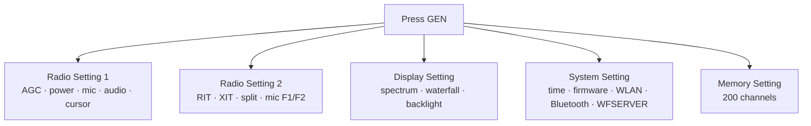
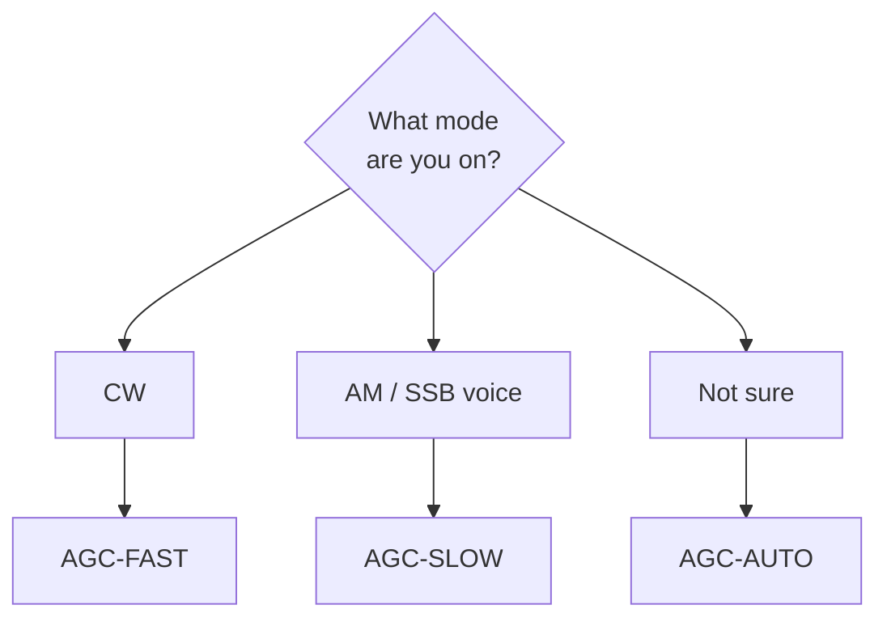

# The GEN settings menu

The **GEN** button is the X6100's control panel. Press it and the radio's core configuration fans out across five tabs along the bottom of the screen — how the receiver rides its gain, how much power leaves the antenna, how your microphone and data audio are levelled, what the spectrum and waterfall look like, the clock, the firmware, and the wireless radios. None of it is difficult once you know what each item is _for_, and most of it you will set once and never touch again. This chapter walks every item in the order the radio presents it, so you can read it straight through or dip in when a setting puzzles you.

One licence reminder before we start, because several settings here shape your transmitted signal: you may only transmit on the amateur HF and 50 MHz bands, within the segments and power your **licence** allows — the radio receives far more than it may legally transmit. If you are not yet licensed, everything in this chapter is still safe to _set and explore_; just do not key up. [Getting Licensed](outpost:entry/logbook73.handbook/getting-licensed) explains how to earn the right.

## Reaching a setting

A short press of **[GEN]** replaces the soft-key row at the bottom of the screen with the five tabs. Each tab is opened by the multi-function button beneath its label. Inside a tab, the drill is always the same two-handed move:

> **Rotate the MFK knob** to scroll the highlight onto the item you want; **rotate the main tuning knob** to change its value. The five soft-keys along the bottom then read **Restore defaults · decrease · increase · Set as shortcut tag · Exit** — so you can also nudge a value with the on-screen ± buttons, reset an item to factory, or leave.



The **Set as shortcut tag** soft-key is the one worth remembering: it pins the highlighted item to the small **multi-function tag** near the top-left of the main screen, so a frequently-changed setting (transmit power is the classic) becomes a one-touch tweak instead of a menu dive. You can point the assignable **MFK knob** at that tag too, which turns "change my power" into a single twist.

Each item below carries a one-glance verdict, the same key used throughout this guide:

| Symbol | Meaning                                            |
| ------ | -------------------------------------------------- |
| ✅     | Set it once and forget — right for almost everyone |
| ⭐     | Genuinely useful, depending on how you operate     |
| ⚠️     | Advanced — understand it before you enable it      |
| ❌     | Leave it off unless you have a specific reason     |

## Radio Setting 1 — the receiver and transmitter

The first and busiest tab holds the settings that shape what you hear and what you send: the automatic gain control, transmit power, the microphones, the audio paths, the charger and — in APP V1.2.0 — **CENTER MODE** for the spectrum cursor.

### AGC SLOW, AGC FAST and AGC HANG — ⭐ time, not level

The first items fine-tune the receiver's [automatic gain control](outpost:entry/logbook73.handbook/receivers), the process that keeps a whisper-weak station and a booming local one within a usable listening range. You do not switch AGC on here — the top-panel **[AGC]** button cycles `AGC-AUTO → AGC-OFF → AGC-SLOW → AGC-FAST`. In the current APP V1.2.0 menu, **AGC SLOW** and **AGC FAST** are the release time constants for those two behaviours, displayed in **milliseconds**; **AGC HANG** controls how long gain remains held down after a strong signal ends.



Xiegu's V1.2.0 release note recommends **slow for AM/SSB voice**, where a longer recovery sounds smoother between words, and **fast for CW**, where quick recovery preserves short details. The manufacturer does not publish one pair of universal default numbers in that release note, so **record the values shown on your own radio before changing them**. Do not copy a KNEE or SLOPE value from an older guide: those were the pre-V1.2.0 labels for items 1 and 2 and no longer describe the current controls.

- **AGC SLOW** (⭐) — the slow-mode recovery time in milliseconds. Longer values hold the gain down for longer after a strong signal; shorter values let the noise floor rise sooner. Start with the installed value and alter it only to solve a specific pumping or recovery problem.
- **AGC FAST** (⭐) — the fast-mode recovery time in milliseconds. It is the sharper choice for CW detail, but an unnecessarily short value can make background noise surge between elements.
- **AGC HANG** (⭐) — the remaining hold behaviour after a strong signal stops. It works with the selected time constant; leave the installed value alone until you can hear the particular rise-and-fall you want to change. See [Receivers](outpost:entry/logbook73.handbook/receivers) for the underlying idea.

### TX POWER — ⭐ lowest that does the job

Sets the RF power the transmitter produces, from a fraction of a watt up to the radio's maximum. The ceiling depends on how the radio is fed — about **10 W** on SSB/CW/FM from a 13.8 V **external supply**, but only about **5 W** on the **internal battery** (and lower still on AM, whose figures are the carrier level). The radio simply cannot make 10 W from the battery, so the same setting behaves differently on the two supplies, and "I only get 5 W" almost always means "you are on battery".

More power is not always better: on [HF](outpost:entry/logbook73.handbook/hf) a few watts routinely cross continents when the [propagation](outpost:entry/logbook73.handbook/propagation) is right, and running less saves your battery, runs the finals cooler and is simply good manners ([RF Power](outpost:entry/logbook73.handbook/rf-power)). ⭐ Use the **lowest power that gets the contact** — for FT8 from the battery, 2–3 W, since full power on a high-duty digital mode makes the radio hot and flattens the pack fast. For an external linear such as the XPA125B, Xiegu advise drive of **≤ 2.5 W** to protect the amp. This is the top candidate to pin with **Set as shortcut tag**, as it is one of the few settings you touch every session.

### MIC SEL — ✅ match how you speak

Chooses which microphone the radio listens to: **BUILT IN** (the hole beside the main knob) or **HANDLE** (the RJ45 hand microphone). Older extended documentation also shows **AUTO**, which selects according to the PTT that is pressed; current V1.6's table only promises built-in/hand selection, so treat AUTO as firmware-dependent rather than a universal third choice. ✅ Match the installed choice to the mic/PTT you actually use. Each mic has its own gain (below), so switching may mean re-checking the level.

### I-MIC GAIN & H-MIC GAIN — ⭐ set once by ear

The microphone gains — **I-MIC GAIN** for the internal mic, **H-MIC GAIN** for the hand mic — set how much the chosen microphone's audio is amplified before it modulates the transmitter. Too little and your signal is thin; too much and you _overdrive_ the transmitter, splattering distorted audio across neighbouring frequencies and sounding muffled rather than louder. ⭐ Set by ear once: speak normally and, watching the ALC/meter or the audio spectrum, raise the gain until your voice is full but the peaks are not pinning the meter. There are **separate** values for the two mics, so don't crank one "to be heard" and forget the other applies when you switch. See [Transmitters](outpost:entry/logbook73.handbook/transmitters).

### LINE IN LV & LINE OUT LV — ⭐ the data-mode levels

The audio levels on the line (sound-card) path used for [data modes](outpost:entry/logbook73.handbook/ft8) over the **DEV** USB-C port — **LINE IN LV** is what comes _into_ the radio from a computer to be transmitted, **LINE OUT LV** is the received audio the radio sends _out_ to the computer. For FT8, PSK, RTTY and the like, the PC's tones must drive the transmitter cleanly and the received audio must reach the decoder at a sensible level. ⭐ When you set up digital modes, adjust **LINE IN LV** so the transmitter is driven cleanly (ALC just tickling, not slamming) and **LINE OUT LV** so the software's waterfall sits in its happy range — too hot on LINE IN and you splatter, too cold on LINE OUT and you blame the antenna for weak decodes. Then leave them. See [Connectivity](outpost:entry/logbook73.guide.x6100/connectivity) and [FT8](outpost:entry/logbook73.handbook/ft8).

### MONI LEVEL — ⭐ off until you want it

The transmit **monitor** level — how loudly you hear your _own_ transmitted audio played back. It feeds a sample of your outgoing audio to the speaker/headphones so you can judge your mic gain and audio quality in real time. ⭐ Leave it low or off for everyday use and raise it briefly only while setting mic gain — on the speaker it can howl. Note this is _not_ the CW sidetone, which lives in the **[KEY]** menu ([CW: the Keyer, Messages & Auto-call](outpost:entry/logbook73.guide.x6100/cw-keyer)).

### PTT MODE — ✅ NORMAL unless you deliberately want a latch

The documented values describe **button behaviour**, not CAT selection: **NORMAL** transmits only while PTT is held; **TOGGLE** makes a press latch between receive and transmit. The extended manual notes TOGGLE was not implemented on that firmware, so do not assume it works merely because the label is present. ✅ Leave **NORMAL** selected unless your installed release explicitly documents and safely implements the latch. Computer PTT is configured in the application/CAT path described under [Connectivity](outpost:entry/logbook73.guide.x6100/connectivity), not by inventing another meaning for this item.

### BANDSTACK — ⭐ handy for band-hopping

Controls what the top **◄ / ►** buttons traverse. **HAM BAND** steps through amateur bands; **ALL BAND** adds the radio's general-coverage receive ranges. In MEMO mode the arrows step through memory channels instead. This setting does not extend the transmitter and it is not the per-band last-frequency recall mechanism sometimes implied by the English name. ✅ Use **HAM BAND** for normal operating; choose ALL BAND only when you intentionally browse broadcast/utility coverage.

### S/P MODE — ✅ and mind the plug

Routes the audio output at the **S/P** jack to a **headphone** or an **external loudspeaker**. The internal speaker is small and fatiguing, so most operators use headphones or an external speaker, and the two want slightly different drive. ✅ Set it to match what you have plugged in—and heed the hardware warning: **it is a 3.5 mm stereo (TRS) socket; a mono TS plug shorts the output, can silence it and can damage the device.** Use a stereo plug or adapter.

### CHARGER — ✅ on to charge, off to protect

The internal charger switch enables or disables charging of the internal battery from the DC input. The current manufacturer V1.6 manual specifies a **two-cell lithium (`7.4 V`, `3500 mAh`)** pack; older English material says 3000 mAh. Early firmware judged the pack by voltage and published thresholds around `7.4/7.2 V`; later battery-gauge firmware explicitly stopped using voltage as the management value. On the current baseline, trust the displayed capacity and expect automatic shutdown below `10%`, rather than diagnosing by those old voltage numbers. With the charger **on**, the supplied adapter tops the battery up; with it **off**, external power runs the radio without cycling the pack. ✅ Turn it **on** to charge, ⭐ **off** for long desk operation.

Official indicator descriptions differ: EU v1.1.7 says blinking green = charging and steady green = complete; current V1.6 says that while powered off, green lit = charging, red lit = battery abnormal and off = CHARGER disabled. Check capacity by powering on and follow the documentation channel matching your build. Never feed the DC jack more than **15 V**, and store the pack at 40–50% if unused (more in [Best Practices](outpost:entry/logbook73.guide.x6100/best-practices)).

### CENTER MODE — ⭐ centre tuning or movable cursor

APP V1.2.0 adds two ways to move around the spectrum. With **CENTER MODE ON**, the tuned frequency remains under the centre line and the whole spectrum scrolls as you turn the main frequency wheel — the familiar behaviour and the simplest default. With **CENTER MODE OFF**, the wheel moves a **cursor** across the received spectrum; place it on a signal to target that signal without keeping it pinned to the zero mark.

Xiegu notes that moving a wanted signal away from an internal interference point can improve the result: shift the displayed slice slightly, then put the cursor back on the signal. ⭐ Keep centre mode on while learning; switch it off deliberately when the cursor makes visual tuning or avoiding a fixed birdie easier. If this item is missing, check **SYSTEM INFO** — the cursor was added in APP V1.2.0.

## Radio Setting 2 — RIT, XIT, split and microphone shortcuts

A short tab, but it holds two everyday operating aids, split operation and the **HANDLE F1 / HANDLE F2** assignments for the programmable keys on the hand microphone. The current manufacturer V1.6 manual lists exactly those five items. Some earlier English menu descriptions and installed builds also expose the I/Q output control here; match that specialist item by name on the firmware actually installed.

### RIT — ⭐ nudge the receiver only

**Receiver Incremental Tuning** shifts _where you listen_ by a small amount (a few kHz) while leaving _where you transmit_ exactly where it was; the offset is shown on screen. A station calling you may be slightly off your frequency, or drifting — RIT lets you tune their voice or CW note perfect without dragging your own transmit off the agreed frequency, and without having to re-net the whole QSO. ⭐ A great tool once you are making contacts; clear it to zero when you finish, or you will think the band has gone quiet when the receiver is simply "detuned". Its transmit twin is **XIT**, next.

### XIT — ⭐ the transmit mirror of RIT

**Transmitter Incremental Tuning** shifts your _transmit_ frequency by a small offset while your receive frequency stays put — handy when you need to nudge your signal (to answer a station listening slightly off, or to dodge interference on your exact frequency) without changing what you monitor. ⭐ Far less used than RIT; reach for it deliberately, then zero it, or you will transmit off-frequency without realising. Its bigger cousin is **SPLE** (split), next.

### SPLE — ⚠️ split-frequency operation

The **split** switch lets you _listen_ on VFO A and _transmit_ on VFO B (or vice versa), so the two can be on entirely different frequencies. This is how you work a **DX pileup**: a rare station transmits on one frequency but _listens_ a few kHz up ("listening 5 to 10 up") so the crowd calling does not bury its own signal. For example, a DXpedition transmitting on `14.195` and "listening up 5–10" — you set VFO A to `14.195` to hear it and VFO B into the 14.200–14.205 window to call. ⚠️ Leave **off** for ordinary same-frequency (simplex) contacts; turn it on only when you know the other station is working split. Don't confuse it with RIT/XIT — those are small nudges around one frequency, whereas split is two independent frequencies ([Tuning, VFOs & Modes](outpost:entry/logbook73.guide.x6100/tuning-modes)).

### HANDLE F1 & HANDLE F2 — ⭐ make the microphone useful

These two items assign the hand microphone's programmable **F1** and **F2** keys. The extended stock manual lists F1 choices **PRE, ATT, AGC, TS−, TS+** (default PRE) and F2 choices **NR, NB, DNF, CW TRAINER** (default NR). Current V1.6 confirms the fields but does not reprint that option list, so treat it as a documented older/current-build inventory rather than a guarantee for every firmware. Pick two jobs you genuinely change, record the originals and test both while receiving.

### Legacy/firmware-dependent: IQ OUT EN — ⚠️ feed an external SDR

This item appears in older English menu descriptions and some installed builds, but not in the current manufacturer V1.6 RADIO SETTING2 inventory. Where your radio exposes it, it switches on the raw **[I/Q signals](outpost:entry/logbook73.handbook/iq-signals)** at the physical I/Q OUT jack, so an external SDR receiver can use the X6100 as a front end and give you a wider panadapter. ⚠️ Leave it **off** unless you are actually using that output. See [Connectivity](outpost:entry/logbook73.guide.x6100/connectivity) and [FFTs & Waterfalls](outpost:entry/logbook73.handbook/ffts-and-waterfalls).

## Display Setting — the spectrum, waterfall and backlight

The X6100's showpiece is its live [spectrum and waterfall](outpost:entry/logbook73.handbook/ffts-and-waterfalls). The current manufacturer V1.6 manual lists nine display controls. None changes what the receiver _hears_; they change what you _see_, so they are safe to explore.

```viz
{
  "type": "spectrum",
  "title": "What the reference and average settings shape",
  "caption": "The reference level sets where the noise floor sits on screen (park it just below the grass); averaging smooths the trace so brief spikes settle and real carriers stand out.",
  "components": [
    { "f": 28, "amp": 0.75, "label": "wanted signal", "tone": "primary" },
    { "f": 52, "amp": 0.32, "tone": "muted" },
    { "f": 74, "amp": 0.95, "label": "strong signal", "tone": "ink" }
  ],
  "noiseFloor": 0.16,
  "xLabel": "frequency across the spectrum window"
}
```

### RF FFT AVE — ⭐ smooth the trace

The **RF spectrum averaging** blends successive sweeps together. More averaging steadies the jittery noise floor so brief spikes settle and steady carriers stand out; less makes the display faster and twitchier, better for catching very short transmissions. ⭐ A modest amount for a calm, readable display; less if you are hunting brief signals like CW dits or FT8 bursts. A little goes a long way.

### RF FFT REF — ⭐ park the noise floor

The **RF spectrum reference level** sets how high up the screen the noise floor and signals sit. The spectrum is a plot of signal strength against frequency, and the reference level slides that plot vertically: too high and everything is squashed at the bottom, too low and the "grass" of the noise floor fills the screen and hides real signals. Since noise levels vary hugely by band, antenna and location, a fixed reference would suit none of them. ⭐ Adjust so the **noise floor sits just above the bottom** of the window, letting real signals stand up clearly as spikes above it, and re-check it when you change band or antenna. Works hand-in-hand with **WF REF** and **RF FFT AVE**.

### FFT SPAN — ⭐ choose how much band you see

Sets the frequency width of the RF spectrum. A wide span is a band-survey tool: more activity fits on screen, but each signal occupies fewer pixels. A narrow span gives better visual separation around the tuned signal. ⭐ Start wide while looking for activity, then narrow when centring or diagnosing close signals.

### FFT PK HOLD — ⭐ remember brief peaks

Peak hold leaves a temporary trace at the highest recent RF-spectrum level. It helps reveal short calls, intermittent interference and tuning peaks that disappear before your eye catches them. It can also turn a busy display into clutter. ⭐ Enable it for hunting brief events; switch it off for the cleanest live trace.

### WF REF — ⭐ tune the waterfall colours

The **waterfall reference offset** anchors the level at which the scrolling waterfall's colour scale sits. The waterfall maps signal strength to colour over time; this offset decides which strength shows as "background" and which lights up. Set well, weak signals glow faintly against a dark floor; set badly, the whole waterfall is one flat colour and tells you nothing. ⭐ Adjust until the background is dark and signals show as bright streaks — it works hand-in-hand with **RF FFT REF**. See [FFTs & Waterfalls](outpost:entry/logbook73.handbook/ffts-and-waterfalls) for how the display is built.

### AF FFT AVE & AF FFT REF — ⭐ the audio spectrum

The same averaging and reference controls for the small **audio (AF) spectrum** — the received audio _after_ demodulation, rather than the RF across the band. **AF FFT REF** sets where its trace sits; **AF FFT AVE** smooths it. The audio spectrum helps you place a CW note or a data signal within the passband and see interfering tones inside your filter. ⭐ Set like their RF cousins — floor low, a little averaging — and leave them.

### BL LEVEL — ✅ backlight brightness

Sets how bright the 800×480 colour screen is: **5 levels on battery**, **10 on external power** (the extra headroom is offered only when you are not spending precious battery on it). The display is one of the biggest drains on the battery, so dimming it directly extends operating time. ✅ Set it as low as you can comfortably read — free battery life. You can also step brightness quickly with a **short press of the Lock button** when unlocked, without opening this menu ([Getting Started](outpost:entry/logbook73.guide.x6100/getting-started)).

### AUDIO SCOPE — ⭐ show or hide the audio panes

Default `OFF`. When enabled, the documented layout compresses the RF waterfall to roughly three-quarters of its width; the remaining quarter shows an audio-frequency spectrum above and audio level-over-time/waveform below. Use it when placing a CW note, checking a data signal or spotting an interfering audio tone. Turn it off for the full-width RF waterfall. It changes the display, not the received audio path.

## System Setting — time, firmware and network

This tab is the radio's "system" corner: the clock, **SYSTEM INFO** version read-out, firmware update, WLAN, Bluetooth, **WFSERVER** and factory reset. Labels still vary across releases, but SYSTEM INFO is the authoritative place to identify the two builds on the radio in front of you.

### TIME SETTING — ✅ set it to UTC

Sets the radio's real-time clock. An accurate clock matters more on HF than on VHF: [FT8 and other data modes](outpost:entry/logbook73.handbook/ft8) need your clock within a second or so to decode at all, and a logged contact wants the right time. ✅ Set it to **UTC** — the timezone amateurs log and schedule in worldwide, which sidesteps daylight-saving confusion. (Early firmware had clock/RTC quirks; if the time will not hold, a firmware update usually cures it, and running FT8 from a PC lets the software keep time regardless.) Set it once, and again after any factory reset.

### SYSTEM INFO — ✅ identify both halves before changing either

Open **SYSTEM INFO** before an update, a reset or a support request and write down both entries. The current official package pairs **APP V1.2.0** (the Linux user interface and DSP, dated 13 December 2025) with **BASE V1.1.9** (the radio-control side, dated 28 November 2025). A radio on a different combination is not automatically broken, but its menus and behaviour may differ from this guide; report both values rather than saying only that it is "up to date".

### FIRMWARE UPGRADE — ⚠️ the firmware story

This menu performs the BASE/baseband half of a stock update. It is not the whole update procedure. Firmware deserves a careful read because the radio has two separately versioned layers and the official process updates them in two stages.

The X6100 runs **two** firmware layers with **separate version numbers**, both shown in SYSTEM INFO: an **APP** version (the Linux user interface and DSP) and a **BASE** version (the STM32 that runs the RF hardware). Seeing two numbers is normal and confuses many owners; a given release pairs a specific APP with a specific BASE. Firmware has improved a great deal over the radio's life — updates have fixed the CW decoder, battery gauge, display legibility (the early hard-to-read red text became white), noise reduction and CAT behaviour — so keeping current genuinely improves the set.

- **Recommendation:** ⚠️ update deliberately on stable external `13.8 V` power, never on the battery. First, use the supplied card-writing tool to **write**, not merely copy, `x6100udimg.img` to a microSD card. Boot the powered-off radio with that flash card inserted; the APP/system update runs automatically and the radio shuts down. Remove the flash card before starting again so it does not repeat. Then boot normally and use **SYSTEM SETTING → FIRMWARE/FW UPGRADE** to apply the matching BASE image. Reboot, verify both versions in SYSTEM INFO, and perform any reset the release requires. The V1.2.0 line requires a factory reset; skipping it can corrupt band data, leaving bands that will not switch or a frequency stuck at `0`. Do not assume settings or memories survive: record them first. The [official X6100 update tutorial](https://xiegu.eu/sdm_downloads/xiegu-x6100-firmware-update-tutorial/) and the target package's notes are authoritative; do not omit or reorder their steps.
- **The alternative-firmware scene:** because the UI is Linux, there is an active community-firmware effort (the well-known one began as R1CBU's SD-card image, now an LVGL-based fork) adding native FT8/FT4, an enhanced live CW decoder beyond stock MODEM's CW text workflow, wider filters and a logbook. It **boots from the SD card** — remove the card and you return to stock. Xiegu considers third-party firmware to void warranty, so treat it as reversible but unsupported, and treat every version/date as time-sensitive.

### WLAN & BLUETOOTH — ⭐ the wireless radios

The 2.4 GHz **WLAN** (Wi-Fi) and **BLUETOOTH** pages switch and manage the two wireless adapters. On current V1.6 WLAN, switch **WiFi ON**, let it scan automatically, use the MFK to choose a network/open its details, enter the required information and **CONNECT**; `HELP` was added when APP V1.2.0 revised this flow. Older manuals show a separate SCAN/EDIT/CONFIG field workflow, so match the screen in front of you. Bluetooth's reliable stock uses are a keyboard and mouse. Xiegu's product marketing advertises wireless audio, but its detailed stock manual says a headset may pair/connect without routing receive audio or its microphone; do not rely on pairing as proof of usable audio. ⭐ Enable either radio only when needed. See [Connectivity](outpost:entry/logbook73.guide.x6100/connectivity).

### WFSERVER — ⚠️ network waterfall and control

Starts the firmware-provided network server used by compatible waterfall/control clients. It can expose radio control, potentially including PTT, so this is a station-security control as well as a convenience. Use it only on a trusted LAN, never expose it directly to the internet, and replace/avoid published default credentials where the firmware permits. Stop it afterwards rather than leaving an unnecessary control service available. Exact clients and credential controls are firmware-dependent; record APP/BASE before following a recipe.

### FACTORY RESET — ⚠️ the clean slate

Wipes your settings back to the factory state: on confirming, the radio resets, shuts itself down, and you power it on again to finish. It clears a confused configuration in one step — and, as noted, is _mandatory_ after certain firmware updates to avoid band-data corruption. ⚠️ Use it deliberately, either as a cure for odd behaviour or as the required post-update step; afterwards you will need to re-set the clock, mic gains, display and the rest of this tab, so note your settings first.

## Memory Setting — saving channels

The last tab—called MEMORY SETTING in the current V1.6 manual and MEMORY EDIT in older English material—manages the radio's **200 memory channels**. Its current visible actions are `TAG`, `ERASE MEMO`, `SAVE VFO` and `EXIT` (with the second soft-key position blank).

### SAVE VFO — ✅ how you keep a channel

Stores the current VFO — frequency, mode and the rest — into a blank memory channel, so a favourite net frequency recalls in one step instead of being re-dialled every time. ✅ In VFO mode, tune it up, choose the mode, then **SAVE VFO**: with VFO A on `14.270000 USB`, it drops into the next free channel, ready to recall. You switch between VFO and memory with the top-panel **[V/M]** button ([Tuning, VFOs & Modes](outpost:entry/logbook73.guide.x6100/tuning-modes)).

### TAG, ERASE MEMO & EXIT — ⭐ housekeeping

The rest of the current tab tidies your channels. **TAG** (⭐) names the current channel using the on-screen (or Bluetooth) keyboard—"GB3xx" reads better than a bare number. **ERASE MEMO** (⭐) clears the selected channel; turn the main knob to pick it first because there is no undo. **EXIT** leaves the page. Older manuals/builds may show a **MARK**/house favourite action, but it is not in the current V1.6 four-action inventory.

## Try it yourself

With the radio on and an antenna (or dummy load) connected — and _without transmitting_ unless you are licensed and on a legal frequency:

1. **Learn the two-knob move.** Press **[GEN] → Radio Setting 1**, rotate the **MFK** to highlight **TX POWER**, and the **main knob** to change it. That gesture — MFK selects, main knob changes — works in every tab.
2. **Pin a shortcut.** With **TX POWER** highlighted, press **Set as shortcut tag** and watch it appear on the multi-function tag near the top-left. Now you can change power without opening the menu.
3. **Tame the display.** Open **Display Setting** and adjust **RF FFT REF** and **WF REF** until the noise floor sits low and signals stand out as bright streaks. Nothing here affects what the radio hears — only what you see.
4. **Save the battery.** Drop **BL LEVEL** a notch or two, then press the **Lock** button briefly to step brightness without the menu.
5. **Set the clock and identify the build.** In **System Setting**, set **TIME SETTING** to **UTC**, then open **SYSTEM INFO** and note the **APP** and **BASE** version numbers.
6. **Read, don't run.** Look at **FACTORY RESET** and **FIRMWARE UPGRADE** so you know where they live — but leave them alone until you actually need them.

## Key takeaways

- **GEN opens five tabs** — Radio Setting 1, Radio Setting 2, Display Setting, System Setting and current-label Memory Setting — and in every one, the **MFK knob selects** an item while the **main knob changes** it.
- **TX POWER** is your most-touched setting: run the **lowest power that works** (about 5 W on battery, 10 W on external), and consider pinning it with **Set as shortcut tag**.
- On APP V1.2.0, **AGC SLOW / AGC FAST are millisecond time constants**, not the old KNEE/SLOPE controls; favour slow for AM/SSB voice, fast for CW, and record your installed numbers before experimenting.
- Set **MIC SEL** to the mic you use and its **gain** by ear (don't overdrive); the **LINE IN/OUT** levels are the data-mode equivalents for [FT8](outpost:entry/logbook73.handbook/ft8) and friends.
- The **Display Setting** items only change what you _see_ — set **RF FFT REF / WF REF** so the noise floor sits low and signals stand out; dimming **BL LEVEL** buys real battery time.
- **CENTER MODE OFF** enables the V1.2.0 movable spectrum cursor; **RIT/XIT** nudge receive/transmit a touch; **SPLE** is the DX-pileup tool; and **HANDLE F1/F2** put two useful actions on the microphone.
- **Firmware is a real topic:** record both **APP and BASE in SYSTEM INFO**, update on external power, and heed any version that demands a **factory reset** afterwards — plus a reversible, SD-card-based alternative-firmware scene worth knowing about.
- **S/P MODE** needs a **stereo (TRS) plug**—a mono TS plug shorts the output and can damage the device—and **CHARGER** lets you run on external power without cycling the 7.4 V battery.

With the radio configured, the next step is the part that makes an SDR shine — cleaning up what you hear: [DFN & DFL: DSP, Noise Reduction & Filters](outpost:entry/logbook73.guide.x6100/dsp-filters).
