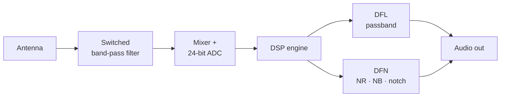
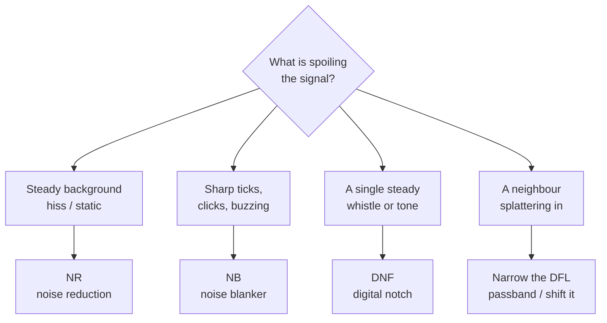

# DFN and DFL: DSP, noise reduction and filters

On a traditional radio, the filter that decides how a signal sounds is a physical thing — a box of quartz crystals, cut and matched at the factory, that you cannot change. On the X6100 that filter is a piece of arithmetic running on a small Linux computer inside the radio, and _you_ draw its shape with a knob. That is the quiet superpower of a software-defined radio, and two buttons on the front panel — **DFN** and **DFL** — are where you reach it. Learn them and you stop being at the mercy of whatever the band throws at you.

## Where the DSP sits in the chain

To use these tools well, it helps to know _where_ in the radio they live, because that single fact explains both what they can do and — just as usefully — what they cannot.

Follow a signal in from the antenna. It arrives at a **switched band-pass filter**, a simple analogue filter that lets through roughly the band you are on and blocks the rest. From there it is mixed down and handed to a **24-bit analogue-to-digital converter** — the point at which the radio stops dealing in voltages and starts dealing in _numbers_. Everything after that happens in software, on the radio's [SDR](outpost:entry/logbook73.handbook/software-defined-radio) engine: the [spectrum and waterfall](outpost:entry/logbook73.handbook/ffts-and-waterfalls) you watch, the demodulation, and every filter and noise tool in this chapter. They are all just maths performed on a stream of numbers.



Here is the honest and important consequence. Because all of this happens **after** the analogue-to-digital converter, the DSP can only work on what the converter was given cleanly. The X6100 is a [zero-IF (direct-conversion) receiver](outpost:entry/logbook73.handbook/receivers) with **no roofing filter** — its only front-end selectivity is those switched band-pass filters — so a very strong nearby signal, such as a broadcast station a few hundred kilohertz away, can overload the front end _before_ the signal is digitised. Once that has happened, no amount of noise reduction or notching will rescue it; the distortion is baked into the numbers. Curing overload is the job of the **attenuator (PRE)**, the **RF Gain** control and, where you live near a broadcaster, an external band-pass or high-pass filter — front-end tools that belong to receiving and tuning, not to DSP. Keep that boundary in mind: **DFL and DFN shape what the front end passes cleanly; they cannot un-break what it has already mangled.**

Within that boundary, though, they are transformative — and the status bar keeps you honest about what you have switched on. Along the top of the current V1.6 screen sit the tell-tales `SPL`, `ATU`, `SQL`, `NB`, `NR` and `DNF`; the last three light when their DSP tool is active, so a glance tells you how much processing stands between you and the raw signal. Older screenshots/translated material may use `ANF`, but this guide uses the current DNF label.

## DFL — the digital filter

Press **DFL** and you open the single most useful control on the radio for making a signal readable: the **passband filter**. Bandwidth — how wide a slice of audio you let through — does more for intelligibility than any other setting, so this is the button you will reach for constantly. The full theory of what a filter is and why narrowing one trades bandwidth for quiet lives in [Filters](outpost:entry/logbook73.handbook/filters); here is how the X6100 hands it to you.

The passband is defined by two edges. The **L-CUT** (low cut) sets the **lower** edge — it trims away low audio frequencies (rumble, mains hum, bass). The **H-CUT** (high cut) sets the **upper** edge — it trims away high audio frequencies (hiss, splatter, treble). What sits _between_ the two edges is what you hear; the width between them is the **bandwidth**. On the display the edges are drawn as two overlapping trapezoids — the manual colours the H-CUT box blue and the L-CUT box red — and their overlap is your actual passband.

```viz
{
  "type": "spectrum",
  "title": "The DFL passband — keep the voice, drop the neighbours",
  "caption": "L-CUT sets the lower edge, H-CUT the upper edge; only what sits between them reaches your ears. Bring the edges in onto the wanted voice and the low rumble and the whistling carrier either side simply vanish.",
  "components": [
    { "f": 12, "amp": 0.5, "label": "hum / rumble", "tone": "muted" },
    { "f": 45, "amp": 0.85, "width": 26, "label": "wanted SSB voice", "tone": "primary" },
    { "f": 84, "amp": 0.7, "label": "adjacent carrier", "tone": "danger" }
  ],
  "noiseFloor": 0.08,
  "mask": { "kind": "bandpass", "from": 24, "to": 66 },
  "xLabel": "audio pitch — low ← → high"
}
```

**Using it:** after pressing DFL, choose one of **FILTER1 / FILTER2 / FILTER3** to edit that preset. A short press of the **MFK knob** toggles which edge you are moving (L-CUT or H-CUT); rotating the MFK then slides that edge in or out, and the change is saved to the chosen filter label automatically — there is no separate "store" step. **DEFAULT** resets the current filter to its factory shape; **CLOSE** leaves the interface.

### FILTER1 / FILTER2 / FILTER3 — three passbands, remembered per mode — ⭐

Three quick-recall filter shapes, and the parameters are held **separately for each mode**.

- **What it does:** gives you three saved passbands you can flick between, and — the clever part — the X6100 keeps a _different_ set of three for SSB, CW, AM and so on, loading the right trio automatically when you change mode.
- **Inside:** each label stores an L-CUT and an H-CUT figure; selecting a mode recalls that mode's stored filters, so your CW filters never trample your SSB filters.
- **Why it exists:** you rarely want just one bandwidth. On CW you might want a roomy one for tuning and a razor-thin one for a crowded pile-up; on SSB, a wide one for a strong local and a narrow one to dig out DX.
- **A sensible scheme:** set FILTER1 as your everyday width, FILTER2 as a _narrower_ rescue filter for crowded conditions, and FILTER3 as a _wider_ one for relaxed, full-audio listening. Then one button-press per situation.
- **Should you change it?** Yes — spend ten minutes setting up all three per mode once, and you will use them for the life of the radio.

### L-CUT — the lower edge (a high-pass) — ⭐

The low-frequency cut, which sets where the passband _starts_.

- **What it does:** removes everything below the frequency you set. Raise it and you strip out low rumble, mains hum and the boomy bottom of a voice.
- **Why it exists:** the lowest audio frequencies carry almost no intelligibility but plenty of noise energy. Trimming them tightens and clarifies a voice, and can silence a low-pitched heterodyne sitting under the signal.
- **Typical values:** for SSB voice, an L-CUT around **150–300 Hz** is a good starting point; for CW you can raise it much higher so it works with the H-CUT to form a narrow window around your beat note.
- **Example:** a station has an annoying low hum under their audio. Nudge L-CUT up from 100 Hz towards 300 Hz and the hum fades while the voice stays perfectly readable.
- **Common mistakes:** raising it so far that the voice sounds thin and telephone-like; forgetting it is a per-mode setting and wondering why CW "changed" your SSB filter.
- **Related:** H-CUT (below), which sets the other edge.

### H-CUT — the upper edge (a low-pass) — ⭐

The high-frequency cut, which sets where the passband _ends_.

- **What it does:** removes everything above the frequency you set. Lower it and you cut hiss, high-pitched noise, and the splatter of a station on the channel above.
- **Why it exists:** most of the "sharpness" of band noise and most adjacent-signal interference lives at the top of the audio range. Pulling the upper edge down is the quickest way to make a noisy band restful.
- **Typical values:** for communications-quality SSB, an H-CUT around **2400–2700 Hz** gives natural speech; drop it to **1800–2100 Hz** to fight a crowded band or a splattering neighbour. For CW, bring it right down towards your sidetone pitch.
- **Example:** someone is splashing in from 2 kHz up the band. Lower H-CUT until the splatter disappears — you will lose a little brightness on the wanted voice, a fair trade for a readable contact.
- **Common mistakes:** the big one, and the manual warns of it explicitly — **if you narrow the passband tighter than the signal you want, you cut the signal off entirely and hear nothing.** If a station goes silent after you tighten the filter, you have over-narrowed; widen an edge back out.
- **Related:** L-CUT (above); together they set the passband width.

**Passband shift.** Because you move the two edges independently, you can do more than just narrow: slide _both_ edges the same way and the whole window shifts, letting you nudge an interfering tone out past one edge while keeping the wanted signal in the clear. The two trapezoids redraw as you move each edge, so you can see exactly where your window sits. It is not a true separate IF-shift control on stock firmware, but for dodging a single close-in interferer it does the job.

**A word on modes.** The passband is most meaningful in **SSB, CW, AM and the data modes**, where audio bandwidth is everything. In **FM** the receiver's bandwidth is essentially fixed by the detector, so the DFL edges make little practical difference there. And there is no stock **CW peaking** filter (a resonant "spotlight" on one pitch) — you approximate it by squeezing L-CUT and H-CUT tightly around your beat note. Some community firmware adds wider and sharper filter options; more on that below.

## DFN — noise reduction, blanker and notch

Where DFL shapes the _shape_ of the signal, **DFN** (press it to open, press again for its second page) attacks the three kinds of noise that ride _inside_ the passband. The crucial idea — and the reason there are three separate tools rather than one "make it quieter" knob — is that each one targets a completely different sort of noise, and using the wrong one does nothing or makes things worse. By default all three are switched off, so the radio ships transparent and you add processing deliberately.

### NR — noise reduction — ⭐

The tool for **steady background hiss**: atmospheric static, band noise, the general roar of a noisy HF day.

- **What it does:** the `NR` switch turns on digital noise reduction; `NR DEPTH` sets how hard it works. It analyses the audio and suppresses the random, hiss-like component while trying to leave the structured sound of speech alone.
- **Inside:** speech is _correlated_ from moment to moment; hiss is random. The DSP exploits that difference statistically, pulling down the parts of the audio that look like noise and keeping the parts that look like a voice.
- **Why it exists:** on a weak-signal band, a wanted voice can be sitting only a little above the hiss. NR can lift it out and rest your ears over a long session.
- **How to set it:** switch NR on, then raise `NR DEPTH` a step at a time until the hiss drops but _before_ the voice starts to sound artificial. Stop the moment it turns "watery".
- **Common mistakes:** over-driving the depth until every voice sounds hollow, robotic or underwater — the classic sign of too much NR, and it can actually make a signal _harder_ to read. NR also does nothing for clicks or whistles; reaching for it against those is a common newcomer error.
- **Verdict:** genuinely useful on a hissy band, but a light touch wins. The X6100's NR is on the gentle side (it was improved in later firmware), so expect help rather than a miracle.

### NB — noise blanker — ⭐ (leave off until you need it)

The tool for **sharp, impulsive noise**: the rhythmic tick of a car ignition, an electric fence, arcing power lines, some switch-mode chargers.

- **What it does:** the `NB` switch turns on the noise blanker. It watches for the brief, sharp _spikes_ of impulse noise and momentarily mutes ("blanks") the receiver for the instant each spike arrives, so the pop never reaches your ears. `NB WIDTH` matches the pulse bandwidth; `NB LEVEL` sets the pulse-suppression depth on a 0–100 scale (default 10). It is not a trigger-threshold control.
- **Inside:** impulse noise is over in a flash but very strong. By snipping out those flashes, the blanker removes the noise while losing only slivers of the wanted signal — usually imperceptibly.
- **Why it exists:** a steady _tick-tick-tick_ is exhausting and can bury weak signals; NR barely touches it because it is not hiss.
- **How to set it:** switch NB on, then raise `NB LEVEL` from its low/default setting only until the ticks are acceptably suppressed; adjust `NB WIDTH` to suit the pulse, backing either control down if wanted audio becomes rough.
- **Common mistakes:** using more suppression depth or width than the noise needs on a busy band, which can produce distortion or a choppy, gargling sound — especially with a strong SSB station present. It also cannot help with hiss (use NR) or a steady whistle (use the notch). Turn it off when the impulse noise is gone.
- **Verdict:** a lifesaver against local electrical noise; a nuisance if left on when there is none.

### DNF — the digital notch — ⭐

The tool for a **single steady tone**: a carrier whistle, a heterodyne "beat", a data pilot tone sitting in your passband.

- **What it does:** the `DNF` switch (the manual calls it the "digital trap") drops a narrow, deep notch into the audio to silence one tone while leaving everything around it untouched. `DNF CENTER` sets the pitch of the notch in hertz — where you place it — and `DNF WIDTH` sets how wide a bite it takes.
- **Inside:** a very narrow band-stop filter is planted at the pitch you choose; the tone falls into the gap and disappears, while speech either side passes through.
- **Why it exists:** a single carrier — often bleed-through from a nearby broadcast or a tuner birdie — produces a piercing whistle that a bandwidth filter can only remove by also throwing away half your signal. A notch removes just the whistle.
- **How to set it:** switch DNF on, then turn `DNF CENTER` until the whistle drops into the notch and goes quiet; widen `DNF WIDTH` only if it will not sit still. On the X6100 you _place_ the notch by hand at the offending pitch, rather than it hunting for tones on its own — more deliberate, but predictable.
- **Common mistakes:** setting the width too broad, which starts to hollow out the voice; using it against hiss or ticks (wrong tool); leaving it switched on so it dents any tone that happens to wander into its pitch.
- **Related:** the DFL edges — sometimes simply pulling an L-CUT or H-CUT past a whistle at the _edge_ of the passband is quicker than notching one in the _middle_.

```viz
{
  "type": "spectrum",
  "title": "DNF — a narrow trap dropped on a heterodyne",
  "caption": "The notch removes just the offending whistle at DNF CENTER, leaving the voice on either side intact — something a bandwidth filter cannot do without sacrificing half the signal.",
  "components": [
    { "f": 40, "amp": 0.8, "width": 40, "label": "wanted SSB voice", "tone": "primary" },
    { "f": 58, "amp": 0.95, "label": "steady whistle", "tone": "danger" }
  ],
  "noiseFloor": 0.06,
  "mask": { "kind": "notch", "from": 54, "to": 62 },
  "xLabel": "audio pitch — low ← → high"
}
```

## Matching the tool to the noise

The whole of DFN and DFL comes down to one habit: **name the problem first, then pick the tool.** Ask yourself what, exactly, is spoiling the signal.



| What you hear                          | The tool                                                                                         | Why                                                         |
| -------------------------------------- | ------------------------------------------------------------------------------------------------ | ----------------------------------------------------------- |
| A steady wash of hiss or static        | **NR** (raise NR DEPTH gently)                                                                   | Suppresses the random, hiss-like component                  |
| A rhythmic tick, buzz or crackle       | **NB** (set NB LEVEL, then NB WIDTH)                                                             | Blanks the short impulse spikes                             |
| One piercing whistle or beat note      | **DNF** (place DNF CENTER on it)                                                                 | Notches out a single tone, keeps the rest                   |
| A station splashing from up the band   | **DFL** (lower H-CUT / narrow the passband)                                                      | Cuts the audio where the interference lives                 |
| Everything distorts near a broadcaster | **Front end, not DSP** — attenuator (PRE) + lower RF Gain, and a band-pass filter if it persists | The overload happens _before_ the ADC, so DSP cannot fix it |

That last row is worth repeating because it is the X6100's best-known quirk: if voices appear "behind" other signals or the broadcast band bleeds across everything, you are hearing front-end overload, and the cure is to reduce the signal _reaching_ the radio — not to pile on noise reduction.

## An honest note on the X6100's DSP — and firmware

Two things keep the picture accurate. First, the X6100's DSP is capable but not the last word: reviewers rate its filters and noise reduction a step below the very best portables, and — as noted — there is no dedicated CW peaking filter in stock firmware. This is not a flaw so much as a level; used sensibly, these tools do real work.

Second, **DSP behaviour is firmware-dependent, so hedge anything you read (including here) against your own unit.** Xiegu's firmware carries two version numbers — an **APP** (the Linux user interface) and a **BASE** (the radio hardware side) — and the noise reduction in particular was improved across releases, so an older radio may behave differently from a freshly updated one. Beyond Xiegu's own builds, there is a well-established **community firmware** (originally R1CBU's non-destructive SD-card image, now maintained as the LVGL fork by gdyuldin) that boots from a microSD card and adds, among much else, **wider and sharper IF filters, a CW decoder with a CW "peak", and a true IF-shift** — precisely the DSP refinements some operators feel stock firmware lacks. Because it runs entirely from the card, removing the card returns you to stock; it is reversible, though Xiegu regard third-party firmware as voiding warranty. If the built-in filters ever feel limiting, that scene is worth knowing about — but everything in this chapter is written for the **stock firmware** you will meet out of the box.

## Try it yourself

Everything here is listening-only, so you can practise it before you are licensed — tune to a busy amateur band by day.

1. **Find the passband.** In SSB, press **DFL**, select **FILTER1**, short-press the **MFK** to grab the H-CUT edge, and pull it down. Listen to a voice go from bright to muffled, and watch the passband narrow on screen. Push it back to about 2500 Hz.
2. **Build a rescue filter.** Set **FILTER2** narrower — say L-CUT 300 Hz, H-CUT 2000 Hz — then flick between FILTER1 and FILTER2 on a crowded voice and hear the difference one button makes.
3. **Over-narrow on purpose.** Squeeze both edges together until the signal disappears entirely. That is the manual's warning made real — now widen back out and remember the feeling.
4. **Meet noise reduction.** On a hissy signal, switch **NR** on and raise **NR DEPTH** step by step until it turns watery, then back off one step. That last good setting is where NR earns its keep.
5. **Notch a whistle.** Tune near a strong carrier until you hear a steady tone, switch **DNF** on, and turn **DNF CENTER** until the whistle drops into silence while the noise around it stays. Watch the current `DNF` status indication; older screenshots or third-party material may use different lettering.

## Key takeaways

- On an SDR the filters and noise tools are **software running on the numbers after the ADC** — endlessly flexible, but powerless to fix **front-end overload**, which is cured with the attenuator, RF Gain and (near broadcasters) an external filter.
- **DFL** is your most-used control: **L-CUT** sets the lower edge, **H-CUT** the upper, and the gap between them is your **bandwidth** — but narrow tighter than the signal and it vanishes entirely.
- The **FILTER1/2/3** presets are remembered **per mode**; set an everyday, a narrow and a wide one for each mode and switch with a single press.
- **DFN carries three different tools for three different noises:** **NR** for steady hiss (a light touch — too much sounds underwater), **NB** for sharp impulse ticks (off unless you need it), and **DNF** for a single steady whistle (place it by hand on the tone).
- The winning habit is to **name the noise first, then pick the tool** — the decision flow and table above are the whole method on one page.
- DSP behaviour is **firmware-dependent**: Xiegu's own builds have improved over time, and a reversible **community firmware** adds wider filters, a CW peak and IF-shift for those who want more than the stock set.

With the received signal now clean and shaped exactly as you like it, the next step is putting your own signal out cleanly — starting with Morse, in [The CW Keyer: KEY, Sidetone & QSK](outpost:entry/logbook73.guide.x6100/cw-keyer).
