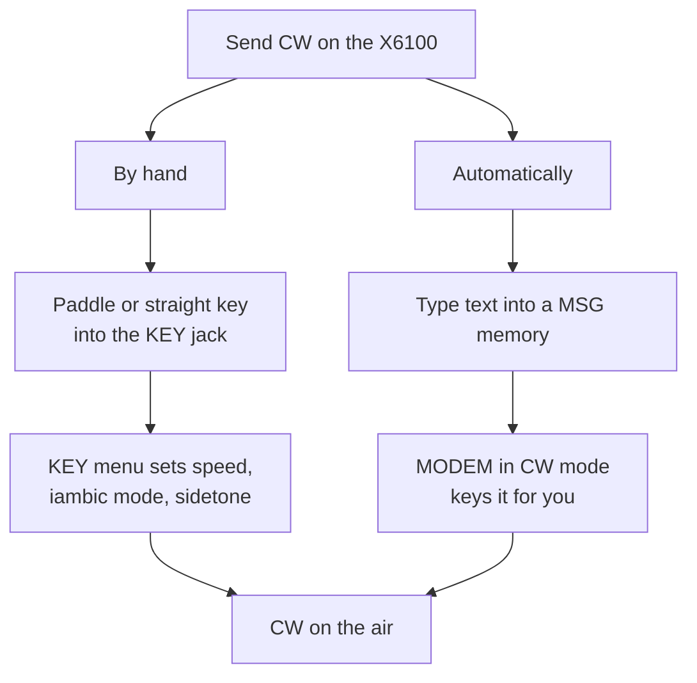

# CW: the keyer, messages and auto-call

Morse code — **CW**, for "continuous wave" — is the oldest voice on the amateur bands and, on a small battery-powered rig like the X6100, still one of the smartest. It sends further on fewer watts than any voice mode, cuts through noise and fading that would bury SSB, and needs so little bandwidth that a whole conversation fits in the gap between two speech syllables. The X6100 takes it seriously: a proper built-in electronic keyer with iambic modes and adjustable weight, an adjustable sidetone, full break-in, and — the part that surprises people — the ability to send stored messages hands-free, so it can call CQ or fire off a contest exchange while your hands stay on the log. This chapter explains all of it, gently, whether or not you can yet tell a dit from a dah. (If you cannot yet, the app's Morse trainer teaches both copying and sending — and its keyer simulator has an X6100 preset, so you can practise the exact keyer behaviour described below before touching the radio.)

## Why CW belongs on a QRP radio

Strip a radio signal down to its barest useful form and you get CW. There is no speech riding on the wave — just a single steady carrier that the operator switches **on and off** in the rhythm of the Morse alphabet. A short "on" is a **dit**, a long one (three times as long) a **dah**, and the pattern of dits and dahs spells out letters. That is the whole scheme; it is the simplest form of [modulation](outpost:entry/logbook73.handbook/modulation) there is, formally called on-off keying.

```viz
{
  "type": "wave",
  "title": "CW is the simplest signal there is — a carrier switched on and off",
  "caption": "The letter K (dah-di-dah): three 'on' bursts, the long ones three times the length of the short one. Your ear, not a circuit, turns the rhythm back into letters.",
  "xLabel": "time",
  "traces": [
    { "kind": "cw", "freq": 42, "pattern": [3, 1, 1, 1, 3], "tone": "primary", "label": "keyed carrier" }
  ]
}
```

That simplicity buys real advantages, and they matter most exactly where the X6100 lives — outdoors, on a modest antenna, running **5 watts from the internal battery** (10 W on external power). Because all the transmitter's energy goes into one narrow tone rather than being spread across kilohertz of speech, CW concentrates your [power](outpost:entry/logbook73.handbook/rf-power) where it counts: 5 W of CW routinely gets through when 5 W of SSB would not. It is also astonishingly narrow — a few hundred hertz — so you can wind the receiver's filters right down and shut out everything either side, and it survives the flutter of long-distance [propagation](outpost:entry/logbook73.handbook/propagation) far better than voice. Best of all for a newcomer, **the decoding happens in your head, not in a circuit**: you learn the rhythm the way you learned to recognise words, so a weak, wobbly note your ear can still follow is a note you can work.

CW lives at the **bottom of every HF band**. As with every mode on this radio, **you may only transmit with the appropriate licence and only in the segments your national band plan and licence conditions allow** ([HF](outpost:entry/logbook73.handbook/hf) and [Getting Licensed](outpost:entry/logbook73.handbook/getting-licensed) set the scene). Receive-only Morse practice must still follow local receiver and protected-communications law.

## Two ways to send CW

The X6100 gives you two quite different ways to put Morse on the air, and they use different controls — hold the shape of both in your head before the settings.



The first way is **by hand**: you plug a key or paddle into the side of the radio and send with your fingers, and everything about how that feels lives in the **`KEY` menu** — the heart of this chapter. The second is **automatic**: type a message once, store it, and let the radio's built-in **modem** key it out for you at a touch. Most operators use both — hand-sending for the conversation, stored messages for the repetitive bits like calling CQ.

## Connecting a key or paddle

Hand-sending plugs into the **`KEY` jack** on the right-hand side, a 3.5 mm **stereo (TRS)** socket whose three contacts carry a paddle's **dot** lever (`Di`), its **dash** lever (`Da`), and a common ground (`Com`). A **paddle** — two levers, one for dits and one for dahs — uses all three and drives the built-in keyer; that is the usual modern choice. A **straight key** — the classic single knob, where you time every element yourself — needs only two contacts, and you tell the radio to expect it with `KEY TYPE`, below.

Three cautions from the factory manual, because they can leave you stuck transmitting:

- **Power the radio off before you plug or unplug a key** — it can jump into transmit the instant a live plug touches the socket.
- Fit a proper 3.5 mm TRS plug rather than a cheap two-to-three-conductor adapter on an old 6.35 mm key: a mono plug or miswiring can hold the radio **keyed in transmit permanently**, and a wrong plug can damage the socket.
- If the radio sits in constant transmit the moment a key is connected, suspect the wiring or the plug first.

## Getting into CW mode

Press the top-panel **`CW`** button to select Morse; press it again to toggle **`CWR`** ("CW reverse"), which is identical but listens on the opposite sideband. You will rarely need `CWR`, but it is a neat trick: if interference sits right beside the station you are working, switching to `CWR` flips it to the other side of your note where the filter can reject it, without your retuning.

One quirk to learn straight away, because it is the classic "why isn't my CW going out?" trap: the X6100 only keys the transmitter when **break-in (QSK) is active**. With it disabled, pressing the paddle gives **sidetone in your headphones but no signal on the air** — a handy silent-practice mode, but a nasty surprise if you did not mean it. If you can hear yourself but no one comes back, check the `QSK TIME` setting before you blame the antenna.

## The KEY menu, item by item

Press the front-panel **`KEY`** button to open the keyer settings. They span **two pages** — the first appears immediately, and pressing `KEY` again flips to the second. On either page, press the physical soft-key under the displayed item and then rotate **MFK** to change that parameter. The GEN-only MFK-select/main-knob-change workflow does not apply here ([Getting Started](outpost:entry/logbook73.guide.x6100/getting-started) covers both patterns).

Each item carries a one-glance verdict, using the key you will see throughout this guide:

| Symbol | Meaning                                               |
| ------ | ----------------------------------------------------- |
| ✅     | Set it once and forget it — right for almost everyone |
| ⭐     | Genuinely useful, depending on how you operate        |
| ⚠️     | Advanced — understand it before you change it         |
| ❌     | Leave it off unless you have a specific reason        |

| Page | Item          | What it sets                               | Start at          |
| ---- | ------------- | ------------------------------------------ | ----------------- |
| 1    | `KEY TYPE`    | `MANUAL`, `AUTO-LEFT` or `AUTO-RIGHT`      | ✅ match your key |
| 1    | `KEY SPEED`   | Keyer speed in words per minute            | ⭐ 12–15 WPM      |
| 1    | `IAMBIC`      | Iambic squeeze behaviour, A or B           | ⭐ A to start     |
| 1    | `TONE`        | Sidetone (and receive) pitch               | ⭐ 600–700 Hz     |
| 1    | `TONE LEVEL`  | Sidetone volume in your ear                | ✅ comfortable    |
| 2    | `QSK TIME`    | Break-in delay — and the on/off for keying | ⭐ short, but on  |
| 2    | `DI/DA RATIO` | Dah-to-dit length ratio                    | ✅ 3.0            |
| 2    | `CW TRAINER`  | Built-in Morse practice mode               | ⭐ while learning |

### KEY TYPE — ✅ tell it which key you have

Chooses **`MANUAL`** for a straight key/external keyer, or **`AUTO-LEFT` / `AUTO-RIGHT`** for a paddle. LEFT/RIGHT tells the internal keyer which lever makes dits and which makes dahs, so it covers paddle handedness rather than a generic one-size-fits-all AUTO.

- **Does:** in MANUAL the radio follows whatever timing your straight key/external keyer produces. In AUTO-LEFT/AUTO-RIGHT the built-in **iambic keyer** forms timed dits/dahs; choose the orientation that makes the intended lever produce the intended element.
- **UK recommendation:** ✅ MANUAL for a straight key/external keyer; test AUTO-LEFT then AUTO-RIGHT with transmit disabled and keep the one matching your paddle/muscle memory.
- **Common mistake:** a paddle left on manual, so squeezing a lever gives one long unbroken dash instead of a string of dits.
- **Should you change it?** Once, then leave it. `KEY SPEED` and `IAMBIC` only act in AUTO-LEFT/AUTO-RIGHT.

### KEY SPEED — ⭐ start slow

Sets how fast the built-in keyer sends, in **words per minute (WPM)**, defaulting to `15 WPM`.

- **Does:** fixes the length of a dit — and therefore everything, since dahs and gaps are all multiples of a dit. WPM is measured against the standard word "PARIS" (50 dit-lengths), so 15 WPM is fifteen PARIS-lengths a minute.
- **UK recommendation:** ⭐ Set it to the speed you can reliably _receive_, not the fastest you can send — a contact only works at the pace of the slower ear. **12–15 WPM** is a comfortable start; nudge it up as your copy improves. (A straight key ignores this — its speed is whatever your hand does.)
- **Common mistake:** cranking the speed up to sound impressive, then being unable to copy the equally fast reply.
- **Should you change it?** Yes, freely — it is the one keyer setting you reach for often. Note the modem has its _own_ separate speed for auto-sent messages.

### IAMBIC — ⭐ mode A or mode B

Chooses how the keyer behaves when you squeeze **both** paddles at once, defaulting to `IAMBIC-B`.

- **Does:** holding both levers makes the keyer send **alternating dits and dahs** automatically. The question is what happens as you _release_: in **mode B** the keyer adds one extra, opposite element after you let go; in **mode A** it stops cleanly with the element already sounding.
- **Why it exists:** the two behaviours came from different early keyer designs, and operators trained on one find the other maddening — so the radio offers both.
- **UK recommendation:** ⭐ Starting fresh, try **mode A** — many learners find it more forgiving, with no surprise extra element to time around. If you already send comfortably in B, stay there. There is no "correct" choice; it is muscle memory, so pick one early and stick with it.
- **Related:** only relevant with a paddle and `KEY TYPE` on automatic.

### TONE — ⭐ the pitch you hear, and where you sit

Sets the frequency of the **sidetone** — the beep you hear as you send — defaulting to `800 Hz`, and doubling as your **receive pitch**.

- **Inside:** on CW the radio offsets its tuning so a station tuned to _this same pitch_ is exactly on your transmit frequency. So match an incoming note to your sidetone by ear and you are **zero-beat** — transmitting right where they are listening, not off to one side calling into empty space.
- **UK recommendation:** ⭐ **600–700 Hz** is restful over a long session; 800 Hz (the default) cuts through noise a shade better. The number matters less than picking one and sticking to it, because your zero-beating becomes automatic once your ear knows "the" pitch.
- **Related:** `TONE LEVEL` (its volume); the [filters](outpost:entry/logbook73.handbook/filters) you narrow around the note for weak-signal work.

### TONE LEVEL — ✅ how loud the beep is

Sets the **sidetone volume** in your ear (default `10`); it has no effect on the transmitted signal. ✅ Set it loud enough to hear your rhythm but soft enough that a weak station replying in the gaps is not drowned out. Set once and forget.

### QSK TIME — ⭐ break-in, and the keying on/off

Sets the **break-in (QSK) delay** in milliseconds, and on this radio it is effectively the master switch for whether CW transmits at all. Default `100 ms`.


- **Does:** "break-in" flips the radio back to _receive_ in the tiny gaps between your dits and dahs, so you hear the band — and anyone breaking in on you — even mid-word. `QSK TIME` sets how long it lingers in transmit after each element. A short delay gives true **full break-in**; a long one behaves like **semi-break-in**, staying in transmit through the small gaps and only returning to receive at the end of a word.
- **The trap:** with break-in disabled, the X6100 gives **sidetone but transmits nothing** — fine for silent practice, but the number-one cause of "my Morse isn't going out."
- **UK recommendation:** ⭐ Keep break-in **active** (or you will not transmit), and set a **short** delay so you hear the band between characters — what lets someone tail-end or correct you in real time. Lengthen it only if the rapid switching distracts you while learning.

### DI/DA RATIO — ✅ the weight of your sending

Sets the **dah-to-dit length ratio** — what operators call weight. Standard Morse makes a dah exactly three times a dit, so `DA/DI = 3.0` (equivalently DIT:DAH is `1:3`). ✅ Leave it at 3.0; it is not a speed control.

### CW TRAINER — ⭐ practise without transmitting

A built-in Morse **practice mode**, `OFF` by default, that pairs with the sidetone-only behaviour above so you can build your fist without going on the air. ⭐ Switch it **on while learning**, off once you are working real stations. The factory manual documents it only as a "training mode switch," so treat the finer points as something to explore on the unit — and note behaviour here has varied between firmware versions.

## Hands-free CW: preset messages and auto-call

Here is the feature that makes the X6100 a _comfortable_ Morse rig. Calling CQ by hand means sending the same string over and over — exactly the repetitive sending that wears out a new fist. The radio will do it for you: the **`MSG`** button stores the messages, and the **`APP > MODEM`** menu is the engine that keys them out.

### Storing your messages

Press **`MSG`** for the preset list. The radio holds **five text messages** (`MSG 1`–`MSG 5`), each sendable as **CW, RTTY or BPSK**. Select a slot with the corresponding physical soft-key to open the editor; current actions are `KEYBOARD`, `DELETE`, `SPACE`, `SAVE` and `EXIT`. `SAVE` stores the text and leaves the editor; `BACKSPACE` appears inside the nested on-screen keyboard rather than on the editor's main soft-key row. On the keyboard rotate MFK to a character and press to enter it. Good first messages, with your own callsign in place of the example:

| Slot    | Typical contents                 | Used for                    |
| ------- | -------------------------------- | --------------------------- |
| `MSG 1` | `CQ CQ CQ DE M0XYZ M0XYZ K`      | Calling CQ                  |
| `MSG 2` | `DE M0XYZ`                       | Answering, giving your call |
| `MSG 3` | `UR 599 599 BK`                  | A signal report             |
| `MSG 4` | `TU 73 DE M0XYZ K`               | Signing off                 |
| `MSG 5` | contest exchange, e.g. `599 001` | Contests                    |

(Those abbreviations — `DE` "from", `K` "over", `BK` "break", `73` "best wishes", `TU` "thank you", `599` a top report — are the everyday shorthand of CW, picked up quickly by using them.)

For voice-message recording, current V1.6 documents the **hand microphone** as the source. It does not promise that the radio's built-in mic records those voice slots; turn MONI LEVEL off to avoid echo.

### Sending them automatically

1. Press **`APP`**, then **`MODEM`**.
2. Set the modem's **`MODE`** to **`CW`** (the same menu offers `RTTY` and `BPSK`), and set **`RATE/SPEED`** to your sending speed — the modem's _own_ speed control, separate from the paddle's `KEY SPEED`.
3. With the modem showing, press **`MSG`**. The five slots appear along the bottom, each previewing its text.
4. Press the physical soft-key corresponding to a slot. The radio keys that message out as CW until it finishes, then returns to receive.

So calling CQ becomes: press the soft-key for `MSG 1`, listen, then press it again if no one answers — no repetitive hand-sending. In a contest, one press on the `MSG 5` soft-key sends your exchange each time. It is the same trick a full-size contest station uses, built in.

### Reading incoming CW

The modem works the other way too: in CW mode it **decodes** received Morse into a text window, which can help confirm what your ear is hearing. Be honest about its limits, though — machine decoders read clean, machine-perfect sending well but stumble on hand-sent rhythm, weak signals and interference, which is most of real HF. Treat the text as a training wheel, never a replacement for learning to copy by ear.

### The voice parallel

For completeness: `APP > VOICE CALL` plays back **five recorded voice messages** (stored on the second page of the `MSG` menu, up to 1 min 30 s each) — the SSB/FM equivalent of a CQ macro. Not CW, but the same idea, reached through the same `MSG` button.

## A note on firmware and CW

Stock firmware gives a genuinely usable keyer and a serviceable auto-call, but two rough edges are worth knowing. There is **no dedicated CW peaking filter** — to get a tight, quiet window around your note you narrow the passband yourself in the `DFL` filter menu (a few hundred hertz wide, shutting out everything either side). And the built-in decoder is basic.

CW is also where the well-known **community firmware** shines. Because the X6100 runs Linux, an alternative image (originally R1CBU's, now continued as OpenX6100 by gdyuldin) can boot entirely from the SD card — remove the card and you are back to stock, nothing permanently changed — adding a much better **CW decoder with a live WPM readout**, a click-to-tune trick for jumping onto a signal in the waterfall, wider and narrower filters, and **automatic CQ** calling. Xiegu treats third-party firmware as voiding the warranty, but the SD-boot approach is reversible. As with everything version-dependent on this radio, versions move quickly — if a CW feature here is missing or behaves differently, your firmware version is the first thing to check.

## Try it yourself

None of the first steps needs you to transmit — and you should only key up with the appropriate licence, in the CW segment of a band you are permitted to use.

1. **Learn a letter by watching it.** With a key connected and `CW TRAINER` on (sidetone only, no RF), send `K` — dah, di, dah — and hear the rhythm match the waveform above. Then try `R` (di-dah-di) and `A` (di-dah).
2. **Set your pitch and speed.** Press `KEY`, set `TONE` to a note you find restful, `KEY SPEED` to 12 WPM, and `IAMBIC` to A. Send a few letters and feel the keyer form them.
3. **Prove the break-in trap.** With break-in off, key the paddle and confirm you hear sidetone but the TR indicator does _not_ go red. Enable it with a short `QSK TIME` and watch the indicator light as you send — the difference between practice and transmitting.
4. **Store and preview a CQ.** Press `MSG`, edit `MSG 1` to your own CQ call, save it, then open `APP > MODEM`, set `MODE` to `CW`, press `MSG`, and read the preview under the slot.
5. **Listen and decode.** Tune to the CW portion at the bottom of a band you may receive on, narrow the `DFL` filter around a note, and race the modem's decoder with your own ear.

## Key takeaways

- **CW is a carrier switched on and off** in Morse rhythm — the narrowest, most power-efficient way to communicate, which is why 5 W of CW from the internal battery gets through where 5 W of SSB will not.
- The **`KEY` menu** (two pages) sets the keyer: `KEY TYPE` for straight key vs paddle, `KEY SPEED` in WPM, `IAMBIC` A or B, and the `TONE`/`TONE LEVEL` sidetone. Start slow (12–15 WPM), pick one iambic mode and keep it, choose a restful pitch.
- The **sidetone pitch is also your receive pitch** — match an incoming note to it by ear and you are zero-beat, transmitting exactly where the other station listens.
- **Break-in (`QSK TIME`) must be active for CW to transmit** — with it off you get sidetone but no signal, the classic "why won't it send?" trap; keep it on and short so you hear the band between characters.
- **Five text messages (`MSG`)** sent through the **`APP > MODEM`** engine in CW mode give you hands-free CQ calls and contest exchanges; the modem also decodes incoming CW, though your ear will always beat it.
- **Firmware matters for CW:** stock has no CW peaking filter (narrow the `DFL` passband instead) and a basic decoder, while the reversible SD-card community firmware adds a far better decoder, auto-CQ and click-to-tune.

With your fist and your macros sorted, the next thing between you and a good signal is the antenna — where the X6100's built-in tuner and SWR scanner earn their keep: [The ATU & SWR Scanner](outpost:entry/logbook73.guide.x6100/atu-swr).
