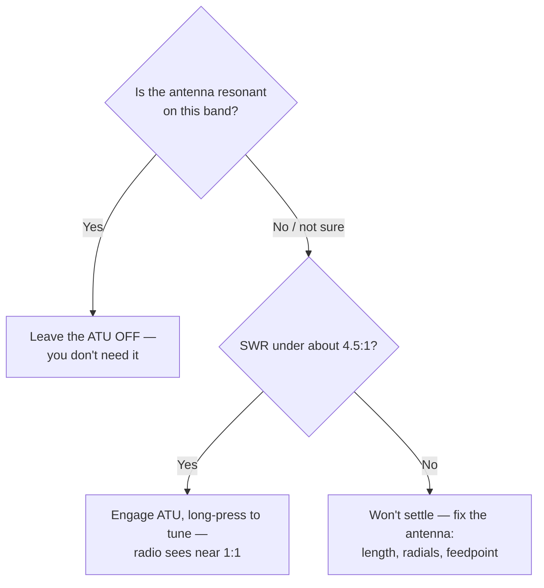

# The antenna tuner and SWR scanner

Two jobs stand between your X6100 and a signal that actually gets out into the world: **matching** the antenna to the radio, and **measuring** whether the antenna is any good in the first place. The X6100 carries a built-in tool for each — an automatic antenna tuner (ATU) that hides a mismatch from the transmitter, and an SWR scanner that draws you a picture of how your antenna behaves across a band. Together they turn "will this bit of wire work?" from a guess into a two-minute check. This chapter explains what each does, what neither can do, and how to drive them without transmitting where you should not.

## First, the idea: why matching matters

Every part of a transmit chain likes to work into a particular load. The X6100's power amplifier is designed to deliver its watts into **50 ohms** — that is the impedance of the coax, the BNC socket, and (ideally) the antenna at its feedpoint. When everything is 50 ohms, power flows out smoothly and nothing bounces back.

An antenna rarely obliges. Its [impedance](outpost:entry/logbook73.handbook/impedance) depends on its length, its height, what is near it and — above all — the frequency you use it on. Get all of that right and it looks like 50 ohms; get it a little wrong and it looks like 30 ohms, or 120, often with some reactance stirred in. Now the radio and the antenna no longer agree, some of your transmit power is **reflected** back down the coax instead of radiating, and that reflected wave interfering with the forward wave is what we measure as **SWR** — the standing wave ratio. A perfect match is `1:1`; `2:1` is a modest mismatch; `4:1` is a poor one. Where standing waves come from is covered in [SWR](outpost:entry/logbook73.handbook/swr) and [Transmission Lines](outpost:entry/logbook73.handbook/transmission-lines) — everything below rests on it.

A high SWR does two unwelcome things at once: it **wastes** the power you can least afford at QRP levels, and it can make the radio's protection circuit throttle the transmitter back to save itself. So before you call CQ, you want the X6100 to see something close to 50 ohms — which is exactly what the ATU is for.

## What an ATU actually does — and what it does not

An **antenna tuner** is not, despite the name, a device that tunes your antenna. Nothing about the aerial in the sky changes when you run it. What it really is, is an **impedance-matching network** — a little box of switchable [inductors and capacitors](outpost:entry/logbook73.handbook/filters) sitting between the transmitter and the feedline, arranged on the fly so that the _radio_ looks down the cable and sees a tidy 50-ohm load, whatever the antenna is actually presenting.


Read that chain carefully, because the position of the ATU is the whole point. On the X6100 the tuner sits **inside the radio**, right after the PA and before the BNC socket. It can therefore make the amplifier happy — restoring full power transfer and letting the radio run at its rated output — but it can only do that for everything on _its own_ side of the network. Beyond the ATU, out along the coax to the antenna, the mismatch is untouched.

That leads to three honest truths every operator should carry:

- **An ATU does not make your antenna radiate better.** It changes what the _radio_ sees, not what the _antenna_ does. A poor radiator with an ATU in front of it is still a poor radiator — it just no longer upsets the transmitter.
- **An ATU does not remove the SWR on the feedline between it and the antenna.** Because the X6100's tuner is at the radio end, the standing waves still live on the coax running out to the aerial, and any loss they cause is still paid. The tuner hides the mismatch _from the radio_, it does not cancel it _on the line_.
- **An ATU does not make an antenna resonant.** Resonance is a property of the antenna's physical dimensions at a frequency. A tuner fakes a match electrically; it does not lengthen or shorten your wire.

None of that makes the ATU useless — far from it. It is what lets you throw a random length of wire over a branch on a hilltop and get on the air _now_, and it protects your PA when your resonant dipole drifts a little off frequency at the band edges. But knowing the limits stops you expecting magic, and stops you leaning on the tuner when the real fix is the antenna. The deeper theory — matching networks, the Smith chart, why loss creeps in — lives in [Impedance](outpost:entry/logbook73.handbook/impedance), [SWR](outpost:entry/logbook73.handbook/swr) and [Antennas](outpost:entry/logbook73.handbook/antennas).

## The X6100's built-in ATU

The X6100 has an efficient automatic tuner built in, and for a radio this size it is one of its most useful features — the thing that makes a "grab a wire and go" antenna practical. The headline specifications from the manual:

| Specification      | Value                     | What it means for you                                 |
| ------------------ | ------------------------- | ----------------------------------------------------- |
| Matching range     | up to about **4.5:1** SWR | It can rescue a moderate mismatch, not a wild one     |
| First (full) tune  | **≤ 15 seconds**          | Searching from scratch takes a few seconds            |
| Memory-recall tune | **≤ 0.2 seconds**         | It remembers matches and snaps back to them instantly |
| Antenna socket     | **50 ohm** BNC            | Standard coax and a BNC-to-PL259 adaptor, if needed   |

Two of those deserve a word. The **4.5:1 matching range** (the manual writes it "VSWR 1:4.5") is the boundary of what the tuner can fix: hand it an antenna already within about 4.5:1 of 50 ohms and it will pull the radio down to near `1:1`; hand it something worse and it will shrug and leave you with a high SWR. This is a _limited-range_ tuner — sensible for its size, but not the wide-range "tune anything" transmatch some pricier base-station ATUs claim.

The **memory-recall** figure is a quiet gift. Once the tuner has found a good match on a frequency, it stores the L and C settings, so when you come back to that part of the band it recalls them in a fifth of a second rather than searching all over again. In practice the ATU feels instant everywhere you have already tuned.

## Running a tune, step by step

The tuner is driven by the top-panel **[ATU]** button (button 35, described in [Getting Started](outpost:entry/logbook73.guide.x6100/getting-started)), and it works in two distinct stages — which is the single most common source of confusion, so go slowly.

**Stage one — bring the tuner into circuit.**

- **Short-press [ATU].** An **`ATU`** icon appears in the status row along the top of the screen. This puts the matching network _in line_ — but, in the manual's own words, "the functions are only enabled but not working." Nothing has been matched yet; you have simply switched the tuner into the signal path, ready to act.

**Stage two — run the actual tune.**

- With the `ATU` icon showing, **long-press [ATU] for about one second.** The radio transmits a brief low-level carrier and the tuner hunts through its inductor and capacitor combinations until the SWR drops as low as it can get it. A full search takes up to fifteen seconds; usually far less. When it finishes it returns to receive on its own.

That is the whole operation: short-press to engage, long-press to tune. (On the supplied hand microphone the **TUNER** button does the same pair of jobs — a short press switches the tuner in or out of circuit, a long press runs a tune — handy when the radio is out of easy reach.)

**Reading the result.** After a tune, key up briefly (antenna connected, on a frequency you are licensed to use) and watch the top of the screen:

- No warning: the match is good. Get on with it.
- A flashing **`SWR`** icon appears while you transmit: the standing wave is _still_ too high — the antenna was outside the 4.5:1 range, or something moved. **Run the tune again**, and if it still will not settle, the problem is the antenna, not the tuner (see below).

Two rules the manual is firm about, and both catch people out:

- **Leave the tuner engaged to use its match.** Once tuned, the `ATU` network must stay in circuit — if you short-press [ATU] again and drop it out, you are back to the raw antenna and the match is gone.
- **Turn the ATU off on an antenna that is already resonant. ⭐** If your dipole or resonant vertical is naturally happy on the band, the tuner has nothing useful to do and only adds a whisker of loss and complexity. Drop it out of circuit (short-press until the `ATU` icon clears) and enjoy the clean match the antenna gives you for free.



### A safety and courtesy note

Tuning **transmits**. The X6100 radiates a real, if small, RF signal while the ATU searches, so you may only run a tune with the appropriate [licence](outpost:entry/logbook73.handbook/getting-licensed), on a frequency your licence permits, with a proper antenna (or dummy load) attached — never into an open socket. The manual adds a specific warning worth repeating: tuning against a **whip antenna** can throw strong RF interference into the radio itself and nearby electronics. A short whip also sits close to you, so keep tuning brief, keep the power modest, and keep the radiating element away from your body — the general reasoning is in [RF Power](outpost:entry/logbook73.handbook/rf-power).

## Matching range and its limits, honestly

The `4.5:1` ceiling is where beginners meet reality. If the tuner refuses to settle — a flashing `SWR` icon that will not clear across two or three attempts — no amount of re-tuning will help, because the antenna is presenting a load the network physically cannot reach. That is a message about the antenna, and the fixes are all at the antenna end:

- **Length.** A wire cut roughly for the band gives the tuner a load it can work with. A random length that happens to look like a few ohms, or a few thousand, on your chosen frequency may sit outside the range. Adding or trimming a metre or two of wire often brings it home.
- **A counterpoise or radials.** End-fed wires and verticals need something to work against. Without a decent ground or a counterpoise, the feedpoint impedance wanders wildly and the tuner struggles. Add a counterpoise wire (a quarter-wave for the band is a good start) and the whole picture steadies.
- **The feedpoint itself.** A high-impedance antenna such as an end-fed half-wave wants a **matching transformer** (a 49:1 or 9:1 "unun") at the feedpoint to get within range before the coax even starts — leaving the internal ATU only a small final trim to do.

The deeper point for a QRP operator is that the tuner buys you _convenience_, not _efficiency_. It will happily present a beautiful `1:1` to the radio while your antenna quietly wastes half your five watts as heat in a poor match or a bad ground — the notorious "tuning into a light bulb." A **resonant, efficient antenna is worth more than any tuner**, and on HF at low power the antenna is almost always the thing that decides whether you are heard. Use the ATU to get on the air and to smooth out band-edge mismatches — but if a band is disappointing, suspect the aerial, and reach for the second tool on this page to find out.

## The SWR scanner: a picture of your antenna

Where the ATU _hides_ a mismatch, the **SWR scanner** _reveals_ it. It is a small sweeper built into the radio: it steps the transmitter across a slice of spectrum, measures the SWR at each point, and plots the result as a curve of **SWR against frequency**. That curve is the single most useful thing you can know about an antenna, because it tells you at a glance where the antenna is happy and where it is not — and by how much.

A well-behaved antenna draws a distinctive shape: a broad, high plateau where it is mismatched, dropping into a clean **dip** at the frequency where it is resonant and the SWR is lowest.

```viz
{
  "type": "response",
  "title": "An SWR sweep of a real antenna",
  "caption": "The scanner plots SWR across the swept span. The dip marks resonance — where the antenna is best matched. Here it sits a little low in the band, so the antenna is slightly too long.",
  "curve": { "preset": "swr", "f0": 42, "bw": 34 },
  "markers": [{ "x": 42, "label": "resonance — lowest SWR" }],
  "xLabel": "frequency across the swept span",
  "yLabel": "SWR"
}
```

Reading that dip is the whole skill, and it is easy:

- **Where the dip sits** is where the antenna is resonant. If the lowest point falls _below_ your operating frequency, the antenna is electrically **too long** — shorten it. If the dip sits _above_ your frequency, the antenna is **too short** — lengthen it. (A useful rule for wire antennas: to move the dip _up_ in frequency, trim a little off; to move it _down_, add a little on.)
- **How deep the dip goes** tells you how good the match is at its best — you want it comfortably under `2:1`.
- **How wide the dip is** tells you the antenna's _bandwidth_ — a broad dip means it stays well-matched across a lot of the band; a narrow, sharp dip (typical of short or loaded antennas) means it is fussy about frequency and you will be reaching for the ATU as you move around.

### Running a sweep

The scanner lives in the **APP** menu, not on a dedicated button:

- **Switch the internal ATU OFF first** (clear the `ATU` icon). Otherwise the scanner can measure the tuner's matched input rather than the raw antenna/feedline you are trying to assess.
- Tune the main VFO to roughly the **centre** of the range you want to check.
- Press **[APP]**, then the **[SWR SCAN]** soft-key. The screen switches to the **SWR SCANNER** view: a graph with SWR up the left (marked from `1` at the bottom upward) and frequency along the base, with the sweep drawing across it.
- Adjust the sweep with two soft-keys:

| Soft-key  | What it sets       | In plain terms                                                                                                                             |
| --------- | ------------------ | ------------------------------------------------------------------------------------------------------------------------------------------ |
| **SPAN**  | Scanning bandwidth | How wide a slice the sweep covers. A wide span shows a whole band at once but coarsely; a narrow span zooms in on the dip for a fine trim. |
| **SPEED** | Scanning speed     | How fast it sweeps. Faster is quicker but coarser; slower gives a smoother, more detailed curve.                                           |
| **EXIT**  | —                  | Leaves the scanner and returns to normal operation.                                                                                        |

Start with a **wide span** to find roughly where the dip is, then narrow the span around it and re-sweep to pin the resonant point precisely. Trim or extend the antenna, sweep again, and repeat until the dip sits where you want it. (The exact SPAN and SPEED values on offer, and some of the scanner's finer behaviour, vary between firmware versions — treat the numbers on your unit as the authority.)

### The same caution as tuning

A sweep **transmits across the whole span**, stepping a small carrier through every frequency in the range. Two consequences follow. First, you may only sweep with a licence, and you must keep the _entire span_ inside a segment you are permitted to transmit on — a wide sweep centred near a band edge can spill your test signal outside the band, which is not allowed. Second, you are briefly putting RF onto a stretch of spectrum other people may be using, so keep spans sensible and sweeps brief, and do not sweep across a band you can hear is busy.

## SWR scanner versus a NanoVNA

The built-in scanner is convenient, but it is not the last word in antenna measurement. The standalone tool most amateurs eventually own is a **[NanoVNA](outpost:entry/logbook73.handbook/nanovna)** — a pocket vector network analyser costing very little — and it is worth understanding the trade-off.

|                     | X6100 SWR scanner                                  | NanoVNA                                                                                                                        |
| ------------------- | -------------------------------------------------- | ------------------------------------------------------------------------------------------------------------------------------ |
| **How it measures** | Transmits a real carrier and reads reflected power | Sends a much lower-level swept test signal                                                                                     |
| **Legal boundary**  | Use only where your licence permits transmission   | Into an antenna it still emits: keep sweeps within local authorisation/exemptions; a dummy load does not radiate intentionally |
| **What it shows**   | SWR versus frequency                               | SWR _plus_ resistance, reactance, a Smith chart, phase, cable length                                                           |
| **Frequency range** | Around the HF/6 m ham region                       | Typically tens of kHz up to GHz — well beyond the bands                                                                        |
| **Convenience**     | Already in the radio, at the antenna you are using | A separate device with wider measurement coverage; local emission rules still apply                                            |

The honest summary: the X6100's scanner is a brilliant **quick field check** — it uses the antenna and coax you are actually operating with, and it needs nothing extra in the bag. But because it transmits, it is limited to frequencies you may key up on, and it tells you only _how bad_ the match is, not _why_. A NanoVNA uses far less test power and shows the [resistance and reactance](outpost:entry/logbook73.handbook/impedance) behind the SWR. Connected to a radiating antenna it still emits a swept signal, so keep it within your local authorisation/exemptions; use a dummy load or non-radiating bench setup when appropriate. Many operators use both tools.

### External amplifier drive is model-specific

Do not transfer one amplifier's drive number to another. X6100 guidance for the **XPA125B** is **≤2.5 W**. The current manufacturer V1.6 appendix separately documents an **X6100 → L4001 → GPA100** path with automatic band/ALC handling and recommends **2–5 W** drive. Those are different products and control paths: follow the matching amplifier manual, start low into a dummy load, and never use the GPA100 range as permission to overdrive an XPA125B.

## Putting it together in the field

A sensible portable routine ties the two tools into one flow: set the antenna up and connect it; **sweep** the band to see where it is resonant and how good the match is; if the dip is roughly right and under about `2:1`, leave the ATU off and operate; if the match is workable but not perfect (up to that `4.5:1` limit), **engage the ATU and long-press to tune**; and if the sweep shows the antenna badly off, fix the _antenna_ before blaming the radio. Measure first, match second, and rebuild the aerial last — only when the numbers tell you to.

## Try it yourself

With a licence, a proper antenna and a frequency you are allowed to use:

1. **Sweep before you tune.** Open **[APP] → [SWR SCAN]**, set a wide **SPAN**, and sweep the band your antenna is cut for. Find the dip. Is it where you expected? Note whether it sits above or below your operating frequency — that tells you if the antenna is short or long.
2. **Zoom in.** Narrow the SPAN around the dip and sweep again to read the resonant point precisely. This is exactly how you would trim a wire to frequency.
3. **Feel the two-stage ATU.** Short-press **[ATU]** and watch the `ATU` icon appear — the tuner is now in circuit but idle. Long-press for a second and listen to it hunt; watch it return to receive. Key up briefly and confirm no `SWR` icon flashes.
4. **Prove the "resonant needs no tuner" point.** On an antenna your sweep showed is already well-matched, short-press [ATU] to drop the tuner out and confirm the radio is still perfectly happy — you have just saved yourself a needless step and a sliver of loss.
5. **Find the limit.** If you have a deliberately awkward antenna (a short whip with no counterpoise, say), try to tune it and watch the `SWR` icon refuse to clear. That flashing icon is the 4.5:1 ceiling telling you the fix is at the antenna.

## Key takeaways

- An **ATU is an impedance matcher**, not an antenna improver: it makes the _radio_ see 50 ohms so the PA delivers full power, but it does **not** make the antenna radiate better, **does not** lower the SWR on the feedline beyond it, and **does not** make the antenna resonant.
- The X6100's tuner is **internal, automatic and limited-range** — it matches up to about **4.5:1**, tunes in ≤15 s, and recalls stored matches in ≤0.2 s.
- Drive it in two stages: **short-press [ATU]** to bring it into circuit (`ATU` icon), then **long-press ~1 s** to run a tune; a flashing **`SWR`** icon on transmit means re-tune, and if it will not settle the antenna is outside range.
- **Turn the ATU off on a resonant antenna** — it only adds loss when it has nothing to do — and remember that **tuning transmits**, so it needs a licence, a real antenna, and care around whips.
- The **SWR scanner** (APP → SWR SCAN) sweeps the transmitter across a span and plots SWR versus frequency: the **dip is resonance**, its position tells you if the antenna is too long or too short, and its width tells you the usable bandwidth. It transmits, so keep the whole span inside a band you may use.
- The scanner is a superb **field check**; a low-level **[NanoVNA](outpost:entry/logbook73.handbook/nanovna)** sweep goes further, revealing the resistance and reactance behind the SWR. A NanoVNA still emits RF into a connected antenna, so keep its sweep within spectrum your licence or local exemption permits — the two tools complement each other.
- At QRP, **the antenna decides whether you are heard** — measure first, match second, and rebuild the aerial last only when the sweep proves you must.

With the antenna matched and measured, the last piece is getting the radio talking to the outside world — computers, USB audio, Bluetooth input devices, WLAN and digital modes — in [Connectivity: USB/CAT, Bluetooth, WLAN & Data (FT8)](outpost:entry/logbook73.guide.x6100/connectivity).
