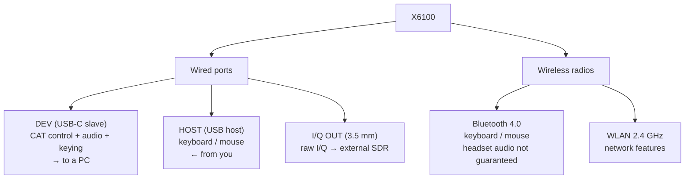
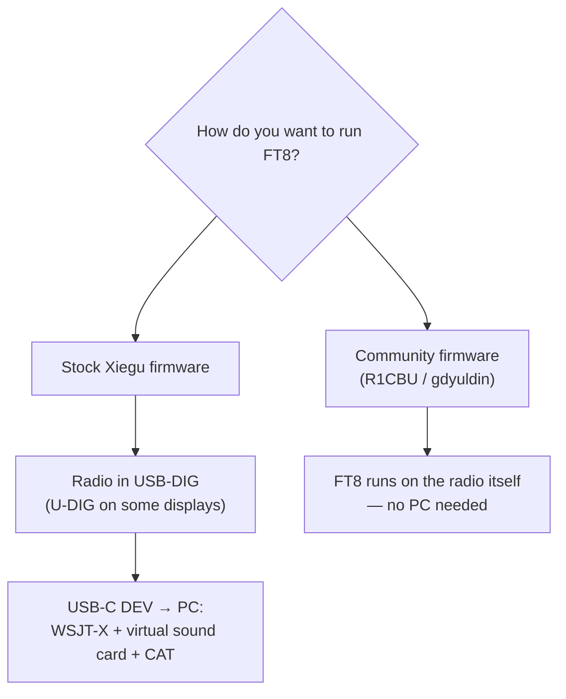
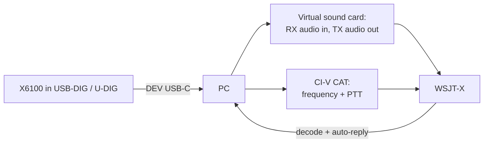

# Connectivity: USB/CAT, Bluetooth, WLAN and data (FT8)

Everything so far has been the X6100 talking to the _air_. This chapter is about the X6100 talking to _everything else_ — a laptop running FT8, a Bluetooth keyboard, your home network, an external panadapter. Because the radio is a [software-defined radio](outpost:entry/logbook73.handbook/software-defined-radio) with a small Linux computer inside, it connects to the outside world more like a clever peripheral than a traditional rig: a single USB-C cable can carry rig control, receive audio, transmit audio and keying all at once. Get that one path working and the whole world of digital modes — [FT8](outpost:entry/logbook73.handbook/ft8) above all — opens up, no soundcard box required.

Throughout, the same one-glance verdict key is used as elsewhere in this guide: ✅ set-and-forget · ⭐ genuinely useful, depends on how you operate · ⚠️ advanced, understand it first · ❌ leave off. And one standing caution before we start: much of what follows changes with firmware. The X6100 has been through many builds, its wireless features arrived and matured _over_ that history, and there is a thriving community-firmware scene that reworks connectivity entirely. Where behaviour is version-dependent, this chapter says so rather than pretending there is one fixed answer.

## The connectivity surface: two USB ports and three radios

Before any settings, get the map of physical connections clear, because the single most common newcomer muddle here is mixing up the two USB ports — and they do opposite jobs.

On the **right-hand side** of the radio, behind the buttons, sit seven sockets: **CARD** (the microSD slot used by stock firmware for updates and backup/transfer of memory channels and voice-keyer recordings), **DEV**, **HOST**, and — lower down — **S/P**, **KEY**, **ACC** and the RJ45 **MIC**. Community builds may add SD-card logs and other workflows; those are not stock promises. The two ports we care about most are `DEV` and `HOST`:

- **DEV** is a **USB-C "slave" port**. _Slave_ means the radio is the peripheral and a computer is in charge: you plug a PC into DEV and the PC drives the radio. This is the port for computer control and digital modes.
- **HOST** is a **USB "host" port**. _Host_ means the radio is in charge and drives a peripheral: you plug a keyboard, mouse or memory stick into HOST and the _radio_ uses it. This is the port for input devices.

Get those two straight — _DEV faces the computer, HOST faces your keyboard_ — and half the confusion evaporates. On the **left-hand side** sits one more connectivity port worth knowing: **I/Q OUT**, a 3.5 mm analogue jack that streams the raw [I/Q signal](outpost:entry/logbook73.handbook/iq-signals) out to an external SDR (covered near the end). And inside the case are **two more "radios" you never see** — a 2.4 GHz **WLAN (WiFi)** transceiver and a **Bluetooth** transceiver — each with its own settings screen.



## USB CAT and CI-V — letting a computer drive the radio

This is the big one, and the foundation for everything digital. **CAT** stands for _Computer Aided Transceiver_ — a serial link over which a program on your PC can read and change the radio's frequency, mode, filters and transmit state, and can key it up and down. It is how logging software knows what band you are on, how a contest program spots and jumps, and how [FT8](outpost:entry/logbook73.handbook/ft8) tunes and transmits for you.

The X6100 uses an Icom-compatible **CI-V** command path, but software names that compatibility in different ways. Prefer a tested **X6100** profile when your application provides one. For Xiegu's official OmniRig/JTDX FT8 procedure, select **`IC-7000`** at **`19200` baud**. An older generic X6100 connection appendix instead documents an **`X108G`** compatibility profile, so that remains a useful legacy fallback where an application specifically expects it. Do not assume that one profile name is universal: use the recipe for the program in front of you and verify that frequency, mode and PTT all follow correctly before transmitting.

### Setting up CAT over the DEV port — ⭐ essential if you want a computer

- **What it does:** turns the USB-C `DEV` port into a computer-control link _and_ a two-way audio path, so a PC can command the radio and hear/feed its audio down the same cable.
- **Inside:** the DEV port carries a **USB-to-serial chip (the WCH CH342)** for the CI-V control data, _plus_ a **USB Audio Class device** — a "virtual sound card" the radio presents to the PC. The computer sees a COM/serial port _and_ a new microphone-and-speaker, all over the one lead. There is no separate SignaLink-style interface to buy; the interface is built in.
- **How to set it up:**
  1. Connect a USB-C cable from `DEV` to the PC.
  2. **Install the CH342 driver** if your system needs it. Modern Windows and recent Linux usually find it automatically; older Windows and macOS may need the CH34x/CH342 driver from the chip maker.
  3. In your control/logging software, choose its tested **X6100** profile when available. In the official OmniRig/JTDX recipe choose **`IC-7000`**, set **`19200` baud**, and point it at the first of the two CH342 COM ports. If it does not respond, try the second port. Use the older **`X108G`** compatibility profile only where the application's own instructions call for it.
  4. For receive/decoder audio, select **`Microphone (USB Audio)`** as the PC **input/recording** device: that is radio RX flowing into the computer. For transmit tones, select **`Loudspeaker (USB Audio)`** as the PC **output/playback** device: that is computer audio flowing into the radio. The endpoint names describe the PC's perspective and must not be swapped.
- **The two-COM-ports quirk:** the CH342 is a _dual_ serial chip, so the X6100 typically shows up as **two COM ports** (often SERIAL-A/SERIAL-B or two numbered COM devices). Do not assign fixed roles by guesswork. Follow the application-specific recipe; Xiegu's official OmniRig/JTDX flow starts with the first port and says to try the other if CAT does not connect.
- **UK recommendation:** ⭐ Set this up once. It is the gateway to FT8, logging and computer CW across 6 m and the HF bands the X6100 can transmit on.
- **Example:** you plug DEV into a laptop, configure OmniRig as `IC-7000` at `19200` baud, set PTT to `CAT`, and select the radio's USB audio devices — you are ready to prove receive and control before transmitting.
- **Common mistakes:** treating one rig-profile name as universal; forgetting the audio half and wondering why the waterfall on the PC is silent; picking the wrong one of the two COM ports; leaving another program holding the port so the second one cannot open it.
- **Related:** the [FT8 workflow](outpost:entry/logbook73.handbook/ft8) below; computer CW (next); the `S/P` audio jack, which you do **not** need for USB digital modes.
- **Should you change it?** Yes, if you ever want a computer involved — it is the single most useful connection the radio makes.

### Computer CW keying — ⭐ for contesting and macros

Xiegu documents connecting **N1MM+** through the DEV port for computer CW. Follow N1MM's current X6100 procedure and test its selected serial device into a dummy load before relying on it. The manuals do not establish a universal “one port is CAT, the other is keying” assignment, so do not hard-code SERIAL-A/SERIAL-B roles from an owner post or from a different application. If you would rather key by hand or from the internal keyer, that lives in [CW: the Keyer, Messages & Auto-call](outpost:entry/logbook73.guide.x6100/cw-keyer).

## USBHOST — a keyboard and mouse for the radio

The `HOST` port faces the _other_ way: it lets the radio drive a standard USB **keyboard or mouse** (or read a USB stick). Plug one in and you can type and click directly on the X6100's own screen.

- **What it does:** attaches a physical keyboard/mouse to the radio so you can type text and navigate without the fiddly on-screen keyboard and MFK-knob character picker.
- **Why it exists:** the built-in [MSG](outpost:entry/logbook73.guide.x6100/cw-keyer) editor, callsign entry and the community firmware's logbook all involve _typing_, and a real keyboard is transformingly quicker than dialling letters one at a time with a knob.
- **UK recommendation:** ⭐ Keep a small USB keyboard in the go-bag if you send preset messages, log on the radio, or run the alternative firmware — it is the difference between "just about usable" and "pleasant".
- **Adapter note:** depending on your keyboard's plug you may need a simple USB adapter (for example USB-C to USB-A) to reach the HOST socket. Any ordinary wired HID keyboard/mouse should work; exotic gaming devices with their own drivers may not.
- **Common mistakes:** plugging the keyboard into `DEV` (the slave port — nothing happens) instead of `HOST`; expecting the HOST port to charge or program the radio (it does neither).
- **Should you change it?** Add one when you find yourself typing on the radio; skip it if you never do.

## Bluetooth — keyboard/mouse input, with an audio caveat

The X6100 carries a **Bluetooth 4.0** radio. A wireless **keyboard or mouse** is a dependable documented use. The extended appendix also documents **SPP virtual-serial/CI-V** control with compatible software such as FLRIG/OmniRig; treat its port/profile steps as application- and firmware-specific. The source record conflicts on audio: Xiegu's product page advertises wireless audio, but the detailed stock manual says a headset may pair/connect while the radio cannot route receive audio to it or accept its microphone. APP V1.2.0 notes change Bluetooth UI logic but do not resolve that routing contradiction. Treat headset audio as build-dependent and do not rely on it merely because pairing succeeds.

### The Bluetooth settings screen — ⭐ pair as needed

- **Where:** press **GEN**, choose the on-screen **SYSTEM SETTING** soft-key, and select **Bluetooth**. The screen lists nearby/paired devices on the left and a master **Bluetooth** on/off toggle on the right.
- **The soft-keys:** current documentation shows **OFF/ON**, **SCAN**, **CONNECT/DISCONNECT** and **EXIT**.
- **How to pair:** turn Bluetooth **ON**, put the keyboard/mouse into pairing mode, press **SCAN**, highlight it with the MFK knob and press **CONNECT**. A paired device can show `paired` beneath its name.
- **What it is good for:** keyboard/mouse typing and navigation on stock firmware. A headset appearing as paired proves discovery, not usable audio routing.
- **UK recommendation:** ⭐ Use it for input devices and test the exact installed APP/BASE before trusting any other profile. Use a correctly wired stereo lead/headphones for predictable audio.
- **Common mistakes:** leaving Bluetooth on and draining the battery; assuming a paired headset must carry receive/mic audio; hunting for a device that is not actually in pairing mode.
- **Related:** the HOST port (the wired equivalent for keyboards/mice); [FT8](outpost:entry/logbook73.handbook/ft8), which does **not** use Bluetooth audio — digital modes go over the USB virtual sound card, not Bluetooth.
- **Should you change it?** Turn it on when you want a wireless keyboard/mouse; otherwise leave it **off** to save power.

## WLAN (WiFi) — joining a network

The internal **WLAN** radio is **2.4 GHz only, 802.11 b/g/n**, with **WEP / WPA-PSK (TKIP) / WPA2-PSK (AES)** security. It joins your home or phone-hotspot network much as any device does — but be honest with yourself about _why_, because on stock firmware WiFi's practical payoff is modest and firmware-dependent (newer builds add a network CAT/waterfall server; the community firmware leans on WiFi far more). Set it up if you have a concrete use; do not feel you are missing out if you leave it off.

### The current WLAN screen, and the older field-by-field screen

Reach it through **GEN → SYSTEM SETTING → WLAN** (`WIFI` on some older builds). In current V1.6, switch **WiFi ON** and the radio scans automatically; use the MFK to choose a network/open its details, enter the required information, then **CONNECT**. The current screen also exposes **HELP**, added when APP V1.2.0 revised the Wi-Fi logic, and **EXIT**. Use that on-radio HELP for the installed build.

Older extended documentation instead shows separate **SCAN**, **CONNECT/DISCONNECT**, **EDIT**, **CONFIG** and **EXIT** soft-keys plus the following detailed fields. Treat this table as a legacy-screen decoder, not a promise that V1.6 still presents every field:

| Field               | What it is                                                 | Set to                   |
| ------------------- | ---------------------------------------------------------- | ------------------------ |
| **WIFI Switch**     | Master on/off for the WLAN radio                           | ⭐ ON only when using it |
| **Auto Connect**    | Re-join this network automatically at power-on             | ⭐ ON for a home network |
| **DHCP**            | Let the router hand out the address settings automatically | ⚠️ test on your build    |
| **Password**        | The network's WiFi password (PSK)                          | as required              |
| **IP Address**      | The radio's address on the network                         | ⚠️ DHCP fills it         |
| **Gate Way**        | Your router's address                                      | ⚠️ DHCP fills it         |
| **DNS Server1 / 2** | Name-lookup servers                                        | ⚠️ DHCP fills them       |
| **Network Prefix**  | Subnet size (e.g. 24)                                      | ⚠️ DHCP fills it         |

- **The short version on current V1.6:** turn Wi-Fi on, wait for the automatic scan, choose the network with the MFK, open its details, supply what the screen asks for and connect. APP V1.2.0 says Wi-Fi logic was optimised but does not explicitly certify that older DHCP defects disappeared.
- **DHCP/static caution (⚠️):** older v1.1.8 documentation says DHCP was broken and used a static address workflow. Start with the current on-radio HELP; if automatic addressing fails, follow the matching release/manual's static IP, gateway, DNS and prefix procedure rather than copying arbitrary numbers from another network.
- **The two real gotchas:** first, **do not turn the MFK knob while typing** into a field — the manual warns that half-entered text is lost if you do. Second, this radio is **2.4 GHz and WPA2-or-older only**: a router set to WPA3, or a 5 GHz-only band, or "advanced" security, **may refuse to connect**. If it will not join, check the router is offering a plain 2.4 GHz WPA2 network (a phone hotspot set to 2.4 GHz is an easy test).
- **What WiFi actually does for you:** on recent firmware, a **network CAT/waterfall server** lets a computer control the radio and view its spectrum over the LAN instead of a USB cable — genuinely useful, but present only on builds that include it. Treat any richer networking as **firmware-dependent** and verify it exists on _your_ version before relying on it.

### WFSERVER — network control on a trusted LAN only

The extended stock documentation places WFSERVER on APP `1.1.7+` / BASE `1.1.6+`. Connect WLAN (or a supported USB-LAN adapter on HOST), open **GEN → SYSTEM SETTING → WFSERVER**, select/start it with MFK, and allow roughly **30 seconds** for the blue `WF` status icon. The documented wfview connection uses port **`50001`**. Published defaults include username **`user`** and password **`123`**; treat those as insecure factory examples, change them if the installed build permits, never expose the service directly to the internet, and stop it when finished. Network control can include PTT, so test first into a dummy load and use only a trusted LAN.

## The built-in modem — RTTY, CW & BPSK without a computer

Before we reach FT8, note the modes the X6100 can do **entirely on its own**, no PC attached. Press **APP** and choose **MODEM** and the radio becomes a small stand-alone data terminal: it can **decode and send RTTY, CW and BPSK**, showing decoded text in a display area on screen. Its menu offers **MODE** (RTTY/CW/BPSK), **FC/TONE** (the carrier/tone frequency), **RATE/SPEED** (baud or code rate) and **RTTY SHIFT** (the mark/space offset) on the first page, and **AFC** (carrier tracking), **SQL** (modem muting), **CLEAR** and **EXIT** on the second. You can even fire off the five stored [MSG](outpost:entry/logbook73.guide.x6100/cw-keyer) text messages through it for hands-free CQ calls.

That is a real convenience for casual RTTY/BPSK/CW — but it is **not** FT8. For FT8 (and JS8, the wider PSK family, and most weak-signal data) you need either a computer or the community firmware, which is where we turn next.

## Running FT8 and the digital modes

[FT8](outpost:entry/logbook73.handbook/ft8) is the mode that has quietly taken over the HF bands: extremely weak-signal, structured into rigid 15-second transmit/receive slots, and able to complete a contact with signals you cannot even hear. It is a superb match for a QRP radio like the X6100, because its clever coding pulls a 5-watt signal across an ocean that SSB never would. There are **two ways** to run it, and which you choose depends on your firmware.



### The stock-firmware way: a PC over USB — ⭐ the standard route

On Xiegu's own firmware the X6100 is **not** a native FT8 machine; it is a radio and USB sound-card path that a PC drives. The workflow is the ordinary WSJT-X/JTDX one, and the beauty is that the single DEV cable you set up earlier does the whole job. The critical radio setting from Xiegu's own tutorial is **USB-DIG** (shown as **U-DIG** on some firmware), not ordinary USB voice mode:



To get on the air:

1. **Radio:** select **USB-DIG / U-DIG** and tune to the band's FT8 watering-hole (for example **14.074 MHz** on 20 m — check the dial frequency for your band and [band plan](outpost:entry/logbook73.handbook/hf)). This selects the line-audio path and avoids treating the computer tones like microphone speech.
2. **Software:** use a tested native X6100 profile when your application has one. In Xiegu's documented OmniRig/JTDX flow choose **`IC-7000`**, set **`19200` baud**, start with the first CH342 COM port (try the other if it does not respond), and set **PTT = CAT** so the software keys the radio down the same cable — no VOX or separate keying wire.
3. **Audio:** PC **input/recording** = **`Microphone (USB Audio)`** for radio RX into the decoder; PC **output/playback** = **`Loudspeaker (USB Audio)`** for generated tones into the radio.
4. **Time:** FT8's 15-second slots are timed to UTC, and the decoder needs your **computer clock within about a second of real time** — enable internet time sync (NTP) or a tool like Meinberg/`chrony`. A wrong clock is the classic "nobody decodes me" fault.
5. **Power and cleanliness:** FT8 is a **100 % duty-cycle** mode — full carrier for the whole 12-13 seconds. Keep the audio drive **low so the ALC barely moves**, run **modest power** (the X6100 is QRP by design — about 5 W from the internal battery, 10 W on an external 13.8 V supply — and even ~5 W does remarkable work on FT8), and mind **heat** on long sessions — Xiegu advises limiting duty cycle, and the little radio warms up. Overdriving does not make you louder; it makes you _splattery_, which the [RF power](outpost:entry/logbook73.handbook/rf-power) chapter explains.

FT8 has an unmistakable look on the radio's own waterfall — short, fixed-length vertical dashes stacked in neat 15-second rows, packed side by side across the audio passband:

```viz
{
  "type": "waterfall",
  "title": "FT8 on the waterfall",
  "caption": "Each FT8 signal is a short, fixed-length burst that repeats every 15 seconds; many stack side by side in the SSB passband. A steady CW carrier (right) is a continuous line for contrast.",
  "xLabel": "audio frequency across the SSB passband",
  "yLabel": "time (each row ≈ one 15-second slot)",
  "signals": [
    { "f": 20, "width": 4, "kind": "ft8" },
    { "f": 34, "width": 4, "kind": "ft8" },
    { "f": 46, "width": 4, "kind": "ft8" },
    { "f": 60, "width": 4, "kind": "ft8" },
    { "f": 88, "width": 2, "kind": "cw" }
  ]
}
```

The same recipe runs **JS8Call**, **fldigi** (PSK, RTTY, Olivia and more) and other data software — swap the program, keep the identical CAT-plus-virtual-soundcard plumbing. Once one digital mode works, they all do.

### The community-firmware way: FT8 on the radio itself — ⚠️ powerful, firmware-dependent

Because the X6100's display interface runs on Linux, there is a well-known **alternative firmware** that turns FT8 from a PC chore into a built-in feature. It began as **R1CBU's** SD-card image and is now actively maintained by gdyuldin as **OpenX6100 `x6100_gui`**; a separate project, **OpenX6X00**, offers on-radio FT8 on both the X6100 and X6200. It adds **native FT8/FT4 with automatic CQ and ADIF logging, a CW decoder, wider filters, audio tweaks and more** — all running on the radio, **no computer attached**. Select a decoded call using the controls supported by that build—normally the physical keys/knobs or an external mouse—and the radio works the contact itself.

- **The big reassurance:** the best-known image is **non-destructive** — it boots entirely from the microSD card, so removing the card returns you to stock firmware with nothing permanently changed.
- **The honest caveats:** it is **community software** — behaviour, features and version numbers move quickly, and it is not Xiegu-supported. Check with your dealer how third-party firmware affects your warranty (the SD-boot approach leaves Xiegu's firmware in place and is reversible), and you should read the project's current instructions rather than any fixed steps here, because they change. [Custom Firmware](outpost:entry/logbook73.guide.x6100/custom-firmware) compares the projects and walks through trying one and going back.
- **UK recommendation:** ⚠️ A genuinely brilliant option for portable/[SOTA-style](outpost:entry/logbook73.handbook/hf) FT8 without lugging a laptop — but treat it as an informed choice: understand the warranty position, keep a stock SD card to revert, and expect to update it as the project evolves.

Whichever route you take, the licence rules are unchanged: FT8 transmits, so **you may only send with the appropriate licence, on the correct band segments, within your national band plan and licence conditions**. Receive-only decoding must still follow local receiver and protected-communications law.

### One more output: I/Q to an external SDR — ⚠️ advanced

Finally, the left-side **I/Q OUT** jack can stream the radio's raw analogue **[I and Q](outpost:entry/logbook73.handbook/iq-signals)** signals to an external soundcard or SDR. Older English menu descriptions and some installed builds expose **`IQ OUT EN`** under RADIO SETTING2; the current manufacturer V1.6 inventory does not, so verify the control on your own build rather than assuming the path. Where present, feed I/Q into [SDR++](outpost:entry/logbook73.handbook/sdr-plus-plus) or similar for a larger panadapter, and leave the option **off** unless you are using it.

## Try it yourself

You can do most of this receive-only, before ever keying up:

1. **Make the one cable work.** Plug DEV into a PC, install the CH342 driver if needed, and open your digital-mode software. Prefer its tested X6100 profile; for the official OmniRig/JTDX procedure use `IC-7000` at `19200` baud. Select `Microphone (USB Audio)` for PC input and `Loudspeaker (USB Audio)` for PC output; confirm the FT8 waterfall comes alive and the frequency readout follows the dial. You have just proved control _and_ audio over one lead.
2. **Fix your clock, then watch it decode.** Turn on internet time sync, select `USB-DIG` (`U-DIG`), tune to `14.074 MHz`, and let WSJT-X decode a slot or two. Seeing distant callsigns pop up from signals you can barely hear is the moment FT8 makes sense.
3. **Type on the radio.** Plug a USB keyboard into **HOST** (not DEV) and edit an MSG preset — feel how much faster it is than the knob-and-screen picker.
4. **Join a 2.4 GHz network.** In GEN → SYSTEM SETTING → WLAN, switch Wi-Fi on, let the current screen scan, choose a phone hotspot set to 2.4 GHz/WPA2 and follow HELP/details to connect. Even if you have no immediate use, you will have learned the installed screen and confirmed the radio's WLAN works.
5. **Only then, transmit.** With power low and ALC barely moving, click a CQ in WSJT-X and complete your first QRP FT8 contact — legally, in-band, within your licence.

## Key takeaways

- **DEV faces the computer, HOST faces your keyboard.** DEV is the USB-C _slave_ port (a PC drives the radio); HOST is the _host_ port (the radio drives a keyboard/mouse). Mixing them up is the number-one connectivity muddle.
- **One USB-C cable does it all.** Over DEV the radio offers CI-V **CAT control** and a **virtual sound card** for audio — no external soundcard interface needed for the documented FT8 flow, which uses PTT = CAT. Install the **CH342** driver if required. Prefer a tested X6100 profile; the official OmniRig/JTDX fallback is **`IC-7000` at `19200` baud**, while `X108G` belongs to the older generic compatibility recipe. The CH342 shows up as **two COM ports**, so follow the application's documented choice and try the other when the first does not control the radio.
- **FT8, the stock way:** run the radio in **USB-DIG / U-DIG** and let a PC (WSJT-X/JTDX) do the work over that one cable — CAT PTT, virtual sound card, an **accurate clock**, low ALC and modest QRP power. It is a superb match for the X6100.
- **FT8, the other way:** the **community firmware** (R1CBU → gdyuldin) runs FT8/FT4, CW decode and logging **on the radio itself**, booting non-destructively from an SD card — powerful, reversible, but unsupported and warranty-voiding, so choose it knowingly.
- **The built-in MODEM** does **RTTY/CW/BPSK** with no PC at all; **Bluetooth 4.0** is dependable for keyboard/mouse input, while stock headset audio is contradicted by the detailed manual and must not be assumed; **WLAN** is 2.4 GHz/WPA2-era hardware and its richer uses are firmware-dependent.
- **Almost all of this is version-sensitive** — check what _your_ firmware actually offers, and remember that transmitting on any digital mode still needs the right licence and band segment.

With the radio now talking to computers, keyboards and networks, [Custom Firmware](outpost:entry/logbook73.guide.x6100/custom-firmware) covers the community firmware that boots from a card, and the chapter after it steps back to the _why_ under all of it — SDR, QRP, matching and the HF modes — in [The Theory: SDR, QRP, ATU/SWR & HF Modes](outpost:entry/logbook73.guide.x6100/theory).
