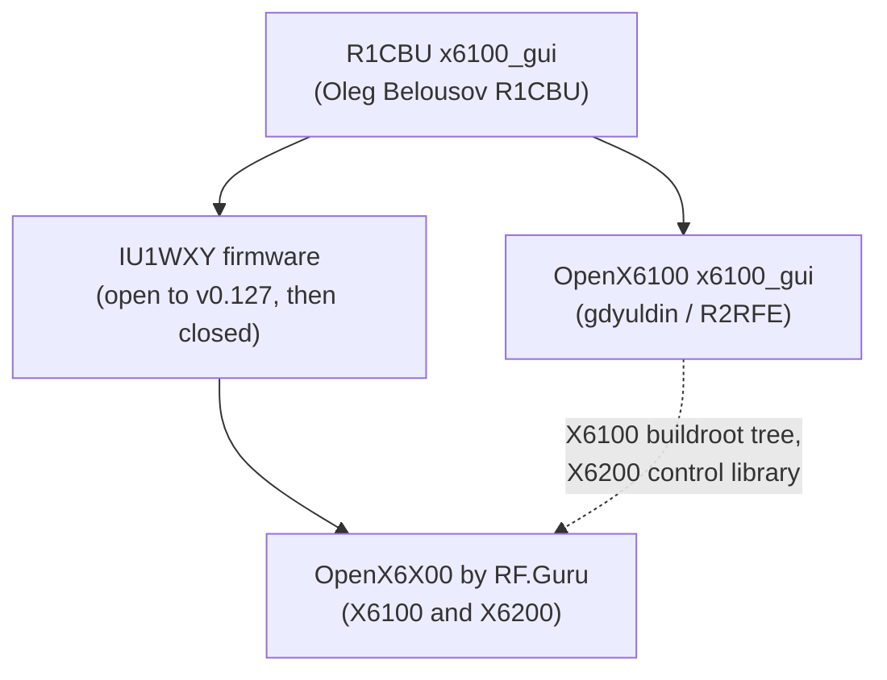

# Custom firmware: OpenX6100, OpenX6X00 and the SD-card route

The X6100's screen, menus and applications are drawn by a small Linux computer inside the radio, and the radio board underneath is a separate processor running its own firmware. That split is why a community of developers has been able to replace the Linux half with alternative software that boots from a microSD card, while Xiegu's own firmware stays where it is. This chapter explains what those projects are, what they add, how to try one without putting the radio at risk, and how to go back. It is written from the projects' own READMEs, wikis and release notes; it is not a substitute for reading them, because they change week by week.

Nothing here is needed to enjoy the radio. The rest of this guide is written around Xiegu's stock firmware, and if the stock radio does what you want, you can skip this chapter.

## The projects, and how they relate

Three names come up, and two of them are confusingly similar. At the time of writing (November 2026) the picture on GitHub is:

| Project                                                         | Who                                                      | Radios          | State at the time of writing                                                                |
| --------------------------------------------------------------- | -------------------------------------------------------- | --------------- | ------------------------------------------------------------------------------------------- |
| [R1CBU `x6100_gui`](https://github.com/strijar/x6100_gui)       | Oleg Belousov R1CBU                                      | X6100           | The original "X6100 LVGL GUI". Its repository was last updated in June 2024                 |
| [OpenX6100 `x6100_gui`](https://github.com/OpenX6100/x6100_gui) | Georgy Dyuldin R2RFE (gdyuldin), with other contributors | X6100           | Active. A fork of R1CBU's GUI; v1.2.0 released 1 November 2026                              |
| [OpenX6X00](https://github.com/Guru-RF/OpenX6X00) by RF.Guru    | Joeri Van Dooren ON6URE                                  | X6100 and X6200 | Active and new: the repository was created in October 2026; v0.3.8 released 31 October 2026 |

**OpenX6100** (the organisation that now hosts gdyuldin's work) is the direct continuation of R1CBU's firmware. Its repository describes itself as a "fork of R1CBU alternative firmware for X6100 Xiegu transceiver", and links that used to point at `github.com/gdyuldin/...` now redirect there; the v1.1.0 release notes record "Repository links moved to OpenX6100". When older forum posts say "the R1CBU firmware" or "the gdyuldin firmware", this is the line they mean.

**OpenX6X00** is a separate project with a separate history. On GitHub it is a new repository, not a fork, but its README explains that it continues the last open-source release (v0.127, 17 October 2026) of a further X6100 firmware by Giovanni Ricciardi IU1WXY, which itself was built on the R1CBU GUI and on decoders by Hany El Imam (1KO125). The README says the IU1WXY firmware became closed-source from v0.128, and that OpenX6X00 continues the open line. This guide has not been able to check the IU1WXY firmware independently, so treat that part of the history as OpenX6X00's own account.

Do not confuse **OpenX6100** (gdyuldin's line, X6100 only) with **OpenX6X00** (RF.Guru, both radios). They are different firmware with different features, files and update methods.

One more project matters because it works on the other half of the radio. gdyuldin's [`x6100_base_patch`](https://github.com/gdyuldin/x6100_base_patch) is a modified **BASE** firmware for the radio board, not an SD-card image. It is covered separately under [the patched BASE](#the-patched-base-is-a-different-kind-of-change) below, because it is installed differently and is not undone by removing a card.

## How it works: the card boots instead, stock stays put

The X6100 carries two firmwares, the **APP** (Linux, screen and menus) and the **BASE** (the radio board: DSP, RF, power, keyer). Both community GUIs replace only the Linux side, and only while their card is in the slot.

- The OpenX6100 wiki says its software runs from the SD card and "doesn't change anything on the internal storage of the device", so you can take the card out at any time and carry on with the original firmware.
- OpenX6X00's README says the baseband is Xiegu's, and that OpenX6X00 "talks to it and never changes it". It describes Xiegu's own system as staying on the radio's internal memory while OpenX6X00 runs from the card: take the card out and switch on, and Xiegu's system starts.
- The reason is the boot order. The [x6100-fw-mangler](https://github.com/j0ju/x6100-fw-mangler) project documents that the X6100's boot ROM looks for a boot loader on the SD card first and then on the internal eMMC. A bootable card wins; no card, and the radio starts from its internal memory as normal.

Because the BASE is untouched, its version still matters. OpenX6X00 lists the X6100 baseband versions it has tried: **V1.1.8** works (it is what the project's own X6100 runs); **V1.1.9** "should work" but had not been run on their bench at the time of writing; gdyuldin's patched base works, with caveats noted below. Settings that need a newer base are hidden when the base is too old. Check **GEN → SYSTEM SETTING → SYSTEM INFO** on stock firmware before you start, and note both numbers.

## What they add

Both projects turn the radio into something closer to a self-contained station. The lists below are drawn from each project's README and release notes; they are not exhaustive, and they change with every release.

**OpenX6100 `x6100_gui`** (v1.1.0 and v1.2.0 release notes, README):

- **FT8 and FT4 on the radio**, logged to `ft_log.adi` on the card. You can copy your existing ADIF log to the card as `incoming_log.adi` so the radio marks callsigns you have already worked.
- **JS8**, keyboard-to-keyboard chat in the style of JS8Call; **WeFax** and **SSTV** receive (SSTV transmit too); a **channel list** of broadcast stations from the EiBi schedule.
- **Bluetooth** headphones and HFP headset voice transmit (the release notes say the headset's own PTT button was tested on one model and may not work on others), Bluetooth keyboards, and CAT over Bluetooth.
- **WSJT-X-compatible UDP output** over Wi-Fi or Bluetooth, so programs such as GridTracker can see the radio's FT8 decodes and logged QSOs.
- USB keyboards with hot-plug support, an S-meter offset setting and a small web server.

**OpenX6X00** (README and manual):

- **Digital modes decoded on the radio**: FT8, FT4 and FT2, JS8, WSPR, PSK31/63, Olivia, JTTY, RTTY, SSTV, WeFax, and NavTex (receive only), with decodes reported to PSK Reporter by default.
- **CW**: a decoder, CW sent from a USB or Bluetooth keyboard, messages with call macros, USB and Bluetooth paddles, and a **CW trainer** (below).
- **DX cluster spots on the waterfall**, a portable-activation interface ("Field Ops") for SOTA, POTA, WWFF and other programmes, and automatic upload to your own Wavelog.
- **Winlink email over HF** from the radio alone, using Pat and the ARDOP modem.
- **Network control**: a browser panel and browser remote, a TCI server (on by default) for TCI clients such as its VFO-Knob, a web configurator, a USB Ethernet adapter or USB tethering, and optional Tailscale.
- **In-radio updates**: the radio fetches signed update bundles from GitHub and rolls back by itself if a new version does not start.
- The README also lists what it removed from the IU1WXY code it started from: the X6100 Link phone app and its remote API, the wfview LAN server, that firmware's own update server and its telemetry.

Neither project runs on the stock menus described in the rest of this guide. Once a community card is in, the [Menu Reference](outpost:entry/logbook73.guide.x6100/menu-reference) and the stock-firmware steps in [Connectivity](outpost:entry/logbook73.guide.x6100/connectivity) no longer describe what you see; use the project's own manual or wiki.

## The CW trainer in OpenX6X00

OpenX6X00 includes a CW trainer under **APP (page 2) → CW Trainer**. The radio plays a group of Morse characters and you key it back on your own paddle or key; the radio's CW decoder checks what you sent.

- It uses the radio's **own keyer and KEY settings**. With a paddle, set the keyer mode to **Auto-L** or **Auto-R** (iambic) before opening the trainer; on **Manual** the paddle behaves as a straight key.
- While the trainer is open the radio is in a training mode: **sidetone only, no transmit, TX power held at 0 W**. Even so, practising into a dummy load costs nothing.
- **Learn** follows the Koch method, adding characters by level and bringing up weak or rarely tried characters more often; **Calls** practises callsigns. The trainer keys from 5 to 50 WPM.
- The manual records several fixes to how answers are timed and decoded "up to v0.3.8", which is a fair sign of how young this feature is. If it marks a correct answer wrong, check the version and the open issues before doubting your fist.

If you want the same "hear it, key it back" practice away from the radio, LogBook73's own Morse trainer has an **Echo** mode (**Morse trainer → Send → Echo**): it plays a hidden group in the browser, you key it back on your configured key, and it shows what it heard alongside timing tips. The [CW chapter](outpost:entry/logbook73.guide.x6100/cw-keyer) covers the stock keyer settings both rely on.

## Before you try it

Ten minutes of preparation makes the experiment risk-free.

1. **Record your stock versions.** On stock firmware, open **GEN → SYSTEM SETTING → SYSTEM INFO** and write down the APP and BASE versions.
2. **Note your stock settings and memories.** Community firmware keeps its own settings on its own card and should not touch Xiegu's, but a written list costs nothing and helps if you later reset the stock firmware.
3. **Use a spare card.** Never overwrite a card that holds Xiegu's update image or anything else you need. OpenX6X00 asks for a branded card of 8 to 32 GB; the OpenX6100 wiki asks for at least 1 GB and warns that a slow card can make the radio freeze, so use a reasonably fast one.
4. **Plan the first start on external power.** OpenX6X00 says to use external power for the first start. It is sensible for either project.
5. **Have a dummy load and, ideally, a wattmeter.** You will want to check transmit before going on the air (see the risks below).

## Trying it, step by step

1. **Download the image for the X6100** from the project's latest release. For OpenX6100 it is `sdcard.v<version>.img.zip`. For OpenX6X00 it is `OpenX6X00-x6100-v<version>-sdcard.img.zip`; the `x6200` file is for the other radio and will not suit an X6100.
2. **Write it to the card** with [balenaEtcher](https://etcher.balena.io/) or Rufus. Both projects name these two tools. OpenX6X00 recommends balenaEtcher because it verifies what it wrote; it can take the `.img.zip` as it is. If Windows then offers to format the card, choose **Cancel**.
3. **Switch the radio off, insert the card and switch on.** OpenX6X00's README warns that the screen stays dark for the first few seconds; give it a minute.
4. **Let the first start finish.** On first boot both projects create a **DATA** partition in the card's free space, where settings, logs and recordings live. On a PC, the OpenX6100 card shows a BOOT partition and a DATA partition; its system partition is not visible under Windows.
5. **Set the basics.** Your callsign and locator, then the clock (FT8, JS8 and WSPR need it right to within a second or two). OpenX6X00's first steps also have you join Wi-Fi, which sets the clock and enables its network features.
6. **Receive first.** Listen, decode some FT8, get used to the new controls.
7. **Then check transmit into a dummy load** at low power, with a wattmeter if you have one, before you go on the air.

If the radio switches off a few seconds after starting from the card, or stops at a dark screen, take the card out and confirm stock still starts. Then check the project's issues: in October 2026 one owner's X6100 (APP V1.2.0, BASE V1.1.9) would not start an OpenX6X00 card until v0.3.6 shipped a new boot loader. That is the kind of problem a new release can fix, or introduce.

## Going back to stock

For either SD-card firmware, the way back is the card itself:

1. Switch the radio off.
2. Remove the community card.
3. Switch on. The radio starts Xiegu's firmware from its internal memory, as it did before.

You can swap back and forth as often as you like. Keep the community card safe if you want to return to it; its settings and logs live on its DATA partition, not in the radio.

**Updating Xiegu's firmware while using a community card** is done with the community card out. OpenX6X00's README describes the sequence: run from a stable 13.8 V supply, boot Xiegu's update image from a _different_ card, take that card out, start the stock firmware and use **FIRMWARE UPGRADE** for the matching BASE file, do the factory reset (which clears Xiegu's settings only), then switch off and put the community card back. That is the same two-stage procedure covered in [The GEN Settings Menu](outpost:entry/logbook73.guide.x6100/gen-settings); follow the [official X6100 update tutorial](https://xiegu.eu/sdm_downloads/xiegu-x6100-firmware-update-tutorial/) rather than a summary.

## Updating the community firmware

- **OpenX6100** publishes each release as a new card image. The README does not say whether writing a new image keeps the DATA partition, so copy your logs and settings off the card's DATA partition to a computer before you write a new image.
- **OpenX6X00** updates itself after the first install: **Settings → Info → Update** (or the web configurator's update page) downloads a signed bundle from GitHub, keeps the previous version and rolls back if the new one fails to start three times. A new card image is needed only when the kernel, drivers, boot loader or system packages change, and the radio tells you when that is the case. The README says a new image normally keeps the DATA partition, but advises downloading the web configurator's Backup first all the same.

## The patched BASE is a different kind of change

gdyuldin's `x6100_base_patch` modifies the **BASE** firmware on the radio board. It adds things such as a TX compressor and noise gate, IF shift, better FM and AM handling, a TX bandpass filter control and true output-power control, and it can be used with the stock GUI or with community firmware. But it is a different sort of commitment:

- It is **installed into the radio**, not run from a card. Its README has you boot stock firmware with no card, copy the `.xgf` file onto the radio over Wi-Fi, then apply it through **System settings → Firmware upgrade** on external power. Removing a card does not undo it. The README does not describe going back; Xiegu's official BASE images are installed through the same **FIRMWARE UPGRADE** menu, as part of the update procedure in [The GEN Settings Menu](outpost:entry/logbook73.guide.x6100/gen-settings).
- The README says TX level **calibration might be required**, and that an earlier revision added gain offsets "for different HW versions of the transceiver", so behaviour can vary between units.
- OpenX6X00's README reports that, on one radio that shipped with V1.1.8, the patched base (r13) read about 10% high at 5 W and 20% high at 10 W before calibration, gave next to no power on the first transmission after a band change, and showed the external voltage as 0 V.
- Its README carries the disclaimer "use it for your own risk".

If you only want to try the community software, leave the BASE alone. The SD-card firmware works on Xiegu's own base.

## Risks and limitations

- **Unsupported, no warranty.** These are volunteer projects; Xiegu does not publish or support them. The OpenX6100 wiki says "There is no warranty that this even works", and the OpenX6X00 site says "Use at your own risk". Ask your dealer about warranty before you rely on it.
- **Young, fast-moving code.** OpenX6X00 was created in October 2026 and shipped several releases within its first fortnight; OpenX6100 has also released frequently. Expect bugs, changed menus and fixes. Read the release notes before updating, and note the version when you report a problem.
- **Check your power output.** Power control is handled differently by the community GUI and, if fitted, by a patched base. Measure output into a dummy load with a wattmeter before trusting the on-screen figure, especially after changing firmware.
- **Hardware compatibility is not formally listed.** Neither project publishes a list of supported X6100 hardware revisions. OpenX6X00 lists tested baseband versions and records at least one unit that needed a newer boot loader; the base patch notes differences between hardware versions. If yours misbehaves, take the card out and report it.
- **Network exposure.** OpenX6X00 turns on network services: its README says the web configurator has no login, the TCI server is on by default with no login, and the Winlink mailbox has no login. Use these only on networks you trust, set TCI clients to listen-only or turn it off elsewhere, and think carefully before exposing anything to the internet. SSH accepts keys only, with password logins switched off.
- **The licence rules do not change.** On-radio FT8, Winlink or a band-plan display does not change what you are licensed to transmit. OpenX6X00's band-plan strip is described as guidance only: "it never stops the key or the microphone".
- **This guide stops at the card slot.** The stock menu tables and troubleshooting in this guide describe Xiegu's firmware. With a community card in, use the project's documentation.

## Licences

- **OpenX6100 `x6100_gui`**: the GUI's own code is LGPL-2.1-or-later. Because the default build includes the JS8 engine (GPL-3.0), the README says the built `x6100_gui` program is distributed as a whole under GPL-3.0. (The project wiki's front page also mentions a "beerware" licence; the repository's licence files are the authority.)
- **OpenX6X00**: the GUI is LGPL-2.1-or-later and the JS8, WSPR, JTTY and PSK Reporter parts are GPL-3, so the README says the firmware image as a whole is GPLv3.
- **`x6100_base_patch`**: no licence is shown on the repository at the time of writing.

## Where to get help

- **OpenX6100**: the [GitHub issues and discussions](https://github.com/OpenX6100/x6100_gui) and the project wiki, which covers installation, controls, FT8, settings and the web server.
- **OpenX6X00**: [GitHub issues](https://github.com/Guru-RF/OpenX6X00/issues), one problem per issue, using the bug-report form. It asks for the radio model, the OpenX6X00 and baseband versions (Settings → Info), what you did and saw, the power source and antenna, and the newest log files from the card's `app_logs` folder. The full manual is `docs/MANUAL.md` in the repository, and the project site is [openx6x00.org](https://openx6x00.org/).
- **Wherever you ask**, say which firmware you are running. "My X6100 does X" means something quite different on stock, OpenX6100 and OpenX6X00.

## Try it yourself

1. **Read your stock versions.** In **GEN → SYSTEM SETTING → SYSTEM INFO**, write down APP and BASE before you change anything.
2. **Prove the way back.** With a community card written, boot it, switch off, remove it and boot stock again. Once you have done that, the experiment holds no fear.
3. **Decode without a computer.** On the community firmware, set the clock, tune to an FT8 frequency on an open band and watch the decodes arrive on the radio itself. Compare the experience with the PC route in [Connectivity](outpost:entry/logbook73.guide.x6100/connectivity).
4. **Measure, don't assume.** Into a dummy load, compare the on-screen power with a wattmeter on stock firmware and on the community card.

## Key takeaways

- The best-known X6100 community firmware began as **R1CBU's `x6100_gui`**. Its current open-source line is **OpenX6100 `x6100_gui`** (gdyuldin/R2RFE). **OpenX6X00** by RF.Guru is a separate, newer project that covers the X6100 and X6200.
- Both are **SD-card images** that boot instead of the stock Linux side. They leave Xiegu's internal firmware and the BASE untouched, so **removing the card returns you to stock**.
- They add **on-radio FT8/FT4, JS8 and other digital modes**, Bluetooth and keyboard support, and logging. OpenX6X00 adds a DX cluster, portable-activation logging, Winlink, browser and TCI control, in-radio updates and a **CW trainer** that has you key Morse back on the paddle.
- **The patched BASE is not reversible by pulling a card.** Treat it as a separate decision, and calibrate and measure power afterwards.
- These are **unsupported, fast-moving community projects**: use a spare card and external power for the first start, check transmit into a dummy load, keep network services on trusted networks, and quote your firmware and versions when you ask for help.

The rest of this guide returns to the stock radio, starting with the ideas underneath it in [The Theory: SDR, QRP, ATU/SWR & HF Modes](outpost:entry/logbook73.guide.x6100/theory).

---

_Community-firmware statements on this page were checked against the projects' GitHub repositories, READMEs, wiki, manual and release notes at the time of writing (November 2026): OpenX6100 `x6100_gui` v1.2.0 (1 November 2026), OpenX6X00 v0.3.8 (31 October 2026) and `x6100_base_patch`. Both projects release often; check their current pages before you rely on any detail here._
