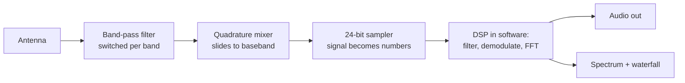

# The theory: SDR, QRP, ATU/SWR and HF modes

The menu chapters told you _what_ each control does and _where_ it lives. This one steps back to the _why_ — the handful of ideas the whole X6100 is built on. Most of what feels mysterious about this radio comes down to five concepts: it is a **software-defined radio**, it paints the band as a **picture**, it cleans up signals with **maths rather than metal**, it is a **QRP** rig running only a few watts, and it must be **matched** to its antenna before it can do anything useful. Learn those five and the settings stop being a wall of acronyms and start reading like sensible choices you happen to be allowed to make. Throughout, we link out to the main [handbook](outpost:entry/logbook73.handbook) whenever you want the full, radio-agnostic story.

## The radio is a computer with an aerial

Open up an older HF transceiver and you find a chain of tuned metal — mixers, crystal filters, amplifiers — each stage a physical circuit doing one job to the signal before passing it on. The X6100 is a different animal. It is a **software-defined radio (SDR)**: the incoming radio wave is turned into _numbers_ as early as possible, and almost everything after that — filtering, demodulation, noise reduction, the spectrum display — happens as software running on a small computer inside the case. Change the software and you change what the radio _is_, which is exactly why this set has such a lively [firmware](outpost:entry/logbook73.handbook/software-defined-radio) scene. The full story of what that shift changed is in [Software Defined Radio](outpost:entry/logbook73.handbook/software-defined-radio).

Here is how the X6100 does it. Xiegu's specification lists the receiver's "circuit type" as **ZIF** — _zero intermediate frequency_, also called **direct conversion**. Instead of shifting your signal up to a high internal frequency and filtering it there (the classic _superheterodyne_ approach in [Receivers](outpost:entry/logbook73.handbook/receivers)), the X6100 uses a [mixer](outpost:entry/logbook73.handbook/mixers) to slide the frequency you are tuned to **straight down to baseband** — down around zero — and then samples it with a 24-bit analogue-to-digital converter. From that point on your signal is a stream of numbers, and a digital signal processor does the rest.



There are really _two computers_ in there working together: a small STM32 microcontroller minds the radio hardware, while a separate Linux-capable processor (a quad-core ARM chip, the same kind you would find in a modest tablet) runs the graphical display interface and the heavy DSP. That is an unusual amount of general-purpose computing for a QRP rig, and it is what makes the alternative-firmware projects possible — but you never see it; to you it is one radio.

Two practical consequences fall straight out of this design, and both explain things you will meet elsewhere. First, the X6100 is extraordinarily **stable and precise**: its reference clock is a **TCXO** (a temperature-compensated crystal oscillator), rated at about ±1.5 ppm within the first half-hour of switch-on, so a signal you tune stays put and CW pitches do not wander. Second — and this is the honest weakness — a direct-conversion front end has **no roofing filter**. The only thing standing between the aerial and the mixer is a **switched band-pass filter**, one per band, that passes a whole amateur band's worth of spectrum at once. A superhet's narrow crystal filter would throw away everything but the slice you want; the X6100 hands the mixer the lot and sorts it out later in software. Where the band is quiet, that is glorious — you see and hear everything. Near a **strong broadcaster**, it is the X6100's best-known headache: a powerful out-of-band signal that a fussier radio would have rejected can overwhelm the front end, and you hear it as voices behind your CW, phantom images as you tune, or a general muddiness. The cure is to _reduce the signal reaching the mixer_: below about 14 MHz, run the preamp OFF (⭐), switch in the attenuator when strong signals appear, wind back RF gain, and — if you live near a broadcast mast — fit a cheap band-stop filter ahead of the aerial. The theory of why this happens is in [Overload & Ghost Signals](outpost:entry/logbook73.handbook/overload-and-ghost-signals).

## I, Q and the band as a picture

Sliding a signal "down to zero" hides a subtlety that turns out to be the key to the whole SDR trick. Once you are sitting at baseband, a signal _10 kHz above_ where you tuned and one _10 kHz below_ both end up looking like a 10 kHz tone — the radio cannot tell which side it came from. The fix is to keep **two copies** of the baseband signal, sampled a quarter-cycle (90°) apart. These are the **I** (in-phase) and **Q** (quadrature) channels, and comparing them lets the maths recover which side of zero every signal lives on — so the radio can separate an upper sideband from a lower one, or a signal just above your tuned frequency from one just below. This two-channel trick is the beating heart of every SDR, and it has a chapter of its own in [IQ Signals](outpost:entry/logbook73.handbook/iq-signals). The X6100 even brings the raw I and Q out on a **3.5 mm socket** so you can feed a computer running [SDR++](outpost:entry/logbook73.handbook/sdr-plus-plus) or [GNU Radio](outpost:entry/logbook73.handbook/gnu-radio) and use the radio as a wideband front end.

Because the whole band arrives as numbers, the radio can do something a knob-and-dial rig cannot: show it to you. A mathematical operation called the **FFT** (Fast Fourier Transform) takes a slice of the sampled band and works out how much energy sits at each frequency — that is the **spectrum** display, the live bar-graph of signals across the top. Stack those spectra one under another as time passes, colour-coded by strength, and you get the scrolling **waterfall** beneath it. The full explanation of how to read one like an operator is in [FFTs & Waterfalls](outpost:entry/logbook73.handbook/ffts-and-waterfalls); here it is enough to know that every mode leaves a recognisable _shape_ on the waterfall.

```viz
{
  "type": "waterfall",
  "title": "Every mode has a signature on the waterfall",
  "caption": "Learn the shapes and the display becomes a map: a thin CW line, a fat SSB smear that wobbles with speech, the tidy tone-ladder of FT8, and the hard vertical stripe of an unmodulated carrier.",
  "xLabel": "frequency across the tuned span",
  "yLabel": "time (newest at top)",
  "signals": [
    { "f": 16, "kind": "cw" },
    { "f": 40, "width": 7, "kind": "ssb" },
    { "f": 64, "kind": "ft8" },
    { "f": 86, "kind": "carrier" }
  ]
}
```

This is the single feature that most sets the X6100 apart from a knobs-only radio at this size and price: you can _see_ a weak signal appear before you can hear it, spot which end of the band is busy, and drop straight onto a station instead of tuning past it. Treat the waterfall as your primary tuning tool and the small tuning knob stops mattering so much.

## Cleaning up the signal in software

Because your signal is now a stream of numbers, "putting a filter on it" means running a calculation, not switching in a physical circuit. That is why the X6100 gives you filtering that would cost a fortune in metal. The general theory — low-pass, high-pass, band-pass, notch — lives in [Filters](outpost:entry/logbook73.handbook/filters); what matters here is that the radio's filter menus are all just software shaping the same number stream.

The **DFL** (digital filter) menu sets the **passband**: the band of audio frequencies the radio lets through. You move a **low-cut** edge and a **high-cut** edge to taste — wide for natural SSB, narrow for CW or an adjacent signal. Alongside it, **DFN** holds **NB** (impulse-noise blanker), **NR** (noise reduction) and **DNF** (digital notch filter). DNF is not an automatic hunter on the current stock baseline: you turn **DNF CENTER** to place the notch manually on a steady heterodyne and use WIDTH sparingly. Heavy NR can sound underwater, so use the least processing that solves the problem.

## QRP: what a few watts really buys

The X6100 is a **QRP** rig — the amateur shorthand for "low power," conventionally 5 watts or less. On its internal battery it makes about **5 W** on SSB, CW and FM; on an external 13.8 V supply it stretches to about **10 W** (and, because AM spends most of its power on a carrier that does no work, only about 2.5 W of AM carrier externally, 1.5 W on battery). Newcomers often assume that a few watts is barely worth keying up. The arithmetic says otherwise, and it is worth doing once.

Signal strength is a game of [decibels](outpost:entry/logbook73.handbook/decibels), and the ear-and-meter rule of thumb is that **one S-unit is about 6 dB** — a fourfold change in power. Now compare your QRP rig with a "full-power" 100 W station:

| Power step                       | Ratio | In decibels | S-units at the far end |
| -------------------------------- | ----- | ----------- | ---------------------- |
| 5 W → 10 W (battery to mains)    | ×2    | 3 dB        | about half an S-unit   |
| 5 W → 100 W (QRP to a "big" rig) | ×20   | 13 dB       | just over 2 S-units    |

Two S-points. That is the whole difference between your 5 W and someone else's 100 W: where they land at S9, you land at about S7 — still perfectly readable. The corollary is the one every QRP operator learns to love: since power moves the needle so little, the things that move it _a lot_ are your **antenna** and the **propagation** on the day. A better aerial, or an hour when the band is open, buys you far more than a linear amplifier ever could. That is why the [antenna](outpost:entry/logbook73.handbook/antennas) chapter and the [propagation](outpost:entry/logbook73.handbook/propagation) chapter matter more to a QRP operator than the power knob, and why a modest 5 W signal on a well-fed wire routinely crosses oceans. The physics of what power does and does not buy is in [RF Power](outpost:entry/logbook73.handbook/rf-power); the character of the [HF](outpost:entry/logbook73.handbook/hf) bands that carry it is next door.

Low power brings two quiet bonuses that suit this radio's field-and-battery life. Running 5 W sips current, so the internal pack lasts through a decent operating session; and low power means less heat, though long high-duty transmissions — an hour of FT8, say — still warm the finals, so keep an eye on duty cycle on the data modes. Set your power to the **lowest that does the job** and treat 10 W as the ceiling, not the target (⭐).

## Impedance, SWR and the built-in tuner

A transmitter is fussy about what it is asked to push power into. The X6100, like almost every HF rig, is built for a **50-ohm** load: it wants to see the world through its aerial socket as if it were a plain 50-ohm resistor. Real antennas rarely oblige. An antenna presents 50 ohms only at the frequency it is _resonant_ on; move off that frequency, or use a random wire, and its **impedance** wanders — the full idea is in [Impedance](outpost:entry/logbook73.handbook/impedance). When what the radio sees differs from the 50 ohms it wants, some of the power you send up the [feedline](outpost:entry/logbook73.handbook/transmission-lines) is reflected back instead of radiated, and the measure of that mismatch is the **standing wave ratio**, or **SWR** (see [SWR](outpost:entry/logbook73.handbook/swr)). A perfect match is 1:1; the higher the number climbs, the more power bounces back and the unhappier — eventually the _hotter_ — the transmitter gets.

```viz
{
  "type": "response",
  "title": "The SWR dip: an antenna is happy over a limited range",
  "caption": "An antenna shows a low SWR only near the frequency it is cut for, dipping toward 1:1 at resonance and rising either side. The tuner's job is to widen where the radio sees a good match.",
  "curve": { "preset": "swr", "f0": 50, "bw": 34 },
  "markers": [{ "x": 50, "label": "resonance — near 1:1" }],
  "xLabel": "frequency",
  "yLabel": "SWR"
}
```

This is where the X6100's **built-in automatic ATU** (antenna tuning unit) earns its place. An ATU does not change your antenna; it sits between the radio and the feedline and _transforms_ whatever impedance it sees into something close to 50 ohms, so the transmitter is content and delivers its full power. The X6100's tuner is **automatic** — a short press brings it into circuit, a long press runs a tune in a few seconds and stores the result for near-instant recall next time. Two honest limits are worth carrying with you. First, it is a **limited-range** tuner: Xiegu rate it to about **1:4.5** SWR, so it will happily match a slightly-off antenna or a compromise wire but will _not_ rescue a wildly mismatched one — get the antenna roughly right first. Second, an ATU makes the _radio_ happy but does nothing for power already lost as heat out on a badly-matched feedline, so it is a convenience, not a cure for a poor antenna. On an antenna that is already resonant, leave the ATU out of circuit altogether (✅) — there is nothing for it to do. To see the dip for yourself, the **SWR scanner** in the APP menu sweeps a span and plots SWR against frequency, drawing the very curve above on your own aerial; a standalone [nanoVNA](outpost:entry/logbook73.handbook/nanovna) does the same job in more detail off-air.

## The HF modes, and when to reach for each

The X6100's hardware speaks four native modes — **CW, SSB, AM and FM** — and, through a PC or its own built-in modem, the whole world of **data**. Each is a different way of stamping information onto the carrier wave, a subject with its own home in [Modulation](outpost:entry/logbook73.handbook/modulation); here is how to choose between them on the [HF](outpost:entry/logbook73.handbook/hf) bands.

- **CW** — Morse, sent by keying the carrier on and off (emission A1A). It sounds old-fashioned and it is the most modern thing on the radio: because all its energy is squeezed into an on/off tone a few hundred hertz wide, CW gets through when a voice cannot, which is exactly what a QRP operator wants. It is also the most power-efficient mode you have. The X6100's keyer, sidetone and iambic settings live in the **KEY** menu.
- **SSB** — single-sideband voice (emission J3E), the workhorse of HF phone. Ordinary AM wastes most of its power on a carrier and a duplicate sideband that carry no extra information; SSB throws both away and sends just one sideband, so all your watts go into intelligible speech. It comes in two flavours, **USB** (upper) and **LSB** (lower), and there is a long-standing convention about which to use: **LSB below 10 MHz** (160, 80 and 40 m) and **USB on everything above** (20 m up, plus 60 m), with **USB used for all data** regardless of band. It is only a convention — the radio is happy either way — but following it means you come out sounding right-way-up to everyone else.
- **AM** — full-carrier amplitude modulation (A3E). Power-hungry and twice as wide as SSB, it survives mostly for nostalgia nets and for listening to shortwave broadcasters; the X6100 makes only a modest AM carrier, so treat it as a receive-mostly, occasional-transmit mode.
- **FM** — frequency modulation (F3E). On HF it lives up at the top of **10 m** (around 29 MHz) and on **6 m**, for repeaters and local simplex. FM needs a strong signal to sound clean, so it is a fair-weather, band-open mode rather than a weak-signal one.
- **Data** — FT8, FT4, RTTY, PSK31, JS8 and the rest. For computer sound-card modes on stock firmware, select **USB-DIG** (shown as **U-DIG** on some builds) and let the connected PC do the encoding and decoding over the USB-C link — this is how the X6100 becomes an [FT8](outpost:entry/logbook73.handbook/ft8) station. The radio also carries a **built-in modem** (the APP menu) that can send and decode RTTY, CW and BPSK on its own, without a computer, which is a genuinely handy field feature. The popular alternative firmware adds native FT8 to the radio itself.

A licence reminder that applies to every mode above: the X6100 will only _transmit_ inside the amateur bands, but _which_ segments — and which modes are polite where — is set by your **national band plan**, and it is your licence that grants the right to key up at all. The manual's printed transmit edges are narrower than some regions allow and vary by firmware and market, so verify them against your own unit and plan rather than assuming. If you are not yet licensed, ordinary amateur-band reception may still be useful study practice, but receiver and protected-communications law varies by place; [Getting Licensed](outpost:entry/logbook73.handbook/getting-licensed) explains how to earn the transmit privilege.

## Try it yourself

Most of this is receive-only listening and watching. Follow local receiver/protected-communications rules, and perform any transmitting or antenna-connected sweep only where your licence or a specific exemption permits it.

1. **Read the waterfall.** Tune to a busy SSB band (40 m in the evening, 20 m by day) and watch the display before you touch the knob. Pick out the fat, speech-wobbling smears of SSB, and if you can find the FT8 watering-hole, the neat ladder of tones. You are now tuning with your eyes.
2. **Hear a filter working.** On a crowded voice signal, open **DFL** and drag the high-cut and low-cut edges inward. Listen to the interference on either side fall away as the passband narrows — pure software, no moving parts.
3. **Prove the power arithmetic.** If you can, work the same station at 5 W and 10 W and ask for a signal report both ways. The change is usually "hard to tell" — half an S-unit — which is the QRP lesson in one contact.
4. **Watch the SWR dip.** Run the **SWR scanner** across a band with your antenna connected and find where the curve dips lowest. That frequency is where your aerial is happiest; the ATU's job is to widen the useful range either side of it.

## Key takeaways

- The X6100 is a **software-defined radio**: it converts the signal to numbers early (a **zero-IF / direct-conversion** front end) and does the filtering, demodulation and displays in software — powerful and flexible, but with only a switched **band-pass filter** up front, so it can **overload** near strong broadcasters.
- It keeps **I and Q** — two baseband copies 90° apart — which is what lets it tell signals apart above and below the tuned point, and lets an **FFT** paint the **spectrum and waterfall**; learn each mode's shape and the screen becomes your main tuning tool.
- Filtering and noise reduction (**DFL**, **NB**, **NR**, **DNF**) are maths on the number stream, not metal — flexible and free, but heavy noise reduction can hide a weak signal as easily as reveal it.
- **QRP** works because power is a game of decibels: 5 W to 100 W is only about **2 S-units**, so your **antenna** and the day's **propagation** matter far more than the power knob.
- Antennas want to see **50 ohms**; when they do not, **SWR** rises and power reflects. The built-in **automatic ATU** transforms a near-match back to 50 ohms (up to about **1:4.5**) but cannot rescue a bad antenna or a lossy feedline — and should be left out on a resonant one.
- The native modes each make a deliberate trade: **CW** for efficiency and reach, **SSB** (LSB below 10 MHz, USB above) for voice, **AM/FM** for their niches, and **USB-DIG / U-DIG** plus a PC for sound-card data — always inside your band plan and licence.

With the _why_ in place, the settings stop being a maze — so let's put them to work with copy-and-go setups in [Ready-made Configurations](outpost:entry/logbook73.guide.x6100/configs).
