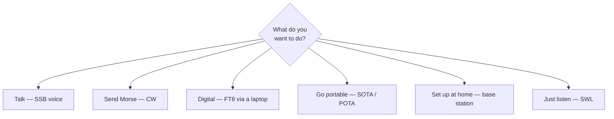

# Ready-made configurations

Everything else in this guide takes the X6100 apart control by control; this chapter puts it back together into working stations. Below are copy-and-go setups — a first voice contact, a CW station, an FT8 rig, a field kit for the hills, a home base and a shortwave listening post — each a short introduction and a table you can dial straight onto the radio. They are starting points, not commandments: tune them to your bands, your antenna, your licence conditions and your ear, and where a setting has its own full chapter we link to it so you can go deeper.

## How to read these recipes

The X6100 keeps its settings in two places, and the tables name both. **Top-panel buttons and knobs** get square brackets — `[SSB]`, `[AGC]`, `[PRE]`, `[ATU]`, `[CW]` — and the **button-menus** down the left edge open on-screen pages we name as a path: `GEN → RADIO SETTING1 → TX POWER`, `KEY → KEY SPEED`, `DFL → FILTER1`, `APP → SWR SCAN`. Three habits recur: the **VOL/SQL/RFG knob** short-presses through Volume, SQL and RF gain; in **GEN**, MFK selects and the main knob changes; in direct **KEY/DFN/DFL/APP/MSG** pages, press the physical soft-key for the item and turn MFK. [Getting Started](outpost:entry/logbook73.guide.x6100/getting-started) walks both menu patterns.

Each important setting carries a one-glance verdict, the same key used throughout the guide:

| Symbol | Meaning                                          |
| ------ | ------------------------------------------------ |
| ✅     | Set it and forget it — right for almost everyone |
| ⭐     | Genuinely useful, depending on how you operate   |
| ⚠️     | Advanced — understand it before you enable it    |
| ❌     | Leave it off unless you have a specific reason   |

Three rules of the road sit under every transmit recipe below. First, **you may only transmit with the appropriate amateur licence, inside the band segments and power your licence allows**; ordinary broadcast/amateur receive-only exploration is generally available without an amateur transmitting licence, but local receiver/protected-communications rules still apply. Second, the X6100's exact transmit band edges vary by region/firmware. Third, **never transmit without an antenna or dummy load**.



## 1. Your first HF SSB voice QSO

Voice on [single sideband](outpost:entry/logbook73.handbook/modulation) is where most people make their first HF contact, and the X6100 makes the hardest part — _finding_ someone to talk to — easy, because you can see the band on the waterfall before you touch the dial. Bands behave by the clock and the sun: **40 m (7 MHz)** is the reliable evening band for regional contacts, while **20 m (14 MHz)** opens by day and carries much further, so start there and let [propagation](outpost:entry/logbook73.handbook/propagation) guide you.

| Setting / control                                  | Value                                             | Why                                                                                                              |
| -------------------------------------------------- | ------------------------------------------------- | ---------------------------------------------------------------------------------------------------------------- |
| Band — `[◄]` / `[►]` step                          | `7 MHz` (evening) · `14 MHz` (day)                | Match the band to the time of day; check your licence and band plan                                              |
| Mode — `[SSB]`                                     | ✅ LSB below 10 MHz, USB above                    | Watch the four-state `LSB → L-DIG → USB → U-DIG` cycle; stop on a voice label, not DIG                           |
| `[AGC]`                                            | ✅ `AGC-SLOW` (AGC-S)                             | APP V1.2.0's recommended [AGC](outpost:entry/logbook73.guide.x6100/tuning-modes) starting point for SSB voice                          |
| `[PRE]`                                            | ⭐ bypass on 40 m, preamp `PRE` on 20 m if quiet  | Below 14 MHz the front end has plenty of signal — the preamp only invites overload; higher and quieter, it helps |
| `DFL → FILTER`                                     | ✅ ~`2.4–2.7 kHz` wide                            | The default SSB passband; narrow it later only to fight a crowded band                                           |
| SQL depth (VOL short-press)                        | ✅ `0` (open)                                     | HF SSB is worked with the squelch open — you _want_ to hear the band noise                                       |
| RF gain (VOL short-press)                          | ⭐ back off on a noisy/crowded band               | Reducing RF gain often lifts a weak voice out of the din — the manual's own tip for the low bands                |
| `GEN → RADIO SETTING1 → MIC SEL`                   | `BUILT-IN` or `HAND`                              | Which microphone the radio listens to; the hand mic frees you from hunching over the set                         |
| `GEN → RADIO SETTING1 → I-MIC GAIN` / `H-MIC GAIN` | ⭐ set so ALC just moves on peaks                 | Too much gain splatters onto your neighbours; too little and you are weak and muffled                            |
| `GEN → RADIO SETTING1 → MONI LEVEL`                | ⭐ enough to hear yourself                        | Monitor your own audio on headphones to check you sound clean                                                    |
| `GEN → RADIO SETTING1 → TX POWER`                  | `5 W` (battery) · up to `10 W` (external)         | QRP by design; a good antenna matters far more than the last few watts                                           |
| `[ATU]`                                            | ✅ short-press to engage, long-press ~1 s to tune | Squeezes a workable match from an imperfect antenna; a flashing `SWR` icon means re-tune                         |
| `GEN → RADIO SETTING2 → RIT`                       | ✅ `0`                                            | Leave receiver incremental tuning off until you meet a station drifting off your frequency                       |

Listen before you leap: find a clear frequency (in Region 1 the 40 m phone segment sits roughly `7.06–7.20 MHz`, and 20 m phone from about `14.10 MHz` up — check your plan), listen for a few moments to be sure it is genuinely free, then either answer a `CQ` you can hear or call your own. If your voice sounds harsh or people ask you to repeat, drop the mic gain a notch before you reach for more power. The band-hopping, sideband and RIT/XIT detail lives in [Tuning, VFOs & Modes](outpost:entry/logbook73.guide.x6100/tuning-modes).

## 2. Getting on CW

Morse is the QRP operator's secret weapon: a narrow CW signal punches through where a wide voice signal fades. The X6100 has a built-in keyer, so all you add is a key or paddle in `KEY`. The two settings that trip up newcomers are **KEY TYPE** (`MANUAL` for a straight key/external keyer; `AUTO-LEFT` or `AUTO-RIGHT` for paddle dit/dah orientation) and **QSK** — with QSK off the radio gives sidetone but does not transmit.

| Setting / control                 | Value                                                     | Why                                                                                                                     |
| --------------------------------- | --------------------------------------------------------- | ----------------------------------------------------------------------------------------------------------------------- |
| Mode — `[CW]`                     | ✅ `CW` (press again for `CWR`)                           | `CWR` flips the sideband the note is derived from — use it to move an interfering signal to the other side of your tone |
| `KEY → KEY TYPE`                  | `AUTO-LEFT` / `AUTO-RIGHT` paddle · `MANUAL` straight key | LEFT/RIGHT chooses dit/dah lever orientation; test silently before transmitting                                         |
| `KEY → KEY SPEED`                 | ⭐ `15–20 WPM` to start                                   | Set it to a speed you can _receive_ comfortably; raise it as your ear improves                                          |
| `KEY → IAMBIC`                    | ✅ `IAMBIC-B`                                             | The common iambic timing; switch to A only if that is what your thumb already knows                                     |
| `KEY → TONE`                      | ⭐ `600–700 Hz`                                           | Your sidetone pitch — pick a note that is easy on the ear over a long session                                           |
| `KEY → TONE LEVEL`                | ⭐ comfortable                                            | Sidetone volume; loud enough to hear against band noise, no louder                                                      |
| `KEY → QSK TIME` (page 2)         | ✅ QSK on, short delay                                    | Full break-in lets you hear the band _between_ your own dots; **QSK must be on to actually transmit**                   |
| `KEY → DI/DA RATIO` (page 2)      | ✅ `3.0`                                                  | Dah-to-dit = 3.0 (equivalently dit:dah 1:3); leave it standard                                                          |
| `KEY → CW TRAINER` (page 2)       | ⭐ `OFF` (or `ON` to practise)                            | A built-in Morse trainer — handy while you learn, off when you operate                                                  |
| `DFL → FILTER`                    | ⭐ narrow to ~`300–500 Hz`                                | The X6100 has no dedicated CW peaking filter, so you _make_ one by pulling the filter edges in                          |
| `[AGC]`                           | ✅ `AGC-FAST`                                             | Fast AGC keeps a strong CW note from pumping the receiver                                                               |
| `GEN → RADIO SETTING1 → TX POWER` | `5 W`                                                     | CW's efficiency means low power goes a long way                                                                         |

Narrowing the filter is what turns a wall of Morse into a single readable note. In `DFL`, short-press the MFK knob to select the low-cut (`L-CUT`) or high-cut (`H-CUT`) edge and turn it in until only the signal you are zero-beat on remains — the radio stores the result against that filter for CW, so it is there next time.

```viz
{
  "type": "spectrum",
  "title": "A narrow CW filter — one note out of the pile-up",
  "caption": "Wide open, every nearby signal pours through; pull L-CUT and H-CUT in to a few hundred hertz and only the note you are tuned to survives. This is how the X6100 does the job a hardware CW filter would.",
  "components": [
    { "f": 28, "amp": 0.55, "label": "QRM" },
    { "f": 45, "amp": 0.92, "label": "wanted", "tone": "primary" },
    { "f": 61, "amp": 0.62, "label": "QRM" },
    { "f": 74, "amp": 0.4 }
  ],
  "noiseFloor": 0.12,
  "mask": { "kind": "bandpass", "from": 39, "to": 51 },
  "xLabel": "audio pitch across the passband"
}
```

For calling `CQ` over and over without wearing out your wrist, the radio can send stored text for you — five CW/RTTY/BPSK message memories set in `MSG` and fired from the `APP → MODEM` screen. The full keyer, message and auto-call story is in [CW: the Keyer, Messages & Auto-call](outpost:entry/logbook73.guide.x6100/cw-keyer), and the filter mechanics in [DFN & DFL: DSP, Noise Reduction & Filters](outpost:entry/logbook73.guide.x6100/dsp-filters).

## 3. FT8 and data via a laptop

[FT8](outpost:entry/logbook73.handbook/ft8) is the modern weak-signal mode that finds contacts when a band sounds dead, and it plays beautifully to the X6100's strengths — but on stock firmware the radio is not a self-contained FT8 machine. Instead it does what an [SDR](outpost:entry/logbook73.handbook/software-defined-radio) does best: it hands a computer clean control and clean audio, and the _software_ (WSJT-X, JS8Call, fldigi) does the decoding and encoding. One cable carries all of it. Because FT8 transmits at full duty for whole seconds at a time, the radio warms up — so keep power modest, give it air, and prefer external power for long sessions.

| Setting / control                                  | Value                                           | Why                                                                            |
| -------------------------------------------------- | ----------------------------------------------- | ------------------------------------------------------------------------------ |
| Cable                                              | `DEV` (USB-C) → PC                              | One USB-C lead carries CAT control _and_ the audio both ways                   |
| PC driver                                          | install the `CH342` USB-serial driver           | Without it the PC never sees the radio's serial port                           |
| Software radio model                               | ✅ native X6100 when tested; OmniRig `IC-7000`  | Xiegu's official FT8 recipe uses `19200` baud; legacy apps may require `X108G` |
| Software PC input / recording                      | ✅ `Microphone (USB Audio)`                     | Radio RX flows into the decoder over DEV                                       |
| Software PC output / playback                      | ✅ `Loudspeaker (USB Audio)`                    | Generated FT8 tones flow from the PC into the radio                            |
| Mode                                               | ✅ `USB-DIG` (`U-DIG` on some displays)         | Selects the line-audio data path; ordinary USB is the voice mode               |
| Dial frequency                                     | `14.074` · `7.074 MHz` (and band equivalents)   | The worldwide FT8 dial frequencies — verify against your band plan             |
| `DFL → FILTER`                                     | ⭐ open to ~`2.7–3.0 kHz`                       | The filter must pass the whole audio window the software listens across        |
| `GEN → RADIO SETTING1 → TX POWER` + PC audio level | ⭐ modest power, drive so ALC _just_ tickles    | Overdriving splatters and distorts; set audio on the PC, not by shouting watts |
| `[AGC]`                                            | ⭐ `AGC-FAST`                                   | A stable receiver level helps the decoder                                      |
| `DFN → NR` / `NB`                                  | ❌ off                                          | Let the software's own processing do the work; on-radio DSP can confuse it     |
| Duty cycle / power                                 | ⚠️ keep it short; external supply for long runs | Continuous digital TX is the radio's hottest workload                          |

If you would rather decode FT8 _on the radio itself_, that is exactly the kind of thing the reversible SD-card community firmware adds — see the note in the [Overview](outpost:entry/logbook73.guide.x6100/overview). The stock cabling, CAT setup, virtual sound card and wireless options are covered fully in [Connectivity: USB/CAT, Bluetooth, WLAN & Data](outpost:entry/logbook73.guide.x6100/connectivity).

## 4. Portable: SOTA / POTA / field

This is the setup the X6100 was built for — a whole HF station in a shoulder bag, powered by its own battery, matching a wire you have just thrown into a tree. On a [Summits on the Air](outpost:entry/logbook73.handbook/hf) or Parks on the Air activation the priorities flip from a home station's: battery life and a quiet, efficient antenna matter far more than watts. The built-in [ATU](outpost:entry/logbook73.guide.x6100/atu-swr) is the star here, because it forgives the imperfect antennas field life throws at you, and the `SWR SCAN` lets you _see_ where a random wire is naturally happy before you commit.

| Setting / control                  | Value                                     | Why                                                                                                             |
| ---------------------------------- | ----------------------------------------- | --------------------------------------------------------------------------------------------------------------- |
| Power source                       | internal battery (`5 W`)                  | Self-contained; check it is charged before you set off                                                          |
| Antenna                            | random wire, EFHW or linked dipole        | A resonant wire is most efficient; a random wire plus the ATU is most flexible                                  |
| `APP → SWR SCAN`                   | ⭐ sweep the band first                   | Plots SWR against frequency so you can see the antenna's natural dip                                            |
| `[ATU]`                            | ✅ engage, then long-press ~1 s per band  | Matches a non-resonant antenna; re-tune on each band, and if `SWR` flashes, tune again                          |
| `[ATU]` on a resonant antenna      | ✅ disengage it                           | The manual advises taking the ATU out of circuit once the antenna is naturally resonant                         |
| `GEN → RADIO SETTING1 → TX POWER`  | `5 W`                                     | Battery power _is_ QRP; a good antenna beats the missing watts                                                  |
| Band / mode                        | `7`/`14 MHz`, SSB or CW                   | 40 m for regional, 20 m for distance; CW stretches a small battery furthest                                     |
| `[AGC]`                            | ✅ `AGC-SLOW` for SSB · `AGC-FAST` for CW | Match APP V1.2.0's voice/CW guidance rather than using one value for both                                       |
| `GEN → DISPLAY SETTING → BL LEVEL` | ⭐ low                                    | The backlight is a real battery drain — the radio offers fewer, dimmer steps on battery for exactly this reason |
| Headphones on `S/P`                | ✅ always a **stereo (TRS)** plug         | A mono TS plug shorts the output and can damage the radio; correct headphones improve weak-signal copy          |
| `MSG` — CW / voice memory          | ⭐ store your CQ call                     | Fires a repeat `CQ SOTA`/`CQ POTA` so you can log and rest your voice or wrist                                  |

Two field cautions worth carrying. The battery is a two-cell lithium pack of about `7.4 V` nominal (not the "12 V" the label prints), but current battery-gauge firmware manages it by displayed capacity rather than the old fixed-voltage thresholds and automatically shuts down below `10%`. If you want the full 10 W and a longer day, bring a small external LiFePO4. And when you run the ATU against a short whip, the tune-up radiates strong RF locally, so keep the antenna clear of people; a handheld-style transmit next to your face wants low power and a little distance, as [RF Power](outpost:entry/logbook73.handbook/rf-power) explains.

```viz
{
  "type": "response",
  "title": "What the SWR scanner draws — and what the ATU chases",
  "caption": "The scanner sweeps your antenna and plots SWR against frequency; the dip marks where it is naturally resonant. Off the dip, the built-in ATU pulls the match down to something the radio will happily run — up to about 4.5:1.",
  "curve": { "preset": "swr", "f0": 55, "bw": 30 },
  "markers": [{ "x": 55, "label": "resonant dip" }],
  "xLabel": "frequency across the band",
  "yLabel": "SWR"
}
```

## 5. Home / base station

Run the X6100 from an external supply and it becomes a compact but capable base station: the full `10 W`, computer logging and CAT, a proper antenna, and an amplifier if you want serious power. The trade-off to plan around is the receiver's honest weakness — a direct-conversion front end with no [roofing filter](outpost:entry/logbook73.handbook/receivers) can **overload near strong medium-wave or shortwave broadcasters**, far more likely at a fixed home antenna than out in a field. The cures are cheap and built into this recipe.

| Setting / control                     | Value                                                 | Why                                                                                                                    |
| ------------------------------------- | ----------------------------------------------------- | ---------------------------------------------------------------------------------------------------------------------- |
| Power source                          | external `13.8 V` PSU, `≥3.5 A`, **never over 15 V**  | Unlocks the full 10 W; a mains supply also spares the internal battery                                                 |
| `GEN → RADIO SETTING1 → TX POWER`     | `10 W` (or `≤2.5 W` to drive an amp)                  | Full QRP at home; the XPA125B amp via the L4001 cable takes ~2.5 W drive up to ~100 W with auto band-switching and ALC |
| CAT / logging                         | `DEV` → PC, tested X6100 profile, `CH342` driver      | For OmniRig use `IC-7000` at `19200` baud; legacy applications may document `X108G`                                    |
| Antenna + `[ATU]`                     | resonant dipole/vertical → ATU **off**; else tune     | Disable the ATU on a naturally resonant antenna; engage and tune for anything else                                     |
| `[PRE]` near broadcasters             | ⚠️ `ATT` in, and reduce RF gain                       | The attenuator and lower RF gain are the first line against front-end overload                                         |
| Broadcast-reject filter               | ⭐ inline AM/BCI high-pass filter                     | An inexpensive filter in the antenna lead cures medium-wave bleed-through for good                                     |
| `GEN → RADIO SETTING1 → S/P MODE`     | `SPEAKER` (or headphones)                             | Routes audio to an external speaker; the tiny internal one is an "is anyone there?" monitor at best                    |
| `GEN → SYSTEM SETTING → TIME SETTING` | ✅ set the clock                                      | Accurate time stamps your log and is essential for FT8                                                                 |
| Wireless                              | ⭐ HOST USB or Bluetooth keyboard/mouse; 2.4 GHz WLAN | A keyboard makes text entry and network CAT far pleasanter at a desk                                                   |
| `[AGC]`                               | ✅ `AGC-SLOW` (AM/SSB) · `AGC-FAST` (CW)              | APP V1.2.0's per-mode starting guidance                                                                                |
| `GEN → RADIO SETTING1 → CHARGER`      | ⭐ `ON`                                               | Trickles the internal battery from the mains supply, so it is a ready backup / UPS                                     |

If a "signal" appears where nothing should be, or you hear a broadcaster faintly behind a ham QSO, suspect overload before you believe the frequency — the mechanism and its fixes are in [Receivers](outpost:entry/logbook73.handbook/receivers) and the receiver chapters, and the amp, CAT and network options in [Connectivity](outpost:entry/logbook73.guide.x6100/connectivity).

## 6. Listening / SWL

The X6100's SDR waterfall makes it a capable receive-only shortwave explorer. The receiver tunes continuously from `0.5` to `30 MHz` (and `50–54 MHz`), covering medium-wave/shortwave broadcast, amateur bands and other signals. Ordinary broadcast/amateur listening generally needs no amateur transmitting licence, but do not monitor protected communications and follow local receiver law. Match the demodulator and filter to the service you may lawfully receive.

| Setting / control                               | Value                                                     | Why                                                                                           |
| ----------------------------------------------- | --------------------------------------------------------- | --------------------------------------------------------------------------------------------- |
| Transmit                                        | — none —                                                  | Receive only; follow local receiver/protected-communications rules                            |
| Mode                                            | `AM` (broadcast) · `USB`/`LSB` (ham voice) · `CW` (Morse) | The wrong demodulator turns a clear signal into mush — see [Modulation](outpost:entry/logbook73.handbook/modulation) |
| `[AGC]`                                         | ✅ `AGC-SLOW` for AM/SSB · `AGC-FAST` for CW              | Slow AGC rides broadcast and speech audio; fast suits Morse detail                            |
| `[PRE]`                                         | ⭐ bypass or `ATT` on the low/crowded bands               | Below 14 MHz you rarely need the preamp; `ATT` tames strong-signal overload                   |
| RF gain (VOL short-press)                       | ⭐ reduce to clean up a crowded band                      | Backing off RF gain is often the single best fix for medium-wave overload                     |
| `DFL → FILTER`                                  | ⭐ wide for AM music, narrow to split crowded signals     | Open the passband for fidelity, pull it in to reject an adjacent station                      |
| `DFN → DNF` (page 2)                            | ⭐ `ON`, then place CENTER on a whistle                   | The manual notch removes a steady heterodyne tone                                             |
| `DFN → NR` / `NB`                               | ⭐ as needed                                              | Noise reduction for hiss, the noise blanker for impulsive electrical crashes                  |
| `GEN → DISPLAY SETTING → WF REF` / `RF FFT REF` | ⭐ adjust to taste                                        | Sets the waterfall's brightness reference so weak signals show without swamping               |
| Headphones on `S/P`                             | ✅ stereo (TRS) plug                                      | The clearest way to dig weak signals out of the noise                                         |
| Firmware-dependent `IQ OUT EN` + `I/Q OUT` jack | ⚠️ `ON` only where the installed build exposes it         | Feeds raw I/Q to a computer SDR; current V1.6 manual omits the menu item                      |

The same overload caveat from the home recipe applies double here, because SWL takes you deliberately onto the crowded, powerful broadcast bands: if voices smear or phantom signals drift as you tune, reach for the attenuator, drop the RF gain, and consider an AM-reject filter in the lead. The waterfall and FFT settings, and why the noise floor sits where it does, are unpacked in [FFTs and Waterfalls](outpost:entry/logbook73.handbook/ffts-and-waterfalls) and the [SDR](outpost:entry/logbook73.handbook/software-defined-radio) chapter.

## Try it yourself

You can build most of these without transmitting. Follow local receiver/protected-communications rules during listening and setup; key up only with the required licence, band and load.

1. **Read the band, then work it.** Set up recipe 1 on 40 m one evening: tune by _eye_ on the waterfall to a voice you can hear, listen, and — if you are licensed — answer. If not, just log what you can copy.
2. **Make a CW filter.** In any mode, open `DFL`, and watch the passband on screen as you pull `L-CUT` and `H-CUT` together. See how the band noise narrows to a slot. That is recipe 2's core skill in one minute.
3. **Scan your antenna.** Whatever antenna you have, run `APP → SWR SCAN` and find its dip, then engage `[ATU]` and long-press to tune — watch the match improve. This is recipe 4 in miniature.
4. **Tame an overloaded band.** On a strong medium-wave evening, tune a crowded patch, long-press `[PRE]` to switch the attenuator on and wind the RF gain down. Hear the phantom signals and bleed-through recede — recipe 6's cure, made audible.
5. **Note your firmware and set the clock.** Open `GEN → SYSTEM SETTING → SYSTEM INFO` to record APP and BASE, then set `TIME SETTING` — worth doing before any FT8 session.

## Key takeaways

- **SSB voice**: pick the band by the clock (40 m evening, 20 m day), let the radio choose the sideband, start with `AGC-SLOW`, set mic gain so ALC _just_ moves, match with the `[ATU]`, and start at 5 W.
- **CW** is the QRP superpower — set `KEY TYPE` to match your key, narrow the `DFL` filter to a few hundred hertz for the CW peaking the radio lacks, and remember **QSK must be on or it transmits nothing**.
- **FT8/data** is the classic SDR split: put the radio in **USB-DIG / U-DIG**, and the `DEV` USB-C cable gives a PC CAT plus virtual sound-card audio. Install the `CH342` driver if needed; prefer a tested native X6100 profile, or use Xiegu's official OmniRig fallback of `IC-7000` at `19200` baud. The software decodes while you keep power modest and watch the heat.
- **Portable** is the radio's home turf — internal battery, a wire plus the built-in ATU, low backlight, headphones on a **stereo** plug — but current firmware shuts down below `10%` displayed capacity, so carry external power for the full 10 W and a long day.
- **At home**, external 13.8 V unlocks 10 W (or ≤2.5 W to drive the XPA125B to ~100 W) plus CAT logging; near broadcasters, reach for `ATT`, less RF gain and an AM-reject filter to beat front-end overload.
- **Receive-only exploration still follows local law**: for services you may receive, match AM/SSB/CW and the filter to the signal, use AGC-SLOW for broadcast and place DNF manually on whistles.

When a recipe misbehaves — no output, a stubborn high SWR, a silent receiver, CAT that will not connect, or a battery that quits early — the next chapter walks the fixes in order: [Troubleshooting](outpost:entry/logbook73.guide.x6100/troubleshooting).
