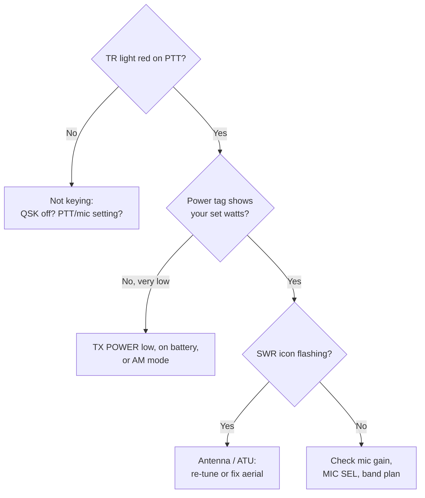
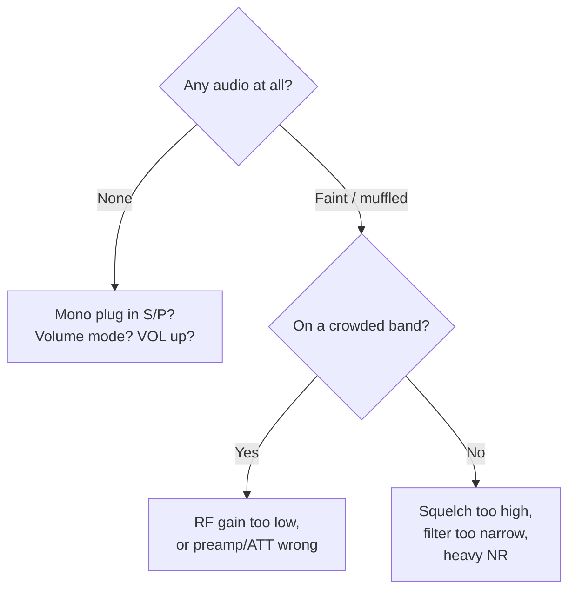

# Troubleshooting

When an SDR QRP rig misbehaves, the fault is almost never where it feels like it is. A "dead" receiver is usually a knob two clicks into the wrong mode; a "broken" transmitter is nearly always the antenna; and "the CAT won't connect" is, nine times in ten, one wrong dropdown on the computer. This chapter is a symptom-first field guide: find what is happening to you, read the likely causes in order of probability, and work down the fixes until it comes right. Almost all of it you can put straight yourself in a couple of minutes.

## Before you panic: a two-question triage

Before chasing any specific fault, answer two questions — they cut the problem in half every time.

**First: is it a _transmit_ or a _receive_ problem?** They have entirely different causes, and it is easy to blame the radio for a receive fault that is really the antenna, or a transmit fault that is really a menu setting. Watch the **TR indicator**: it should flip from green to red the instant you key up. If it turns red on PTT, the radio _is_ transmitting — so a "no output" complaint is downstream, in the antenna, the ATU or the power setting.

**Second: is it the _radio_, or the _thing attached to it_?** The X6100 is one box in a chain — antenna, feedline, connectors, computer, USB cable, power supply. Swapping one suspect at a time (a known-good antenna, a dummy load, a different cable) tells you more in thirty seconds than an hour of menu-diving.

One first-aid note, too: because the X6100 runs a small Linux computer, it can occasionally **freeze or refuse to boot**. If the screen is stuck and a normal press does nothing, **hold the power button for more than 12 seconds** to force a shutdown. Do not do this routinely — a clean shutdown (a ~1 second hold, then let it finish for about ten seconds) protects the internal memory — and always leave at least **30 seconds** before switching on again.

## The transmitter: no output, or only a trickle



### "It won't transmit at all"

**Symptom:** you press PTT (or key) and nothing goes out.

- **You are outside a transmit band.** The X6100 only transmits inside the amateur segments; tune off them and PTT does nothing. The printed edges are also _narrower than some regions allow and vary by firmware and market_, so a frequency legal for you may still sit outside what your unit will key on. Check both your [licence](outpost:entry/logbook73.handbook/getting-licensed) conditions and the radio's transmit range.
- **CW: QSK is switched off.** The classic "my CW won't transmit" trap, and not a fault. On **KEY** page 2, with `QSK TIME` set so break-in is _disabled_, the radio gives you sidetone in your headphones but **puts nothing on the air**. If you can hear yourself keying but nobody answers, enable QSK. See [CW: the Keyer & Messages](outpost:entry/logbook73.guide.x6100/cw-keyer).
- **Wrong microphone selected.** `MIC SEL` in **GEN → RADIO SETTING1** chooses built-in or hand mic; if it points at the one you are _not_ speaking into, your audio never reaches the modulator.
- **No antenna, or a dead short.** Keying into nothing (or a shorted plug) on ANT presents the finals with a wild mismatch: output collapses, and — worse — an open or shorted socket can stress and damage the power amplifier. Never transmit without an antenna or dummy load; Xiegu are explicit that the feed system must meet the transmitting requirements before you key up.

### "It transmits, but at a fraction of the power I expect"

**Symptom:** it keys up (TR red), but the `TX POWER` tag reads far less than you set, or reports say you are weak.

- **You are on the internal battery.** The commonest cause. On the battery the X6100 makes about **5 W** on SSB/CW/FM; only on an external 13.8 V supply does it reach **10 W** — the 7.4 V pack cannot feed the finals as hard. For full output, use a proper supply (at least 3.5 A, correct polarity, _never_ over 15 V DC on the barrel).
- **`TX POWER` is simply set low.** Check the tag in **GEN → RADIO SETTING1** — it may have been wound down to 0.8 W. ⭐ Low power is a virtue locally, less so when reaching for DX.
- **You are in AM.** AM makes only about **2.5 W** of carrier externally (1.5 W on battery), so a low reading is normal; use SSB for efficient voice — the _why_ is in [RF Power](outpost:entry/logbook73.handbook/rf-power).
- **Microphone gain too low.** Thin SSB audio reads as low power because the peaks never reach full output. Nudge `I-MIC GAIN` (built-in) or `H-MIC GAIN` (hand mic) up until voice peaks drive the meter properly — short of over-driving into splatter (see the FT8 section).
- **The battery is nearly flat.** Current battery-gauge firmware uses displayed capacity rather than the old `7.4/7.2 V` rules and automatically shuts down below `10%`. If TX cuts out under load with a low battery icon, charge the pack or test on a stable external supply before suspecting the transmitter.

### "It seems stuck in transmit"

**Symptom:** the radio drops into transmit and stays there, or keys up the moment you plug something in.

- **The Morse key is miswired.** Xiegu warn that a straight 2-core-to-3-core adaptor, or an incorrectly wired paddle, can leave the KEY line permanently grounded — which the radio reads as "key held down" and sits in CW transmit continuously. Use a properly wired 3.5 mm **stereo (3-core)** plug, and **power the radio off before connecting or disconnecting a key** (it may briefly key up otherwise).

## The ATU won't tune, or SWR stays high

**Symptom:** you run a tune and the `SWR` icon still flashes on transmit, or the tuner "won't find a match."

Almost always, **this is the antenna, not the radio**, and the fix is at the aerial end. Work through it in order:

- **You engaged the ATU but never told it to tune.** The tuner works in two stages, and this catches everyone. A **short-press [ATU]** only brings the network _into circuit_ (the `ATU` icon appears); you must then **long-press [ATU] for about a second** to run the tune. Once tuned, leave it engaged — short-pressing again drops it out and loses the match. See [The Antenna Tuner & SWR Scanner](outpost:entry/logbook73.guide.x6100/atu-swr).
- **The antenna is outside the tuner's range.** The ATU is _limited-range_ — it matches up to about **4.5:1**, not the "tune anything" span of a big base-station transmatch. Hand it something wildly off and it searches, gives up, and leaves the `SWR` icon flashing: that flashing icon is the ceiling telling you the fix is the aerial.
- **A wire antenna with no counterpoise, or the wrong length.** End-fed wires and verticals need something to work against; without radials or a counterpoise the feedpoint impedance wanders far outside range. Add a quarter-wave counterpoise, or trim/extend the wire, and re-run the SWR scanner (**APP → SWR SCAN**) to watch the dip move toward your frequency.
- **A cable or connector fault.** A dodgy BNC, nicked coax or corroded joint throws the SWR up regardless of the antenna. Tune into a **dummy load**: if that reaches 1:1 instantly, the radio and ATU are fine and the fault is out along the line.

Remember the honest limit: an ATU makes the _radio_ see 50 ohms; it does not make a poor antenna radiate better, nor cancel loss on the feedline beyond it. On a resonant antenna, leave the ATU **off** (✅). The theory lives in [SWR](outpost:entry/logbook73.handbook/swr), [Impedance](outpost:entry/logbook73.handbook/impedance) and [Antennas](outpost:entry/logbook73.handbook/antennas).

## The receiver is dead, or very deaf



**Symptom:** silence, or the band sounds far deader than it should.

- **A mono plug in the S/P jack.** Disconnect it. The S/P socket requires a **TRS (stereo) plug**; a mono TS plug shorts the output, can silence the audio and, as the manufacturer warns, can damage the device. Use correctly wired stereo headphones/speaker leads before retesting.
- **The volume knob is in the wrong mode.** That top-left knob cycles **Volume → Squelch → RF gain** on each short-press, so it is easy to turn it expecting volume. Glance at the on-screen tag first; if it says `SQL` or `RF GAIN`, short-press until it reads volume.
- **RF gain is backed off.** ⭐ Wind it too far down and weak signals vanish into the noise. If the receiver sounds _dead_ rather than _crowded_, turn RF gain back up toward maximum.
- **Squelch is set too high.** Set too high, it gates out the very signals you want, leaving you sure the band is dead when it is merely closed. Set it just above the hiss (✅), or on quiet HF open it fully.
- **The receive filter is too narrow.** The **DFL** menu sets the audio passband; moving L-CUT/H-CUT too close can remove the wanted signal. `CLOSE` only exits the editor; it does not close the passband. Press `DEFAULT` to restore a sensible width. Heavy **NR** can also mask a weak voice — back it off if things sound underwater. See [DFN & DFL](outpost:entry/logbook73.guide.x6100/dsp-filters).
- **Wrong VFO, mode or sideband.** Check the VFO (A/B), the mode, and the sideband — LSB below 10 MHz, USB above. A strong SSB signal on the wrong sideband is unintelligible mush.
- **Attenuator left in, or preamp wrong for the band.** Below about 14 MHz, run the preamp **off** (⭐); the current V1.6 manual recommends ATT for strong signals above roughly `−50 dBm`. Short-press **PRE** to toggle preamp/bypass and long-press it to toggle ATT. If a quiet band sounds deaf, make sure both `PRE` and `ATT` indicators are off rather than trying to cycle through three states.

If the receiver instead sounds _harsh and crowded_ — voices behind CW, phantom images near a broadcaster — that is front-end **overload**, not deafness, and the cure is the opposite: reduce RF gain, switch the attenuator in, and near a broadcast mast fit a band-stop filter ahead of the aerial. See [Overload & Ghost Signals](outpost:entry/logbook73.handbook/overload-and-ghost-signals).

## The computer won't talk to the radio (CAT)

**Symptom:** your logging or digital-mode software reports "rig not responding," "could not open port," or the frequency in the software never matches the radio.

CAT (Computer Aided Transceiver control) rides over the **DEV** USB-C port, and getting it working is a checklist:

- **Wrong USB port.** Use **DEV** (the USB-C "slave" port) — _not_ HOST, which is for a keyboard or mouse. HOST will never give you control.
- **The driver is missing.** The DEV port needs the **CH342** USB-serial driver on the computer; without it, no COM port appears at all.
- **Wrong rig profile.** Prefer a tested native **X6100** profile when the application offers one. Xiegu's official OmniRig/JTDX procedure uses **`IC-7000` at `19200` baud**; the older generic connection appendix documents **`X108G`** compatibility. Follow the recipe for your particular program rather than assuming one name works everywhere.
- **Wrong COM port.** The CH342 usually presents _two_ ports; if control fails, try the other. Windows Device Manager shows which appeared when you plugged the radio in.
- **Baud rate mismatch.** The serial speed must match at both ends. Xiegu's official OmniRig recipe specifies **`19200` baud**; another tested native profile may manage this for you.
- **CI-V address mismatch.** CI-V identifies the rig on the bus by a hex address. If your application exposes an address override, leave the tested profile's value alone unless its documentation tells you otherwise.
- **The port is already in use.** Only one program can hold it, so if your logger and WSJT-X both grab it, one fails — route them through a single controller.

The full connectivity walkthrough — including the virtual sound card — is in [Connectivity: USB/CAT, Bluetooth & Data](outpost:entry/logbook73.guide.x6100/connectivity).

## FT8 won't decode — or won't transmit

FT8 on stock firmware is the radio in **USB-DIG** (**U-DIG** on some displays), with a computer doing the encoding and decoding over the DEV port. Two separate things must work — the **audio** path and the **CAT/keying** path — so split the fault accordingly. Ordinary USB is the voice path, so check the digital-mode selection before changing levels or drivers. (Theory in [FT8](outpost:entry/logbook73.handbook/ft8).)

### "It decodes nothing"

- **The computer's clock is wrong.** FT8's number-one silent killer: the mode needs both stations agreeing on time to within about a second, so a drifted PC clock decodes _nothing_ even from a strong signal. Turn on automatic internet time sync (NTP).
- **Audio isn't reaching the software.** The decoder's PC _input/recording_ device must be **`Microphone (USB Audio)`** — radio RX flowing into the computer — not the laptop microphone. For transmit tones, PC _output/playback_ must be **`Loudspeaker (USB Audio)`**. Confirm the level meter twitches with band noise before enabling transmit.
- **Audio level too low or too high.** Adjust `LINE IN LV` / `LINE OUT LV` in **GEN → RADIO SETTING1** with the computer's slider so the decoder's level sits mid-scale.
- **Wrong band or mode.** Be in **USB-DIG / U-DIG**, on the band's FT8 dial frequency, with squelch open and RF gain sensible.

### "It decodes fine but won't transmit"

- **PTT isn't keying the radio.** For the official FT8 flow set **PTT method to CAT** over CI-V on DEV. Older firmware notes also discuss RTS/CW behaviour, so do not make a universal RTS/DTR claim; follow the application-specific recipe (including N1MM for computer CW). If CAT PTT is set and the TR light stays green, revisit the CAT checklist.
- **TX audio over-driven.** Too much drive does not make you louder, it makes you _wider_ — splattering across your neighbours. Raise the computer's output and `LINE IN LV` only until output just reaches full and the ALC barely tickles, then stop.

```viz
{
  "type": "spectrum",
  "title": "Clean drive versus an over-driven FT8 signal",
  "caption": "Drive the audio just to full output and your signal is a single clean tone (left). Push it harder and it sprays spurious products either side (right) — louder to nobody, and interference to everybody. Back off until the ALC only just moves.",
  "components": [
    { "f": 26, "amp": 0.95, "label": "clean", "tone": "primary", "width": 2 },
    { "f": 66, "amp": 0.95, "label": "over-driven", "tone": "ink", "width": 2 },
    { "f": 56, "amp": 0.42, "tone": "danger", "width": 2 },
    { "f": 76, "amp": 0.42, "tone": "danger", "width": 2 },
    { "f": 48, "amp": 0.22, "tone": "danger", "width": 2 },
    { "f": 84, "amp": 0.22, "tone": "danger", "width": 2 }
  ],
  "noiseFloor": 0.05,
  "xLabel": "frequency across the passband"
}
```

- **Power set high, or a slow supply.** A long string of full-power overs on a small rig invites the heat described below; run FT8 at modest power, which is plenty for the mode.

## Bluetooth or Wi-Fi won't connect

Both wireless features live under **GEN → SYSTEM SETTING** (select **WLAN** or **BLUETOOTH**; older builds may say WIFI). Keyboard/mouse input is the dependable Bluetooth use; stock headset audio is contradicted between product marketing and the detailed manual, so pairing alone is not proof of audio routing.

### Wi-Fi (WLAN)

- **A 5 GHz-only or modern router.** The X6100's radio is **2.4 GHz 802.11 b/g/n** only. Xiegu warn that "some wireless routers that support advanced protocols and new frequency bands may be unable to connect" — so a 5 GHz-only network, or one demanding WPA3, will not join. Use a **2.4 GHz** WPA2 network (or a 2.4 GHz guest network on a dual-band router).
- **You lost your typing.** Do not turn the MFK while entering a password or IP address — older documentation says it discards the text. Current V1.6 scans automatically and provides HELP; APP V1.2.0 says Wi-Fi logic improved, but older v1.1.8 material also records broken DHCP. Follow the installed HELP and use the matching static-address fallback if automatic addressing fails.

### Bluetooth

- **It never finds the device.** Switch Bluetooth on, put the keyboard/mouse into pairing mode, press **SCAN** on the current documented screen and give it a moment to appear.
- **A headset pairs but is silent.** That matches the detailed stock manual: pairing may succeed without receive-audio or microphone routing. Use wired stereo audio unless your exact installed build explicitly proves otherwise.
- **Interference from other 2.4 GHz kit.** A wireless mouse or another router in the same band can clash and drop the connection — move away from it or turn it off.
- **A stuck pairing.** If a paired device refuses to reconnect, disconnect and re-pair. Wireless behaviour has also shifted between firmware versions, so if it is flaky, note your firmware (below).

## Battery, charging and the radio getting warm

### "It won't charge, or the charge light looks wrong"

- **Charging is switched off in the menu.** The `CHARGER` item in **GEN → RADIO SETTING1** enables charging; with it off, plugging in does nothing and the TR light stays **dark**. Turn it on.
- **Reading the TR light is documentation-versioned.** EU v1.1.7 says blinking green = charging and steady green = complete. Current V1.6 says that during powered-off charging, green lit = charging, red lit = battery abnormal and off = CHARGER disabled; check remaining capacity by powering on. No current source requires the red state to flash.
- **The first four charges take longer.** Current V1.6 specifies **8–10 hours** for each of those calibration cycles; let them complete. Later charge time varies with remaining capacity and conditions rather than one guaranteed six-hour figure.
- **Use only the supplied charger.** A non-compliant charger can damage the radio, and the charging adapter _cannot_ power transmit — it only charges.

### "Transmit cuts out, or it shuts itself down"

Early firmware used voltage thresholds around **7.4/7.2 V**, but the later battery-gauge update explicitly changed management to measured capacity. On the current baseline, automatic shutdown occurs below **10% displayed capacity**. If the radio drops out mid-session, charge it or test on external 13.8 V; do not infer cell health from one loaded voltage reading. For longevity, store the pack around **40–50%** charged.

### "It gets warm on long transmissions"

Expected, not a fault. On a high-duty-cycle mode like **FT8 or RTTY** the finals run continuously, and a compact QRP rig has limited heatsinking — Xiegu's advice is to "extend the transmitting interval and strengthen external heat dissipation." In practice: run **lower power** on data (a few watts is plenty for FT8), give it **airflow**, and note that external 13.8 V (10 W) runs hotter than the battery (5 W).

## When it really is the firmware

The X6100 tracks **two** firmware versions — **APP** (the Linux user interface) and **BASE** (the STM32 radio side) — shown together in **GEN → SYSTEM SETTING → SYSTEM INFO**. The current official baseline is APP V1.2.0 with BASE V1.1.9, but the values on your own radio are the authority. Firmware is a genuine source of faults here, so record both before concluding the hardware is broken.

Two documented cases show why firmware matters:

- **A build that broke transmit.** A September 2024 release (APP V1.1.8) was **withdrawn** after it disabled transmit, and fixed in V1.1.9. So "my X6100 suddenly won't transmit after I updated it" can be a firmware regression, not a hardware failure — move to a known-good build.
- **Bands won't switch, or the frequency shows "0".** Later builds (from V1.2.0) require a **mandatory factory reset after upgrading**; skip it and the band data can corrupt, so bands refuse to switch or the frequency reads `0`. The fix is exactly that reset: **GEN → SYSTEM SETTING → FACTORY RESET**, then power-cycle.

Two rules keep updates safe: **use a stable 13.8 V external supply, never the battery**, and complete both official stages. Write `x6100udimg.img` to a bootable microSD flash card, boot it for the automatic APP/system update, remove it after the radio shuts down, boot normally, then apply the matching BASE image through **SYSTEM SETTING → FIRMWARE/FW UPGRADE**. Reboot, verify both versions and perform the release-required reset. Record settings and memories first rather than assuming any update preserves them. Follow the [official X6100 update tutorial](https://xiegu.eu/sdm_downloads/xiegu-x6100-firmware-update-tutorial/) and the exact package notes.

There is also a lively **alternative-firmware** scene worth understanding. Because the UI is Linux, a well-known community image (originally R1CBU's, now maintained by gdyuldin as OpenX6100) boots **entirely from the microSD card**: it adds features stock lacks — native FT8/FT4 decode, a CW decoder, wider filters, logging — and is **non-destructive, so removing the card boots stock again, unchanged.** That makes it low-risk to try, whether for the extra features or to sidestep a stock bug for an afternoon. Xiegu treat third-party firmware as voiding the warranty, but the SD-boot approach is reversible and leaves the factory firmware untouched. It moves fast, so expect its exact features and versions to change — and keep your stock backup either way. If something goes wrong _on_ a community card, first switch off, remove the card and check whether stock firmware behaves; then report it to that project, not to Xiegu. [Custom Firmware](outpost:entry/logbook73.guide.x6100/custom-firmware) covers the projects, their risks and where to get help.

## Try it yourself

You can rehearse most of these fixes safely, without transmitting anywhere you should not:

1. **Practise the receive triage.** Deliberately break the receiver — wind RF gain right down, set squelch high, narrow the DFL filter to nothing — and learn what each "deafness" sounds like. Restore each with `DEFAULT` and the volume tag.
2. **Read your firmware.** In **GEN → SYSTEM SETTING → SYSTEM INFO**, note your APP and BASE versions and check them against Xiegu's release notes to see whether a known bug applies to you.
3. **Tune into a dummy load.** Engage the ATU into a 50 Ω dummy load — it should reach 1:1 instantly. Now you know what a _healthy_ match looks like, so a stubborn `SWR` icon on a real antenna clearly points at the aerial.
4. **Dry-run CAT.** Connect the DEV port, install the CH342 driver, select a tested X6100 profile or the official OmniRig `IC-7000`/`19200` recipe, and confirm the software follows frequency and mode — the bench beats the field for this.
5. **Sync your clock.** Turn on automatic internet time on your FT8 computer — the one setting most often between you and your first decode.

## Key takeaways

- **Triage first:** decide whether it is a _transmit_ or _receive_ fault (watch the TR light), and whether it is the _radio_ or the _thing attached to it_ — a swapped antenna, cable or dummy load answers most questions in seconds.
- **Low or no output** is usually the power source (5 W on battery, 10 W external), the `TX POWER` setting, AM mode, or — for CW — **QSK switched off** (sidetone but no transmit); a stuck transmitter is often a miswired key.
- **The ATU "won't tune"** is nearly always the antenna: engage _then_ long-press to tune, respect the **4.5:1** limit, add a counterpoise or trim the wire, and check the feedline.
- **A "deaf" receiver** is usually a **mono plug in the stereo S/P jack**, the knob in the wrong (SQL/RFG) mode, squelch too high, a filter closed to nothing, or the attenuator left in — while _harsh and crowded_ means overload, cured the opposite way.
- **CAT** is a checklist: DEV port (not HOST), **CH342** driver, a profile documented for your program (native X6100 first; OmniRig `IC-7000`/`19200` officially), the right COM port, matching settings and one program holding the port.
- **FT8** starts with **USB-DIG / U-DIG**, then splits into audio (clock sync, virtual sound card, levels) and keying (**CAT PTT**, drive so the ALC just tickles); Wi-Fi needs **2.4 GHz**; warmth on long data transmits is normal — lower power, more airflow.
- **Suspect the firmware** after an update: check the **APP and BASE** versions, redo the **factory reset** V1.2.0 demands, update only on external power, and keep the reversible SD-card **community firmware** in mind as both a feature upgrade and a bug workaround.

With the faults tamed, the last chapter turns from fixing problems to avoiding them — the habits that make you a clean, considerate, well-organised operator, in [Best Practices](outpost:entry/logbook73.guide.x6100/best-practices).
