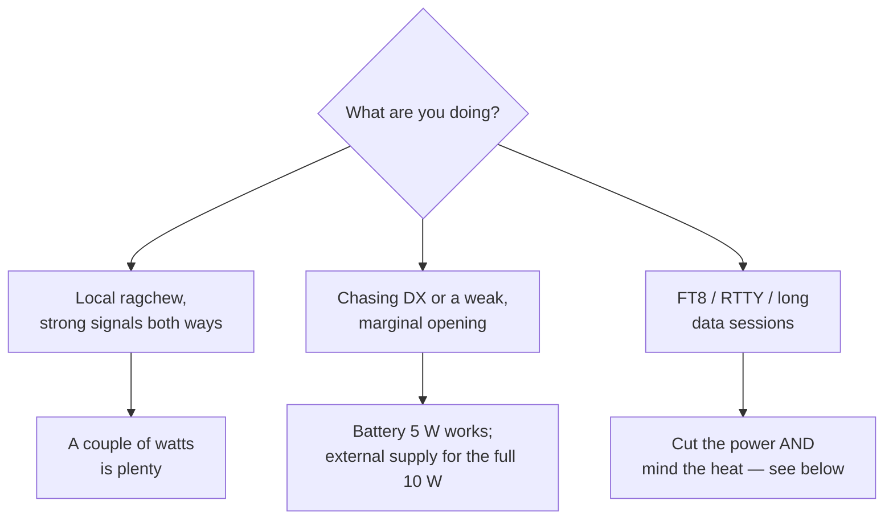
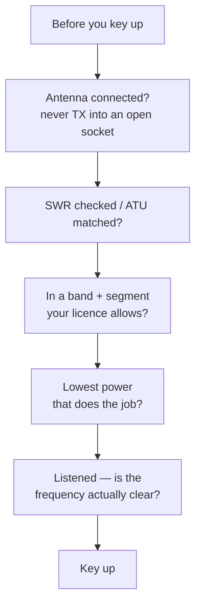

# Best practices

Every setting in this guide has been about _what the radio can do_. This last chapter is about _doing it well_ — the handful of habits that turn a capable little SDR into a station other operators are glad to hear, and keep you, your radio and your neighbours out of trouble. None of it is difficult, and most of it is free. At five or ten watts you have no power to waste and no margin for a sloppy antenna, so the good habits below are not politeness for its own sake — they are what actually gets you heard.

## The antenna comes first, always

If you take one thing from this chapter, take this: **at QRP, the antenna decides almost everything.** Watts are cheap and you have few of them; a good antenna is what turns those few watts into a contact across an ocean, and a bad one turns them into warmth in the ground. The rig is rarely the reason a band is disappointing — the aerial almost always is.

That reframes what the built-in [ATU](outpost:entry/logbook73.guide.x6100/atu-swr) is for. A tuner is an _impedance matcher_, not an antenna improver: it makes the radio's power amplifier see a comfortable 50 ohms so it delivers full output, but it changes nothing about how well the wire in the sky actually radiates. A tuner will happily present a perfect `1:1` to the transmitter while your antenna quietly wastes half your power in a poor match or a bad earth — the classic "tuning into a light bulb." So the order of operations matters:

- **A resonant antenna beats a forced match.** An antenna cut to length for the band, matched close to 50 ohms on its own, needs no tuner and loses nothing to one. Reach for the wire and the tape measure before you reach for the ATU. The [SWR scanner](outpost:entry/logbook73.guide.x6100/atu-swr) built into the radio, or a [NanoVNA](outpost:entry/logbook73.handbook/nanovna) on the bench, tells you where the antenna is truly resonant so you can trim it there.
- **The ATU is for convenience and band edges, not for rescue.** Use it to get a random length of wire on the air _now_ on a hilltop, or to smooth a resonant antenna's small drift at the band edges — not to paper over an antenna that is fundamentally in the wrong place. Remember its ceiling is about `4.5:1`; a flashing `SWR` icon that will not clear is the antenna telling you the fix is at the antenna, not the radio.
- **Turn the tuner off when you don't need it. ⭐** On a naturally resonant antenna the ATU only adds a whisker of loss and a step to forget — drop it out of circuit.

The manual puts the same point bluntly in its own safety notes: _make sure the antenna feed system meets the transmitting requirements before actual transmitting._ The full theory — where standing waves come from, why matching matters, what an antenna is really doing — lives in [SWR](outpost:entry/logbook73.handbook/swr), [Impedance](outpost:entry/logbook73.handbook/impedance), [Antennas](outpost:entry/logbook73.handbook/antennas) and [Transmission Lines](outpost:entry/logbook73.handbook/transmission-lines). Read them once and the ATU stops being magic and becomes a tool you know the limits of.

## Run the power you need, and no more

The X6100 gives you roughly **5 watts from the internal battery and up to about 10 watts on an external 13.8 V supply** — and the discipline of QRP is to treat even those as a ceiling, not a target. Running more power than the contact needs flattens the battery faster, warms the radio, spreads your signal further than a local chat requires, and — crucially — buys you almost nothing where it counts. The difference between 5 W and 10 W is just 3 dB — only half an [S-point](outpost:entry/logbook73.handbook/rf-power) at the far end, barely at the threshold of what the ear even registers as "louder." A better antenna or a better band will beat any power increase you can make here.



Set the level with **TX POWER** in RADIO SETTING1. ⭐ Pick the least that reliably does the job: full output for chasing a weak DX station, but a watt or two for a strong local. Because HF outcomes are dominated by [propagation](outpost:entry/logbook73.handbook/propagation) and your antenna, working the world on a handful of watts is not a handicap to apologise for — it is the whole point, and one of the real thrills of the hobby.

### FT8 and the duty-cycle trap

Voice and CW are _low-duty_ modes: you transmit in bursts with gaps between, and the power amplifier spends most of its time cooling. **FT8, RTTY, and other data modes are the opposite** — a continuous, full-power carrier for the entire transmit slot (about 12.6 seconds at a time for FT8), over and over, sometimes for hours. That is the hardest work you can ask of a small transmitter, and the X6100 will get warm doing it. The manual is explicit: _the device may be hot after continuous and long-term transmitting (such as FT8 operation) — appropriately extend the transmitting interval and strengthen external heat dissipation._

So for any sustained data run:

- **Turn the power down.** ⭐ FT8 is a weak-signal mode designed to be decoded well below the noise; you rarely need more than a few watts, and lower power means less heat and a signal that is still perfectly workable. Reducing power here costs you almost nothing and protects the radio.
- **Give it air and give it breaks.** Do not run it buried in a bag or with the back pressed against something; a little airflow, and the occasional pause between calling sequences, keeps the temperature sane. Some operators add a small stand or a quiet fan for long FT8 sessions.
- **Set the audio drive low.** On data modes the _soundcard level_, not the mic gain, is what can overdrive the transmitter — feed too much audio from the PC and you flat-top the signal into splatter (next section). Set it just high enough to reach your chosen power, no more. The [FT8](outpost:entry/logbook73.handbook/ft8) chapter and the guide's own [Connectivity](outpost:entry/logbook73.guide.x6100/connectivity) page cover the workflow.

## Look after the battery

The current manufacturer V1.6 manual specifies a **two-cell lithium pack of `7.4 V`, `3500 mAh`** (about 26 Wh); older English material says 3000 mAh. Early firmware judged it by loaded voltage and published roughly `7.4/7.2 V` protection points. Xiegu's later battery-gauge update explicitly stopped using voltage as the management value; on the current baseline the displayed percentage is authoritative and the radio automatically shuts down below `10%`. A low-battery dropout late in a session is therefore a prompt to charge or test on external power, not a reliable cell-voltage diagnostic.

A few habits help the pack approach the current V1.6 service expectation of about **2 years / 200–300 cycles** under its stated conditions. Heat, storage charge and depth of discharge can shorten or extend real life, so this is a conservative service boundary rather than a warranty:

- **Store it part-charged. ✅** If the radio will sit unused for weeks, leave the battery at **40–50%**, not full and not flat — the manual says so plainly, and it is the single biggest thing you can do for battery longevity. A pack left full or empty for months ages far faster.
- **Keep it cool.** Heat is the enemy of lithium cells. Don't leave the radio in a hot car, in direct sun, or above about 60 °C, and don't charge it in a vehicle in direct sunlight.
- **Charge sensibly.** Charging is toggled by **CHARGER** in RADIO SETTING1. Current V1.6 says the first four calibration cycles each take `8–10 hours`. EU v1.1.7 describes blinking green while charging and steady green when complete; current V1.6 describes green lit while powered-off charging, red lit for battery abnormal and off when CHARGER is disabled. Use the supplied adapter and stop for unusual heat, swelling, smell or the documented red abnormal state.
- **Mind the DC input.** The external supply must be **9–15 V DC, and never more than 15 V** — the manual warns that exceeding it, applying AC, or reversing polarity can destroy the radio. A regulated supply of at least 3.5 A on the correct 5.5 × 2.5 mm barrel is what you want for the full 10 W.

## Keep your signal clean

A clean signal is the mark of a considerate operator, and it is mostly about _not overdoing it_. On SSB, your voice is stamped onto a tidy slice of spectrum about 2.4–2.8 kHz wide. Drive the transmitter too hard — too much mic gain, shouting into it, or too much audio on data — and it can no longer reproduce your voice honestly. Instead of getting louder it starts generating extra products that spread _outside_ that tidy slice, spilling across the frequencies either side. That mess is called **splatter**, and to everyone near you it sounds like a distorted signal smearing over their conversations.

```viz
{
  "type": "spectrum",
  "title": "Clean SSB versus an overdriven signal",
  "caption": "Driven properly, your voice fills a tidy ~2.7 kHz block (blue). Overdrive it — too much mic gain, or too much audio on data — and the transmitter throws out extra products either side (red) that splatter across your neighbours' frequencies.",
  "noiseFloor": 0.04,
  "components": [
    { "f": 50, "amp": 0.92, "width": 9, "tone": "primary", "label": "your voice — clean" },
    { "f": 35, "amp": 0.34, "tone": "danger" },
    { "f": 30, "amp": 0.2, "tone": "danger", "label": "splatter" },
    { "f": 65, "amp": 0.34, "tone": "danger" },
    { "f": 70, "amp": 0.2, "tone": "danger" }
  ],
  "xLabel": "frequency across the channel"
}
```

The cures are simple habits:

- **Set the mic gain to "enough," not "maximum." ⭐** RADIO SETTING1 has **I-MIC GAIN** for the built-in microphone and **H-MIC GAIN** for the hand mic — two separate settings, so adjust whichever you actually use. Speak across the microphone at a normal, steady level and set the gain so a comfortable voice just reaches full drive. Past that point, more gain adds only distortion and splatter, never intelligibility — the far end hears you _worse_, not better.
- **Watch the display.** The X6100 shows a transmit meter while you key up; use it to confirm you are reaching your set power on voice peaks without pinning it flat. If you want to _hear_ how you sound, the **MONI LEVEL** setting lets you monitor your own transmit audio through headphones (⭐, off by default) — a genuinely useful way to catch a rasp or a hum you didn't know you had.
- **On data, drive from the soundcard, gently.** As above, keep the PC audio level low enough that the radio reaches — but never exceeds — your target power. An overdriven FT8 signal splatters exactly like an overdriven voice, and is a common cause of the "wide" signals people grumble about on the FT8 sub-bands.

The underlying idea — why over-modulating a [transmitter](outpost:entry/logbook73.handbook/transmitters) generates out-of-band products, and how [modulation](outpost:entry/logbook73.handbook/modulation) puts your voice on the wave in the first place — is worth reading once so the habit makes sense rather than being a rule you follow blindly.

## Stay in band, in mode, and considerate

The X6100 _receives_ continuously from `0.5` to `30 MHz` and `50` to `54 MHz`, but you may **transmit only on the amateur bands, only within the segments your licence permits, and only in modes allowed there** — the manual states it as plainly as any regulator would: _transmission activities shall not be carried out in non-amateur frequency bands_, and _obtain the corresponding amateur qualification and licence before making a call._ Two practical points follow that catch newcomers out.

First, **the radio's built-in transmit band edges are not your licence.** Xiegu's factory segments are narrower than some national allocations, they omit bands like 60 m, and the manual openly warns that the transmit range _varies by version of the equipment_ and by region/firmware. So the fact that the radio _lets_ you transmit somewhere does not mean you _may_ — the authority is your national band plan and [licence conditions](outpost:entry/logbook73.handbook/getting-licensed), not the firmware. Check them, and stay well inside the edges (the [SWR scanner](outpost:entry/logbook73.guide.x6100/atu-swr) is a sneaky offender here — a wide sweep centred near a band edge can throw your test carrier outside the band).

Second, **listen before you leap.** The waterfall shows you activity, but it does not tell you a frequency is _free_ — a distant station you cannot see may be working someone. The universal courtesy, on any band, is to listen, then ask "is this frequency in use?" before you call. And observe the band-plan conventions: SSB above certain points, CW down the low end, and the recognised [FT8](outpost:entry/logbook73.handbook/ft8) sub-band watering-holes (like `14.074 MHz`) rather than parking a data signal in the middle of the voice segment.



Run through that little checklist until it becomes automatic, and you will never be the station that keys up out of band, over the top of someone, or into no antenna at all.

## Get the most from the receiver

Hearing well is half of working well, and the X6100's direct-conversion front end — its known soft spot, with no [roofing filter](outpost:entry/logbook73.handbook/receivers) — rewards a little management near strong signals. A few receive habits transform it:

- **Below 14 MHz, turn the preamp off.** ⭐ The lower bands are noisy enough that the extra gain of the preamp does nothing but help the receiver overload. Short-press **PRE** to toggle preamp/bypass; long-press it to toggle the **attenuator** when strong signals appear (the current V1.6 manual says above roughly `−50 dBm`). Above 14 MHz, where signals are weaker, the preamp earns its keep.
- **Use RF gain, not just volume.** Short-press the VOL/SQL/RFG knob to reach **RF Gain** and back it off when the band is crowded or noisy — it lifts weak signals out of a wall of strong ones far better than turning the volume down.
- **Reach for the DSP tools deliberately.** The [DFN and DFL menus](outpost:entry/logbook73.guide.x6100/dsp-filters) give you noise reduction, a noise blanker, a manually placed digital notch and a variable passband — powerful, but each has a cost in naturalness, so add the least that clears the problem.
- **Near strong broadcasters, filter the front end.** If you operate from home close to a medium-wave or shortwave transmitter and hear voices behind CW or broadcast bleed-through, an inexpensive AM-broadcast reject (high-pass) filter in the antenna lead is the standard cure. The mechanism is explained in [Overload and Ghost Signals](outpost:entry/logbook73.handbook/overload-and-ghost-signals).

## RF safety, kept simple

A QRP HF rig is a gentle thing compared with a kilowatt station, but it still puts real RF into a real antenna, so the sensible precautions — all straight from the manual — are worth a moment:

- **Never touch the antenna while transmitting**, and keep the radiating element away from your body when you key up. Tuning against a short whip in particular concentrates RF close to you and can splash interference into the radio itself.
- **Never transmit without an antenna or a dummy load.** A transmitter with nowhere to send its power can be damaged by its own reflected energy — and running a tune or an SWR sweep into an open socket is exactly the wrong thing to do.
- **Disconnect for lightning.** In a thunderstorm, unplug both the antenna and the power in advance — an antenna is a lovely thing to hand a lightning strike to your radio. Don't operate in the wet or with wet hands.
- **Give it air, and respect the temperature ranges.** Current V1.6 specifies **operation at `0…+55 °C`**. Its broader `−10…+55 °C` wording is a placement/storage safety boundary, not permission to operate below freezing. Don't block the case or run it buried under gear on high-duty modes. And spare your ears — don't run headphones at high volume.

That really is the whole of RF safety at this size: right licence, right band, always an antenna, a sane supply voltage, and a little respect for heat. The reasoning behind exposure and power is in [RF Power](outpost:entry/logbook73.handbook/rf-power).

## Firmware and update habits

The X6100's firmware is part of owning it, so a few habits save a lot of grief. Remember it carries **two version numbers** — an **APP** version (the Linux interface) and a **BASE** version (the radio hardware) — that move independently; note both from the system-info screen before you ask for help or plan an update.

- **Update deliberately, not reflexively.** ⭐ Read the release notes first. The history has been bumpy — one build was even withdrawn for breaking transmit — so "newest" is not always "best." A stable version that does what you need is worth more than the latest one.
- **Update on external power.** ✅ Run the radio from a 13.8 V supply, never the battery, while flashing firmware. A shutdown mid-update is how radios get bricked.
- **Do the mandatory reset when told to.** ✅ Recent Xiegu updates require a **factory reset after upgrading** — skip it and the band data can corrupt, leaving the radio unable to change bands or showing a frequency of `0`. Because a reset wipes your settings and the 200 memory channels, note or back up anything you have customised first.
- **Plan for battery ageing.** Current V1.6 service guidance gives about `2 years` or `200–300` cycles under its stated use conditions. Actual life depends strongly on heat, storage charge, depth of discharge and time; use that as a conservative service expectation rather than the older generic 3–4-year/300–500-cycle claim.
- **Community firmware is optional — and reversible. ⚠️** The best-known alternative boots entirely from the SD card (adding on-radio FT8/CW decode, wider filters, a logbook and more); removing the card returns you to stock Xiegu firmware, changing nothing permanent. Xiegu treats it as voiding the warranty, so it is an advanced, at-your-own-risk choice — but the SD-boot approach is the safe way to try it, and you can always step back. The full update procedure lives in [Connectivity](outpost:entry/logbook73.guide.x6100/connectivity).

## Try it yourself

A short routine that bakes the good habits in — do it once and it becomes second nature:

1. **Measure before you match.** Before a session, run the [SWR scanner](outpost:entry/logbook73.guide.x6100/atu-swr) across your band and confirm the antenna's dip is where you want it. If it is already under about `2:1`, leave the ATU off and enjoy a match you didn't have to force.
2. **Find your floor on power.** Make a contact, then drop **TX POWER** step by step until the other station reports you getting weaker. You will usually find you can lose several watts before it matters — that is your working level for the day.
3. **Hear yourself.** Turn on **MONI LEVEL** and listen through headphones as you speak at different mic-gain settings. Find the point where more gain stops making you clearer and starts making you harsh — then set it just below that.
4. **Run the pre-flight.** For a week, force yourself through the checklist above — antenna, SWR, band, power, listen — before every single transmission, until you stop having to think about it.
5. **Note your firmware.** Read your APP and BASE versions and write them down. You now know exactly what your radio is running before you ever need to.

## Key takeaways

- **The antenna decides the outcome at QRP** — a resonant antenna beats any forced match, and the ATU is a convenience and a matcher, never an antenna improver. Measure first, match second, rebuild the aerial last.
- **Run the least power that does the job**: 5 W on battery, up to 10 W external, and even those are ceilings — a better antenna or band beats more watts every time.
- **FT8 and data are full-duty modes that heat the radio** — cut the power, keep the audio drive low, and give the set air and breaks.
- **Look after the 7.4 V lithium pack**: store it at 40–50%, keep it cool, charge it with the right adapter, and never feed the DC input more than 15 V.
- **Keep your signal clean** by setting mic gain (or soundcard drive) to "enough," not "maximum" — overdriving only produces splatter, never clarity.
- **Transmit only where your licence allows**, not merely where the firmware lets you; listen before you call, stay inside the band edges, and observe the band plan.
- **Handle firmware with care**: know your APP and BASE versions, update on external power, do any required factory reset, back up first — and treat community firmware as a reversible, advanced option.

That is the whole of good practice on the X6100 — the rest is hours on the air. When a specific setting sends you back to look something up, the fastest way in is the one-page map of every button-menu and value in the [Menu & Button Reference](outpost:entry/logbook73.guide.x6100/menu-reference).
