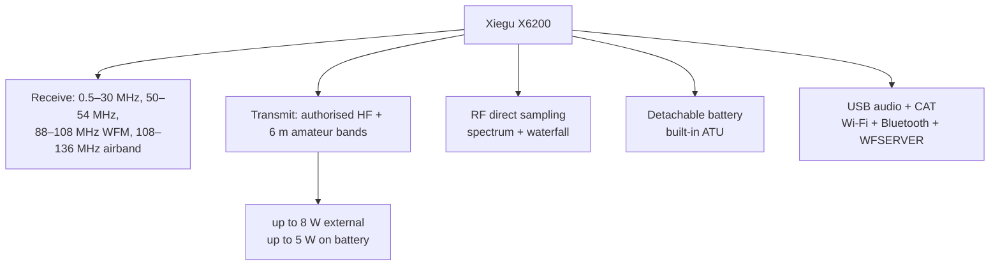

# Why the X6200 is a separate radio

The Xiegu X6200 is a small, self-contained HF and 6 m station built for operating away from a desk. It combines an RF direct-sampling receiver, a colour spectrum-and-waterfall display, a removable battery, an automatic antenna tuner, computer audio and control, wireless links, and several on-radio applications. It is easy to describe as an updated X6100, but that description is only useful at first glance. The controls look related; the receiver architecture, battery, power limits, receive coverage, menu tree, applications and update process are different enough that the X6200 deserves its own guide.

This companion explains the stock Xiegu firmware in plain English. Its primary baseline is the public English V01 manual on Xiegu EU, supplemented by a fuller manufacturer-authored Rev 05 manual mirrored by Radioddity, then brought forward with the official Xiegu EU changes for firmware `1.0.6` and `1.0.7`. Whenever a control arrived or moved in one of those releases, the text says so. Check **GEN → SYSTEM → SYSTEM INFO** on your own radio before assuming that a menu shown here must be present.

## What the X6200 actually is

Strip away the abbreviations and it is a **portable, all-mode, low-power transceiver for the amateur HF bands and 50 MHz**, with wide-range receive coverage and most of the station accessories built in.

The published specification is quite precise about the distinction between receiving and transmitting:

- **General coverage receive** runs from `0.5–30 MHz` and `50–54 MHz`. That includes medium-wave and shortwave broadcasting as well as the amateur bands.
- **Broadcast FM receive** covers `88–108 MHz` in WFM. WFM means _wide_ FM, the bandwidth used by broadcast stations; it is not the same as the NFM voice mode used for narrow communications.
- **Airband receive** covers `108–136 MHz` in AM. This is receive-only. Never try to transmit on an aviation frequency.
- **Transmit coverage** is confined to enabled amateur allocations. Exact edges can vary by market and firmware. Your licence and national band plan, not the coloured bar on the screen, decide where and how you may transmit.

Xiegu specifies a maximum output of about `8 W` from a suitable `13.8 V` external supply and about `5 W` from the battery panel. Power is adjustable in `0.5 W` steps. Those numbers make the radio **QRP**: low power by design. It can make long-distance contacts, but the antenna, propagation, low noise and operating skill matter more than a few extra watts. [RF Power](outpost:entry/logbook73.handbook/rf-power) and [Propagation](outpost:entry/logbook73.handbook/propagation) explain why.

The receiver is described by the manufacturer as **RF direct sampling**. Incoming radio-frequency energy is digitised and processed in software, which is what makes flexible filters, a live spectrum and a waterfall possible. The screen is a display operated by the five physical soft-keys and the knobs; this guide never assumes that tapping the glass is a control method. [Software-Defined Radio](outpost:entry/logbook73.handbook/software-defined-radio), [I/Q Signals](outpost:entry/logbook73.handbook/iq-signals) and [FFTs and Waterfalls](outpost:entry/logbook73.handbook/ffts-and-waterfalls) cover the deeper theory.

## The feature set that matters in use

Some specifications sound impressive without changing an operating session. These do change it:

- **The removable rear battery panel** makes a field change practical. It also means the update and hard-recovery procedures differ from the X6100: the battery can, and for a full system update must, be removed.
- **The built-in ATU** remembers successful matching solutions and can quickly recall them near a previously tuned frequency. It makes a mildly mismatched antenna usable; it does not turn an arbitrary wire into an efficient antenna.
- **The waterfall** shows where activity is before you tune to it. In firmware `1.0.7`, the display adds normal/slow waterfall speeds, an optional received-level readout and an optional 3D bandscope.
- **Two USB-C ports have different jobs.** `DEV` connects the radio to a computer and exposes control and audio devices. `HOST` accepts suitable peripherals and the optional WR12 receiver module. They are not interchangeable.
- **The H-22 microphone** is more than a PTT and mic capsule. It has direct band entry, frequency entry, VFO/memory and mode controls, three assignable function keys, HOME, volume keys and channel controls.
- **The APP menu contains real radio tools:** an RTTY/BPSK modem, SWR scanner, voice caller and an FT8 decoder. The last word is important: the on-radio FT8 screen decodes; it is not, by itself, a complete FT8 QSO interface.
- **Firmware `1.0.6` adds a CW decoder, FT8CN Bluetooth support, WR12 support and network information.** Firmware `1.0.7` moves CW decoding fully into the KEY menu and removes CW from the MODEM choices.

## X6200 versus X6100

They share a family resemblance, common concepts and several button names, but combining both radios into one set of button-by-button instructions would create dangerous ambiguity.

| Area                 | X6200                                                             | X6100                                             |
| -------------------- | ----------------------------------------------------------------- | ------------------------------------------------- |
| Receiver description | RF direct sampling                                                | Xiegu manual describes a ZIF receiver             |
| Maximum RF output    | about 8 W external / 5 W battery                                  | about 10 W external / 5 W battery                 |
| Battery              | detachable rear panel                                             | internal pack                                     |
| Extra receive ranges | WFM broadcast and VHF AM airband                                  | no equivalent stock coverage                      |
| Top controls         | dedicated SSB, CW, AM/FM, A/B, ATU, FST/lock and band arrows      | different dedicated-button layout                 |
| USB/data             | built-in USB audio and X6200 CAT/CI-V path                        | related idea, different setup and model selection |
| I/Q socket           | no X6100-style I/Q output                                         | dedicated I/Q output                              |
| Apps                 | FT8 decode, voice call, modem, SWR scan; later KEY-menu CW decode | different stock-app and community-firmware story  |
| Update/recovery      | system image plus baseband stage; removable battery matters       | different image and recovery procedure            |

If you are choosing between them, read the focused [X6100 versus X6200 comparison](outpost:entry/logbook73.guide.x6100/x6100-vs-x6200). If you already own an X6200, stay in this companion for all procedural instructions. A cable, firmware image, menu label or power figure that is correct for one model is not automatically correct for the other.

## Who the X6200 suits

The radio makes most sense for:

- **Portable voice and CW operators** who value a built-in tuner and removable battery more than high output power.
- **Listeners** who want shortwave, 6 m, broadcast FM and civil airband reception in one small radio.
- **Operators who like a visual band display** and are happy to spend an hour arranging filters, shortcuts and display settings around their own habits.
- **Data-mode users** who want one USB cable for CAT and audio, or a supported Bluetooth workflow with FT8CN.
- **Experimenters** who want Wi-Fi, Bluetooth, WFSERVER and an expansion path, while accepting that firmware version and network configuration are part of ownership.

It is less suitable if you need a full-power 100 W base station, a weather-sealed field radio, a guaranteed all-day battery under heavy transmit duty, or a receiver installation beside very strong local transmitters without external filtering. Low power and a compact direct-sampling platform are design choices, not hidden defects, but they determine expectations.

## What the radio does not do for you

The feature list can tempt a new owner to skip fundamentals. The radio cannot:

- grant permission to transmit; you still need the appropriate amateur licence;
- know every national band plan merely from a coloured screen overlay;
- make a poor antenna radiate efficiently just because the SWR seen by the transmitter is low;
- turn its FT8 decoder into a complete contact workflow without a computer or compatible FT8CN setup;
- make WFM or airband frequencies legal transmit channels — those ranges are receive-only;
- protect itself from reverse polarity, more than `15 V`, a live antenna during a storm, water, or a shorted connector;
- preserve personal settings through every factory reset, so keep a short written configuration record.

## Firmware: identify first, change second

Firmware is not a footnote on this radio. Xiegu has added visible features, changed algorithms and moved controls between menus. The [Xiegu EU downloads page](https://xiegu.eu/downloads/) still provides `1.0.7` as its latest fully documented English baseline. The manufacturer download site now lists a V06 Chinese manual and a newer 2026 system image, while Radioddity's support channel labels software `1.0.8`. Those channels are not assumed interchangeable: this guide anchors versioned English procedures to EU `1.0.7`, calls out V06 differences that can be verified, and does not invent or recommend `1.0.8` changes without authoritative notes for that package.

The two most important deltas are:

**Firmware 1.0.6**

- adds **CW Decoder** and **CW Decoding Threshold** on KEY page 2;
- adds full Bluetooth support for the FT8CN application;
- adds recognition of the optional WR12 wide-band receiver on `HOST`;
- adds network information under SYSTEM INFO;
- improves NR, AM, NFM and the battery gauge.

**Firmware 1.0.7**

- refines AGC, NR and the receive noise floor;
- adds `2.5 kHz` and `5 kHz` SSB tuning steps;
- changes the AM filter presets to `9 / 12 / 15 kHz`;
- adds DISPLAY page 3 items **SHOW RX LEVEL**, **WATERFALL SPEED** and **3D BANDSCOPE**;
- fixes WFM silence, battery indication, CW-decoder crackle and several display/WR12 faults;
- removes CW from MODEM because CW decode now belongs in KEY.

Do not diagnose a missing `3D BANDSCOPE` button until you have looked at SYSTEM INFO. Equally, do not install an image simply because its number is higher. Read the release notes, use a file intended for the X6200 and your support region, verify its checksum when one is supplied, and follow the complete two-stage tutorial. [Connectivity and Firmware](outpost:entry/logbook73.guide.x6200/connectivity-firmware) explains the safe workflow.

## Safety that belongs on page one

The manufacturer's manual gives several rules worth preserving in plain language:

1. **Use a regulated `12–15 V DC`, centre-positive communications supply capable of at least `3.5 A`; never exceed `15 V` and never reverse polarity.** A stable `13.8 V` supply is the normal operating and update source. The Xiegu EU English material specifies `12–15 V`; current manufacturer V06 gives a wider `9–15 V` electrical input range and says that, below `11 V` with a battery fitted, the radio changes to battery power. Treat that as a documented support-channel difference, not a reason to design a new station supply around 9 V. The supplied charging adapter is for charging a powered-off radio only and must not be used as a transmit supply.
2. **Connect a 50 Ω antenna or dummy load before transmitting.** Do not touch the antenna while transmitting. Disconnect antenna and power before a thunderstorm.
3. **Keep data-mode power at or below about `5 W` and provide airflow.** FT8 and other high-duty-cycle modes hold the transmitter on much longer than speech.
4. **Use the normal software shutdown.** Hold power until the display exits, release it, and wait at least five seconds before starting again. The twelve-second hold is an emergency recovery, not the daily off switch.
5. **Treat the battery as a lithium-ion pack.** Stop using it if it swells, leaks, smells unusual or becomes abnormally hot. Remove it for long storage and keep it around 40–50% charge rather than full or empty.
6. **Power off before connecting or removing a key.** The 3.5 mm KEY socket expects the correct stereo wiring; an unsuitable adapter can leave the transmitter keyed.
7. **Use a stereo plug in S/P.** A mono plug can short the output. Choose the matching EAR PHONE or SPEAKER level in SETTING 2 before listening.

## A sensible first hour

You can learn the X6200 without making a transmission:

1. Fit the battery securely, connect an antenna, and start the radio with a short press of power.
2. Open **GEN → SYSTEM → SYSTEM INFO**. Write down every version shown.
3. Use the band arrows to reach `14 MHz` in daytime or `7 MHz` in the evening, then choose SSB.
4. Press the VOL/SQL/RFG knob until the display says `RFG`; begin with full or near-full RF gain. Return the knob to volume.
5. Rotate the main tuning knob and watch signals move through the filter marker. Try `RF FFT SPAN` values later; do not alter ten settings at once.
6. Try WFM and airband receive. Observe that the mode, step and filter needs are completely different from HF SSB.
7. Save one known receive frequency into MEMORY, give it a tag, read it back, then erase it. That small exercise teaches the MFK and soft-key pattern safely.

## Sources and scope

The primary hardware facts and controls in this companion come from the public [X6200 English V01 user manual](https://xiegu.eu/wp-content/uploads/sites/4/2024/07/X6200-USER-MANUAL-V01-PileupDX.com.pdf), the [official X6200 brochure](https://xiegu.eu/wp-content/uploads/sites/4/2024/01/X6200-Brochure-20231225-EN.pdf), and the current [Xiegu EU firmware release notes](https://xiegu.eu/downloads/). The more complete menu inventory is checked against a [manufacturer-authored Rev 05 manual mirror](https://radioddity.s3.amazonaws.com/Xiegu_X6200_Manual_20240925.pdf), transparently treated here as a supporting mirror rather than the public Xiegu EU manual. Both manuals pre-date some firmware screens, so later additions are explicitly labelled rather than silently folded into the original menu.

## Key takeaways

- The X6200 is a **portable RF direct-sampling HF/6 m QRP transceiver** with `8 W` external and `5 W` battery output, a removable battery, built-in ATU, spectrum/waterfall and single-cable computer audio/control.
- It also receives **WFM broadcast and AM airband**, but those ranges are receive-only.
- It is related to, not interchangeable with, the X6100. Use the model-specific guide, cable instructions and firmware image.
- Firmware `1.0.6` and `1.0.7` materially change KEY, APP, DISPLAY, FT8CN and WR12 behaviour. Check **SYSTEM INFO** before troubleshooting a missing control.
- The built-in FT8 feature is a **decoder**. A full FT8 contact needs FT8CN over supported Bluetooth or suitable computer software over USB.
- Never exceed `15 V`, never transmit without a suitable load, reduce power for long data transmissions, and use orderly shutdown.

Next, learn the physical radio in [Getting Started: Panel, Ports, Battery and Power](outpost:entry/logbook73.guide.x6200/getting-started).
