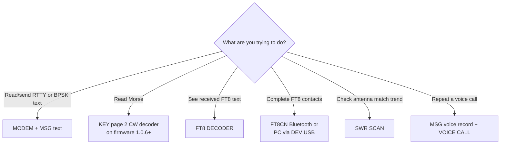

# Applications, modem, FT8 and voice call

APP contains four tools that are easy to confuse because all can involve transmitted or decoded information: MODEM, SWR SCAN, VOICE CALL and FT8 DECODER. They do not form one digital-mode suite. MODEM is a self-contained text modem; SWR SCAN briefly transmits to examine an antenna; VOICE CALL plays recordings; FT8 DECODER reads received FT8. Learn the boundary of each before pressing PTT.

## Opening APP

Press the physical `APP` function button. The five physical soft-keys select:

1. `MODEM`
2. `SWR SCAN`
3. `VOICE CALL`
4. `FT8 DECODER`
5. an unused/exit position depending on build

If FT8 DECODER or another label differs, check SYSTEM INFO and release notes. APP changed during the first firmware releases.

## MODEM: radio-only text modes

MODEM demodulates supported narrow text modes and displays decoded characters over the radio interface. It can also send the five text memories prepared under MSG.

### Firmware boundary: where CW went

The Rev 05 manual describes MODE choices `RTTY / CW / BPSK`. Firmware `1.0.6` adds a dedicated CW decoder to KEY page 2, and firmware `1.0.7` removes CW from MODEM because it has moved there. Therefore:

- on older firmware, MODEM may show RTTY, CW and BPSK;
- on `1.0.7`, expect RTTY and BPSK in MODEM and use **KEY → page 2 → CW DECODER** for Morse reception;
- a guide or video showing three options is not proof that a current radio is missing one.

### MODEM page 1

| Control      | Meaning                                     | How to use it                                |
| ------------ | ------------------------------------------- | -------------------------------------------- |
| `MODE`       | selects supported RTTY/BPSK (and legacy CW) | match the signal, not just its visual width  |
| `FC/TONE`    | carrier or sidetone frequency               | align demodulator to the received audio tone |
| `RATE/SPEED` | baud/code speed                             | must match the transmitting station          |
| unused slot  | no documented function                      | do not expect a hidden app                   |
| page control | moves to page 2                             | press the corresponding key                  |

### MODEM page 2

| Control | Meaning                              | How to use it                                                             |
| ------- | ------------------------------------ | ------------------------------------------------------------------------- |
| `AFC`   | automatic frequency/carrier tracking | ON can follow small drift; OFF gives manual certainty                     |
| `SQL`   | modem squelch                        | low enough to admit weak text, high enough to suppress garbage if desired |
| `CLEAR` | clears the decoded-text area         | use before a new test/contact                                             |
| `EXIT`  | leaves MODEM                         | returns without erasing stored MSG text                                   |

A decoder only succeeds when mode, polarity/sideband, tone, speed, passband and tuning all agree. If text is nonsense, work in this order:

1. confirm it really is the selected mode;
2. use the correct USB/LSB convention for that activity;
3. widen DFL enough to contain both relevant tones;
4. turn NR/NB/notch off while establishing decode;
5. tune `FC/TONE` onto the visible/audible signal;
6. try the other supported `RATE/SPEED` only when the service is uncertain;
7. toggle AFC after manual centring, not as a cure for being far off-frequency.

### Sending a stored text message

Prepare text first under `MSG` page 1:

1. press MSG;
2. choose MSG1–MSG5;
3. open the virtual keyboard;
4. rotate an MFK ring to a character and press MFK to enter it;
5. use the keyboard control to cycle letters, digits/symbols and the IPv4-oriented layout;
6. delete/space as needed, then save and exit.

In MODEM, press `MSG` to show previews, then press the physical soft-key under the required message. The radio sends it in the currently selected supported modem mode until complete.

Before the first transmission:

- use a dummy load or a permitted clear frequency;
- set low TX power;
- verify callsign/content and mode;
- listen first;
- keep text brief and legal;
- know how to stop/exit if the wrong memory is selected.

Stored text is not automatically tailored to a contact. A `CQ` memory that embeds an old callsign, location or event reference can repeatedly transmit wrong information.

## FT8 DECODER: what “decode” means

Choose `APP → FT8 DECODER`. Received FT8 messages are overlaid in the spectrum area. This is valuable for seeing whether a band is active without a laptop, but the stock decoder page is **not a complete QSO engine**. It does not by itself provide the familiar sequence of selecting a caller, generating reports, timing transmit periods, logging and uploading.

Think of three distinct X6200 FT8 workflows:

| Workflow                      | Receive decode         | Transmit/manage QSO                    | Connection                                    |
| ----------------------------- | ---------------------- | -------------------------------------- | --------------------------------------------- |
| built-in FT8 DECODER          | radio                  | not supplied as a complete workflow    | none                                          |
| FT8CN                         | compatible Android app | app manages supported contact workflow | Bluetooth support completed in firmware 1.0.6 |
| WSJT-X/JTDX-class PC workflow | computer software      | computer software                      | DEV USB audio + CAT                           |

Do not tell a user “the radio has FT8” without saying which row is meant.

### Getting useful built-in decodes

1. Set the radio's clock accurately. FT8 uses synchronised 15-second periods; a time error can defeat decode even with strong audio.
2. Tune the published FT8 dial frequency for the band and region/activity. Frequencies can change; use a current band plan/reference.
3. Use USB/data-appropriate receive mode as specified by the chosen workflow.
4. Open the filter wide enough to pass the active audio range.
5. Begin AGC AUTO, NR/NB/notch off and sensible RF gain.
6. Enter FT8 DECODER and wait through several complete receive periods.

If the waterfall shows the familiar regular block of signals but no text appears, check time first, then dial frequency/mode/filter. PRE is not the first solution on a noisy HF band.

## FT8CN over Bluetooth

Xiegu's firmware notes say `1.0.6` adds **full support for FT8CN via Bluetooth**; `1.0.3` had introduced initial support. That version distinction matters.

General setup boundary:

1. Verify `1.0.6` or newer in SYSTEM INFO.
2. Leave `SETTING 2 → BUILT-IN = ON` when using the internal wireless adapter.
3. Open SYSTEM → BLUETOOTH, enable it and pair/connect the supported Android device/app as directed by the current FT8CN documentation.
4. Confirm app-to-radio frequency/control and audio paths on receive before allowing PTT.
5. Synchronise the phone's time from a reliable network/GPS source.
6. Use `≤5 W`, a matched antenna, airflow and conservative audio level.

Bluetooth pairing alone does not prove the FT8 data/control profile is working. A phone may appear connected while the app has the wrong rig setting, permissions or audio route. Diagnose connection, CAT/frequency, receive data and transmit as separate stages.

Because FT8CN is an external application, its screen labels and permissions can change independently of X6200 firmware. This guide deliberately does not freeze a volatile Android UI into model instructions; follow its current documentation for app-specific taps.

## FT8 and other data over USB

The USB route is the conventional, inspectable setup:

1. Connect a data-capable USB-C cable from computer to `DEV`, not HOST.
2. Install the CH342 serial driver if the operating system does not recognise the control ports.
3. In radio-control/data software select the native `XIEGU X6200` model when available. A merely CI-V-compatible model may omit commands.
4. Select the X6200 virtual sound input for received audio and its virtual sound output for transmit audio. The manual notes that input and output can appear as different devices.
5. Configure CAT PTT and confirm frequency read/write on receive.
6. Synchronise the computer clock.
7. Adjust LINE OUT GAIN/computer input so receive noise and strong signals do not clip.
8. Set speech COMP off. Reduce application audio and LINE IN GAIN, then bring them up only until clean desired RF output is reached.
9. Test into a dummy load at low power before an on-air period.

The radio's volume control and the computer decode level are not necessarily the same path. If changing speaker volume does nothing to the waterfall in the application, that may be correct.

### Duty cycle

FT8 transmits for roughly half of repeated cycles and drives the transmitter continuously during each on period. Xiegu's manual specifically warns that the radio can become very hot and advises data power `≤5 W`, longer intervals and external heat dissipation. In warm weather or while charging, use less power and pause. A higher power display is not worth thermal shutdown or a wide signal.

## SWR SCAN: a reference, not a VNA

SWR SCAN transmits across a set of points and plots the match seen at the antenna port.

Controls:

- `START` begins; press again to stop;
- `STEP` changes scan spacing;
- `EXIT` leaves the tool.

Safe sequence:

1. Choose a permitted amateur segment and a frequency range where brief test transmissions are lawful.
2. Listen first and identify the radio if required by your rules.
3. Connect the actual antenna/feedline configuration.
4. Reduce power and keep fingers away from antenna/connections.
5. Open SWR SCAN, select a useful step and start.
6. Stop immediately if the radio becomes hot, SWR is extreme or the scan crosses an inappropriate frequency.

The manual explicitly describes results as a temporary reference and recommends professional antenna-analysis equipment for accurate measurement. A NanoVNA-class analyser measures without using the X6200 transmitter on air, offers calibration at the feed point and shows impedance as well as SWR. Use the built-in scanner for “where is the dip?” and “did this field adjustment move it?”, not acceptance testing.

The tuner state changes what the transmitter sees. To inspect the antenna itself, bypass the ATU. To inspect a stored match's result, enable it and state that the plot is _after the tuner_. Never confuse a low post-ATU SWR with efficient radiation.

## VOICE CALL and MSG voice memories

MSG page 2 records up to five voice messages, each up to `1 minute 30 seconds`. APP → VOICE CALL selects and transmits them.

### Recording cleanly

1. Select the intended microphone and set its clean gain first.
2. Turn MONITOR LEVEL off/down to prevent feedback.
3. Press MSG again to reach the voice page.
4. Choose a memory.
5. Hold the H-22 approximately `5–10 cm` away and speak normally.
6. Press `RECORD`, speak, then `STOP`.
7. Press `PLAY` and listen for clipping, room noise, errors and a clean ending.
8. Exit only after the correct message is stored.

Short recordings are better. A portable CQ call might contain callsign twice, activity/reference once and “listening.” Do not record a minute of repeated calls; it blocks the frequency and makes it harder to hear an answer.

### Playing/transmitting

Open APP → VOICE CALL. Stored slots show a prompt/preview state. Select the physical soft-key for the required recording; the radio transmits until playback finishes.

Before doing so:

- ensure voice mode, frequency, power and antenna match are correct;
- listen and ask if the frequency is in use;
- verify the recording after callsign/location changes;
- keep PTT MODE NORMAL;
- know whether pressing the slot/exit stops current playback on your firmware.

Monitor level affects what you hear locally, not a guarantee of transmitted quality. Check with another receiver.

## Choosing the right APP tool

## Troubleshooting the apps

### MODEM produces gibberish

- wrong MODE or RATE/SPEED;
- wrong sideband/polarity;
- FC/TONE not aligned;
- DFL excludes one tone;
- signal is a different digital mode;
- NR/notch alters tones;
- multipath/fading or several signals overlap.

### Built-in FT8 shows nothing

- clock not synchronised;
- wrong dial frequency/mode;
- filter too narrow;
- not waiting for complete periods;
- no actual FT8 activity despite noise;
- old firmware/app fault.

### USB decodes but will not transmit

- CAT/PTT method or control port wrong;
- application output points to computer speakers rather than X6200;
- LINE IN GAIN/application level at zero;
- transmit inhibited by out-of-band frequency;
- split/XIT wrong;
- cable is charge-only.

### Transmits but no one decodes

- clock error;
- audio overdrive/ALC/compression;
- wrong sideband/data mode;
- RF feedback into USB cable;
- power reduced by high SWR or weak supply;
- transmitting in the wrong FT8 period.

### Voice call echoes/squeals

- MONITOR LEVEL too high during recording or playback;
- speaker feeding microphone;
- microphone gain excessive;
- external speaker too close.

## Try it yourself

Do this without on-air transmit:

1. Find a received FT8 band, synchronise time and compare the radio's decoder with a PC decoder.
2. Store a short harmless MODEM test string and inspect it without sending.
3. Record a ten-second voice message, play it locally and delete/re-record until clean.
4. Connect a dummy load, choose minimum power and practise entering/exiting SWR SCAN without crossing a band edge.

## Key takeaways

- APP has four separate tools; it is not one integrated digital suite.
- On firmware `1.0.7`, CW no longer belongs to MODEM—use KEY page 2.
- MODEM needs correct mode, tone, speed, filter and tuning, and uses MSG text memories to send.
- Built-in FT8 **decodes only**. Complete contacts use supported FT8CN Bluetooth or computer software over DEV USB.
- Keep data output at or below `5 W`, processing off, audio clean and the clock exact.
- SWR SCAN is a transmitting reference tool, not a calibrated analyser.
- MSG records voice; APP → VOICE CALL transmits it. Keep monitor low and messages brief.

Next, [DSP, Noise Tools and Filter Banks](outpost:entry/logbook73.guide.x6200/dsp-filters) explains how to preserve wanted signals while removing interference.

### References

- [Manufacturer-authored Rev 05 manual mirror: APP, MODEM, SWR, FT8 and voice](https://radioddity.s3.amazonaws.com/Xiegu_X6200_Manual_20240925.pdf)
- [Xiegu firmware 1.0.6/1.0.7 notes](https://xiegu.eu/downloads/)
