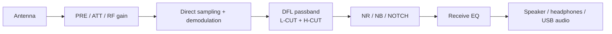

# DSP, filters, spectrum and noise control

The X6200 gives you four families of receiver cleanup: DFL passband filters, NR noise reduction, NB impulse blanking and a manual notch. Each attacks a different shape of unwanted energy. Good operation is not turning all four on; it is identifying the problem, choosing the matching tool and using the least amount that works.

## The signal path in plain English

The exact internal order is more complex, but this mental model prevents common mistakes:

- DFL decides which part of the demodulated audio is wanted.
- NR estimates broadly random noise.
- NB detects short impulses.
- NOTCH removes a narrow steady tone.
- EQ changes tonal balance after useful content has passed.

If a signal is already outside DFL, no amount of EQ or PRE restores it.

## DFL: three remembered filter banks per mode

Press `DFL`. Choose `FILTER1`, `FILTER2` or `FILTER3`. The banks are stored independently by mode, so FILTER1 in USB need not equal FILTER1 in CW or AM.

Inside a bank:

1. Press MFK to alternate the selected edge. The manual's graphic shows blue for H-CUT and red for L-CUT.
2. Rotate the MFK outer control to move the selected edge.
3. Watch the two filter shapes. Their overlap is the audio range passed.
4. Values save automatically to that bank.
5. `DEFAULT` restores the selected bank; `CLOSE` exits.

### L-CUT

L-CUT removes audio below its boundary. On SSB voice, raising it can reduce bass rumble, mains hum and low-frequency noise. Raise it too far and voices become thin; in digital modes it can remove the lower tone.

### H-CUT

H-CUT removes audio above its boundary. Lowering it reduces hiss and a high-side adjacent signal. Lower it too far and consonants vanish; in CW it may exclude the sidetone pitch.

### Why a filter can make the radio “deaf”

The passband is the overlap. If L-CUT rises to meet/cross H-CUT, or a stored bank from a special task is recalled in the wrong context, useful audio becomes extremely narrow or disappears. The first recovery for silent receive is:

1. choose the expected mode;
2. open DFL;
3. select a bank;
4. press DEFAULT;
5. set SQL low and RFG high;
6. turn NR/NB/notch off.

Do this before factory reset.

## Three useful banks for each mode

Exact edge values depend on hearing, firmware and interference, but roles transfer well:

### SSB

- **FILTER1 — natural voice:** broad enough for comfortable speech.
- **FILTER2 — crowded voice:** trim low rumble and high adjacent chatter.
- **FILTER3 — weak/emergency narrow:** preserve intelligibility at the expense of fidelity.

Do not narrow until a clean signal sounds like a telephone through a wall. Speech intelligibility needs consonant energy.

### CW

- **FILTER1 — search:** wide enough to hear neighbours and tune.
- **FILTER2 — normal contact:** moderate narrow passband around TONE.
- **FILTER3 — crowded:** very narrow after the station is centred.

A narrow CW filter magnifies tuning error. Use a wide bank to find and centre, then narrow. `CW ZOOM` changes the picture, not DFL.

### AM

Firmware `1.0.7` supplies preset AM widths `9 / 12 / 15 kHz`. Treat them as narrow/normal/wide roles. Wide sounds richer on a clear broadcast; narrow rejects adjacent channels. Airband voice may call for the narrower appropriate filter presented by the radio.

### RTTY/BPSK/FT8

Pass the complete audio range used by the decoder. A visually pleasing narrow marker can remove tones at one edge. Begin wide enough, prove decode, then trim only interference outside the occupied range.

## DFN page 1: NR and NB

Press `DFN` once for `NR`, `NR DEPTH`, `NB`, `NB WIDTH` and `NB LEVEL`.

### NR — noise reduction

NR estimates wanted speech/tone against less-correlated noise. It works best on steady hiss or broad background noise. `NR DEPTH` sets how strongly it acts.

Method:

1. Tune and set DFL first.
2. Turn NR on at low depth.
3. Increase until readability improves.
4. Back down when speech becomes watery, hollow or syllables smear.

NR cannot create signal-to-noise ratio that the antenna never delivered. At high depth it often makes a weak station sound quieter but less accurate. Firmware `1.0.6` and `1.0.7` both optimise the algorithm, so the same numeric preference can sound different across versions.

### NB — noise blanker

NB targets brief, repetitive impulses such as ignition, electric fence or switching clicks.

- `NB` enables it.
- `NB WIDTH` defines how much time around each detected pulse is blanked.
- `NB LEVEL` is the documented pulse-noise/blanking level. The manuals do not define it as a threshold or promise which numeric direction is more sensitive.

Safe tuning:

1. Confirm the noise consists of distinct pulses. NB does little for smooth hiss.
2. Enable NB at the installed/default width and level.
3. Move the level in small steps and keep the smallest change that improves the clicks.
4. Use the smallest width that removes them.
5. Check a strong wanted signal for clicks or distortion.

Too much width or level can cut holes in speech/CW. Compare against NB off and back down if wanted peaks become rough.

## DFN page 2: manual notch

Press DFN again for `NOTCH` and `NOTCH FC`.

NOTCH removes a narrow audio frequency. It is ideal for a continuous carrier/whistle inside an SSB passband. Enable it and move NOTCH FC until the tone collapses.

It is poor for:

- broadband hiss (use NR/DFL);
- impulses (use NB);
- a voice splattering across yours (adjust DFL/tuning);
- frequency-hopping or warbling interference (manual centre cannot follow it).

On CW, the wanted signal itself is a steady audio tone. A notch centred on it erases the station. Check NOTCH status whenever CW suddenly vanishes.

## Match the symptom to the control

| What you hear/see                            | First tool                  | Then consider               |
| -------------------------------------------- | --------------------------- | --------------------------- |
| broad steady hiss                            | DFL, then NR                | RF gain, antenna noise      |
| regular sharp ticks                          | NB                          | ferrites/source suppression |
| one stable whistle                           | NOTCH                       | DFL edge                    |
| strong neighbour above/below                 | DFL H/L edge                | ATT/RFG if overload         |
| many ghost copies / whole band buckles       | ATT, RFG                    | external reject filter      |
| weak signal and noise rise together with PRE | turn PRE off                | better antenna/propagation  |
| digital decode worsens after cleanup         | disable NR/notch, widen DFL | input level/time/mode       |

## PRE/ATT/RFG before DSP

DSP cannot repair analogue/digitiser overload. If a strong station causes phantom signals, engage ATT or reduce RFG before touching NR. Conversely, PRE should not be used to compensate for a DFL bank that excludes the signal.

On a low-band evening, natural noise often dominates, so PRE raises noise without improving readability. On 6 m in a quiet location, PRE may lower the effective system noise contribution and help. Judge by readability, not S-meter movement.

## Filters and AGC interact

A wide passband admits more total noise, so AGC may respond to energy you do not want. Narrowing to the wanted station can reduce that pumping. FAST AGC makes CW elements distinct but may make background more active; SLOW smooths voice but a nearby loud signal can hold gain down.

When comparing NR depth or DFL banks, keep AGC state fixed. Otherwise you are comparing two changes at once.

## Audio EQ is not DFL

Receive EQ boosts/cuts fixed tone regions but does not reject an adjacent RF/audio signal as sharply as a filter edge. Use DFL to define the useful passband, then EQ for comfort.

Example: muddy SSB with no interference. A slight EQ-RX reduction near 300 Hz may preserve full voice while reducing boom. Muddy SSB with a low-side adjacent caller needs L-CUT first.

## The spectrum is evidence, not audio

RF FFT AVERAGE, reference level, line width, colour and peak hold change how signals look. A trace can disappear because the reference moved while audio remains; a bright waterfall can be only an over-sensitive palette. Never diagnose sensitivity from one screenshot without recording span, reference, PRE/ATT/RFG and antenna.

Firmware `1.0.7` fixes a freeze related to spectrum-line alpha below 255. If an older build freezes after colour adjustment, use full opacity and plan an authorised update.

## Practical filter recipes

### Weak SSB in hiss

1. PRE off initially, ATT off, AGC AUTO/SLOW.
2. Centre voice naturally.
3. Select normal SSB DFL.
4. Raise L-CUT enough to remove rumble; lower H-CUT only until hiss falls.
5. Add shallow NR.
6. Reduce RFG slightly if noise dominates.

### SSB with a carrier whistle

1. Keep enough DFL for speech.
2. Enable NOTCH.
3. sweep NOTCH FC until whistle disappears.
4. leave NR off unless separate hiss needs it.

### CW pile-up

1. CW/CW-R side that places interference favourably.
2. search bank wide and centre wanted tone to KEY TONE.
3. switch to normal/narrow bank.
4. CW ZOOM for the view.
5. AGC FAST; NR minimal or off; NOTCH off.

### FT8 decode

1. USB/data workflow and correct dial frequency.
2. DFL wide enough for full decoder audio range.
3. NR, NB and NOTCH off initially.
4. AGC AUTO and LINE OUT below clipping.
5. fix clock and level before narrowing.

### Electric-fence clicks

1. Identify repeating impulses.
2. NB on; adjust the documented pulse-noise level minimally while listening for improvement.
3. minimum effective width.
4. ferrites/source repair if under your control—the best noise blanker is eliminating the source.

## Try it yourself

Find a steady SSB station and write down a score from 1–5 for readability. Then, one step at a time:

1. compare all three default filter banks;
2. alter only H-CUT;
3. restore and alter only L-CUT;
4. add shallow NR;
5. return everything to baseline;
6. deliberately overdo NR and NB briefly so you learn their artifacts.

Hearing the failure mode makes it much easier to recognise in the field.

## Key takeaways

- DFL passes the overlap between L-CUT and H-CUT; three banks are remembered per mode.
- Restore a DFL bank before declaring a silent receiver faulty.
- NR is for broad random noise, NB for impulses, NOTCH for one stable tone.
- Use the least processing that improves readability; deep settings create artifacts.
- Fix overload with ATT/RFG or an external filter before DSP.
- Digital decoders usually prefer a complete passband and little processing.
- Display controls change the picture, not sensitivity.

Continue to [CW, the Keyer, Decoder and Message Memories](outpost:entry/logbook73.guide.x6200/cw-messages).

### References

- [Manufacturer-authored Rev 05 manual mirror: DFN and DFL](https://radioddity.s3.amazonaws.com/Xiegu_X6200_Manual_20240925.pdf)
- [Firmware NR/display/CW fixes](https://xiegu.eu/downloads/)
